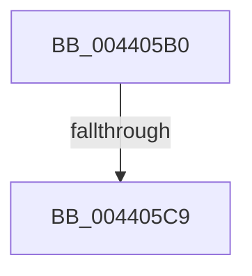

# sub_004405B0

- RVA: `0x004405B0`–`0x004405E0` (길이 `48` bytes)
- VA: `0x00000001404405B0`
- 실행 섹션: `.text`
- PDB 이름 있음: `아니요`; PDB Function 태그: `아니요`
- unwind 정보 RVA: `0x000A4EC0`
- 디코드: `10`개 명령, `48/48` bytes 표시
- 미해석 바이트: `0` (있으면 어셈블리에 `.byte`로 보존)

> 이 문서는 커널 이미지의 기계어와 PDB 기호를 분석해 생성했습니다. 4번과 5번은 함수 원형과 자료형을 바이너리 사용 방식에서 추정한 C 해석이며 원본 소스 복구 결과는 아닙니다.

## 1. Dependencies

- 직접 호출 지점: **1**; 고유 호출 대상: **1**
- 직접 호출자로 확인된 함수: **0**
- RIP 상대 이미지 참조: **0**

### Outgoing calls
- `0x004405D5` → [ExpUpdateDebugInfo](../../page/86/ExpUpdateDebugInfo_function_0086B174.md) (function, `0x0086B174`)

### Direct callers
- 이 함수 시작 RVA로 연결되는 직접 call은 확인되지 않았습니다. 간접 호출은 완전히 역산할 수 없습니다.

### Static image references
- 디코드된 RIP-relative 메모리 참조가 없습니다.

## 2. Other-region calls and transfers

- 다른 실행 섹션으로 향하는 call: **1**
  - `0x004405D5` → [ExpUpdateDebugInfo](../../page/86/ExpUpdateDebugInfo_function_0086B174.md) (`.text` → `PAGE`)
- call이 아닌 외부 분기/꼬리 이동: **2**
  - `0x004405C3` → [sub_006EF914](../6E/Unknown_function_006EF914.md) (`tail-transfer`)
  - `0x004405DB` → [sub_006EF914](../6E/Unknown_function_006EF914.md) (`tail-transfer`)

## 3. Assembly (complete function range)

```asm
004405B0  48 89 6C 24 60                  mov qword ptr [rsp + 0x60], rbp
004405B5  65 48 8B 2C 25 88 01 00 00      mov rbp, qword ptr gs:[0x188]
004405BE  48 83 79 60 00                  cmp qword ptr [rcx + 0x60], 0
004405C3  0F 84 4B F3 2A 00               je 0x1406ef914
004405C9  41 B9 03 00 00 00               mov r9d, 3
004405CF  4C 8B C7                        mov r8, rdi
004405D2  48 8B D5                        mov rdx, rbp
004405D5  E8 9A AB 42 00                  call 0x14086b174
004405DA  90                              nop
004405DB  E9 34 F3 2A 00                  jmp 0x1406ef914
```

## 4. C-style interpretation (structured pseudocode)

```c
__int64 __fastcall sub_004405B0(__int64 a1)
{
    __int64 result;
    unsigned __int64 v_stack_p60;

    v_stack_p60 = v_rbp;
    result = ExpUpdateDebugInfo(a1, *(unsigned __int64 *)(gs_base + (0 + 392)), v_rdi, 3);
}
```

## 5. (Beta) C Style

```c
int64_t sub_004405B0(void *Arg1)
{
    uint8_t *arg1 = (uint8_t *)Arg1;

    int64_t result;
    uint64_t v_stack_p60;

    v_stack_p60 = local_rbp;
    result = ExpUpdateDebugInfo(Arg1, *(uint64_t *)(gs_base + (0 + 0x188)), local_rdi, 3);
}
```

### 관측된 메모리 오프셋

구조체 형식이 확인되지 않은 접근은 인자 기준의 오프셋으로만 기록했습니다.

| 기준 인자 | 오프셋 표현 | 폭 (bit) | 접근 |
|---|---:|---:|---|
| `Arg1` | `+ 0x60` | `64` | `R` |

## 6. Execution-region graph

[열기: 2D/3D 그래프와 함수 탐색 컨트롤 패널](../../../control-panel.html?section=text&rva=0x004405B0&view=graph)

- 2D 그래프는 위에서 아래로 흐르고, 3D 그래프는 빈 공간을 드래그해 회전합니다. Shift+드래그는 이동, 휠은 확대·축소, 함수 노드 선택은 대상 보고서 이동입니다.

### Static fallback


