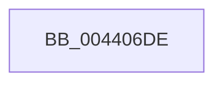

# sub_004406DE

- RVA: `0x004406DE`–`0x00440705` (길이 `39` bytes)
- VA: `0x00000001404406DE`
- 실행 섹션: `.text`
- PDB 이름 있음: `아니요`; PDB Function 태그: `아니요`
- unwind 정보 RVA: `0x000A4F98`
- 디코드: `7`개 명령, `39/39` bytes 표시
- 미해석 바이트: `0` (있으면 어셈블리에 `.byte`로 보존)

> 이 문서는 커널 이미지의 기계어와 PDB 기호를 분석해 생성했습니다. 4번과 5번은 함수 원형과 자료형을 바이너리 사용 방식에서 추정한 C 해석이며 원본 소스 복구 결과는 아닙니다.

## 1. Dependencies

- 직접 호출 지점: **0**; 고유 호출 대상: **0**
- 직접 호출자로 확인된 함수: **0**
- RIP 상대 이미지 참조: **1**

### Outgoing calls
- 직접 디코드된 call 명령이 없습니다.

### Direct callers
- 이 함수 시작 RVA로 연결되는 직접 call은 확인되지 않았습니다. 간접 호출은 완전히 역산할 수 없습니다.

### Static image references
- `0x004406E6` → RVA `0x00E0B804` (`.data`; read)

## 2. Other-region calls and transfers

- 다른 실행 섹션으로 향하는 call: **0**
- call이 아닌 외부 분기/꼬리 이동: **1**
  - `0x004406FF` → [sub_004407B0](Unknown_function_004407B0.md) (`tail-transfer`)

## 3. Assembly (complete function range)

```asm
004406DE  4C 89 64 24 40                  mov qword ptr [rsp + 0x40], r12
004406E3  45 33 DB                        xor r11d, r11d
004406E6  44 39 1D 17 B1 9C 00            cmp dword ptr [rip + 0x9cb117], r11d
004406ED  4C 8B A1 58 8A 00 00            mov r12, qword ptr [rcx + 0x8a58]
004406F4  4C 89 3C 24                     mov qword ptr [rsp], r15
004406F8  4C 8B B9 60 8A 00 00            mov r15, qword ptr [rcx + 0x8a60]
004406FF  0F 86 AB 00 00 00               jbe 0x1404407b0
```

## 4. C-style interpretation (structured pseudocode)

```c
void __fastcall sub_004406DE(__int64 a1)
{
    __int64 v_r11;
    unsigned __int64 v_stack_p0;
    unsigned __int64 v_stack_p40;

    v_stack_p40 = v_r12;
    v_r11 = 0;
    v_stack_p0 = v_r15;
}
```

## 5. (Beta) C Style

```c
void sub_004406DE(void *Arg1)
{
    uint8_t *arg1 = (uint8_t *)Arg1;

    int64_t local_r11;
    uint64_t v_stack_p0;
    uint64_t v_stack_p40;

    v_stack_p40 = local_r12;
    local_r11 = 0;
    v_stack_p0 = local_r15;
}
```

### 관측된 메모리 오프셋

구조체 형식이 확인되지 않은 접근은 인자 기준의 오프셋으로만 기록했습니다.

| 기준 인자 | 오프셋 표현 | 폭 (bit) | 접근 |
|---|---:|---:|---|
| `Arg1` | `+ 0x8A58` | `64` | `R` |
| `Arg1` | `+ 0x8A60` | `64` | `R` |

## 6. Execution-region graph

[열기: 2D/3D 그래프와 함수 탐색 컨트롤 패널](../../../control-panel.html?section=text&rva=0x004406DE&view=graph)

- 2D 그래프는 위에서 아래로 흐르고, 3D 그래프는 빈 공간을 드래그해 회전합니다. Shift+드래그는 이동, 휠은 확대·축소, 함수 노드 선택은 대상 보고서 이동입니다.

### Static fallback


