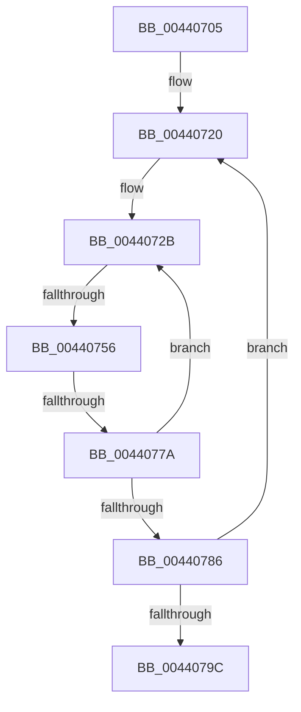

# sub_00440705

- RVA: `0x00440705`–`0x004407B0` (길이 `171` bytes)
- VA: `0x0000000140440705`
- 실행 섹션: `.text`
- PDB 이름 있음: `아니요`; PDB Function 태그: `아니요`
- unwind 정보 RVA: `0x000A4FB0`
- 디코드: `44`개 명령, `171/171` bytes 표시
- 미해석 바이트: `0` (있으면 어셈블리에 `.byte`로 보존)

> 이 문서는 커널 이미지의 기계어와 PDB 기호를 분석해 생성했습니다. 4번과 5번은 함수 원형과 자료형을 바이너리 사용 방식에서 추정한 C 해석이며 원본 소스 복구 결과는 아닙니다.

## 1. Dependencies

- 직접 호출 지점: **0**; 고유 호출 대상: **0**
- 직접 호출자로 확인된 함수: **0**
- RIP 상대 이미지 참조: **2**

### Outgoing calls
- 직접 디코드된 call 명령이 없습니다.

### Direct callers
- 이 함수 시작 RVA로 연결되는 직접 call은 확인되지 않았습니다. 간접 호출은 완전히 역산할 수 없습니다.

### Static image references
- `0x00440714` → RVA `0x00FC5460` (`ALMOSTRO`; read)
- `0x00440793` → RVA `0x00E0B804` (`.data`; read)

## 2. Other-region calls and transfers

- 다른 실행 섹션으로 향하는 call: **0**
- call이 아닌 외부 분기/꼬리 이동: **2**
  - `0x00440754` → [sub_004407BE](Unknown_function_004407BE.md) (`tail-transfer`)
  - `0x00440778` → [sub_004407BE + 0x5](Unknown_function_004407BE.md) (`tail-transfer`)

## 3. Assembly (complete function range)

```asm
00440705  48 89 5C 24 30                  mov qword ptr [rsp + 0x30], rbx
0044070A  48 89 6C 24 38                  mov qword ptr [rsp + 0x38], rbp
0044070F  4C 89 6C 24 10                  mov qword ptr [rsp + 0x10], r13
00440714  4C 8D 2D 45 4D B8 00            lea r13, [rip + 0xb84d45]
0044071B  4C 89 74 24 08                  mov qword ptr [rsp + 8], r14
00440720  8B 5F 30                        mov ebx, dword ptr [rdi + 0x30]
00440723  33 ED                           xor ebp, ebp
00440725  45 33 F6                        xor r14d, r14d
00440728  45 33 C0                        xor r8d, r8d
0044072B  49 63 C0                        movsxd rax, r8d
0044072E  47 8D 0C 00                     lea r9d, [r8 + r8]
00440732  41 8B C9                        mov ecx, r9d
00440735  0F AF CB                        imul ecx, ebx
00440738  4C 8D 14 00                     lea r10, [rax + rax]
0044073C  43 8B 44 95 00                  mov eax, dword ptr [r13 + r10*4]
00440741  83 E8 03                        sub eax, 3
00440744  41 03 CB                        add ecx, r11d
00440747  48 8B 54 CF 38                  mov rdx, qword ptr [rdi + rcx*8 + 0x38]
0044074C  48 2B 54 CE 38                  sub rdx, qword ptr [rsi + rcx*8 + 0x38]
00440751  83 F8 01                        cmp eax, 1
00440754  77 68                           ja 0x1404407be
00440756  48 03 EA                        add rbp, rdx
00440759  43 8B 4C 95 04                  mov ecx, dword ptr [r13 + r10*4 + 4]
0044075E  41 8D 41 01                     lea eax, [r9 + 1]
00440762  0F AF C3                        imul eax, ebx
00440765  83 E9 03                        sub ecx, 3
00440768  41 03 C3                        add eax, r11d
0044076B  48 8B 54 C7 38                  mov rdx, qword ptr [rdi + rax*8 + 0x38]
00440770  48 2B 54 C6 38                  sub rdx, qword ptr [rsi + rax*8 + 0x38]
00440775  83 F9 01                        cmp ecx, 1
00440778  77 49                           ja 0x1404407c3
0044077A  48 03 EA                        add rbp, rdx
0044077D  41 FF C0                        inc r8d
00440780  41 83 F8 07                     cmp r8d, 7
00440784  72 A5                           jb 0x14044072b
00440786  4F 89 74 DF 08                  mov qword ptr [r15 + r11*8 + 8], r14
0044078B  4B 89 6C DC 08                  mov qword ptr [r12 + r11*8 + 8], rbp
00440790  41 FF C3                        inc r11d
00440793  44 3B 1D 6A B0 9C 00            cmp r11d, dword ptr [rip + 0x9cb06a]
0044079A  72 84                           jb 0x140440720
0044079C  4C 8B 74 24 08                  mov r14, qword ptr [rsp + 8]
004407A1  4C 8B 6C 24 10                  mov r13, qword ptr [rsp + 0x10]
004407A6  48 8B 6C 24 38                  mov rbp, qword ptr [rsp + 0x38]
004407AB  48 8B 5C 24 30                  mov rbx, qword ptr [rsp + 0x30]
```

## 4. C-style interpretation (structured pseudocode)

```c
__int64 __fastcall sub_00440705(__int64 a1, __int64 a2, int a3, __int64 a4, __int64 a5, __int64 a6, __int64 a7)
{
    __int64 result;
    __int64 v_r11;
    __int64 v_r14;
    __int64 v_rbp;
    unsigned __int64 v_stack_p10;
    unsigned __int64 v_stack_p30;
    unsigned __int64 v_stack_p38;
    unsigned __int64 v_stack_p8;

    v_stack_p30 = v_rbx;
    v_stack_p38 = v_rbp;
    v_stack_p10 = v_r13;
    v_stack_p8 = v_r14;
loc_00440720:
    v_rbp = 0;
    v_r14 = 0;
    a3 = 0;
loc_0044072B:
    a1 = (unsigned int)(((unsigned int)((unsigned int)(a3 + a3 * 1))) * ((unsigned int)((unsigned int)(*(unsigned int *)(v_rdi + 48)))));
    result = (unsigned int)(((unsigned int)(*(unsigned int *)(v_rip + 12078405 + (int)(0) + (int)(0) * 1 * 4))) - (3));
    a1 = (unsigned int)((a1) + ((unsigned int)(v_r11)));
    a2 = (*(unsigned __int64 *)(v_rdi + a1 * 8 + 56)) - (*(unsigned __int64 *)(v_rsi + a1 * 8 + 56));
    v_rbp = (v_rbp) + (a2);
    result = (unsigned int)((a3 + a3 * 1 + 1) * ((unsigned int)((unsigned int)(*(unsigned int *)(v_rdi + 48)))));
    a1 = (unsigned int)(((unsigned int)(*(unsigned int *)(v_rip + 12078405 + (int)(0) + (int)(0) * 1 * 4 + 4))) - (3));
    result = (unsigned int)((result) + ((unsigned int)(v_r11)));
    a2 = (*(unsigned __int64 *)(v_rdi + result * 8 + 56)) - (*(unsigned __int64 *)(v_rsi + result * 8 + 56));
    v_rbp = (v_rbp) + (a2);
    a3 = (unsigned int)((a3) + 1);
    if (a3 < 7) goto loc_0044072B;
    *(unsigned __int64 *)(v_r15 + v_r11 * 8 + 8) = 0;
    *(unsigned __int64 *)(v_r12 + v_r11 * 8 + 8) = v_rbp;
    v_r11 = (unsigned int)((v_r11) + 1);
    if (((unsigned int)(v_r11)) < (*(unsigned int *)(v_rip + 10268778))) goto loc_00440720;
    return result;
}
```

## 5. (Beta) C Style

```c
int64_t sub_00440705(int64_t Arg1, int64_t Arg2, int32_t Arg3, int64_t Arg4, uint64_t Arg5, int64_t Arg6, int64_t Arg7)
{
    int64_t result;
    int64_t local_r11;
    int64_t local_r14;
    int64_t local_rbp;
    uint64_t v_stack_p10;
    uint64_t v_stack_p30;
    uint64_t v_stack_p38;
    uint64_t v_stack_p8;

    v_stack_p30 = local_rbx;
    v_stack_p38 = local_rbp;
    v_stack_p10 = local_r13;
    v_stack_p8 = local_r14;
loc_00440720:
    local_rbp = 0;
    local_r14 = 0;
    Arg3 = 0;
loc_0044072B:
    Arg1 = (uint32_t)(((uint32_t)((uint32_t)(Arg3 + Arg3 * 1))) * ((uint32_t)((uint32_t)(*(uint32_t *)(local_rdi + 0x30)))));
    result = (uint32_t)(((uint32_t)(*(uint32_t *)(v_rip + 0xB84D45 + (int32_t)(0) + (int32_t)(0) * 1 * 4))) - (3));
    Arg1 = (uint32_t)((Arg1) + ((uint32_t)(local_r11)));
    Arg2 = (*(uint64_t *)(local_rdi + Arg1 * 8 + 0x38)) - (*(uint64_t *)(local_rsi + Arg1 * 8 + 0x38));
    local_rbp = (local_rbp) + (Arg2);
    result = (uint32_t)((Arg3 + Arg3 * 1 + 1) * ((uint32_t)((uint32_t)(*(uint32_t *)(local_rdi + 0x30)))));
    Arg1 = (uint32_t)(((uint32_t)(*(uint32_t *)(v_rip + 0xB84D45 + (int32_t)(0) + (int32_t)(0) * 1 * 4 + 0x4))) - (3));
    result = (uint32_t)((result) + ((uint32_t)(local_r11)));
    Arg2 = (*(uint64_t *)(local_rdi + result * 8 + 0x38)) - (*(uint64_t *)(local_rsi + result * 8 + 0x38));
    local_rbp = (local_rbp) + (Arg2);
    Arg3 = (uint32_t)((Arg3) + 1);
    if (Arg3 < 7) goto loc_0044072B;
    *(uint64_t *)(local_r15 + local_r11 * 8 + 0x8) = 0;
    *(uint64_t *)(local_r12 + local_r11 * 8 + 0x8) = local_rbp;
    local_r11 = (uint32_t)((local_r11) + 1);
    if (((uint32_t)(local_r11)) < (*(uint32_t *)(v_rip + 0x9CB06A))) goto loc_00440720;
    return result;
}
```

## 6. Execution-region graph

[열기: 2D/3D 그래프와 함수 탐색 컨트롤 패널](../../../control-panel.html?section=text&rva=0x00440705&view=graph)

- 2D 그래프는 위에서 아래로 흐르고, 3D 그래프는 빈 공간을 드래그해 회전합니다. Shift+드래그는 이동, 휠은 확대·축소, 함수 노드 선택은 대상 보고서 이동입니다.

### Static fallback


