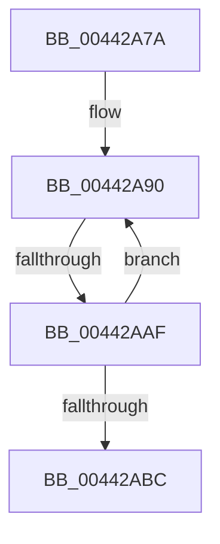

# sub_00442A7A

- RVA: `0x00442A7A`–`0x00442AC1` (길이 `71` bytes)
- VA: `0x0000000140442A7A`
- 실행 섹션: `.text`
- PDB 이름 있음: `아니요`; PDB Function 태그: `아니요`
- unwind 정보 RVA: `0x000A5340`
- 디코드: `18`개 명령, `71/71` bytes 표시
- 미해석 바이트: `0` (있으면 어셈블리에 `.byte`로 보존)

> 이 문서는 커널 이미지의 기계어와 PDB 기호를 분석해 생성했습니다. 4번과 5번은 함수 원형과 자료형을 바이너리 사용 방식에서 추정한 C 해석이며 원본 소스 복구 결과는 아닙니다.

## 1. Dependencies

- 직접 호출 지점: **0**; 고유 호출 대상: **0**
- 직접 호출자로 확인된 함수: **0**
- RIP 상대 이미지 참조: **0**

### Outgoing calls
- 직접 디코드된 call 명령이 없습니다.

### Direct callers
- 이 함수 시작 RVA로 연결되는 직접 call은 확인되지 않았습니다. 간접 호출은 완전히 역산할 수 없습니다.

### Static image references
- 디코드된 RIP-relative 메모리 참조가 없습니다.

## 2. Other-region calls and transfers

- 다른 실행 섹션으로 향하는 call: **0**
- call이 아닌 외부 분기/꼬리 이동: **1**
  - `0x00442AAD` → [sub_00442AC4](Unknown_function_00442AC4.md) (`tail-transfer`)

## 3. Assembly (complete function range)

```asm
00442A7A  48 89 7C 24 10                  mov qword ptr [rsp + 0x10], rdi
00442A7F  48 BF AB AA AA AA AA AA AA AA   movabs rdi, 0xaaaaaaaaaaaaaaab
00442A89  0F 1F 80 00 00 00 00            nop dword ptr [rax]
00442A90  49 8B 01                        mov rax, qword ptr [r9]
00442A93  49 FF C0                        inc r8
00442A96  49 89 02                        mov qword ptr [r10], rax
00442A99  48 8B C7                        mov rax, rdi
00442A9C  49 F7 E0                        mul r8
00442A9F  48 C1 EA 02                     shr rdx, 2
00442AA3  48 8D 0C 52                     lea rcx, [rdx + rdx*2]
00442AA7  48 03 C9                        add rcx, rcx
00442AAA  4C 3B C1                        cmp r8, rcx
00442AAD  74 15                           je 0x140442ac4
00442AAF  49 83 C1 08                     add r9, 8
00442AB3  49 83 C2 08                     add r10, 8
00442AB7  4D 3B C3                        cmp r8, r11
00442ABA  72 D4                           jb 0x140442a90
00442ABC  48 8B 7C 24 10                  mov rdi, qword ptr [rsp + 0x10]
```

## 4. C-style interpretation (structured pseudocode)

```c
__int64 __fastcall sub_00442A7A(__int64 a1, __int64 a2, __int64 a3, __int64 a4)
{
    __int64 v_r10;
    unsigned __int64 v_stack_p10;

    v_stack_p10 = v_rdi;
loc_00442A90:
    a3 = (a3) + 1;
    *(unsigned __int64 *)(v_r10) = *(unsigned __int64 *)(a4);
    a2 = (a2) >> (2);
    a1 = (a2 + a2 * 2) + (a2 + a2 * 2);
    a4 = (a4) + (8);
    v_r10 = (v_r10) + (8);
    if (a3 < v_r11) goto loc_00442A90;
    return v_rdi;
}
```

## 5. (Beta) C Style

```c
int64_t sub_00442A7A(int64_t Arg1, int64_t Arg2, int64_t Arg3, void *Arg4)
{
    uint8_t *arg4 = (uint8_t *)Arg4;

    int64_t local_r10;
    uint64_t v_stack_p10;

    v_stack_p10 = local_rdi;
loc_00442A90:
    Arg3 = (Arg3) + 1;
    *(uint64_t *)(local_r10) = *(uint64_t *)(arg4);
    Arg2 = (Arg2) >> (2);
    Arg1 = (Arg2 + Arg2 * 2) + (Arg2 + Arg2 * 2);
    Arg4 = (Arg4) + (8);
    local_r10 = (local_r10) + (8);
    if (Arg3 < local_r11) goto loc_00442A90;
    return local_rdi;
}
```

### 관측된 메모리 오프셋

구조체 형식이 확인되지 않은 접근은 인자 기준의 오프셋으로만 기록했습니다.

| 기준 인자 | 오프셋 표현 | 폭 (bit) | 접근 |
|---|---:|---:|---|
| `Arg4` | `+ 0x0` | `64` | `R` |

## 6. Execution-region graph

[열기: 2D/3D 그래프와 함수 탐색 컨트롤 패널](../../../control-panel.html?section=text&rva=0x00442A7A&view=graph)

- 2D 그래프는 위에서 아래로 흐르고, 3D 그래프는 빈 공간을 드래그해 회전합니다. Shift+드래그는 이동, 휠은 확대·축소, 함수 노드 선택은 대상 보고서 이동입니다.

### Static fallback


