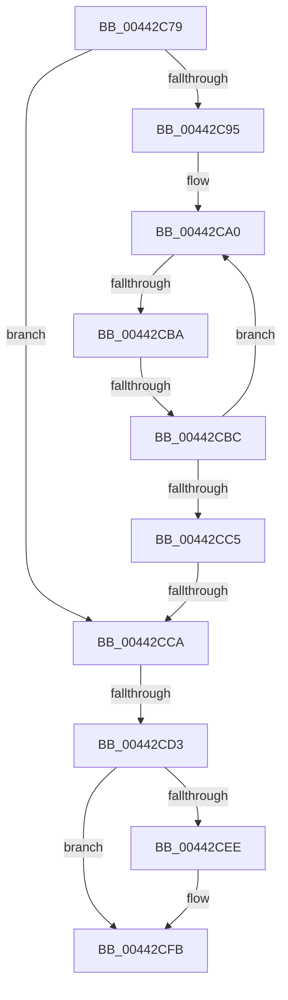

# sub_00442C79

- RVA: `0x00442C79`–`0x00442D0C` (길이 `147` bytes)
- VA: `0x0000000140442C79`
- 실행 섹션: `.text`
- PDB 이름 있음: `아니요`; PDB Function 태그: `아니요`
- unwind 정보 RVA: `0x000A53E0`
- 디코드: `36`개 명령, `147/147` bytes 표시
- 미해석 바이트: `0` (있으면 어셈블리에 `.byte`로 보존)

> 이 문서는 커널 이미지의 기계어와 PDB 기호를 분석해 생성했습니다. 4번과 5번은 함수 원형과 자료형을 바이너리 사용 방식에서 추정한 C 해석이며 원본 소스 복구 결과는 아닙니다.

## 1. Dependencies

- 직접 호출 지점: **2**; 고유 호출 대상: **2**
- 직접 호출자로 확인된 함수: **0**
- RIP 상대 이미지 참조: **4**

### Outgoing calls
- `0x00442C7E` → [ExAcquireSpinLockShared](../24/ExAcquireSpinLockShared_function_0024DCE0.md) (function, `0x0024DCE0`)
- `0x00442CF6` → [KiLowerIrqlProcessIrqlFlags](../4F/KiLowerIrqlProcessIrqlFlags_function_004F5698.md) (function, `0x004F5698`)

### Direct callers
- 이 함수 시작 RVA로 연결되는 직접 call은 확인되지 않았습니다. 간접 호출은 완전히 역산할 수 없습니다.

### Static image references
- `0x00442C83` → RVA `0x00F8D028` (`.data`; read)
- `0x00442CCA` → RVA `0x00FC6B06` (`ALMOSTRO`; read)
- `0x00442CD3` → RVA `0x00F8D024` (`.data`; read/write)
- `0x00442CE5` → RVA `0x00FC6D20` (`ALMOSTRO`; read)

## 2. Other-region calls and transfers

- 다른 실행 섹션으로 향하는 call: **0**
- call이 아닌 외부 분기/꼬리 이동: **5**
  - `0x00442CB8` → [sub_00442D0C + 0x1D](Unknown_function_00442D0C.md) (`tail-transfer`)
  - `0x00442CBA` → [sub_00442D0C + 0x22](Unknown_function_00442D0C.md) (`tail-transfer`)
  - `0x00442CC8` → [sub_00442D0C + 0x30](Unknown_function_00442D0C.md) (`tail-transfer`)
  - `0x00442CD1` → [sub_00442D0C](Unknown_function_00442D0C.md) (`tail-transfer`)
  - `0x00442D07` → [IopMcFindNextTableEntryForUnlock + 0x21](IopMcFindNextTableEntryForUnlock_function_00442C40.md) (`tail-transfer`)

## 3. Assembly (complete function range)

```asm
00442C79  48 89 6C 24 30                  mov qword ptr [rsp + 0x30], rbp
00442C7E  E8 5D B0 E0 FF                  call 0x14024dce0
00442C83  4C 8B 05 9E A3 B4 00            mov r8, qword ptr [rip + 0xb4a39e]
00442C8A  4C 8B DB                        mov r11, rbx
00442C8D  0F B6 E8                        movzx ebp, al
00442C90  4D 85 C0                        test r8, r8
00442C93  74 35                           je 0x140442cca
00442C95  4C 8B 17                        mov r10, qword ptr [rdi]
00442C98  0F 1F 84 00 00 00 00 00         nop dword ptr [rax + rax]
00442CA0  41 8B 50 18                     mov edx, dword ptr [r8 + 0x18]
00442CA4  4D 8B C8                        mov r9, r8
00442CA7  8D 4A 03                        lea ecx, [rdx + 3]
00442CAA  C1 E1 05                        shl ecx, 5
00442CAD  4C 2B C9                        sub r9, rcx
00442CB0  49 8B 41 58                     mov rax, qword ptr [r9 + 0x58]
00442CB4  4C 3B 14 D0                     cmp r10, qword ptr [rax + rdx*8]
00442CB8  72 6F                           jb 0x140442d29
00442CBA  76 72                           jbe 0x140442d2e
00442CBC  4D 8B 40 08                     mov r8, qword ptr [r8 + 8]
00442CC0  4D 85 C0                        test r8, r8
00442CC3  75 DB                           jne 0x140442ca0
00442CC5  4D 85 DB                        test r11, r11
00442CC8  75 72                           jne 0x140442d3c
00442CCA  F6 05 35 3E B8 00 01            test byte ptr [rip + 0xb83e35], 1
00442CD1  75 39                           jne 0x140442d0c
00442CD3  F0 81 25 46 A3 B4 00 FF FF FF BF  lock and dword ptr [rip + 0xb4a346], 0xbfffffff
00442CDE  F0 FF 0D 3F A3 B4 00            lock dec dword ptr [rip + 0xb4a33f]
00442CE5  83 3D 34 40 B8 00 00            cmp dword ptr [rip + 0xb84034], 0
00442CEC  74 0D                           je 0x140442cfb
00442CEE  44 0F 20 C1                     mov rcx, cr8
00442CF2  40 0F B6 D5                     movzx edx, bpl
00442CF6  E8 9D 29 0B 00                  call 0x1404f5698
00442CFB  44 0F 22 C5                     mov cr8, rbp
00442CFF  48 8B 6C 24 30                  mov rbp, qword ptr [rsp + 0x30]
00442D04  48 8B C3                        mov rax, rbx
00442D07  E9 55 FF FF FF                  jmp 0x140442c61
```

## 4. C-style interpretation (structured pseudocode)

```c
__int64 __fastcall sub_00442C79(__int64 a1, __int64 a2, __int64 a3, __int64 a4, __int64 a5, __int64 a6)
{
    __int64 result;
    unsigned __int64 v_stack_p30;

    v_stack_p30 = v_rbp;
    result = ExAcquireSpinLockShared(a1, a2, a3, a4);
    if (*(unsigned __int64 *)(v_rip + 11838366) == 0) goto loc_00442CCA;
loc_00442CA0:
    a1 = (unsigned int)(((unsigned int)(*(unsigned int *)(*(unsigned __int64 *)(v_rip + 11838366) + 24)) + 3) << (5));
    a4 = (*(unsigned __int64 *)(v_rip + 11838366)) - (a1);
    if (*(unsigned __int64 *)(*(unsigned __int64 *)(v_rip + 11838366) + 8) != 0) goto loc_00442CA0;
loc_00442CCA:
    result = *(unsigned __int64 *)(a4 + 88);
    if ((*(unsigned int *)(v_rip + 12075060)) != 0) {
        a1 = v_cr8;
        a2 = (unsigned __int8)((unsigned __int8)(result));
        result = KiLowerIrqlProcessIrqlFlags(a1, a2, *(unsigned __int64 *)(*(unsigned __int64 *)(v_rip + 11838366) + 8), a4);
    }
}
```

## 5. (Beta) C Style

```c
int64_t sub_00442C79(int64_t Arg1, int64_t Arg2, int64_t Arg3, int64_t Arg4, uint64_t Arg5, int64_t Arg6)
{
    int64_t result;
    uint64_t v_stack_p30;

    v_stack_p30 = local_rbp;
    result = ExAcquireSpinLockShared(Arg1, Arg2, Arg3, Arg4);
    if (*(uint64_t *)(v_rip + 0xB4A39E) == 0) goto loc_00442CCA;
loc_00442CA0:
    Arg1 = (uint32_t)(((uint32_t)(*(uint32_t *)(*(uint64_t *)(v_rip + 0xB4A39E) + 0x18)) + 3) << (5));
    Arg4 = (*(uint64_t *)(v_rip + 0xB4A39E)) - (Arg1);
    if (*(uint64_t *)(*(uint64_t *)(v_rip + 0xB4A39E) + 0x8) != 0) goto loc_00442CA0;
loc_00442CCA:
    result = *(uint64_t *)(Arg4 + 0x58);
    if ((*(uint32_t *)(v_rip + 0xB84034)) != 0) {
        Arg1 = v_cr8;
        Arg2 = (uint8_t)((uint8_t)(result));
        result = KiLowerIrqlProcessIrqlFlags(Arg1, Arg2, *(uint64_t *)(*(uint64_t *)(v_rip + 0xB4A39E) + 0x8), Arg4);
    }
}
```

## 6. Execution-region graph

[열기: 2D/3D 그래프와 함수 탐색 컨트롤 패널](../../../control-panel.html?section=text&rva=0x00442C79&view=graph)

- 2D 그래프는 위에서 아래로 흐르고, 3D 그래프는 빈 공간을 드래그해 회전합니다. Shift+드래그는 이동, 휠은 확대·축소, 함수 노드 선택은 대상 보고서 이동입니다.

### Static fallback


