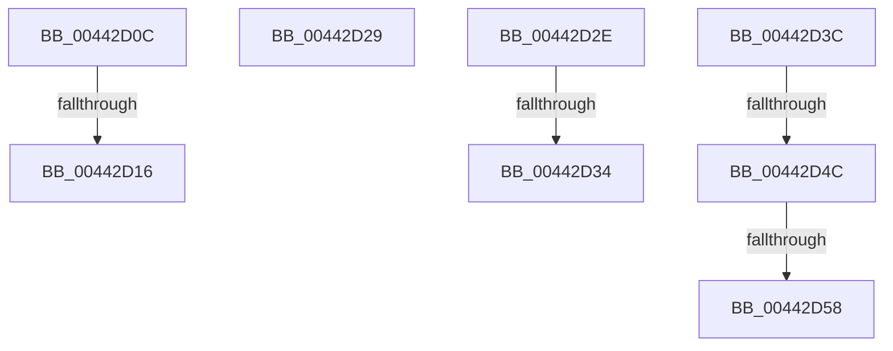

# sub_00442D0C

- RVA: `0x00442D0C`–`0x00442D5D` (길이 `81` bytes)
- VA: `0x0000000140442D0C`
- 실행 섹션: `.text`
- PDB 이름 있음: `아니요`; PDB Function 태그: `아니요`
- unwind 정보 RVA: `0x000A53F4`
- 디코드: `22`개 명령, `81/81` bytes 표시
- 미해석 바이트: `0` (있으면 어셈블리에 `.byte`로 보존)

> 이 문서는 커널 이미지의 기계어와 PDB 기호를 분석해 생성했습니다. 4번과 5번은 함수 원형과 자료형을 바이너리 사용 방식에서 추정한 C 해석이며 원본 소스 복구 결과는 아닙니다.

## 1. Dependencies

- 직접 호출 지점: **1**; 고유 호출 대상: **1**
- 직접 호출자로 확인된 함수: **0**
- RIP 상대 이미지 참조: **2**

### Outgoing calls
- `0x00442D22` → [ExpReleaseSpinLockSharedFromDpcLevelInstrumented](../2F/ExpReleaseSpinLockSharedFromDpcLevelInstrumented_function_002F0F48.md) (function, `0x002F0F48`)

### Direct callers
- 이 함수 시작 RVA로 연결되는 직접 call은 확인되지 않았습니다. 간접 호출은 완전히 역산할 수 없습니다.

### Static image references
- `0x00442D0C` → RVA `0x00F0DE58` (`.data`; read)
- `0x00442D1B` → RVA `0x00F8D024` (`.data`; read)

## 2. Other-region calls and transfers

- 다른 실행 섹션으로 향하는 call: **0**
- call이 아닌 외부 분기/꼬리 이동: **8**
  - `0x00442D14` → [sub_00442C79 + 0x5A](Unknown_function_00442C79.md) (`tail-transfer`)
  - `0x00442D27` → [sub_00442C79 + 0x6C](Unknown_function_00442C79.md) (`tail-transfer`)
  - `0x00442D2C` → [sub_00442C79 + 0x47](Unknown_function_00442C79.md) (`tail-transfer`)
  - `0x00442D32` → [sub_00442C79 + 0x43](Unknown_function_00442C79.md) (`tail-transfer`)
  - `0x00442D3A` → [sub_00442C79 + 0x47](Unknown_function_00442C79.md) (`tail-transfer`)
  - `0x00442D46` → [sub_006EFAD4 + 0x10](../6E/Unknown_function_006EFAD4.md) (`tail-transfer`)
  - `0x00442D52` → [sub_006EFAD4](../6E/Unknown_function_006EFAD4.md) (`tail-transfer`)
  - `0x00442D58` → [sub_006EFAD4 + 0x2C](../6E/Unknown_function_006EFAD4.md) (`tail-transfer`)

## 3. Assembly (complete function range)

```asm
00442D0C  8B 05 46 B1 AC 00               mov eax, dword ptr [rip + 0xacb146]
00442D12  85 C0                           test eax, eax
00442D14  75 BD                           jne 0x140442cd3
00442D16  48 8B 54 24 28                  mov rdx, qword ptr [rsp + 0x28]
00442D1B  48 8D 0D 02 A3 B4 00            lea rcx, [rip + 0xb4a302]
00442D22  E8 21 E2 EA FF                  call 0x1402f0f48
00442D27  EB BC                           jmp 0x140442ce5
00442D29  4D 8B 00                        mov r8, qword ptr [r8]
00442D2C  EB 92                           jmp 0x140442cc0
00442D2E  4C 39 4F 08                     cmp qword ptr [rdi + 8], r9
00442D32  73 88                           jae 0x140442cbc
00442D34  4D 8B D8                        mov r11, r8
00442D37  4D 8B 00                        mov r8, qword ptr [r8]
00442D3A  EB 84                           jmp 0x140442cc0
00442D3C  4D 8B 43 08                     mov r8, qword ptr [r11 + 8]
00442D40  49 8B DB                        mov rbx, r11
00442D43  4D 85 C0                        test r8, r8
00442D46  0F 84 98 CD 2A 00               je 0x1406efae4
00442D4C  49 8B 08                        mov rcx, qword ptr [r8]
00442D4F  48 85 C9                        test rcx, rcx
00442D52  0F 85 7C CD 2A 00               jne 0x1406efad4
00442D58  E9 A3 CD 2A 00                  jmp 0x1406efb00
```

## 4. C-style interpretation (structured pseudocode)

```c
__int64 __fastcall sub_00442D0C(__int64 a1, __int64 a2, __int64 a3, __int64 a4, __int64 a5)
{
    __int64 result;

    result = ExpReleaseSpinLockSharedFromDpcLevelInstrumented(v_rip + 11838210, a5, a3, a4);
}
```

## 5. (Beta) C Style

```c
int64_t sub_00442D0C(int64_t Arg1, int64_t Arg2, int64_t Arg3, int64_t Arg4, int64_t Arg5)
{
    int64_t result;

    result = ExpReleaseSpinLockSharedFromDpcLevelInstrumented(v_rip + 11838210, Arg5, Arg3, Arg4);
}
```

## 6. Execution-region graph

[열기: 2D/3D 그래프와 함수 탐색 컨트롤 패널](../../../control-panel.html?section=text&rva=0x00442D0C&view=graph)

- 2D 그래프는 위에서 아래로 흐르고, 3D 그래프는 빈 공간을 드래그해 회전합니다. Shift+드래그는 이동, 휠은 확대·축소, 함수 노드 선택은 대상 보고서 이동입니다.

### Static fallback


