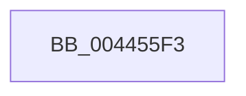

# sub_004455F3

- RVA: `0x004455F3`–`0x0044565B` (길이 `104` bytes)
- VA: `0x00000001404455F3`
- 실행 섹션: `.text`
- PDB 이름 있음: `아니요`; PDB Function 태그: `아니요`
- unwind 정보 RVA: `0x000A58C4`
- 디코드: `22`개 명령, `104/104` bytes 표시
- 미해석 바이트: `0` (있으면 어셈블리에 `.byte`로 보존)

> 이 문서는 커널 이미지의 기계어와 PDB 기호를 분석해 생성했습니다. 4번과 5번은 함수 원형과 자료형을 바이너리 사용 방식에서 추정한 C 해석이며 원본 소스 복구 결과는 아닙니다.

## 1. Dependencies

- 직접 호출 지점: **1**; 고유 호출 대상: **1**
- 직접 호출자로 확인된 함수: **0**
- RIP 상대 이미지 참조: **0**

### Outgoing calls
- `0x00445642` → [MiLockWorkingSetShared](../27/MiLockWorkingSetShared_function_0027CBF0.md) (function, `0x0027CBF0`)

### Direct callers
- 이 함수 시작 RVA로 연결되는 직접 call은 확인되지 않았습니다. 간접 호출은 완전히 역산할 수 없습니다.

### Static image references
- 디코드된 RIP-relative 메모리 참조가 없습니다.

## 2. Other-region calls and transfers

- 다른 실행 섹션으로 향하는 call: **0**
- call이 아닌 외부 분기/꼬리 이동: **1**
  - `0x00445655` → [sub_00445820](Unknown_function_00445820.md) (`tail-transfer`)

## 3. Assembly (complete function range)

```asm
004455F3  48 89 58 08                     mov qword ptr [rax + 8], rbx
004455F7  4C 89 60 18                     mov qword ptr [rax + 0x18], r12
004455FB  4C 89 68 E8                     mov qword ptr [rax - 0x18], r13
004455FF  4C 89 70 E0                     mov qword ptr [rax - 0x20], r14
00445603  49 BE F8 FF FF FF 7F 00 00 00   movabs r14, 0x7ffffffff8
0044560D  48 C1 EF 09                     shr rdi, 9
00445611  49 23 FE                        and rdi, r14
00445614  48 BB 00 00 00 00 80 F6 FF FF   movabs rbx, 0xfffff68000000000
0044561E  48 8B C3                        mov rax, rbx
00445621  48 C1 ED 09                     shr rbp, 9
00445625  48 03 F8                        add rdi, rax
00445628  49 23 EE                        and rbp, r14
0044562B  48 8B C3                        mov rax, rbx
0044562E  4D 8B A8 B8 00 00 00            mov r13, qword ptr [r8 + 0xb8]
00445635  48 03 E8                        add rbp, rax
00445638  49 81 C5 00 04 00 00            add r13, 0x400
0044563F  49 8B CD                        mov rcx, r13
00445642  E8 A9 75 E3 FF                  call 0x14027cbf0
00445647  88 84 24 98 00 00 00            mov byte ptr [rsp + 0x98], al
0044564E  44 0F B6 E0                     movzx r12d, al
00445652  48 3B FD                        cmp rdi, rbp
00445655  0F 87 C5 01 00 00               ja 0x140445820
```

## 4. C-style interpretation (structured pseudocode)

```c
__int64 __fastcall sub_004455F3(__int64 a1, __int64 a2, __int64 a3)
{
    __int64 result;
    __int64 v_r13;
    __int64 v_rbp;
    __int64 v_rdi;
    unsigned __int8 v_stack_p98;

    *(unsigned __int64 *)(result + 8) = v_rbx;
    *(unsigned __int64 *)(result + 24) = v_r12;
    *(unsigned __int64 *)(result - 24) = v_r13;
    *(unsigned __int64 *)(result - 32) = v_r14;
    v_rdi = (v_rdi) >> (9);
    v_rdi = (v_rdi) & (v_r14);
    v_rbp = (v_rbp) >> (9);
    v_rdi = (v_rdi) + (v_rbx);
    v_rbp = (v_rbp) & (v_r14);
    v_rbp = (v_rbp) + (v_rbx);
    v_r13 = (*(unsigned __int64 *)(a3 + 184)) + (0x400ULL);
    result = MiLockWorkingSetShared(v_r13, a2, a3, a4);
    v_stack_p98 = (unsigned __int8)(result);
}
```

## 5. (Beta) C Style

```c
int64_t sub_004455F3(int64_t Arg1, int64_t Arg2, void *Arg3)
{
    uint8_t *arg3 = (uint8_t *)Arg3;

    int64_t result;
    int64_t local_r13;
    int64_t local_rbp;
    int64_t local_rdi;
    uint8_t v_stack_p98;

    *(uint64_t *)(result + 0x8) = local_rbx;
    *(uint64_t *)(result + 0x18) = local_r12;
    *(uint64_t *)(result - 0x18) = local_r13;
    *(uint64_t *)(result - 0x20) = local_r14;
    local_rdi = (local_rdi) >> (9);
    local_rdi = (local_rdi) & (local_r14);
    local_rbp = (local_rbp) >> (9);
    local_rdi = (local_rdi) + (local_rbx);
    local_rbp = (local_rbp) & (local_r14);
    local_rbp = (local_rbp) + (local_rbx);
    local_r13 = (*(uint64_t *)(arg3 + 0xB8)) + (0x400ULL);
    result = MiLockWorkingSetShared(local_r13, Arg2, Arg3, a4);
    v_stack_p98 = (uint8_t)(result);
}
```

### 관측된 메모리 오프셋

구조체 형식이 확인되지 않은 접근은 인자 기준의 오프셋으로만 기록했습니다.

| 기준 인자 | 오프셋 표현 | 폭 (bit) | 접근 |
|---|---:|---:|---|
| `Arg3` | `+ 0xB8` | `64` | `R` |

## 6. Execution-region graph

[열기: 2D/3D 그래프와 함수 탐색 컨트롤 패널](../../../control-panel.html?section=text&rva=0x004455F3&view=graph)

- 2D 그래프는 위에서 아래로 흐르고, 3D 그래프는 빈 공간을 드래그해 회전합니다. Shift+드래그는 이동, 휠은 확대·축소, 함수 노드 선택은 대상 보고서 이동입니다.

### Static fallback


