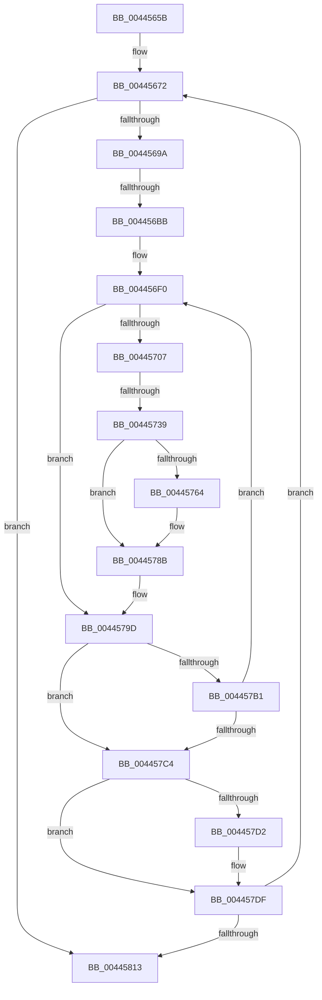

# sub_0044565B

- RVA: `0x0044565B`–`0x00445820` (길이 `453` bytes)
- VA: `0x000000014044565B`
- 실행 섹션: `.text`
- PDB 이름 있음: `아니요`; PDB Function 태그: `아니요`
- unwind 정보 RVA: `0x000A58E4`
- 디코드: `99`개 명령, `453/453` bytes 표시
- 미해석 바이트: `0` (있으면 어셈블리에 `.byte`로 보존)

> 이 문서는 커널 이미지의 기계어와 PDB 기호를 분석해 생성했습니다. 4번과 5번은 함수 원형과 자료형을 바이너리 사용 방식에서 추정한 C 해석이며 원본 소스 복구 결과는 아닙니다.

## 1. Dependencies

- 직접 호출 지점: **9**; 고유 호출 대상: **9**
- 직접 호출자로 확인된 함수: **0**
- RIP 상대 이미지 참조: **0**

### Outgoing calls
- `0x00445689` → [MiGetNextPageTable](../2C/MiGetNextPageTable_function_002C2EE0.md) (function, `0x002C2EE0`)
- `0x00445741` → [MiSetPfnModified](../36/MiSetPfnModified_function_00362960.md) (function, `0x00362960`)
- `0x00445755` → [MiWriteValidPteNewProtection](../28/MiWriteValidPteNewProtection_function_00281810.md) (function, `0x00281810`)
- `0x00445764` → [MiGetProcessorFlushList](../24/MiGetProcessorFlushList_function_00242C90.md) (function, `0x00242C90`)
- `0x00445786` → [MiInitializeTbFlushList](../29/MiInitializeTbFlushList_function_00294F00.md) (function, `0x00294F00`)
- `0x00445798` → [MiInsertTbFlushEntry](../29/MiInsertTbFlushEntry_function_00293670.md) (function, `0x00293670`)
- `0x004457D5` → [MiFlushTbList](../31/MiFlushTbList_function_00311FC0.md) (function, `0x00311FC0`)
- `0x004457DA` → [MiReleaseProcessorFlushList](../31/MiReleaseProcessorFlushList_function_00313C70.md) (function, `0x00313C70`)
- `0x00445805` → [MiUnlockPageTable](../21/MiUnlockPageTable_function_00216EC0.md) (function, `0x00216EC0`)

### Direct callers
- 이 함수 시작 RVA로 연결되는 직접 call은 확인되지 않았습니다. 간접 호출은 완전히 역산할 수 없습니다.

### Static image references
- 디코드된 RIP-relative 메모리 참조가 없습니다.

## 2. Other-region calls and transfers

- 다른 실행 섹션으로 향하는 call: **0**
- call이 아닌 외부 분기/꼬리 이동: **2**
  - `0x004456B5` → [sub_00445850 + 0x3A](Unknown_function_00445850.md) (`tail-transfer`)
  - `0x00445733` → [sub_00445850](Unknown_function_00445850.md) (`tail-transfer`)

## 3. Assembly (complete function range)

```asm
0044565B  48 89 B4 24 88 00 00 00         mov qword ptr [rsp + 0x88], rsi
00445663  4C 89 7C 24 50                  mov qword ptr [rsp + 0x50], r15
00445668  49 BF 00 00 00 00 00 DE FF FF   movabs r15, 0xffffde0000000000
00445672  48 8D 44 24 30                  lea rax, [rsp + 0x30]
00445677  45 33 C9                        xor r9d, r9d
0044567A  45 0F B6 C4                     movzx r8d, r12b
0044567E  48 89 44 24 20                  mov qword ptr [rsp + 0x20], rax
00445683  48 8B D5                        mov rdx, rbp
00445686  48 8B CF                        mov rcx, rdi
00445689  E8 52 D8 E7 FF                  call 0x1402c2ee0
0044568E  48 8B F8                        mov rdi, rax
00445691  48 85 C0                        test rax, rax
00445694  0F 84 79 01 00 00               je 0x140445813
0044569A  4C 8B C0                        mov r8, rax
0044569D  49 C1 E8 09                     shr r8, 9
004456A1  4D 23 C6                        and r8, r14
004456A4  48 8B C3                        mov rax, rbx
004456A7  8B 4C 24 30                     mov ecx, dword ptr [rsp + 0x30]
004456AB  4C 03 C0                        add r8, rax
004456AE  4C 89 44 24 40                  mov qword ptr [rsp + 0x40], r8
004456B3  85 C9                           test ecx, ecx
004456B5  0F 85 CF 01 00 00               jne 0x14044588a
004456BB  48 8B F7                        mov rsi, rdi
004456BE  48 C1 E6 19                     shl rsi, 0x19
004456C2  48 8B C3                        mov rax, rbx
004456C5  48 C1 E0 19                     shl rax, 0x19
004456C9  49 BC FF FF FF FF FF FF FF 7F   movabs r12, 0x7fffffffffffffff
004456D3  48 2B F0                        sub rsi, rax
004456D6  48 C1 FE 10                     sar rsi, 0x10
004456DA  45 33 F6                        xor r14d, r14d
004456DD  4C 89 74 24 38                  mov qword ptr [rsp + 0x38], r14
004456E2  0F 1F 40 00                     nop dword ptr [rax]
004456E6  66 66 0F 1F 84 00 00 00 00 00   nop word ptr [rax + rax]
004456F0  48 8B 1F                        mov rbx, qword ptr [rdi]
004456F3  F6 C3 42                        test bl, 0x42
004456F6  0F 95 C1                        setne cl
004456F9  F6 C3 01                        test bl, 1
004456FC  0F 95 C0                        setne al
004456FF  84 C8                           test al, cl
00445701  0F 84 96 00 00 00               je 0x14044579d
00445707  48 8B C3                        mov rax, rbx
0044570A  48 B9 FF FF FF FF FF 00 00 00   movabs rcx, 0xffffffffff
00445714  48 C1 E8 0C                     shr rax, 0xc
00445718  48 23 C1                        and rax, rcx
0044571B  4C 8D 34 40                     lea r14, [rax + rax*2]
0044571F  49 C1 E6 04                     shl r14, 4
00445723  49 8B C7                        mov rax, r15
00445726  4C 03 F0                        add r14, rax
00445729  45 33 FF                        xor r15d, r15d
0044572C  F0 49 0F BA 6E 18 3F            lock bts qword ptr [r14 + 0x18], 0x3f
00445733  0F 82 17 01 00 00               jb 0x140445850
00445739  BA 01 00 00 00                  mov edx, 1
0044573E  49 8B CE                        mov rcx, r14
00445741  E8 1A D2 F1 FF                  call 0x140362960
00445746  F0 4D 21 66 18                  lock and qword ptr [r14 + 0x18], r12
0044574B  48 83 E3 BD                     and rbx, 0xffffffffffffffbd
0044574F  48 8B CF                        mov rcx, rdi
00445752  48 8B D3                        mov rdx, rbx
00445755  E8 B6 C0 E3 FF                  call 0x140281810
0044575A  4C 8B 74 24 38                  mov r14, qword ptr [rsp + 0x38]
0044575F  4D 85 F6                        test r14, r14
00445762  75 27                           jne 0x14044578b
00445764  E8 27 D5 DF FF                  call 0x140242c90
00445769  45 33 C9                        xor r9d, r9d
0044576C  48 89 44 24 38                  mov qword ptr [rsp + 0x38], rax
00445771  49 8B D5                        mov rdx, r13
00445774  C7 44 24 20 0A 00 00 00         mov dword ptr [rsp + 0x20], 0xa
0044577C  48 8B C8                        mov rcx, rax
0044577F  4C 8B F0                        mov r14, rax
00445782  44 8B 40 0C                     mov r8d, dword ptr [rax + 0xc]
00445786  E8 75 F7 E4 FF                  call 0x140294f00
0044578B  45 33 C9                        xor r9d, r9d
0044578E  48 8B D6                        mov rdx, rsi
00445791  49 8B CE                        mov rcx, r14
00445794  45 8D 41 01                     lea r8d, [r9 + 1]
00445798  E8 D3 DE E4 FF                  call 0x140293670
0044579D  48 81 C6 00 10 00 00            add rsi, 0x1000
004457A4  48 83 C7 08                     add rdi, 8
004457A8  48 F7 C6 FF FF 1F 00            test rsi, 0x1fffff
004457AF  74 13                           je 0x1404457c4
004457B1  49 BF 00 00 00 00 00 DE FF FF   movabs r15, 0xffffde0000000000
004457BB  48 3B FD                        cmp rdi, rbp
004457BE  0F 86 2C FF FF FF               jbe 0x1404456f0
004457C4  44 0F B6 A4 24 98 00 00 00      movzx r12d, byte ptr [rsp + 0x98]
004457CD  4D 85 F6                        test r14, r14
004457D0  74 0D                           je 0x1404457df
004457D2  49 8B CE                        mov rcx, r14
004457D5  E8 E6 C7 EC FF                  call 0x140311fc0
004457DA  E8 91 E4 EC FF                  call 0x140313c70
004457DF  49 BF 00 00 00 00 00 DE FF FF   movabs r15, 0xffffde0000000000
004457E9  49 BE F8 FF FF FF 7F 00 00 00   movabs r14, 0x7ffffffff8
004457F3  48 BB 00 00 00 00 80 F6 FF FF   movabs rbx, 0xfffff68000000000
004457FD  48 8B 54 24 40                  mov rdx, qword ptr [rsp + 0x40]
00445802  49 8B CD                        mov rcx, r13
00445805  E8 B6 16 DD FF                  call 0x140216ec0
0044580A  48 3B FD                        cmp rdi, rbp
0044580D  0F 86 5F FE FF FF               jbe 0x140445672
00445813  48 8B B4 24 88 00 00 00         mov rsi, qword ptr [rsp + 0x88]
0044581B  4C 8B 7C 24 50                  mov r15, qword ptr [rsp + 0x50]
```

## 4. C-style interpretation (structured pseudocode)

```c
__int64 __fastcall sub_0044565B(__int64 a1, __int64 a2, __int64 a3, int a4, __int64 a5, unsigned int a6, __int64 a7, __int64 a8, __int64 a9, __int64 a10, __int64 a11, __int64 a12, __int64 a13, __int64 a14, __int64 a15, __int64 a16, __int64 a17, __int64 a18, unsigned __int8 a19)
{
    __int64 result;
    __int64 v_r14;
    __int64 v_r15;
    __int64 v_rbx;
    __int64 v_rdi;
    __int64 v_rsi;
    unsigned __int64 v_stack_p20;
    unsigned __int64 v_stack_p38;
    unsigned __int64 v_stack_p40;
    unsigned __int64 v_stack_p50;
    unsigned __int64 v_stack_p88;

    v_stack_p88 = v_rsi;
    v_stack_p50 = v_r15;
loc_00445672:
    a4 = 0;
    v_stack_p20 = a6;
    result = MiGetNextPageTable(v_rdi, v_rbp, (unsigned __int8)(v_r12), a4);
    if (result == 0) goto loc_00445813;
    a3 = (result) >> (9);
    a3 = (a3) & (v_r14);
    a3 = (a3) + (v_rbx);
    v_stack_p40 = a3;
    v_rsi = (result) << (25);
    result = (v_rbx) << (25);
    v_rsi = (v_rsi) - (result);
    v_rsi = (v_rsi) >> (16);
    v_r14 = 0;
    v_stack_p38 = 0;
loc_004456F0:
    a1 = ((((unsigned __int8)(*(unsigned __int64 *)(result))) & (66)) != 0) ? 1 : 0;
    result = ((((unsigned __int8)(*(unsigned __int64 *)(result))) & (1)) != 0) ? 1 : 0;
    if ((((unsigned __int8)(result)) & ((unsigned __int8)(a1))) == 0) goto loc_0044579D;
    result = (*(unsigned __int64 *)(result)) >> (12);
    result = (result) & (a1);
    v_r14 = (result + result * 2) << (4);
    v_r14 = (v_r14) + (v_r15);
    v_r15 = 0;
    result = MiSetPfnModified(v_r14, 1, a3, a4);
    v_rbx = (*(unsigned __int64 *)(result)) & (-67);
    result = MiWriteValidPteNewProtection(result, v_rbx, a3, a4);
    v_r14 = a7;
    if (a7 == 0) {
        result = MiGetProcessorFlushList(result, v_rbx, a3, a4);
        a4 = 0;
        v_stack_p38 = result;
        a2 = v_r13;
        v_stack_p20 = 10;
        a1 = result;
        v_r14 = result;
        a3 = *(unsigned int *)(result + 12);
        result = MiInitializeTbFlushList(a1, a2, a3, a4);
    }
    a4 = 0;
    result = MiInsertTbFlushEntry(v_r14, v_rsi, a4 + 1, a4);
loc_0044579D:
    v_rsi = (v_rsi) + (0x1000ULL);
    v_rdi = (result) + (8);
    if (((v_rsi) & (0x1FFFFFULL)) == 0) goto loc_004457C4;
    if (v_rdi <= v_rbp) goto loc_004456F0;
loc_004457C4:
    if (v_r14 != 0) {
        a1 = v_r14;
        result = MiFlushTbList(a1, v_rsi, a4 + 1, a4);
        result = MiReleaseProcessorFlushList(a1, v_rsi, a4 + 1, a4);
    }
    result = MiUnlockPageTable(v_r13, a8, a4 + 1, a4);
    if (v_rdi <= v_rbp) goto loc_00445672;
loc_00445813:
    return result;
}
```

## 5. (Beta) C Style

```c
int64_t sub_0044565B(int64_t Arg1, int64_t Arg2, int64_t Arg3, int32_t Arg4, uint64_t Arg5, uint32_t Arg6, int64_t Arg7, int64_t Arg8, uint64_t Arg9, int64_t Arg10, uint64_t Arg11, uint64_t Arg12, uint64_t Arg13, uint64_t Arg14, uint64_t Arg15, uint64_t Arg16, int64_t Arg17, uint64_t Arg18, uint8_t Arg19)
{
    int64_t result;
    int64_t local_r14;
    int64_t local_r15;
    int64_t local_rbx;
    int64_t local_rdi;
    int64_t local_rsi;
    uint64_t v_stack_p20;
    uint64_t v_stack_p38;
    uint64_t v_stack_p40;
    uint64_t v_stack_p50;
    uint64_t v_stack_p88;

    v_stack_p88 = local_rsi;
    v_stack_p50 = local_r15;
loc_00445672:
    Arg4 = 0;
    v_stack_p20 = Arg6;
    result = MiGetNextPageTable(local_rdi, local_rbp, (uint8_t)(local_r12), Arg4);
    if (result == 0) goto loc_00445813;
    Arg3 = (result) >> (9);
    Arg3 = (Arg3) & (local_r14);
    Arg3 = (Arg3) + (local_rbx);
    v_stack_p40 = Arg3;
    local_rsi = (result) << (25);
    result = (local_rbx) << (25);
    local_rsi = (local_rsi) - (result);
    local_rsi = (local_rsi) >> (16);
    local_r14 = 0;
    v_stack_p38 = 0;
loc_004456F0:
    Arg1 = ((((uint8_t)(*(uint64_t *)(result))) & (66)) != 0) ? 1 : 0;
    result = ((((uint8_t)(*(uint64_t *)(result))) & (1)) != 0) ? 1 : 0;
    if ((((uint8_t)(result)) & ((uint8_t)(Arg1))) == 0) goto loc_0044579D;
    result = (*(uint64_t *)(result)) >> (12);
    result = (result) & (Arg1);
    local_r14 = (result + result * 2) << (4);
    local_r14 = (local_r14) + (local_r15);
    local_r15 = 0;
    result = MiSetPfnModified(local_r14, 1, Arg3, Arg4);
    local_rbx = (*(uint64_t *)(result)) & (-67);
    result = MiWriteValidPteNewProtection(result, local_rbx, Arg3, Arg4);
    local_r14 = Arg7;
    if (Arg7 == 0) {
        result = MiGetProcessorFlushList(result, local_rbx, Arg3, Arg4);
        Arg4 = 0;
        v_stack_p38 = result;
        Arg2 = local_r13;
        v_stack_p20 = 10;
        Arg1 = result;
        local_r14 = result;
        Arg3 = *(uint32_t *)(result + 0xC);
        result = MiInitializeTbFlushList(Arg1, Arg2, Arg3, Arg4);
    }
    Arg4 = 0;
    result = MiInsertTbFlushEntry(local_r14, local_rsi, Arg4 + 1, Arg4);
loc_0044579D:
    local_rsi = (local_rsi) + (0x1000ULL);
    local_rdi = (result) + (8);
    if (((local_rsi) & (0x1FFFFFULL)) == 0) goto loc_004457C4;
    if (local_rdi <= local_rbp) goto loc_004456F0;
loc_004457C4:
    if (local_r14 != 0) {
        Arg1 = local_r14;
        result = MiFlushTbList(Arg1, local_rsi, Arg4 + 1, Arg4);
        result = MiReleaseProcessorFlushList(Arg1, local_rsi, Arg4 + 1, Arg4);
    }
    result = MiUnlockPageTable(local_r13, Arg8, Arg4 + 1, Arg4);
    if (local_rdi <= local_rbp) goto loc_00445672;
loc_00445813:
    return result;
}
```

## 6. Execution-region graph

[열기: 2D/3D 그래프와 함수 탐색 컨트롤 패널](../../../control-panel.html?section=text&rva=0x0044565B&view=graph)

- 2D 그래프는 위에서 아래로 흐르고, 3D 그래프는 빈 공간을 드래그해 회전합니다. Shift+드래그는 이동, 휠은 확대·축소, 함수 노드 선택은 대상 보고서 이동입니다.

### Static fallback


