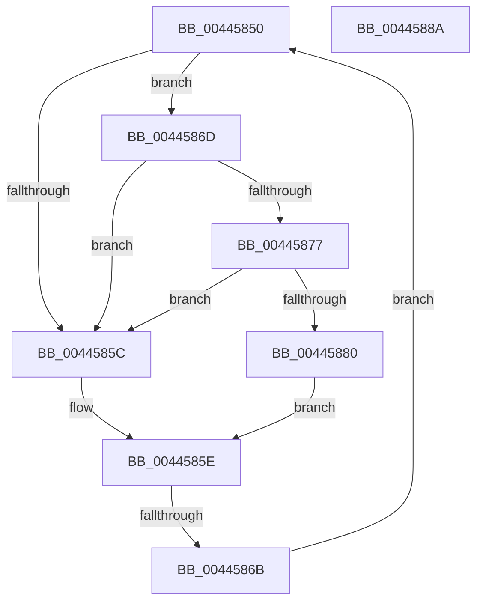

# sub_00445850

- RVA: `0x00445850`–`0x00445895` (길이 `69` bytes)
- VA: `0x0000000140445850`
- 실행 섹션: `.text`
- PDB 이름 있음: `아니요`; PDB Function 태그: `아니요`
- unwind 정보 RVA: `0x000A5920`
- 디코드: `20`개 명령, `69/69` bytes 표시
- 미해석 바이트: `0` (있으면 어셈블리에 `.byte`로 보존)

> 이 문서는 커널 이미지의 기계어와 PDB 기호를 분석해 생성했습니다. 4번과 5번은 함수 원형과 자료형을 바이너리 사용 방식에서 추정한 C 해석이며 원본 소스 복구 결과는 아닙니다.

## 1. Dependencies

- 직접 호출 지점: **2**; 고유 호출 대상: **2**
- 직접 호출자로 확인된 함수: **0**
- RIP 상대 이미지 참조: **2**

### Outgoing calls
- `0x00445877` → [KiCheckVpBackingLongSpinWaitHypercall](../30/KiCheckVpBackingLongSpinWaitHypercall_function_0030F490.md) (function, `0x0030F490`)
- `0x00445883` → [HvlNotifyLongSpinWait](../30/HvlNotifyLongSpinWait_function_0030F460.md) (function, `0x0030F460`)

### Direct callers
- 이 함수 시작 RVA로 연결되는 직접 call은 확인되지 않았습니다. 간접 호출은 완전히 역산할 수 없습니다.

### Static image references
- `0x00445853` → RVA `0x00FC52AC` (`ALMOSTRO`; reference)
- `0x0044586D` → RVA `0x00FC6AB8` (`ALMOSTRO`; read)

## 2. Other-region calls and transfers

- 다른 실행 섹션으로 향하는 call: **0**
- call이 아닌 외부 분기/꼬리 이동: **2**
  - `0x00445865` → [sub_0044565B + 0xD1](Unknown_function_0044565B.md) (`tail-transfer`)
  - `0x00445890` → [sub_006EFE28](../6E/Unknown_function_006EFE28.md) (`tail-transfer`)

## 3. Assembly (complete function range)

```asm
00445850  41 FF C7                        inc r15d
00445853  44 85 3D 52 FA B7 00            test dword ptr [rip + 0xb7fa52], r15d
0044585A  74 11                           je 0x14044586d
0044585C  F3 90                           pause
0044585E  49 8B 46 18                     mov rax, qword ptr [r14 + 0x18]
00445862  48 85 C0                        test rax, rax
00445865  0F 89 C1 FE FF FF               jns 0x14044572c
0044586B  EB E3                           jmp 0x140445850
0044586D  8B 05 45 12 B8 00               mov eax, dword ptr [rip + 0xb81245]
00445873  A8 40                           test al, 0x40
00445875  74 E5                           je 0x14044585c
00445877  E8 14 9C EC FF                  call 0x14030f490
0044587C  84 C0                           test al, al
0044587E  74 DC                           je 0x14044585c
00445880  41 8B CF                        mov ecx, r15d
00445883  E8 D8 9B EC FF                  call 0x14030f460
00445888  EB D4                           jmp 0x14044585e
0044588A  49 8B F0                        mov rsi, r8
0044588D  48 8B D1                        mov rdx, rcx
00445890  E9 93 A5 2A 00                  jmp 0x1406efe28
```

## 4. C-style interpretation (structured pseudocode)

```c
__int64 __fastcall sub_00445850(__int64 a1, __int64 a2, __int64 a3)
{
    __int64 result;
    __int64 v_r15;

    v_r15 = (unsigned int)((v_r15) + 1);
    if (((*(unsigned int *)(v_rip + 12057170)) & ((unsigned int)(v_r15))) == 0) goto loc_0044586D;
loc_0044585C:
loc_0044585E:
    goto loc_00445850;
loc_0044586D:
    if ((((unsigned __int8)((unsigned int)(*(unsigned int *)(v_rip + 12063301)))) & (64)) == 0) goto loc_0044585C;
    result = KiCheckVpBackingLongSpinWaitHypercall(a1, a2, a3, a4);
    if ((unsigned __int8)(result) == 0) goto loc_0044585C;
    result = HvlNotifyLongSpinWait((unsigned int)((unsigned int)(v_r15)), a2, a3, a4);
    goto loc_0044585E;
}
```

## 5. (Beta) C Style

```c
int64_t sub_00445850(int64_t Arg1, int64_t Arg2, int64_t Arg3)
{
    int64_t result;
    int64_t local_r15;

    local_r15 = (uint32_t)((local_r15) + 1);
    if (((*(uint32_t *)(v_rip + 0xB7FA52)) & ((uint32_t)(local_r15))) == 0) goto loc_0044586D;
loc_0044585C:
loc_0044585E:
    goto loc_00445850;
loc_0044586D:
    if ((((uint8_t)((uint32_t)(*(uint32_t *)(v_rip + 0xB81245)))) & (64)) == 0) goto loc_0044585C;
    result = KiCheckVpBackingLongSpinWaitHypercall(Arg1, Arg2, Arg3, a4);
    if ((uint8_t)(result) == 0) goto loc_0044585C;
    result = HvlNotifyLongSpinWait((uint32_t)((uint32_t)(local_r15)), Arg2, Arg3, a4);
    goto loc_0044585E;
}
```

## 6. Execution-region graph

[열기: 2D/3D 그래프와 함수 탐색 컨트롤 패널](../../../control-panel.html?section=text&rva=0x00445850&view=graph)

- 2D 그래프는 위에서 아래로 흐르고, 3D 그래프는 빈 공간을 드래그해 회전합니다. Shift+드래그는 이동, 휠은 확대·축소, 함수 노드 선택은 대상 보고서 이동입니다.

### Static fallback


