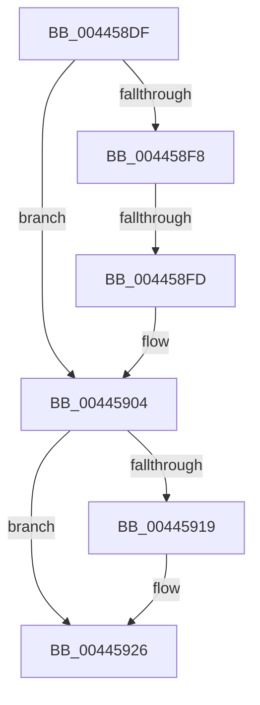

# sub_004458DF

- RVA: `0x004458DF`–`0x00445940` (길이 `97` bytes)
- VA: `0x00000001404458DF`
- 실행 섹션: `.text`
- PDB 이름 있음: `아니요`; PDB Function 태그: `아니요`
- unwind 정보 RVA: `0x000A5984`
- 디코드: `25`개 명령, `97/97` bytes 표시
- 미해석 바이트: `0` (있으면 어셈블리에 `.byte`로 보존)

> 이 문서는 커널 이미지의 기계어와 PDB 기호를 분석해 생성했습니다. 4번과 5번은 함수 원형과 자료형을 바이너리 사용 방식에서 추정한 C 해석이며 원본 소스 복구 결과는 아닙니다.

## 1. Dependencies

- 직접 호출 지점: **3**; 고유 호출 대상: **3**
- 직접 호출자로 확인된 함수: **0**
- RIP 상대 이미지 참조: **2**

### Outgoing calls
- `0x004458E4` → [ExAcquireSpinLockShared](../24/ExAcquireSpinLockShared_function_0024DCE0.md) (function, `0x0024DCE0`)
- `0x0044590B` → [ExReleaseSpinLockSharedFromDpcLevel](../24/ExReleaseSpinLockSharedFromDpcLevel_function_0024A590.md) (function, `0x0024A590`)
- `0x00445921` → [KiLowerIrqlProcessIrqlFlags](../4F/KiLowerIrqlProcessIrqlFlags_function_004F5698.md) (function, `0x004F5698`)

### Direct callers
- 이 함수 시작 RVA로 연결되는 직접 call은 확인되지 않았습니다. 간접 호출은 완전히 역산할 수 없습니다.

### Static image references
- `0x00445904` → RVA `0x00F8D1E0` (`.data`; read)
- `0x00445910` → RVA `0x00FC6D20` (`ALMOSTRO`; read)

## 2. Other-region calls and transfers

- 다른 실행 섹션으로 향하는 call: **0**
- call이 아닌 외부 분기/꼬리 이동: **2**
  - `0x004458FB` → [sub_00445940](Unknown_function_00445940.md) (`tail-transfer`)
  - `0x0044593E` → [IopReferenceIoAttributionFromProcess + 0x27](IopReferenceIoAttributionFromProcess_function_004458A0.md) (`tail-transfer`)

## 3. Assembly (complete function range)

```asm
004458DF  48 89 6C 24 30                  mov qword ptr [rsp + 0x30], rbp
004458E4  E8 F7 83 E0 FF                  call 0x14024dce0
004458E9  48 8B 9B D8 06 00 00            mov rbx, qword ptr [rbx + 0x6d8]
004458F0  0F B6 E8                        movzx ebp, al
004458F3  48 85 DB                        test rbx, rbx
004458F6  74 0C                           je 0x140445904
004458F8  40 84 F6                        test sil, sil
004458FB  74 43                           je 0x140445940
004458FD  48 8B 4B 18                     mov rcx, qword ptr [rbx + 0x18]
00445901  48 89 0F                        mov qword ptr [rdi], rcx
00445904  48 8D 0D D5 78 B4 00            lea rcx, [rip + 0xb478d5]
0044590B  E8 80 4C E0 FF                  call 0x14024a590
00445910  83 3D 09 14 B8 00 00            cmp dword ptr [rip + 0xb81409], 0
00445917  74 0D                           je 0x140445926
00445919  44 0F 20 C1                     mov rcx, cr8
0044591D  40 0F B6 D5                     movzx edx, bpl
00445921  E8 72 FD 0A 00                  call 0x1404f5698
00445926  44 0F 22 C5                     mov cr8, rbp
0044592A  48 8B 6C 24 30                  mov rbp, qword ptr [rsp + 0x30]
0044592F  33 C9                           xor ecx, ecx
00445931  B8 25 02 00 C0                  mov eax, 0xc0000225
00445936  48 85 DB                        test rbx, rbx
00445939  0F 44 C8                        cmove ecx, eax
0044593C  8B C1                           mov eax, ecx
0044593E  EB 87                           jmp 0x1404458c7
```

## 4. C-style interpretation (structured pseudocode)

```c
__int64 __fastcall sub_004458DF(__int64 a1, __int64 a2, __int64 a3, __int64 a4, __int64 a5, __int64 a6)
{
    __int64 result;
    unsigned __int64 v_stack_p30;

    v_stack_p30 = v_rbp;
    result = ExAcquireSpinLockShared(a1, a2, a3, a4);
    if (*(unsigned __int64 *)(v_rbx + 1752) == 0) goto loc_00445904;
    *(unsigned __int64 *)(v_rdi) = *(unsigned __int64 *)(*(unsigned __int64 *)(v_rbx + 1752) + 24);
loc_00445904:
    result = ExReleaseSpinLockSharedFromDpcLevel(v_rip + 11827413, a2, a3, a4);
    if ((*(unsigned int *)(v_rip + 12063753)) != 0) {
        a1 = v_cr8;
        a2 = (unsigned __int8)((unsigned __int8)(result));
        result = KiLowerIrqlProcessIrqlFlags(a1, a2, a3, a4);
    }
    a1 = 0;
    if (*(unsigned __int64 *)(v_rbx + 1752) == 0) { a1 = (unsigned int)((unsigned int)(0xC0000225ULL)); }
}
```

## 5. (Beta) C Style

```c
int64_t sub_004458DF(int64_t Arg1, int64_t Arg2, int64_t Arg3, int64_t Arg4, uint64_t Arg5, int64_t Arg6)
{
    int64_t result;
    uint64_t v_stack_p30;

    v_stack_p30 = local_rbp;
    result = ExAcquireSpinLockShared(Arg1, Arg2, Arg3, Arg4);
    if (*(uint64_t *)(local_rbx + 0x6D8) == 0) goto loc_00445904;
    *(uint64_t *)(local_rdi) = *(uint64_t *)(*(uint64_t *)(local_rbx + 0x6D8) + 0x18);
loc_00445904:
    result = ExReleaseSpinLockSharedFromDpcLevel(v_rip + 11827413, Arg2, Arg3, Arg4);
    if ((*(uint32_t *)(v_rip + 0xB81409)) != 0) {
        Arg1 = v_cr8;
        Arg2 = (uint8_t)((uint8_t)(result));
        result = KiLowerIrqlProcessIrqlFlags(Arg1, Arg2, Arg3, Arg4);
    }
    Arg1 = 0;
    if (*(uint64_t *)(local_rbx + 0x6D8) == 0) { Arg1 = (uint32_t)((uint32_t)(0xC0000225ULL)); }
}
```

## 6. Execution-region graph

[열기: 2D/3D 그래프와 함수 탐색 컨트롤 패널](../../../control-panel.html?section=text&rva=0x004458DF&view=graph)

- 2D 그래프는 위에서 아래로 흐르고, 3D 그래프는 빈 공간을 드래그해 회전합니다. Shift+드래그는 이동, 휠은 확대·축소, 함수 노드 선택은 대상 보고서 이동입니다.

### Static fallback


