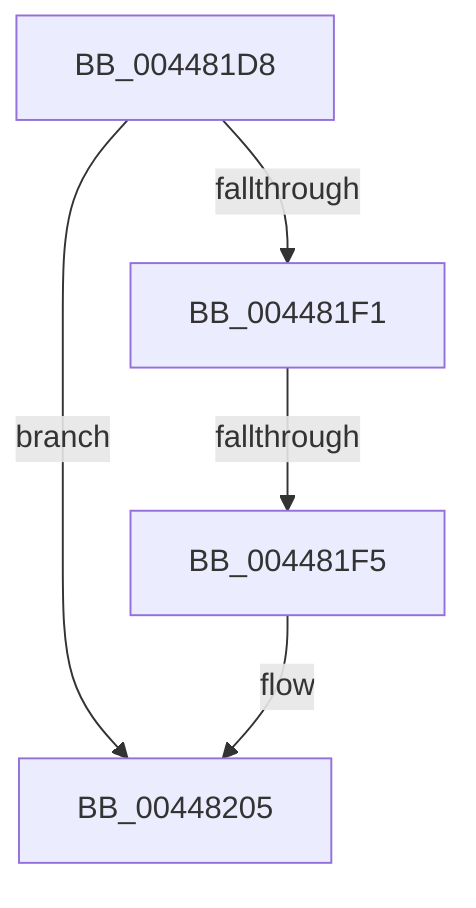

# sub_004481D8

- RVA: `0x004481D8`–`0x00448224` (길이 `76` bytes)
- VA: `0x00000001404481D8`
- 실행 섹션: `.text`
- PDB 이름 있음: `아니요`; PDB Function 태그: `아니요`
- unwind 정보 RVA: `0x000A6024`
- 디코드: `25`개 명령, `76/76` bytes 표시
- 미해석 바이트: `0` (있으면 어셈블리에 `.byte`로 보존)

> 이 문서는 커널 이미지의 기계어와 PDB 기호를 분석해 생성했습니다. 4번과 5번은 함수 원형과 자료형을 바이너리 사용 방식에서 추정한 C 해석이며 원본 소스 복구 결과는 아닙니다.

## 1. Dependencies

- 직접 호출 지점: **0**; 고유 호출 대상: **0**
- 직접 호출자로 확인된 함수: **0**
- RIP 상대 이미지 참조: **0**

### Outgoing calls
- 직접 디코드된 call 명령이 없습니다.

### Direct callers
- 이 함수 시작 RVA로 연결되는 직접 call은 확인되지 않았습니다. 간접 호출은 완전히 역산할 수 없습니다.

### Static image references
- 디코드된 RIP-relative 메모리 참조가 없습니다.

## 2. Other-region calls and transfers

- 다른 실행 섹션으로 향하는 call: **0**
- call이 아닌 외부 분기/꼬리 이동: **1**
  - `0x004481F3` → [sub_0044822E](Unknown_function_0044822E.md) (`tail-transfer`)

## 3. Assembly (complete function range)

```asm
004481D8  48 89 5C 24 10                  mov qword ptr [rsp + 0x10], rbx
004481DD  49 8D 1C D3                     lea rbx, [r11 + rdx*8]
004481E1  48 89 3C 24                     mov qword ptr [rsp], rdi
004481E5  8B 7B 04                        mov edi, dword ptr [rbx + 4]
004481E8  B8 FF FF FF FF                  mov eax, 0xffffffff
004481ED  3B F8                           cmp edi, eax
004481EF  74 14                           je 0x140448205
004481F1  85 D2                           test edx, edx
004481F3  74 39                           je 0x14044822e
004481F5  41 8D 41 FE                     lea eax, [r9 - 2]
004481F9  41 8B 14 C3                     mov edx, dword ptr [r11 + rax*8]
004481FD  8B 03                           mov eax, dword ptr [rbx]
004481FF  2B C2                           sub eax, edx
00448201  FF C8                           dec eax
00448203  03 C7                           add eax, edi
00448205  48 8B 3C 24                     mov rdi, qword ptr [rsp]
00448209  48 8B 5C 24 10                  mov rbx, qword ptr [rsp + 0x10]
0044820E  49 89 00                        mov qword ptr [r8], rax
00448211  8B 51 04                        mov edx, dword ptr [rcx + 4]
00448214  48 8B 41 10                     mov rax, qword ptr [rcx + 0x10]
00448218  FF CA                           dec edx
0044821A  8B 04 D0                        mov eax, dword ptr [rax + rdx*8]
0044821D  FF C8                           dec eax
0044821F  49 89 02                        mov qword ptr [r10], rax
00448222  B0 01                           mov al, 1
```

## 4. C-style interpretation (structured pseudocode)

```c
__int64 __fastcall sub_004481D8(__int64 a1, __int64 a2, __int64 a3, __int64 a4)
{
    __int64 result;
    unsigned __int64 v_stack_p0;
    unsigned __int64 v_stack_p10;

    v_stack_p10 = v_rbx;
    v_stack_p0 = v_rdi;
    if (((unsigned int)((unsigned int)(*(unsigned int *)(v_r11 + a2 * 8 + 4)))) == ((unsigned int)((unsigned int)(0xFFFFFFFFULL)))) goto loc_00448205;
    result = (unsigned int)(((unsigned int)(*(unsigned int *)(v_r11 + a2 * 8))) - ((unsigned int)((unsigned int)(*(unsigned int *)(v_r11 + a4 - 2 * 8)))));
    result = (unsigned int)((result) - 1);
    result = (unsigned int)((result) + ((unsigned int)((unsigned int)(*(unsigned int *)(v_r11 + a2 * 8 + 4)))));
loc_00448205:
    *(unsigned __int64 *)(a3) = result;
    a2 = (unsigned int)(((unsigned int)(*(unsigned int *)(a1 + 4))) - 1);
    result = (unsigned int)(((unsigned int)(*(unsigned int *)(*(unsigned __int64 *)(a1 + 16) + a2 * 8))) - 1);
    *(unsigned __int64 *)(v_r10) = result;
    return 1;
}
```

## 5. (Beta) C Style

```c
int64_t sub_004481D8(void *Arg1, int64_t Arg2, void *Arg3, void *Arg4)
{
    uint8_t *arg1 = (uint8_t *)Arg1;
    uint8_t *arg3 = (uint8_t *)Arg3;
    uint8_t *arg4 = (uint8_t *)Arg4;

    int64_t result;
    uint64_t v_stack_p0;
    uint64_t v_stack_p10;

    v_stack_p10 = local_rbx;
    v_stack_p0 = local_rdi;
    if (((uint32_t)((uint32_t)(*(uint32_t *)(local_r11 + Arg2 * 8 + 0x4)))) == ((uint32_t)((uint32_t)(0xFFFFFFFFULL)))) goto loc_00448205;
    result = (uint32_t)(((uint32_t)(*(uint32_t *)(local_r11 + Arg2 * 8))) - ((uint32_t)((uint32_t)(*(uint32_t *)(local_r11 + arg4 - 0x2 * 8)))));
    result = (uint32_t)((result) - 1);
    result = (uint32_t)((result) + ((uint32_t)((uint32_t)(*(uint32_t *)(local_r11 + Arg2 * 8 + 0x4)))));
loc_00448205:
    *(uint64_t *)(arg3) = result;
    Arg2 = (uint32_t)(((uint32_t)(*(uint32_t *)(arg1 + 0x4))) - 1);
    result = (uint32_t)(((uint32_t)(*(uint32_t *)(*(uint64_t *)(arg1 + 0x10) + Arg2 * 8))) - 1);
    *(uint64_t *)(local_r10) = result;
    return 1;
}
```

### 관측된 메모리 오프셋

구조체 형식이 확인되지 않은 접근은 인자 기준의 오프셋으로만 기록했습니다.

| 기준 인자 | 오프셋 표현 | 폭 (bit) | 접근 |
|---|---:|---:|---|
| `Arg1` | `+ 0x4` | `32` | `R` |
| `Arg1` | `+ 0x10` | `64` | `R` |
| `Arg3` | `+ 0x0` | `64` | `W` |
| `Arg4` | `- 0x2` | `32` | `R` |

## 6. Execution-region graph

[열기: 2D/3D 그래프와 함수 탐색 컨트롤 패널](../../../control-panel.html?section=text&rva=0x004481D8&view=graph)

- 2D 그래프는 위에서 아래로 흐르고, 3D 그래프는 빈 공간을 드래그해 회전합니다. Shift+드래그는 이동, 휠은 확대·축소, 함수 노드 선택은 대상 보고서 이동입니다.

### Static fallback


