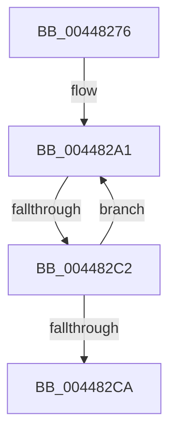

# sub_00448276

- RVA: `0x00448276`–`0x004482EE` (길이 `120` bytes)
- VA: `0x0000000140448276`
- 실행 섹션: `.text`
- PDB 이름 있음: `아니요`; PDB Function 태그: `아니요`
- unwind 정보 RVA: `0x000A6074`
- 디코드: `28`개 명령, `120/120` bytes 표시
- 미해석 바이트: `0` (있으면 어셈블리에 `.byte`로 보존)

> 이 문서는 커널 이미지의 기계어와 PDB 기호를 분석해 생성했습니다. 4번과 5번은 함수 원형과 자료형을 바이너리 사용 방식에서 추정한 C 해석이며 원본 소스 복구 결과는 아닙니다.

## 1. Dependencies

- 직접 호출 지점: **0**; 고유 호출 대상: **0**
- 직접 호출자로 확인된 함수: **0**
- RIP 상대 이미지 참조: **1**

### Outgoing calls
- 직접 디코드된 call 명령이 없습니다.

### Direct callers
- 이 함수 시작 RVA로 연결되는 직접 call은 확인되지 않았습니다. 간접 호출은 완전히 역산할 수 없습니다.

### Static image references
- `0x0044827D` → RVA `0x00000000` (`image boundary/outside`; read)

## 2. Other-region calls and transfers

- 다른 실행 섹션으로 향하는 call: **0**
- call이 아닌 외부 분기/꼬리 이동: **2**
  - `0x004482C0` → [sub_004482EE](Unknown_function_004482EE.md) (`tail-transfer`)
  - `0x004482E9` → [RtlNtStatusToDosErrorNoTeb + 0xA](RtlNtStatusToDosErrorNoTeb_function_00448240.md) (`tail-transfer`)

## 3. Assembly (complete function range)

```asm
00448276  48 89 1C 24                     mov qword ptr [rsp], rbx
0044827A  44 8B C9                        mov r9d, ecx
0044827D  48 8D 1D 7C 7D BB FF            lea rbx, [rip - 0x448284]
00448284  41 81 E1 FF FF FF CF            and r9d, 0xcfffffff
0044828B  25 00 00 00 F0                  and eax, 0xf0000000
00448290  3D 00 00 00 D0                  cmp eax, 0xd0000000
00448295  44 0F 45 C9                     cmovne r9d, ecx
00448299  45 33 C0                        xor r8d, r8d
0044829C  B9 58 01 00 00                  mov ecx, 0x158
004482A1  41 8D 14 08                     lea edx, [r8 + rcx]
004482A5  45 8B D1                        mov r10d, r9d
004482A8  D1 EA                           shr edx, 1
004482AA  4C 8D 1C D5 00 00 00 00         lea r11, [rdx*8]
004482B2  41 8B 84 1B 30 15 03 00         mov eax, dword ptr [r11 + rbx + 0x31530]
004482BA  44 2B D0                        sub r10d, eax
004482BD  44 3B C8                        cmp r9d, eax
004482C0  73 2C                           jae 0x1404482ee
004482C2  8D 4A FF                        lea ecx, [rdx - 1]
004482C5  44 3B C1                        cmp r8d, ecx
004482C8  76 D7                           jbe 0x1404482a1
004482CA  48 8B 1C 24                     mov rbx, qword ptr [rsp]
004482CE  41 8B D1                        mov edx, r9d
004482D1  81 E2 00 00 FF FF               and edx, 0xffff0000
004482D7  41 0F B7 C9                     movzx ecx, r9w
004482DB  81 FA 00 00 01 C0               cmp edx, 0xc0010000
004482E1  B8 3D 01 00 00                  mov eax, 0x13d
004482E6  0F 44 C1                        cmove eax, ecx
004482E9  E9 5C FF FF FF                  jmp 0x14044824a
```

## 4. C-style interpretation (structured pseudocode)

```c
__int64 __fastcall sub_00448276(int a1, __int64 a2, int a3)
{
    __int64 result;
    __int64 v_r10;
    unsigned __int64 v_stack_p0;

    v_stack_p0 = v_rbx;
    a4 = (unsigned int)(((unsigned int)(a1)) & (0xCFFFFFFFULL));
    result = (unsigned int)((result) & (0xF0000000ULL));
    if (((unsigned int)(result)) != 0xD0000000ULL) { a4 = a1; }
    a3 = 0;
loc_004482A1:
    a2 = (unsigned int)((a3 + 344 * 1) >> (1));
    v_r10 = (unsigned int)(((unsigned int)((unsigned int)(a4))) - ((unsigned int)((unsigned int)(*(unsigned int *)(a2 * 8 + v_rip - 4489860 * 1 + 202032)))));
    if (0 <= ((unsigned int)(a2 - 1))) goto loc_004482A1;
    a2 = (unsigned int)(((unsigned int)((unsigned int)(a4))) & (0xFFFF0000ULL));
    result = 317;
    if (((unsigned int)(a2)) == 0xC0010000ULL) { result = (unsigned int)((unsigned __int16)(a4)); }
}
```

## 5. (Beta) C Style

```c
int64_t sub_00448276(int32_t Arg1, int64_t Arg2, int32_t Arg3)
{
    int64_t result;
    int64_t local_r10;
    uint64_t v_stack_p0;

    v_stack_p0 = local_rbx;
    a4 = (uint32_t)(((uint32_t)(Arg1)) & (0xCFFFFFFFULL));
    result = (uint32_t)((result) & (0xF0000000ULL));
    if (((uint32_t)(result)) != 0xD0000000ULL) { a4 = Arg1; }
    Arg3 = 0;
loc_004482A1:
    Arg2 = (uint32_t)((Arg3 + 344 * 1) >> (1));
    local_r10 = (uint32_t)(((uint32_t)((uint32_t)(a4))) - ((uint32_t)((uint32_t)(*(uint32_t *)(Arg2 * 8 + v_rip - 0x448284 * 1 + 0x31530)))));
    if (0 <= ((uint32_t)(Arg2 - 1))) goto loc_004482A1;
    Arg2 = (uint32_t)(((uint32_t)((uint32_t)(a4))) & (0xFFFF0000ULL));
    result = 317;
    if (((uint32_t)(Arg2)) == 0xC0010000ULL) { result = (uint32_t)((uint16_t)(a4)); }
}
```

## 6. Execution-region graph

[열기: 2D/3D 그래프와 함수 탐색 컨트롤 패널](../../../control-panel.html?section=text&rva=0x00448276&view=graph)

- 2D 그래프는 위에서 아래로 흐르고, 3D 그래프는 빈 공간을 드래그해 회전합니다. Shift+드래그는 이동, 휠은 확대·축소, 함수 노드 선택은 대상 보고서 이동입니다.

### Static fallback


