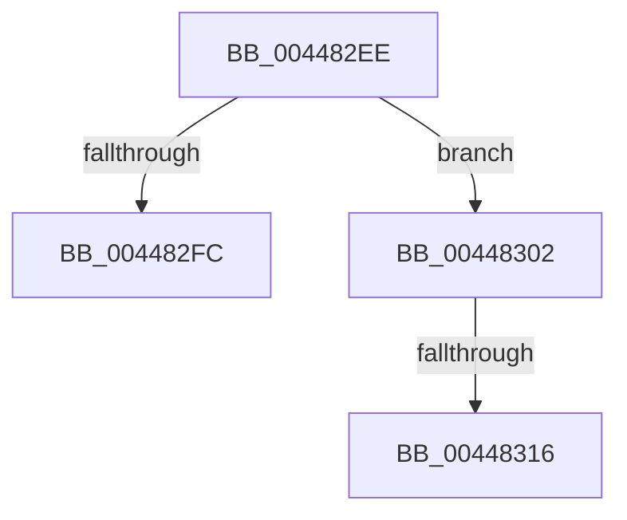

# sub_004482EE

- RVA: `0x004482EE`–`0x0044832A` (길이 `60` bytes)
- VA: `0x00000001404482EE`
- 실행 섹션: `.text`
- PDB 이름 있음: `아니요`; PDB Function 태그: `아니요`
- unwind 정보 RVA: `0x000A6088`
- 디코드: `12`개 명령, `60/60` bytes 표시
- 미해석 바이트: `0` (있으면 어셈블리에 `.byte`로 보존)

> 이 문서는 커널 이미지의 기계어와 PDB 기호를 분석해 생성했습니다. 4번과 5번은 함수 원형과 자료형을 바이너리 사용 방식에서 추정한 C 해석이며 원본 소스 복구 결과는 아닙니다.

## 1. Dependencies

- 직접 호출 지점: **0**; 고유 호출 대상: **0**
- 직접 호출자로 확인된 함수: **0**
- RIP 상대 이미지 참조: **0**

### Outgoing calls
- 직접 디코드된 call 명령이 없습니다.

### Direct callers
- 이 함수 시작 RVA로 연결되는 직접 call은 확인되지 않았습니다. 간접 호출은 완전히 역산할 수 없습니다.

### Static image references
- 디코드된 RIP-relative 메모리 참조가 없습니다.

## 2. Other-region calls and transfers

- 다른 실행 섹션으로 향하는 call: **0**
- call이 아닌 외부 분기/꼬리 이동: **3**
  - `0x00448300` → [sub_00448276 + 0x4F](Unknown_function_00448276.md) (`tail-transfer`)
  - `0x00448314` → [sub_0044832A](Unknown_function_0044832A.md) (`tail-transfer`)
  - `0x00448325` → [RtlNtStatusToDosErrorNoTeb + 0xA](RtlNtStatusToDosErrorNoTeb_function_00448240.md) (`tail-transfer`)

## 3. Assembly (complete function range)

```asm
004482EE  41 0F B6 84 1B 34 15 03 00      movzx eax, byte ptr [r11 + rbx + 0x31534]
004482F7  44 3B D0                        cmp r10d, eax
004482FA  72 06                           jb 0x140448302
004482FC  44 8D 42 01                     lea r8d, [rdx + 1]
00448300  EB C3                           jmp 0x1404482c5
00448302  41 80 BC 1B 35 15 03 00 01      cmp byte ptr [r11 + rbx + 0x31535], 1
0044830B  41 0F B7 84 1B 36 15 03 00      movzx eax, word ptr [r11 + rbx + 0x31536]
00448314  75 14                           jne 0x14044832a
00448316  41 03 C2                        add eax, r10d
00448319  0F B7 84 43 00 20 03 00         movzx eax, word ptr [rbx + rax*2 + 0x32000]
00448321  48 8B 1C 24                     mov rbx, qword ptr [rsp]
00448325  E9 20 FF FF FF                  jmp 0x14044824a
```

## 4. C-style interpretation (structured pseudocode)

```c
__int64 __fastcall sub_004482EE(__int64 a1, __int64 a2)
{
    __int64 result;
    unsigned __int64 v_stack_p0;

    if (((unsigned int)(v_r10)) < ((unsigned int)(*(unsigned __int8 *)(v_r11 + v_rbx * 1 + 202036)))) goto loc_00448302;
loc_00448302:
    result = (unsigned int)((*(unsigned __int16 *)(v_r11 + v_rbx * 1 + 202038)) + ((unsigned int)(v_r10)));
}
```

## 5. (Beta) C Style

```c
int64_t sub_004482EE(int64_t Arg1, void *Arg2)
{
    uint8_t *arg2 = (uint8_t *)Arg2;

    int64_t result;
    uint64_t v_stack_p0;

    if (((uint32_t)(local_r10)) < ((uint32_t)(*(uint8_t *)(local_r11 + local_rbx * 1 + 0x31534)))) goto loc_00448302;
loc_00448302:
    result = (uint32_t)((*(uint16_t *)(local_r11 + local_rbx * 1 + 0x31536)) + ((uint32_t)(local_r10)));
}
```

### 관측된 메모리 오프셋

구조체 형식이 확인되지 않은 접근은 인자 기준의 오프셋으로만 기록했습니다.

| 기준 인자 | 오프셋 표현 | 폭 (bit) | 접근 |
|---|---:|---:|---|
| `Arg2` | `+ 0x1` | `32` | `R` |

## 6. Execution-region graph

[열기: 2D/3D 그래프와 함수 탐색 컨트롤 패널](../../../control-panel.html?section=text&rva=0x004482EE&view=graph)

- 2D 그래프는 위에서 아래로 흐르고, 3D 그래프는 빈 공간을 드래그해 회전합니다. Shift+드래그는 이동, 휠은 확대·축소, 함수 노드 선택은 대상 보고서 이동입니다.

### Static fallback


