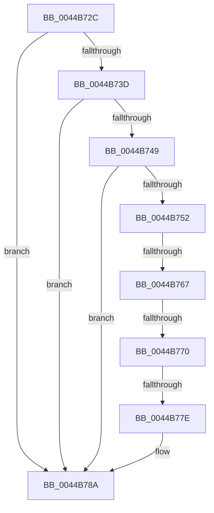

# sub_0044B72C

- RVA: `0x0044B72C`–`0x0044B78F` (길이 `99` bytes)
- VA: `0x000000014044B72C`
- 실행 섹션: `.text`
- PDB 이름 있음: `아니요`; PDB Function 태그: `아니요`
- unwind 정보 RVA: `0x000A66F0`
- 디코드: `22`개 명령, `99/99` bytes 표시
- 미해석 바이트: `0` (있으면 어셈블리에 `.byte`로 보존)

> 이 문서는 커널 이미지의 기계어와 PDB 기호를 분석해 생성했습니다. 4번과 5번은 함수 원형과 자료형을 바이너리 사용 방식에서 추정한 C 해석이며 원본 소스 복구 결과는 아닙니다.

## 1. Dependencies

- 직접 호출 지점: **1**; 고유 호출 대상: **1**
- 직접 호출자로 확인된 함수: **0**
- RIP 상대 이미지 참조: **0**

### Outgoing calls
- `0x0044B757` → [guard_dispatch_icall](../6B/guard_dispatch_icall_function_006BAAD0.md) (function, `0x006BAAD0`)

### Direct callers
- 이 함수 시작 RVA로 연결되는 직접 call은 확인되지 않았습니다. 간접 호출은 완전히 역산할 수 없습니다.

### Static image references
- 디코드된 RIP-relative 메모리 참조가 없습니다.

## 2. Other-region calls and transfers

- 다른 실행 섹션으로 향하는 call: **0**
- call이 아닌 외부 분기/꼬리 이동: **3**
  - `0x0044B765` → [sub_0044B79B](Unknown_function_0044B79B.md) (`tail-transfer`)
  - `0x0044B76E` → [sub_0044B79B + 0x9](Unknown_function_0044B79B.md) (`tail-transfer`)
  - `0x0044B77C` → [sub_0044B79B + 0x12](Unknown_function_0044B79B.md) (`tail-transfer`)

## 3. Assembly (complete function range)

```asm
0044B72C  48 89 74 24 38                  mov qword ptr [rsp + 0x38], rsi
0044B731  48 8B B1 B8 89 00 00            mov rsi, qword ptr [rcx + 0x89b8]
0044B738  48 85 F6                        test rsi, rsi
0044B73B  74 4D                           je 0x14044b78a
0044B73D  48 8B 87 40 01 00 00            mov rax, qword ptr [rdi + 0x140]
0044B744  48 85 C0                        test rax, rax
0044B747  74 41                           je 0x14044b78a
0044B749  80 B9 38 89 00 00 00            cmp byte ptr [rcx + 0x8938], 0
0044B750  74 38                           je 0x14044b78a
0044B752  48 8D 4C 24 30                  lea rcx, [rsp + 0x30]
0044B757  E8 74 F3 26 00                  call 0x1406baad0
0044B75C  8B 87 C8 01 00 00               mov eax, dword ptr [rdi + 0x1c8]
0044B762  39 46 50                        cmp dword ptr [rsi + 0x50], eax
0044B765  72 34                           jb 0x14044b79b
0044B767  80 BB 40 89 00 00 00            cmp byte ptr [rbx + 0x8940], 0
0044B76E  74 34                           je 0x14044b7a4
0044B770  48 8B 44 24 30                  mov rax, qword ptr [rsp + 0x30]
0044B775  48 39 83 48 89 00 00            cmp qword ptr [rbx + 0x8948], rax
0044B77C  75 2F                           jne 0x14044b7ad
0044B77E  48 8B 44 24 30                  mov rax, qword ptr [rsp + 0x30]
0044B783  48 89 83 48 89 00 00            mov qword ptr [rbx + 0x8948], rax
0044B78A  48 8B 74 24 38                  mov rsi, qword ptr [rsp + 0x38]
```

## 4. C-style interpretation (structured pseudocode)

```c
__int64 __fastcall sub_0044B72C(__int64 a1, __int64 a2, __int64 a3, __int64 a4, __int64 a5, __int64 a6, __int64 a7)
{
    __int64 result;
    unsigned __int64 v_stack_p38;

    v_stack_p38 = v_rsi;
    if (*(unsigned __int64 *)(a1 + 35256) == 0) goto loc_0044B78A;
    if (*(unsigned __int64 *)(v_rdi + 320) == 0) goto loc_0044B78A;
    if ((*(unsigned __int8 *)(a1 + 35128)) == 0) goto loc_0044B78A;
    result = guard_dispatch_icall(a6, a2, a3, a4);
    *(unsigned __int64 *)(v_rbx + 35144) = a6;
loc_0044B78A:
    return a6;
}
```

## 5. (Beta) C Style

```c
int64_t sub_0044B72C(void *Arg1, int64_t Arg2, int64_t Arg3, int64_t Arg4, uint64_t Arg5, int64_t Arg6, int64_t Arg7)
{
    uint8_t *arg1 = (uint8_t *)Arg1;

    int64_t result;
    uint64_t v_stack_p38;

    v_stack_p38 = local_rsi;
    if (*(uint64_t *)(arg1 + 0x89B8) == 0) goto loc_0044B78A;
    if (*(uint64_t *)(local_rdi + 0x140) == 0) goto loc_0044B78A;
    if ((*(uint8_t *)(arg1 + 0x8938)) == 0) goto loc_0044B78A;
    result = guard_dispatch_icall(Arg6, Arg2, Arg3, Arg4);
    *(uint64_t *)(local_rbx + 0x8948) = Arg6;
loc_0044B78A:
    return Arg6;
}
```

### 관측된 메모리 오프셋

구조체 형식이 확인되지 않은 접근은 인자 기준의 오프셋으로만 기록했습니다.

| 기준 인자 | 오프셋 표현 | 폭 (bit) | 접근 |
|---|---:|---:|---|
| `Arg1` | `+ 0x8938` | `8` | `R` |
| `Arg1` | `+ 0x89B8` | `64` | `R` |

## 6. Execution-region graph

[열기: 2D/3D 그래프와 함수 탐색 컨트롤 패널](../../../control-panel.html?section=text&rva=0x0044B72C&view=graph)

- 2D 그래프는 위에서 아래로 흐르고, 3D 그래프는 빈 공간을 드래그해 회전합니다. Shift+드래그는 이동, 휠은 확대·축소, 함수 노드 선택은 대상 보고서 이동입니다.

### Static fallback


