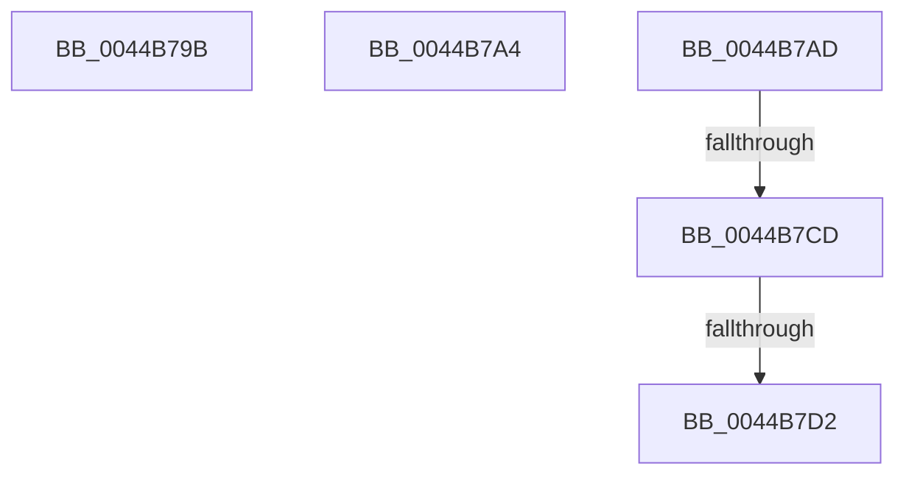

# sub_0044B79B

- RVA: `0x0044B79B`–`0x0044B7D7` (길이 `60` bytes)
- VA: `0x000000014044B79B`
- 실행 섹션: `.text`
- PDB 이름 있음: `아니요`; PDB Function 태그: `아니요`
- unwind 정보 RVA: `0x000A6728`
- 디코드: `15`개 명령, `60/60` bytes 표시
- 미해석 바이트: `0` (있으면 어셈블리에 `.byte`로 보존)

> 이 문서는 커널 이미지의 기계어와 PDB 기호를 분석해 생성했습니다. 4번과 5번은 함수 원형과 자료형을 바이너리 사용 방식에서 추정한 C 해석이며 원본 소스 복구 결과는 아닙니다.

## 1. Dependencies

- 직접 호출 지점: **0**; 고유 호출 대상: **0**
- 직접 호출자로 확인된 함수: **0**
- RIP 상대 이미지 참조: **1**

### Outgoing calls
- 직접 디코드된 call 명령이 없습니다.

### Direct callers
- 이 함수 시작 RVA로 연결되는 직접 call은 확인되지 않았습니다. 간접 호출은 완전히 역산할 수 없습니다.

### Static image references
- `0x0044B7BF` → RVA `0x00E0B3EC` (`.data`; read)

## 2. Other-region calls and transfers

- 다른 실행 섹션으로 향하는 call: **0**
- call이 아닌 외부 분기/꼬리 이동: **5**
  - `0x0044B7A2` → [sub_0044B72C + 0x52](Unknown_function_0044B72C.md) (`tail-transfer`)
  - `0x0044B7AB` → [sub_0044B72C + 0x52](Unknown_function_0044B72C.md) (`tail-transfer`)
  - `0x0044B7C7` → [sub_006F0D76](../6F/Unknown_function_006F0D76.md) (`tail-transfer`)
  - `0x0044B7D0` → [sub_0044B72C + 0x52](Unknown_function_0044B72C.md) (`tail-transfer`)
  - `0x0044B7D2` → [sub_006F0D76](../6F/Unknown_function_006F0D76.md) (`tail-transfer`)

## 3. Assembly (complete function range)

```asm
0044B79B  C6 83 40 89 00 00 00            mov byte ptr [rbx + 0x8940], 0
0044B7A2  EB DA                           jmp 0x14044b77e
0044B7A4  C6 83 40 89 00 00 01            mov byte ptr [rbx + 0x8940], 1
0044B7AB  EB D1                           jmp 0x14044b77e
0044B7AD  8B 8B 3C 89 00 00               mov ecx, dword ptr [rbx + 0x893c]
0044B7B3  33 D2                           xor edx, edx
0044B7B5  FF C1                           inc ecx
0044B7B7  8B C1                           mov eax, ecx
0044B7B9  89 8B 3C 89 00 00               mov dword ptr [rbx + 0x893c], ecx
0044B7BF  F7 35 27 FC 9B 00               div dword ptr [rip + 0x9bfc27]
0044B7C5  85 D2                           test edx, edx
0044B7C7  0F 84 A9 55 2A 00               je 0x1406f0d76
0044B7CD  83 F9 01                        cmp ecx, 1
0044B7D0  75 AC                           jne 0x14044b77e
0044B7D2  E9 9F 55 2A 00                  jmp 0x1406f0d76
```

## 4. C-style interpretation (structured pseudocode)

```c
__int64 __fastcall sub_0044B79B(__int64 a1, int a2)
{
    *(unsigned __int8 *)(v_rbx + 35136) = 0;
}
```

## 5. (Beta) C Style

```c
int64_t sub_0044B79B(int64_t Arg1, int32_t Arg2)
{
    *(uint8_t *)(local_rbx + 0x8940) = 0;
}
```

## 6. Execution-region graph

[열기: 2D/3D 그래프와 함수 탐색 컨트롤 패널](../../../control-panel.html?section=text&rva=0x0044B79B&view=graph)

- 2D 그래프는 위에서 아래로 흐르고, 3D 그래프는 빈 공간을 드래그해 회전합니다. Shift+드래그는 이동, 휠은 확대·축소, 함수 노드 선택은 대상 보고서 이동입니다.

### Static fallback


