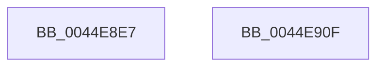

# sub_0044E8E7

- RVA: `0x0044E8E7`–`0x0044E913` (길이 `44` bytes)
- VA: `0x000000014044E8E7`
- 실행 섹션: `.text`
- PDB 이름 있음: `아니요`; PDB Function 태그: `아니요`
- unwind 정보 RVA: `0x000A6AA4`
- 디코드: `12`개 명령, `44/44` bytes 표시
- 미해석 바이트: `0` (있으면 어셈블리에 `.byte`로 보존)

> 이 문서는 커널 이미지의 기계어와 PDB 기호를 분석해 생성했습니다. 4번과 5번은 함수 원형과 자료형을 바이너리 사용 방식에서 추정한 C 해석이며 원본 소스 복구 결과는 아닙니다.

## 1. Dependencies

- 직접 호출 지점: **0**; 고유 호출 대상: **0**
- 직접 호출자로 확인된 함수: **0**
- RIP 상대 이미지 참조: **1**

### Outgoing calls
- 직접 디코드된 call 명령이 없습니다.

### Direct callers
- 이 함수 시작 RVA로 연결되는 직접 call은 확인되지 않았습니다. 간접 호출은 완전히 역산할 수 없습니다.

### Static image references
- `0x0044E8EC` → RVA `0x00000000` (`image boundary/outside`; read)

## 2. Other-region calls and transfers

- 다른 실행 섹션으로 향하는 call: **0**
- 별도 외부 분기/꼬리 이동을 확인하지 못했습니다.

## 3. Assembly (complete function range)

```asm
0044E8E7  48 89 7C 24 10                  mov qword ptr [rsp + 0x10], rdi
0044E8EC  48 8D 3D 0D 17 BB FF            lea rdi, [rip - 0x44e8f3]
0044E8F3  48 63 C2                        movsxd rax, edx
0044E8F6  0F B6 84 07 04 EA 44 00         movzx eax, byte ptr [rdi + rax + 0x44ea04]
0044E8FE  8B 8C 87 D8 E9 44 00            mov ecx, dword ptr [rdi + rax*4 + 0x44e9d8]
0044E905  48 03 CF                        add rcx, rdi
0044E908  48 8B 7C 24 10                  mov rdi, qword ptr [rsp + 0x10]
0044E90D  FF E1                           jmp rcx
0044E90F  CC                              int3
0044E910  CC                              int3
0044E911  CC                              int3
0044E912  CC                              int3
```

## 4. C-style interpretation (structured pseudocode)

```c
__int64 __fastcall sub_0044E8E7(__int64 a1, int a2)
{
    unsigned __int64 v_stack_p10;

    v_stack_p10 = v_rdi;
    a1 = ((unsigned int)(*(unsigned int *)(v_rip - 4516083 + *(unsigned __int8 *)(v_rip - 4516083 + (int)(a2) * 1 + 4516356) * 4 + 4516312))) + (v_rip - 4516083);
}
```

## 5. (Beta) C Style

```c
int64_t sub_0044E8E7(int64_t Arg1, int32_t Arg2)
{
    uint64_t v_stack_p10;

    v_stack_p10 = local_rdi;
    Arg1 = ((uint32_t)(*(uint32_t *)(v_rip - 0x44E8F3 + *(uint8_t *)(v_rip - 0x44E8F3 + (int32_t)(Arg2) * 1 + 0x44EA04) * 4 + 0x44E9D8))) + (v_rip - 4516083);
}
```

## 6. Execution-region graph

[열기: 2D/3D 그래프와 함수 탐색 컨트롤 패널](../../../control-panel.html?section=text&rva=0x0044E8E7&view=graph)

- 2D 그래프는 위에서 아래로 흐르고, 3D 그래프는 빈 공간을 드래그해 회전합니다. Shift+드래그는 이동, 휠은 확대·축소, 함수 노드 선택은 대상 보고서 이동입니다.

### Static fallback


