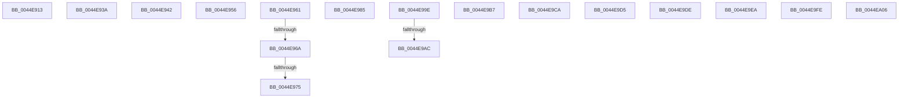

# sub_0044E913

- RVA: `0x0044E913`–`0x0044EA28` (길이 `277` bytes)
- VA: `0x000000014044E913`
- 실행 섹션: `.text`
- PDB 이름 있음: `아니요`; PDB Function 태그: `아니요`
- unwind 정보 RVA: `0x000A6AB8`
- 디코드: `73`개 명령, `277/277` bytes 표시
- 미해석 바이트: `2` (있으면 어셈블리에 `.byte`로 보존)

> 이 문서는 커널 이미지의 기계어와 PDB 기호를 분석해 생성했습니다. 4번과 5번은 함수 원형과 자료형을 바이너리 사용 방식에서 추정한 C 해석이며 원본 소스 복구 결과는 아닙니다.

## 1. Dependencies

- 직접 호출 지점: **0**; 고유 호출 대상: **0**
- 직접 호출자로 확인된 함수: **0**
- RIP 상대 이미지 참조: **0**

### Outgoing calls
- 직접 디코드된 call 명령이 없습니다.

### Direct callers
- 이 함수 시작 RVA로 연결되는 직접 call은 확인되지 않았습니다. 간접 호출은 완전히 역산할 수 없습니다.

### Static image references
- 디코드된 RIP-relative 메모리 참조가 없습니다.

## 2. Other-region calls and transfers

- 다른 실행 섹션으로 향하는 call: **0**
- call이 아닌 외부 분기/꼬리 이동: **14**
  - `0x0044E951` → [SeSetAuditParameter + 0x30](SeSetAuditParameter_function_0044E850.md) (`tail-transfer`)
  - `0x0044E95C` → [SeSetAuditParameter + 0x37](SeSetAuditParameter_function_0044E850.md) (`tail-transfer`)
  - `0x0044E964` → [sub_006F1120 + 0x6](../6F/Unknown_function_006F1120.md) (`tail-transfer`)
  - `0x0044E96F` → [sub_006F1120](../6F/Unknown_function_006F1120.md) (`tail-transfer`)
  - `0x0044E980` → [sub_006F1120 + 0x6](../6F/Unknown_function_006F1120.md) (`tail-transfer`)
  - `0x0044E999` → [SeSetAuditParameter + 0x30](SeSetAuditParameter_function_0044E850.md) (`tail-transfer`)
  - `0x0044E9A6` → [sub_006F1120 + 0x19](../6F/Unknown_function_006F1120.md) (`tail-transfer`)
  - `0x0044E9B2` → [sub_006F1120 + 0x32](../6F/Unknown_function_006F1120.md) (`tail-transfer`)
  - `0x0044E9C5` → [SeSetAuditParameter + 0x2A](SeSetAuditParameter_function_0044E850.md) (`tail-transfer`)
  - `0x0044E9D0` → [SeSetAuditParameter + 0x37](SeSetAuditParameter_function_0044E850.md) (`tail-transfer`)
  - `0x0044E9D8` → `0x-170015DE` (`tail-transfer`)
  - `0x0044E9E5` → `0x-175215D2` (`tail-transfer`)
  - `0x0044E9F9` → `0x-161D15BE` (`tail-transfer`)
  - `0x0044EA01` → `0x0144EA4A` (`tail-transfer`)

## 3. Assembly (complete function range)

```asm
0044E913  41 0F B6 41 01                  movzx eax, byte ptr [r9 + 1]
0044E918  44 8D 1C 85 08 00 00 00         lea r11d, [rax*4 + 8]
0044E920  41 8B C0                        mov eax, r8d
0044E923  48 C1 E0 05                     shl rax, 5
0044E927  48 03 C3                        add rax, rbx
0044E92A  4C 89 48 30                     mov qword ptr [rax + 0x30], r9
0044E92E  89 50 18                        mov dword ptr [rax + 0x18], edx
0044E931  44 89 58 1C                     mov dword ptr [rax + 0x1c], r11d
0044E935  41 8B C2                        mov eax, r10d
0044E938  5B                              pop rbx
0044E939  C3                              ret
0044E93A  CC                              int3
0044E93B  B8 0D 00 00 C0                  mov eax, 0xc000000d
0044E940  5B                              pop rbx
0044E941  C3                              ret
0044E942  CC                              int3
0044E943  41 8B C0                        mov eax, r8d
0044E946  48 C1 E0 05                     shl rax, 5
0044E94A  48 03 C3                        add rax, rbx
0044E94D  44 89 50 1C                     mov dword ptr [rax + 0x1c], r10d
0044E951  E9 2A FF FF FF                  jmp 0x14044e880
0044E956  41 BA 02 00 00 C0               mov r10d, 0xc0000002
0044E95C  E9 26 FF FF FF                  jmp 0x14044e887
0044E961  4D 85 C9                        test r9, r9
0044E964  0F 84 BC 27 2A 00               je 0x1406f1126
0044E96A  41 8B 01                        mov eax, dword ptr [r9]
0044E96D  85 C0                           test eax, eax
0044E96F  0F 84 AB 27 2A 00               je 0x1406f1120
0044E975  8D 04 40                        lea eax, [rax + rax*2]
0044E978  44 8D 1C 85 08 00 00 00         lea r11d, [rax*4 + 8]
0044E980  E9 A1 27 2A 00                  jmp 0x1406f1126
0044E985  41 8B C0                        mov eax, r8d
0044E988  41 BB 10 00 00 00               mov r11d, 0x10
0044E98E  48 C1 E0 05                     shl rax, 5
0044E992  48 03 C3                        add rax, rbx
0044E995  4C 89 48 30                     mov qword ptr [rax + 0x30], r9
0044E999  E9 E2 FE FF FF                  jmp 0x14044e880
0044E99E  41 0F B7 01                     movzx eax, word ptr [r9]
0044E9A2  66 83 F8 17                     cmp ax, 0x17
0044E9A6  0F 85 8D 27 2A 00               jne 0x1406f1139
0044E9AC  41 BB 1C 00 00 00               mov r11d, 0x1c
0044E9B2  E9 9B 27 2A 00                  jmp 0x1406f1152
0044E9B7  41 8B C0                        mov eax, r8d
0044E9BA  48 C1 E0 05                     shl rax, 5
0044E9BE  48 03 C3                        add rax, rbx
0044E9C1  4C 89 48 20                     mov qword ptr [rax + 0x20], r9
0044E9C5  E9 B0 FE FF FF                  jmp 0x14044e87a
0044E9CA  41 BA 0D 00 00 C0               mov r10d, 0xc000000d
0044E9D0  E9 B2 FE FF FF                  jmp 0x14044e887
0044E9D5  0F 1F 00                        nop dword ptr [rax]
0044E9D8  43 E9 44 00 BB E8               jmp 0x128ffea22
0044E9DE  44 00 92 E8 44 00 13            add byte ptr [rdx + 0x130044e8], r10b
0044E9E5  E9 44 00 69 E8                  jmp 0x128adea2e
0044E9EA  44 00 56 E9                     add byte ptr [rsi - 0x17], r10b
0044E9EE  44 00 61 E9                     add byte ptr [rcx - 0x17], r12b
0044E9F2  44 00 B7 E9 44 00 85            add byte ptr [rdi - 0x7affbb17], r14b
0044E9F9  E9 44 00 9E E9                  jmp 0x129e2ea42
0044E9FE  44 00 CA                        add dl, r9b
0044EA01  E9 44 00 00 01                  jmp 0x14144ea4a
0044EA06  01 02                           add dword ptr [rdx], eax
0044EA08  03 04 00                        add eax, dword ptr [rax + rax]
0044EA0B  05 06 05 02 07                  add eax, 0x7020506
0044EA10  04 08                           add al, 8
0044EA12  04 04                           add al, 4
0044EA14  05 05 04 05 05                  add eax, 0x5050405
0044EA19  0A 04 09                        or al, byte ptr [rcx + rcx]
0044EA1C  0A 0A                           or cl, byte ptr [rdx]
0044EA1E  0A 02                           or al, byte ptr [rdx]
0044EA20  09 0A                           or dword ptr [rdx], ecx
0044EA22  0A 0A                           or cl, byte ptr [rdx]
0044EA24  0A 0A                           or cl, byte ptr [rdx]
0044EA26  0A                              .byte 0x0a
0044EA27  04                              .byte 0x04
```

## 4. C-style interpretation (structured pseudocode)

```c
__int64 __fastcall sub_0044E913(__int64 a1, __int64 a2, int a3, __int64 a4)
{
    __int64 result;

    result = ((unsigned int)(a3)) << (5);
    result = (result) + (v_rbx);
    *(unsigned __int64 *)(result + 48) = a4;
    *(unsigned int *)(result + 24) = (unsigned int)(a2);
    *(unsigned int *)(result + 28) = (unsigned int)(*(unsigned __int8 *)(a4 + 1) * 4 + 8);
    return (unsigned int)((unsigned int)(v_r10));
}
```

## 5. (Beta) C Style

```c
int64_t sub_0044E913(int64_t Arg1, int64_t Arg2, int32_t Arg3, void *Arg4)
{
    uint8_t *arg4 = (uint8_t *)Arg4;

    int64_t result;

    result = ((uint32_t)(Arg3)) << (5);
    result = (result) + (local_rbx);
    *(void **)(result + 0x30) = Arg4;
    *(uint32_t *)(result + 0x18) = (uint32_t)(Arg2);
    *(uint32_t *)(result + 0x1C) = (uint32_t)(*(uint8_t *)(arg4 + 0x1) * 4 + 8);
    return (uint32_t)((uint32_t)(local_r10));
}
```

### 관측된 메모리 오프셋

구조체 형식이 확인되지 않은 접근은 인자 기준의 오프셋으로만 기록했습니다.

| 기준 인자 | 오프셋 표현 | 폭 (bit) | 접근 |
|---|---:|---:|---|
| `Arg4` | `+ 0x1` | `8` | `R` |

## 6. Execution-region graph

[열기: 2D/3D 그래프와 함수 탐색 컨트롤 패널](../../../control-panel.html?section=text&rva=0x0044E913&view=graph)

- 2D 그래프는 위에서 아래로 흐르고, 3D 그래프는 빈 공간을 드래그해 회전합니다. Shift+드래그는 이동, 휠은 확대·축소, 함수 노드 선택은 대상 보고서 이동입니다.

### Static fallback


