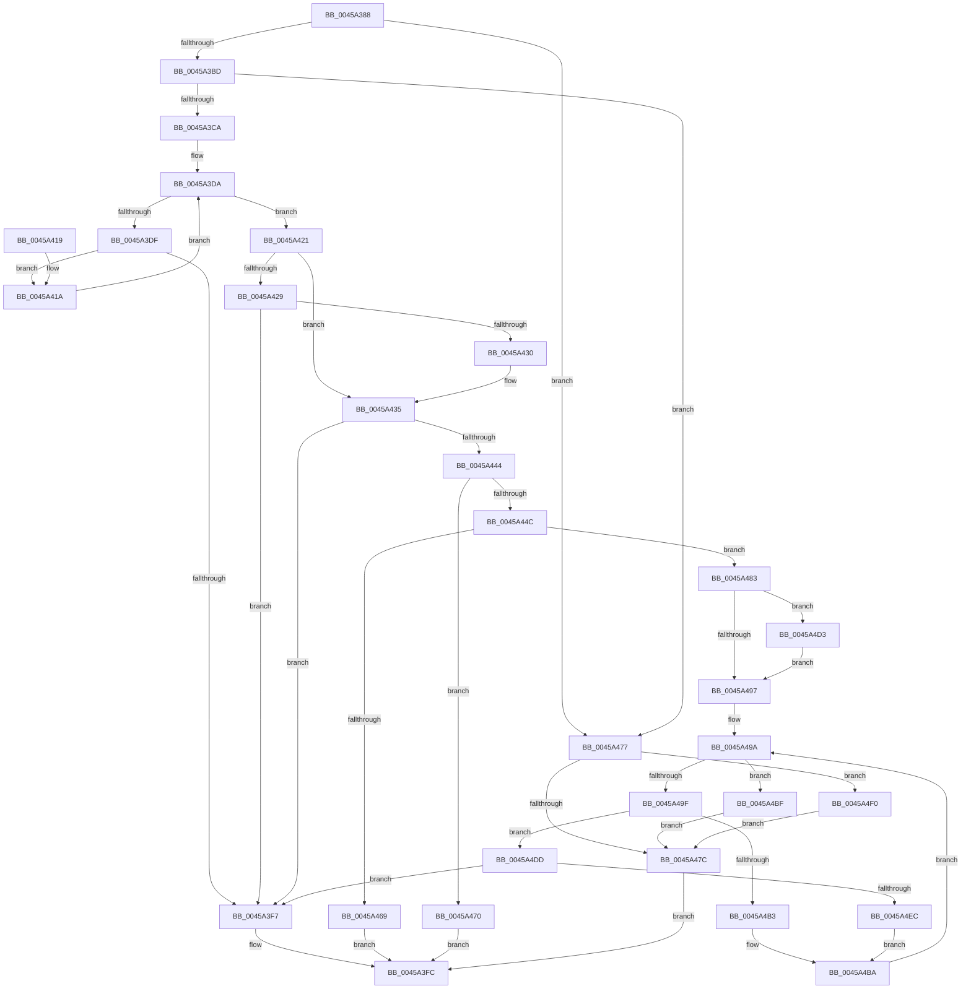

# AdtpBuildMultiSzStringListString

- RVA: `0x0045A388`–`0x0045A4FA` (길이 `370` bytes)
- VA: `0x000000014045A388`
- 실행 섹션: `.text`
- PDB 이름 있음: `예`; PDB Function 태그: `아니요`
- unwind 정보 RVA: `0x000A8F44`
- 디코드: `117`개 명령, `370/370` bytes 표시
- 미해석 바이트: `0` (있으면 어셈블리에 `.byte`로 보존)

> 이 문서는 커널 이미지의 기계어와 PDB 기호를 분석해 생성했습니다. 4번과 5번은 함수 원형과 자료형을 바이너리 사용 방식에서 추정한 C 해석이며 원본 소스 복구 결과는 아닙니다.

## 1. Dependencies

- 직접 호출 지점: **2**; 고유 호출 대상: **2**
- 직접 호출자로 확인된 함수: **1**
- RIP 상대 이미지 참조: **0**

### Outgoing calls
- `0x0045A459` → [ExAllocatePool2](../../poolcode/B8/ExAllocatePool2_function_00B820F0.md) (function, `0x00B820F0`)
- `0x0045A4F3` → [AdtpEtwBuildDashString](../../page/AA/AdtpEtwBuildDashString_function_00AAB7B0.md) (function, `0x00AAB7B0`)

### Direct callers
- [AdtpPackageParameters](AdtpPackageParameters_function_00459964.md) at `0x0045A05A`

### Static image references
- 디코드된 RIP-relative 메모리 참조가 없습니다.

## 2. Other-region calls and transfers

- 다른 실행 섹션으로 향하는 call: **2**
  - `0x0045A459` → [ExAllocatePool2](../../poolcode/B8/ExAllocatePool2_function_00B820F0.md) (`.text` → `POOLCODE`)
  - `0x0045A4F3` → [AdtpEtwBuildDashString](../../page/AA/AdtpEtwBuildDashString_function_00AAB7B0.md) (`.text` → `PAGE`)
- 별도 외부 분기/꼬리 이동을 확인하지 못했습니다.

## 3. Assembly (complete function range)

```asm
0045A388  48 89 5C 24 08                  mov qword ptr [rsp + 8], rbx
0045A38D  48 89 6C 24 10                  mov qword ptr [rsp + 0x10], rbp
0045A392  48 89 74 24 18                  mov qword ptr [rsp + 0x18], rsi
0045A397  57                              push rdi
0045A398  41 54                           push r12
0045A39A  41 55                           push r13
0045A39C  41 56                           push r14
0045A39E  41 57                           push r15
0045A3A0  48 83 EC 20                     sub rsp, 0x20
0045A3A4  33 C0                           xor eax, eax
0045A3A6  4D 8B E8                        mov r13, r8
0045A3A9  48 8B F2                        mov rsi, rdx
0045A3AC  4C 8B F9                        mov r15, rcx
0045A3AF  8B E8                           mov ebp, eax
0045A3B1  44 8B E0                        mov r12d, eax
0045A3B4  48 85 C9                        test rcx, rcx
0045A3B7  0F 84 BA 00 00 00               je 0x14045a477
0045A3BD  4C 8B 49 08                     mov r9, qword ptr [rcx + 8]
0045A3C1  4D 85 C9                        test r9, r9
0045A3C4  0F 84 AD 00 00 00               je 0x14045a477
0045A3CA  44 0F B7 31                     movzx r14d, word ptr [rcx]
0045A3CE  44 8D 40 01                     lea r8d, [rax + 1]
0045A3D2  41 D1 EE                        shr r14d, 1
0045A3D5  41 8B D8                        mov ebx, r8d
0045A3D8  8B D0                           mov edx, eax
0045A3DA  41 3B D6                        cmp edx, r14d
0045A3DD  73 42                           jae 0x14045a421
0045A3DF  8B C2                           mov eax, edx
0045A3E1  41 0F B7 0C 41                  movzx ecx, word ptr [r9 + rax*2]
0045A3E6  66 F7 D9                        neg cx
0045A3E9  1B C0                           sbb eax, eax
0045A3EB  83 E0 FD                        and eax, 0xfffffffd
0045A3EE  8D 48 04                        lea ecx, [rax + 4]
0045A3F1  03 CB                           add ecx, ebx
0045A3F3  3B CB                           cmp ecx, ebx
0045A3F5  73 23                           jae 0x14045a41a
0045A3F7  B8 95 00 00 C0                  mov eax, 0xc0000095
0045A3FC  48 8B 5C 24 50                  mov rbx, qword ptr [rsp + 0x50]
0045A401  48 8B 6C 24 58                  mov rbp, qword ptr [rsp + 0x58]
0045A406  48 8B 74 24 60                  mov rsi, qword ptr [rsp + 0x60]
0045A40B  48 83 C4 20                     add rsp, 0x20
0045A40F  41 5F                           pop r15
0045A411  41 5E                           pop r14
0045A413  41 5D                           pop r13
0045A415  41 5C                           pop r12
0045A417  5F                              pop rdi
0045A418  C3                              ret
0045A419  CC                              int3
0045A41A  8B D9                           mov ebx, ecx
0045A41C  41 03 D0                        add edx, r8d
0045A41F  EB B9                           jmp 0x14045a3da
0045A421  8D 43 FF                        lea eax, [rbx - 1]
0045A424  41 3B C6                        cmp eax, r14d
0045A427  76 0C                           jbe 0x14045a435
0045A429  8D 43 04                        lea eax, [rbx + 4]
0045A42C  3B C3                           cmp eax, ebx
0045A42E  72 C7                           jb 0x14045a3f7
0045A430  8B D8                           mov ebx, eax
0045A432  45 8B E0                        mov r12d, r8d
0045A435  8B FB                           mov edi, ebx
0045A437  B8 FF FF FF FF                  mov eax, 0xffffffff
0045A43C  48 03 FF                        add rdi, rdi
0045A43F  48 3B F8                        cmp rdi, rax
0045A442  77 B3                           ja 0x14045a3f7
0045A444  81 FF FF FF 00 00               cmp edi, 0xffff
0045A44A  77 24                           ja 0x14045a470
0045A44C  8B D7                           mov edx, edi
0045A44E  B9 00 01 00 00                  mov ecx, 0x100
0045A453  41 B8 53 65 41 6B               mov r8d, 0x6b416553
0045A459  E8 92 7C 72 00                  call 0x140b820f0
0045A45E  45 33 D2                        xor r10d, r10d
0045A461  48 8B D0                        mov rdx, rax
0045A464  48 85 C0                        test rax, rax
0045A467  75 1A                           jne 0x14045a483
0045A469  B8 17 00 00 C0                  mov eax, 0xc0000017
0045A46E  EB 8C                           jmp 0x14045a3fc
0045A470  B8 0D 00 00 C0                  mov eax, 0xc000000d
0045A475  EB 85                           jmp 0x14045a3fc
0045A477  48 85 F6                        test rsi, rsi
0045A47A  75 74                           jne 0x14045a4f0
0045A47C  33 C0                           xor eax, eax
0045A47E  E9 79 FF FF FF                  jmp 0x14045a3fc
0045A483  41 C6 45 00 01                  mov byte ptr [r13], 1
0045A488  49 BB 0D 00 0A 00 09 00 09 00   movabs r11, 0x90009000a000d
0045A492  45 85 E4                        test r12d, r12d
0045A495  75 3C                           jne 0x14045a4d3
0045A497  45 8B C2                        mov r8d, r10d
0045A49A  45 3B C6                        cmp r8d, r14d
0045A49D  73 20                           jae 0x14045a4bf
0045A49F  49 8B 47 08                     mov rax, qword ptr [r15 + 8]
0045A4A3  41 8B C8                        mov ecx, r8d
0045A4A6  44 0F B7 0C 48                  movzx r9d, word ptr [rax + rcx*2]
0045A4AB  8B C5                           mov eax, ebp
0045A4AD  66 45 85 C9                     test r9w, r9w
0045A4B1  74 2A                           je 0x14045a4dd
0045A4B3  66 44 89 0C 42                  mov word ptr [rdx + rax*2], r9w
0045A4B8  FF C5                           inc ebp
0045A4BA  41 FF C0                        inc r8d
0045A4BD  EB DB                           jmp 0x14045a49a
0045A4BF  8D 43 FF                        lea eax, [rbx - 1]
0045A4C2  66 44 89 14 42                  mov word ptr [rdx + rax*2], r10w
0045A4C7  48 89 16                        mov qword ptr [rsi], rdx
0045A4CA  89 7E 08                        mov dword ptr [rsi + 8], edi
0045A4CD  44 89 56 0C                     mov dword ptr [rsi + 0xc], r10d
0045A4D1  EB A9                           jmp 0x14045a47c
0045A4D3  4C 89 18                        mov qword ptr [rax], r11
0045A4D6  BD 04 00 00 00                  mov ebp, 4
0045A4DB  EB BA                           jmp 0x14045a497
0045A4DD  4C 89 1C 42                     mov qword ptr [rdx + rax*2], r11
0045A4E1  8D 45 04                        lea eax, [rbp + 4]
0045A4E4  3B C5                           cmp eax, ebp
0045A4E6  0F 82 0B FF FF FF               jb 0x14045a3f7
0045A4EC  8B E8                           mov ebp, eax
0045A4EE  EB CA                           jmp 0x14045a4ba
0045A4F0  48 8B CE                        mov rcx, rsi
0045A4F3  E8 B8 12 65 00                  call 0x140aab7b0
0045A4F8  EB 82                           jmp 0x14045a47c
```

## 4. C-style interpretation (structured pseudocode)

```c
__int64 __fastcall AdtpBuildMultiSzStringListString(__int64 a1, __int64 a2, __int64 a3)
{
    __int64 result;
    __int64 v_r10;
    __int64 v_r14;
    __int64 v_rbp;
    __int64 v_rdi;
    __int64 v_rsp;
    unsigned __int64 v_stack_p10;
    unsigned __int64 v_stack_p18;
    unsigned __int64 v_stack_p8;

    v_stack_p8 = v_rbx;
    v_stack_p10 = v_rbp;
    v_stack_p18 = v_rsi;
    v_rsp = (v_rsp) - (32);
    result = 0;
    if (a1 == 0) goto loc_0045A477;
    if (*(unsigned __int64 *)(a1 + 8) == 0) goto loc_0045A477;
    v_r14 = (unsigned int)((*(unsigned __int16 *)(a1)) >> (1));
loc_0045A3DA:
    if (0 >= ((unsigned int)(v_r14))) goto loc_0045A421;
    a1 = (unsigned __int16)(-(*(unsigned __int16 *)(*(unsigned __int64 *)(a1 + 8) + 0 * 2)));
    result = (unsigned int)((0) & (0xFFFFFFFDULL));
    a1 = (unsigned int)((result + 4) + ((unsigned int)((unsigned int)((unsigned int)(result + 1)))));
    if (((unsigned int)(a1)) >= ((unsigned int)((unsigned int)((unsigned int)(result + 1))))) goto loc_0045A41A;
loc_0045A3F7:
loc_0045A3FC:
    v_rsp = (v_rsp) + (32);
    return (unsigned int)(0xC0000095ULL);
loc_0045A41A:
    a2 = (unsigned int)((0) + ((unsigned int)(result + 1)));
    goto loc_0045A3DA;
loc_0045A421:
    if (((unsigned int)((unsigned int)((unsigned int)(a1)) - 1)) <= ((unsigned int)(v_r14))) goto loc_0045A435;
    if (((unsigned int)((unsigned int)((unsigned int)(a1)) + 4)) < ((unsigned int)((unsigned int)((unsigned int)(a1))))) goto loc_0045A3F7;
loc_0045A435:
    v_rdi = ((unsigned int)((unsigned int)((unsigned int)((unsigned int)((unsigned int)((unsigned int)(a1)) + 4))))) + ((unsigned int)((unsigned int)((unsigned int)((unsigned int)((unsigned int)((unsigned int)(a1)) + 4)))));
    if (v_rdi > ((unsigned int)(0xFFFFFFFFULL))) goto loc_0045A3F7;
    if (((unsigned int)(v_rdi)) > 0xFFFFULL) goto loc_0045A470;
    result = ExAllocatePool2(256, (unsigned int)((unsigned int)(v_rdi)), (unsigned int)(0x6B416553ULL), *(unsigned __int64 *)(a1 + 8));
    v_r10 = 0;
    if (result != 0) goto loc_0045A483;
    goto loc_0045A3FC;
loc_0045A470:
    goto loc_0045A3FC;
loc_0045A477:
    if (v_stack_p18 != 0) goto loc_0045A4F0;
loc_0045A47C:
    result = 0;
    goto loc_0045A3FC;
loc_0045A483:
    *(unsigned __int8 *)(a3) = 1;
    if ((unsigned int)((unsigned int)((unsigned int)(result + 1))) != 0) goto loc_0045A4D3;
loc_0045A497:
loc_0045A49A:
    if (0 >= ((unsigned int)(v_r14))) goto loc_0045A4BF;
    if ((unsigned __int16)(*(unsigned __int16 *)(*(unsigned __int64 *)(a1 + 8) + 0 * 2)) == 0) goto loc_0045A4DD;
    *(unsigned __int16 *)(result + (unsigned int)((unsigned int)(v_stack_p10)) * 2) = (unsigned __int16)(*(unsigned __int16 *)(*(unsigned __int64 *)(a1 + 8) + 0 * 2));
    v_rbp = (unsigned int)((v_stack_p10) + 1);
loc_0045A4BA:
    a3 = (unsigned int)((0) + 1);
    goto loc_0045A49A;
loc_0045A4BF:
    *(unsigned __int16 *)(result + (unsigned int)((unsigned int)((unsigned int)((unsigned int)(a1)) + 4)) - 1 * 2) = 0;
    *(unsigned __int64 *)(v_stack_p18) = 0;
    *(unsigned int *)(v_stack_p18 + 8) = (unsigned int)(v_rdi);
    *(unsigned int *)(v_stack_p18 + 12) = 0;
    goto loc_0045A47C;
loc_0045A4D3:
    *(unsigned __int64 *)((unsigned int)((unsigned int)((unsigned int)((unsigned int)(a1)) + 4)) - 1) = v_r11;
    goto loc_0045A497;
loc_0045A4DD:
    *(unsigned __int64 *)(result + (unsigned int)((unsigned int)((unsigned int)((unsigned int)(a1)) + 4)) - 1 * 2) = v_r11;
    if (((unsigned int)(4 + 4)) < 4) goto loc_0045A3F7;
    goto loc_0045A4BA;
loc_0045A4F0:
    result = AdtpEtwBuildDashString(v_stack_p18, result, a3, *(unsigned __int16 *)(*(unsigned __int64 *)(a1 + 8) + 0 * 2));
    goto loc_0045A47C;
}
```

## 5. (Beta) C Style

```c
int64_t AdtpBuildMultiSzStringListString(void *Arg1, void *Arg2, void *Arg3)
{
    uint8_t *arg1 = (uint8_t *)Arg1;
    uint8_t *arg2 = (uint8_t *)Arg2;
    uint8_t *arg3 = (uint8_t *)Arg3;

    int64_t result;
    int64_t local_r10;
    int64_t local_r14;
    int64_t local_rbp;
    int64_t local_rdi;
    int64_t local_rsp;
    uint64_t v_stack_p10;
    uint64_t v_stack_p18;
    uint64_t v_stack_p8;

    v_stack_p8 = local_rbx;
    v_stack_p10 = local_rbp;
    v_stack_p18 = local_rsi;
    local_rsp = (local_rsp) - (32);
    result = 0;
    if (Arg1 == NULL) goto loc_0045A477;
    if (*(uint64_t *)(arg1 + 0x8) == 0) goto loc_0045A477;
    local_r14 = (uint32_t)((*(uint16_t *)(arg1)) >> (1));
loc_0045A3DA:
    if (0 >= ((uint32_t)(local_r14))) goto loc_0045A421;
    Arg1 = (uint16_t)(-(*(uint16_t *)(*(uint64_t *)(arg1 + 0x8) + 0x0 * 2)));
    result = (uint32_t)((0) & (0xFFFFFFFDULL));
    Arg1 = (uint32_t)((result + 4) + ((uint32_t)((uint32_t)((uint32_t)(result + 1)))));
    if (((uint32_t)(Arg1)) >= ((uint32_t)((uint32_t)((uint32_t)(result + 1))))) goto loc_0045A41A;
loc_0045A3F7:
loc_0045A3FC:
    local_rsp = (local_rsp) + (32);
    return (uint32_t)(0xC0000095ULL);
loc_0045A41A:
    Arg2 = (uint32_t)((0) + ((uint32_t)(result + 1)));
    goto loc_0045A3DA;
loc_0045A421:
    if (((uint32_t)((uint32_t)((uint32_t)(Arg1)) - 1)) <= ((uint32_t)(local_r14))) goto loc_0045A435;
    if (((uint32_t)((uint32_t)((uint32_t)(Arg1)) + 4)) < ((uint32_t)((uint32_t)((uint32_t)(Arg1))))) goto loc_0045A3F7;
loc_0045A435:
    local_rdi = ((uint32_t)((uint32_t)((uint32_t)((uint32_t)((uint32_t)((uint32_t)(Arg1)) + 4))))) + ((uint32_t)((uint32_t)((uint32_t)((uint32_t)((uint32_t)((uint32_t)(Arg1)) + 4)))));
    if (local_rdi > ((uint32_t)(0xFFFFFFFFULL))) goto loc_0045A3F7;
    if (((uint32_t)(local_rdi)) > 0xFFFFULL) goto loc_0045A470;
    result = ExAllocatePool2(256, (uint32_t)((uint32_t)(local_rdi)), (uint32_t)(0x6B416553ULL), *(uint64_t *)(arg1 + 0x8));
    local_r10 = 0;
    if (result != 0) goto loc_0045A483;
    goto loc_0045A3FC;
loc_0045A470:
    goto loc_0045A3FC;
loc_0045A477:
    if (v_stack_p18 != 0) goto loc_0045A4F0;
loc_0045A47C:
    result = 0;
    goto loc_0045A3FC;
loc_0045A483:
    *(uint8_t *)(arg3) = 1;
    if ((uint32_t)((uint32_t)((uint32_t)(result + 1))) != 0) goto loc_0045A4D3;
loc_0045A497:
loc_0045A49A:
    if (0 >= ((uint32_t)(local_r14))) goto loc_0045A4BF;
    if ((uint16_t)(*(uint16_t *)(*(uint64_t *)(arg1 + 0x8) + 0x0 * 2)) == 0) goto loc_0045A4DD;
    *(uint16_t *)(result + (uint32_t)((uint32_t)(v_stack_p10)) * 2) = (uint16_t)(*(uint16_t *)(*(uint64_t *)(arg1 + 0x8) + 0x0 * 2));
    local_rbp = (uint32_t)((v_stack_p10) + 1);
loc_0045A4BA:
    Arg3 = (uint32_t)((0) + 1);
    goto loc_0045A49A;
loc_0045A4BF:
    *(uint16_t *)(result + (uint32_t)((uint32_t)((uint32_t)((uint32_t)(arg1)) + 0x4)) - 0x1 * 2) = 0;
    *(uint64_t *)(v_stack_p18) = 0;
    *(uint32_t *)(v_stack_p18 + 0x8) = (uint32_t)(local_rdi);
    *(uint32_t *)(v_stack_p18 + 0xC) = 0;
    goto loc_0045A47C;
loc_0045A4D3:
    *(uint64_t *)((uint32_t)((uint32_t)((uint32_t)((uint32_t)(arg1)) + 0x4)) - 0x1) = local_r11;
    goto loc_0045A497;
loc_0045A4DD:
    *(uint64_t *)(result + (uint32_t)((uint32_t)((uint32_t)((uint32_t)(arg1)) + 0x4)) - 0x1 * 2) = local_r11;
    if (((uint32_t)(4 + 4)) < 4) goto loc_0045A3F7;
    goto loc_0045A4BA;
loc_0045A4F0:
    result = AdtpEtwBuildDashString(v_stack_p18, result, Arg3, *(uint16_t *)(*(uint64_t *)(arg1 + 0x8) + 0x0 * 2));
    goto loc_0045A47C;
}
```

### 관측된 메모리 오프셋

구조체 형식이 확인되지 않은 접근은 인자 기준의 오프셋으로만 기록했습니다.

| 기준 인자 | 오프셋 표현 | 폭 (bit) | 접근 |
|---|---:|---:|---|
| `Arg1` | `+ 0x8` | `64` | `R` |
| `Arg2` | `+ 0x0` | `64` | `W` |
| `Arg2` | `+ 0x8` | `32` | `W` |
| `Arg2` | `+ 0xC` | `32` | `W` |
| `Arg3` | `+ 0x0` | `8` | `W` |

## 6. Execution-region graph

[열기: 2D/3D 그래프와 함수 탐색 컨트롤 패널](../../../control-panel.html?section=text&rva=0x0045A388&view=graph)

- 2D 그래프는 위에서 아래로 흐르고, 3D 그래프는 빈 공간을 드래그해 회전합니다. Shift+드래그는 이동, 휠은 확대·축소, 함수 노드 선택은 대상 보고서 이동입니다.

### Static fallback


