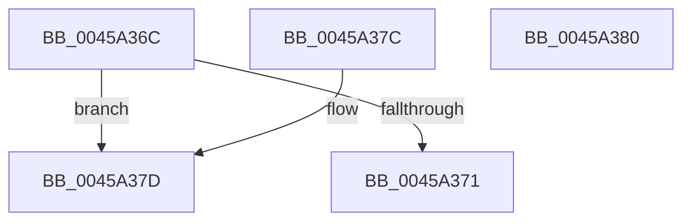

# AdtpIsCorrectlyFormedUnicodeString

- RVA: `0x0045A36C`–`0x0045A381` (길이 `21` bytes)
- VA: `0x000000014045A36C`
- 실행 섹션: `.text`
- PDB 이름 있음: `예`; PDB Function 태그: `아니요`
- unwind 정보 RVA: `0x000DB714`
- 디코드: `10`개 명령, `21/21` bytes 표시
- 미해석 바이트: `0` (있으면 어셈블리에 `.byte`로 보존)

> 이 문서는 커널 이미지의 기계어와 PDB 기호를 분석해 생성했습니다. 4번과 5번은 함수 원형과 자료형을 바이너리 사용 방식에서 추정한 C 해석이며 원본 소스 복구 결과는 아닙니다.

## 1. Dependencies

- 직접 호출 지점: **0**; 고유 호출 대상: **0**
- 직접 호출자로 확인된 함수: **1**
- RIP 상대 이미지 참조: **0**

### Outgoing calls
- 직접 디코드된 call 명령이 없습니다.

### Direct callers
- [AdtpPackageParameters](AdtpPackageParameters_function_00459964.md) at `0x00459C79`
- [AdtpPackageParameters](AdtpPackageParameters_function_00459964.md) at `0x00459E76`

### Static image references
- 디코드된 RIP-relative 메모리 참조가 없습니다.

## 2. Other-region calls and transfers

- 다른 실행 섹션으로 향하는 call: **0**
- 별도 외부 분기/꼬리 이동을 확인하지 못했습니다.

## 3. Assembly (complete function range)

```asm
0045A36C  48 85 C9                        test rcx, rcx
0045A36F  74 0C                           je 0x14045a37d
0045A371  0F B7 01                        movzx eax, word ptr [rcx]
0045A374  66 39 41 02                     cmp word ptr [rcx + 2], ax
0045A378  0F 93 C0                        setae al
0045A37B  C3                              ret
0045A37C  CC                              int3
0045A37D  B0 01                           mov al, 1
0045A37F  C3                              ret
0045A380  CC                              int3
```

## 4. C-style interpretation (structured pseudocode)

```c
__int64 __fastcall AdtpIsCorrectlyFormedUnicodeString(__int64 a1)
{
    __int64 result;

    if (a1 == 0) goto loc_0045A37D;
    result = ((*(unsigned __int16 *)(a1 + 2)) >= ((unsigned __int16)(*(unsigned __int16 *)(a1)))) ? 1 : 0;
    return result;
loc_0045A37D:
    return 1;
}
```

## 5. (Beta) C Style

```c
int64_t AdtpIsCorrectlyFormedUnicodeString(int64_t Arg1)
{
    int64_t result;

    if (Arg1 == 0) goto loc_0045A37D;
    result = ((*(uint16_t *)(Arg1 + 0x2)) >= ((uint16_t)(*(uint16_t *)(Arg1)))) ? 1 : 0;
    return result;
loc_0045A37D:
    return 1;
}
```

## 6. Execution-region graph

[열기: 2D/3D 그래프와 함수 탐색 컨트롤 패널](../../../control-panel.html?section=text&rva=0x0045A36C&view=graph)

- 2D 그래프는 위에서 아래로 흐르고, 3D 그래프는 빈 공간을 드래그해 회전합니다. Shift+드래그는 이동, 휠은 확대·축소, 함수 노드 선택은 대상 보고서 이동입니다.

### Static fallback


