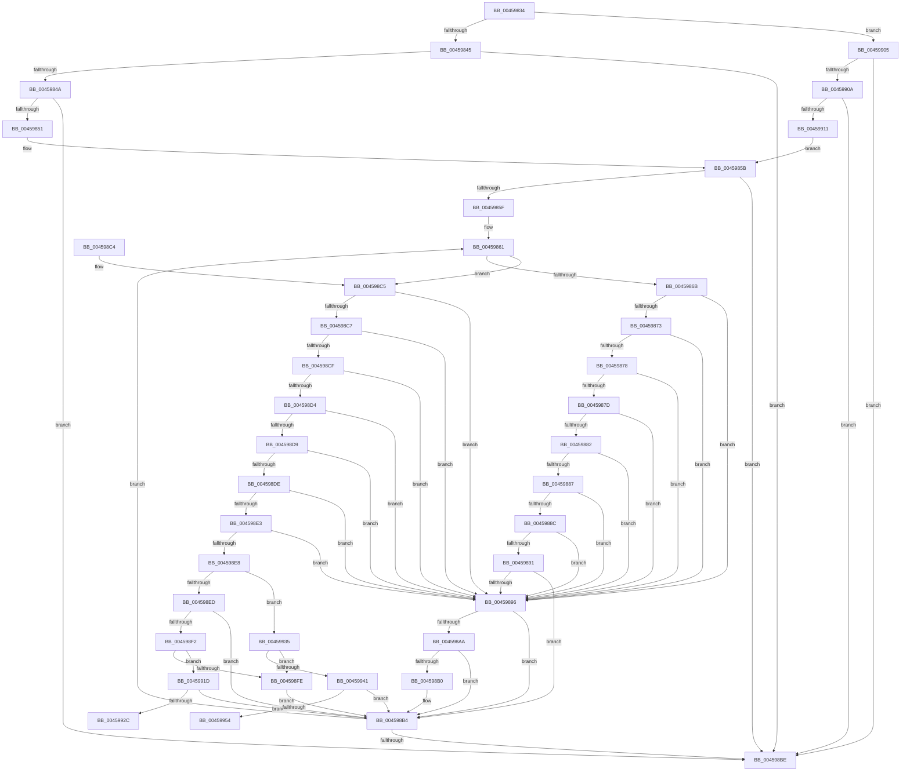

# AdtpNormalizeAuditInfoHelper

- RVA: `0x00459834`–`0x0045995D` (길이 `297` bytes)
- VA: `0x0000000140459834`
- 실행 섹션: `.text`
- PDB 이름 있음: `예`; PDB Function 태그: `예`
- unwind 정보 RVA: `0x000A8EFC`
- 디코드: `102`개 명령, `297/297` bytes 표시
- 미해석 바이트: `0` (있으면 어셈블리에 `.byte`로 보존)

> 이 문서는 커널 이미지의 기계어와 PDB 기호를 분석해 생성했습니다. 4번과 5번은 함수 원형과 자료형을 바이너리 사용 방식에서 추정한 C 해석이며 원본 소스 복구 결과는 아닙니다.

## 1. Dependencies

- 직접 호출 지점: **0**; 고유 호출 대상: **0**
- 직접 호출자로 확인된 함수: **2**
- RIP 상대 이미지 참조: **0**

### Outgoing calls
- 직접 디코드된 call 명령이 없습니다.

### Direct callers
- [AdtpWriteToEtwEx](AdtpWriteToEtwEx_function_004595EC.md) at `0x00459675`
- [AdtpWriteToEtw](../../page/AF/AdtpWriteToEtw_function_00AF98B0.md) at `0x00AF993B`

### Static image references
- 디코드된 RIP-relative 메모리 참조가 없습니다.

## 2. Other-region calls and transfers

- 다른 실행 섹션으로 향하는 call: **0**
- call이 아닌 외부 분기/꼬리 이동: **2**
  - `0x00459930` → [sub_006F1C14](../6F/Unknown_function_006F1C14.md) (`tail-transfer`)
  - `0x00459958` → [sub_006F1C14 + 0x14](../6F/Unknown_function_006F1C14.md) (`tail-transfer`)

## 3. Assembly (complete function range)

```asm
00459834  48 89 5C 24 08                  mov qword ptr [rsp + 8], rbx
00459839  4C 8B D1                        mov r10, rcx
0045983C  48 85 C9                        test rcx, rcx
0045983F  0F 84 C0 00 00 00               je 0x140459905
00459845  48 85 D2                        test rdx, rdx
00459848  75 74                           jne 0x1404598be
0045984A  8B 41 14                        mov eax, dword ptr [rcx + 0x14]
0045984D  A8 01                           test al, 1
0045984F  74 6D                           je 0x1404598be
00459851  8B 41 08                        mov eax, dword ptr [rcx + 8]
00459854  4C 8D 41 30                     lea r8, [rcx + 0x30]
00459858  48 8B D1                        mov rdx, rcx
0045985B  85 C0                           test eax, eax
0045985D  74 5F                           je 0x1404598be
0045985F  8B D8                           mov ebx, eax
00459861  45 8B 48 E8                     mov r9d, dword ptr [r8 - 0x18]
00459865  41 83 F9 17                     cmp r9d, 0x17
00459869  7E 5A                           jle 0x1404598c5
0045986B  41 8B C9                        mov ecx, r9d
0045986E  83 E9 18                        sub ecx, 0x18
00459871  74 23                           je 0x140459896
00459873  83 E9 01                        sub ecx, 1
00459876  74 1E                           je 0x140459896
00459878  83 E9 03                        sub ecx, 3
0045987B  74 19                           je 0x140459896
0045987D  83 E9 01                        sub ecx, 1
00459880  74 14                           je 0x140459896
00459882  83 E9 01                        sub ecx, 1
00459885  74 0F                           je 0x140459896
00459887  83 E9 01                        sub ecx, 1
0045988A  74 0A                           je 0x140459896
0045988C  83 E9 01                        sub ecx, 1
0045988F  74 05                           je 0x140459896
00459891  83 F9 02                        cmp ecx, 2
00459894  75 1E                           jne 0x1404598b4
00459896  49 8B 08                        mov rcx, qword ptr [r8]
00459899  41 8D 41 FF                     lea eax, [r9 - 1]
0045989D  48 03 CA                        add rcx, rdx
004598A0  49 89 08                        mov qword ptr [r8], rcx
004598A3  A9 DE FF FF FF                  test eax, 0xffffffde
004598A8  75 0A                           jne 0x1404598b4
004598AA  41 83 F9 21                     cmp r9d, 0x21
004598AE  74 04                           je 0x1404598b4
004598B0  48 01 51 08                     add qword ptr [rcx + 8], rdx
004598B4  49 83 C0 20                     add r8, 0x20
004598B8  48 83 EB 01                     sub rbx, 1
004598BC  75 A3                           jne 0x140459861
004598BE  48 8B 5C 24 08                  mov rbx, qword ptr [rsp + 8]
004598C3  C3                              ret
004598C4  CC                              int3
004598C5  74 CF                           je 0x140459896
004598C7  41 8B C9                        mov ecx, r9d
004598CA  83 E9 01                        sub ecx, 1
004598CD  74 C7                           je 0x140459896
004598CF  83 E9 01                        sub ecx, 1
004598D2  74 C2                           je 0x140459896
004598D4  83 E9 02                        sub ecx, 2
004598D7  74 BD                           je 0x140459896
004598D9  83 E9 04                        sub ecx, 4
004598DC  74 B8                           je 0x140459896
004598DE  83 E9 01                        sub ecx, 1
004598E1  74 B3                           je 0x140459896
004598E3  83 E9 04                        sub ecx, 4
004598E6  74 AE                           je 0x140459896
004598E8  83 E9 03                        sub ecx, 3
004598EB  74 48                           je 0x140459935
004598ED  83 F9 01                        cmp ecx, 1
004598F0  75 C2                           jne 0x1404598b4
004598F2  4D 01 10                        add qword ptr [r8], r10
004598F5  49 8B 00                        mov rax, qword ptr [r8]
004598F8  8B 08                           mov ecx, dword ptr [rax]
004598FA  85 C9                           test ecx, ecx
004598FC  75 1F                           jne 0x14045991d
004598FE  48 83 60 08 00                  and qword ptr [rax + 8], 0
00459903  EB AF                           jmp 0x1404598b4
00459905  48 85 D2                        test rdx, rdx
00459908  74 B4                           je 0x1404598be
0045990A  8B 42 18                        mov eax, dword ptr [rdx + 0x18]
0045990D  A8 01                           test al, 1
0045990F  74 AD                           je 0x1404598be
00459911  8B 42 0C                        mov eax, dword ptr [rdx + 0xc]
00459914  4C 8D 42 38                     lea r8, [rdx + 0x38]
00459918  E9 3E FF FF FF                  jmp 0x14045985b
0045991D  4C 01 50 08                     add qword ptr [rax + 8], r10
00459921  45 33 C9                        xor r9d, r9d
00459924  4C 8B 58 08                     mov r11, qword ptr [rax + 8]
00459928  85 C9                           test ecx, ecx
0045992A  74 88                           je 0x1404598b4
0045992C  49 8D 4B 08                     lea rcx, [r11 + 8]
00459930  E9 DF 82 29 00                  jmp 0x1406f1c14
00459935  49 01 10                        add qword ptr [r8], rdx
00459938  49 8B 00                        mov rax, qword ptr [r8]
0045993B  8B 08                           mov ecx, dword ptr [rax]
0045993D  85 C9                           test ecx, ecx
0045993F  74 BD                           je 0x1404598fe
00459941  48 01 50 08                     add qword ptr [rax + 8], rdx
00459945  45 33 C9                        xor r9d, r9d
00459948  4C 8B 58 08                     mov r11, qword ptr [rax + 8]
0045994C  85 C9                           test ecx, ecx
0045994E  0F 84 60 FF FF FF               je 0x1404598b4
00459954  49 8D 4B 10                     lea rcx, [r11 + 0x10]
00459958  E9 CB 82 29 00                  jmp 0x1406f1c28
```

## 4. C-style interpretation (structured pseudocode)

```c
__int64 __fastcall AdtpNormalizeAuditInfoHelper(__int64 a1, __int64 a2)
{
    __int64 v_rbx;
    unsigned __int64 v_stack_p8;

    v_stack_p8 = v_rbx;
    if (a1 == 0) goto loc_00459905;
    if (a2 != 0) goto loc_004598BE;
    if ((((unsigned __int8)((unsigned int)(*(unsigned int *)(a1 + 20)))) & (1)) == 0) goto loc_004598BE;
loc_0045985B:
    if ((unsigned int)((unsigned int)(*(unsigned int *)(a1 + 8))) == 0) goto loc_004598BE;
loc_00459861:
    if (((unsigned int)((unsigned int)(*(unsigned int *)(a1 + 48 - 24)))) <= 23) goto loc_004598C5;
    a1 = (unsigned int)(((unsigned int)((unsigned int)((unsigned int)(*(unsigned int *)(a1 + 48 - 24))))) - (24));
    if (condition_is_equal) goto loc_00459896;
    a1 = (unsigned int)((a1) - (1));
    if (condition_is_equal) goto loc_00459896;
    a1 = (unsigned int)((a1) - (3));
    if (condition_is_equal) goto loc_00459896;
    a1 = (unsigned int)((a1) - (1));
    if (condition_is_equal) goto loc_00459896;
    a1 = (unsigned int)((a1) - (1));
    if (condition_is_equal) goto loc_00459896;
    a1 = (unsigned int)((a1) - (1));
    if (condition_is_equal) goto loc_00459896;
    a1 = (unsigned int)((a1) - (1));
    if (condition_is_equal) goto loc_00459896;
    if (((unsigned int)(a1)) != 2) goto loc_004598B4;
loc_00459896:
    a1 = (*(unsigned __int64 *)(a1 + 48)) + (a1);
    *(unsigned __int64 *)(a1 + 48) = a1;
    if ((((unsigned int)((unsigned int)(*(unsigned int *)(a1 + 48 - 24)) - 1)) & (0xFFFFFFDEULL)) != 0) goto loc_004598B4;
    if (((unsigned int)((unsigned int)(*(unsigned int *)(a1 + 48 - 24)))) != 33) {
    }
    a3 = (a1 + 48) + (32);
    v_rbx = ((unsigned int)((unsigned int)((unsigned int)(*(unsigned int *)(a1 + 8))))) - (1);
    if (condition_is_not_equal) goto loc_00459861;
loc_004598BE:
    return (unsigned int)(*(unsigned int *)(a1 + 48 - 24)) - 1;
loc_004598C5:
    if (condition_is_equal) goto loc_00459896;
    a1 = (unsigned int)(((unsigned int)((unsigned int)((unsigned int)(*(unsigned int *)(a1 + 48 - 24))))) - (1));
    if (condition_is_equal) goto loc_00459896;
    a1 = (unsigned int)((a1) - (1));
    if (condition_is_equal) goto loc_00459896;
    a1 = (unsigned int)((a1) - (2));
    if (condition_is_equal) goto loc_00459896;
    a1 = (unsigned int)((a1) - (4));
    if (condition_is_equal) goto loc_00459896;
    a1 = (unsigned int)((a1) - (1));
    if (condition_is_equal) goto loc_00459896;
    a1 = (unsigned int)((a1) - (4));
    if (condition_is_equal) goto loc_00459896;
    a1 = (unsigned int)((a1) - (3));
    if (condition_is_equal) goto loc_00459935;
    if (((unsigned int)(a1)) != 1) goto loc_004598B4;
    if ((unsigned int)((unsigned int)(*(unsigned int *)(*(unsigned __int64 *)(a3)))) != 0) goto loc_0045991D;
loc_004598FE:
    goto loc_004598B4;
loc_00459905:
    if (a1 == 0) goto loc_004598BE;
    if ((((unsigned __int8)((unsigned int)(*(unsigned int *)(a1 + 24)))) & (1)) == 0) goto loc_004598BE;
    goto loc_0045985B;
loc_0045991D:
    a4 = 0;
    if ((unsigned int)((unsigned int)(*(unsigned int *)(*(unsigned __int64 *)(a3)))) == 0) goto loc_004598B4;
loc_00459935:
    if ((unsigned int)((unsigned int)(*(unsigned int *)(*(unsigned __int64 *)(a1 + 56)))) == 0) goto loc_004598FE;
    a4 = 0;
    if ((unsigned int)((unsigned int)(*(unsigned int *)(*(unsigned __int64 *)(a1 + 56)))) == 0) goto loc_004598B4;
}
```

## 5. (Beta) C Style

```c
int64_t AdtpNormalizeAuditInfoHelper(int64_t Arg1, int64_t Arg2)
{
    int64_t local_rbx;
    uint64_t v_stack_p8;

    v_stack_p8 = local_rbx;
    if (Arg1 == 0) goto loc_00459905;
    if (Arg2 != 0) goto loc_004598BE;
    if ((((uint8_t)((uint32_t)(*(uint32_t *)(Arg1 + 0x14)))) & (1)) == 0) goto loc_004598BE;
loc_0045985B:
    if ((uint32_t)((uint32_t)(*(uint32_t *)(Arg1 + 0x8))) == 0) goto loc_004598BE;
loc_00459861:
    if (((uint32_t)((uint32_t)(*(uint32_t *)(Arg1 + 0x30 - 0x18)))) <= 23) goto loc_004598C5;
    Arg1 = (uint32_t)(((uint32_t)((uint32_t)((uint32_t)(*(uint32_t *)(Arg1 + 0x30 - 0x18))))) - (24));
    if (condition_is_equal) goto loc_00459896;
    Arg1 = (uint32_t)((Arg1) - (1));
    if (condition_is_equal) goto loc_00459896;
    Arg1 = (uint32_t)((Arg1) - (3));
    if (condition_is_equal) goto loc_00459896;
    Arg1 = (uint32_t)((Arg1) - (1));
    if (condition_is_equal) goto loc_00459896;
    Arg1 = (uint32_t)((Arg1) - (1));
    if (condition_is_equal) goto loc_00459896;
    Arg1 = (uint32_t)((Arg1) - (1));
    if (condition_is_equal) goto loc_00459896;
    Arg1 = (uint32_t)((Arg1) - (1));
    if (condition_is_equal) goto loc_00459896;
    if (((uint32_t)(Arg1)) != 2) goto loc_004598B4;
loc_00459896:
    Arg1 = (*(uint64_t *)(Arg1 + 0x30)) + (Arg1);
    *(uint64_t *)(Arg1 + 0x30) = Arg1;
    if ((((uint32_t)((uint32_t)(*(uint32_t *)(Arg1 + 0x30 - 0x18)) - 1)) & (0xFFFFFFDEULL)) != 0) goto loc_004598B4;
    if (((uint32_t)((uint32_t)(*(uint32_t *)(Arg1 + 0x30 - 0x18)))) != 33) {
    }
    a3 = (Arg1 + 48) + (32);
    local_rbx = ((uint32_t)((uint32_t)((uint32_t)(*(uint32_t *)(Arg1 + 0x8))))) - (1);
    if (condition_is_not_equal) goto loc_00459861;
loc_004598BE:
    return (uint32_t)(*(uint32_t *)(Arg1 + 0x30 - 0x18)) - 1;
loc_004598C5:
    if (condition_is_equal) goto loc_00459896;
    Arg1 = (uint32_t)(((uint32_t)((uint32_t)((uint32_t)(*(uint32_t *)(Arg1 + 0x30 - 0x18))))) - (1));
    if (condition_is_equal) goto loc_00459896;
    Arg1 = (uint32_t)((Arg1) - (1));
    if (condition_is_equal) goto loc_00459896;
    Arg1 = (uint32_t)((Arg1) - (2));
    if (condition_is_equal) goto loc_00459896;
    Arg1 = (uint32_t)((Arg1) - (4));
    if (condition_is_equal) goto loc_00459896;
    Arg1 = (uint32_t)((Arg1) - (1));
    if (condition_is_equal) goto loc_00459896;
    Arg1 = (uint32_t)((Arg1) - (4));
    if (condition_is_equal) goto loc_00459896;
    Arg1 = (uint32_t)((Arg1) - (3));
    if (condition_is_equal) goto loc_00459935;
    if (((uint32_t)(Arg1)) != 1) goto loc_004598B4;
    if ((uint32_t)((uint32_t)(*(uint32_t *)(*(uint64_t *)(a3)))) != 0) goto loc_0045991D;
loc_004598FE:
    goto loc_004598B4;
loc_00459905:
    if (Arg1 == 0) goto loc_004598BE;
    if ((((uint8_t)((uint32_t)(*(uint32_t *)(Arg1 + 0x18)))) & (1)) == 0) goto loc_004598BE;
    goto loc_0045985B;
loc_0045991D:
    a4 = 0;
    if ((uint32_t)((uint32_t)(*(uint32_t *)(*(uint64_t *)(a3)))) == 0) goto loc_004598B4;
loc_00459935:
    if ((uint32_t)((uint32_t)(*(uint32_t *)(*(uint64_t *)(Arg1 + 0x38)))) == 0) goto loc_004598FE;
    a4 = 0;
    if ((uint32_t)((uint32_t)(*(uint32_t *)(*(uint64_t *)(Arg1 + 0x38)))) == 0) goto loc_004598B4;
}
```

## 6. Execution-region graph

[열기: 2D/3D 그래프와 함수 탐색 컨트롤 패널](../../../control-panel.html?section=text&rva=0x00459834&view=graph)

- 2D 그래프는 위에서 아래로 흐르고, 3D 그래프는 빈 공간을 드래그해 회전합니다. Shift+드래그는 이동, 휠은 확대·축소, 함수 노드 선택은 대상 보고서 이동입니다.

### Static fallback


