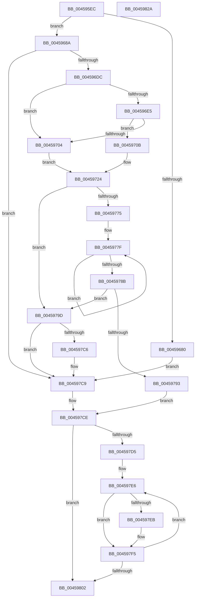

# AdtpWriteToEtwEx

- RVA: `0x004595EC`–`0x0045982B` (길이 `575` bytes)
- VA: `0x00000001404595EC`
- 실행 섹션: `.text`
- PDB 이름 있음: `예`; PDB Function 태그: `아니요`
- unwind 정보 RVA: `0x000A8ED8`
- 디코드: `141`개 명령, `575/575` bytes 표시
- 미해석 바이트: `0` (있으면 어셈블리에 `.byte`로 보존)

> 이 문서는 커널 이미지의 기계어와 PDB 기호를 분석해 생성했습니다. 4번과 5번은 함수 원형과 자료형을 바이너리 사용 방식에서 추정한 C 해석이며 원본 소스 복구 결과는 아닙니다.

## 1. Dependencies

- 직접 호출 지점: **8**; 고유 호출 대상: **7**
- 직접 호출자로 확인된 함수: **1**
- RIP 상대 이미지 참조: **1**

### Outgoing calls
- `0x0045963E` → [memset](../6C/memset_function_006C6C40.md) (function, `0x006C6C40`)
- `0x00459650` → [memset](../6C/memset_function_006C6C40.md) (function, `0x006C6C40`)
- `0x00459675` → [AdtpNormalizeAuditInfoHelper](AdtpNormalizeAuditInfoHelper_function_00459834.md) (function, `0x00459834`)
- `0x004596CD` → [AdtpPackageParameters](AdtpPackageParameters_function_00459964.md) (function, `0x00459964`)
- `0x004596FB` → [AdtpGetCategoryAndSubCategoryId](../../page/A5/AdtpGetCategoryAndSubCategoryId_function_00A57588.md) (function, `0x00A57588`)
- `0x004597B8` → [EtwWriteKMSecurityEvent](../22/EtwWriteKMSecurityEvent_function_00225B8C.md) (function, `0x00225B8C`)
- `0x004597F0` → [ExFreePoolWithTag](../../poolcode/B8/ExFreePoolWithTag_function_00B82870.md) (function, `0x00B82870`)
- `0x0045980E` → [_security_check_cookie](../6A/_security_check_cookie_function_006AC640.md) (function, `0x006AC640`)

### Direct callers
- [SeAuditPlugAndPlay](../../page/A8/SeAuditPlugAndPlay_function_00A86BA0.md) at `0x00A86F26`

### Static image references
- `0x00459607` → RVA `0x00E0A740` (`.data`; read)

## 2. Other-region calls and transfers

- 다른 실행 섹션으로 향하는 call: **2**
  - `0x004596FB` → [AdtpGetCategoryAndSubCategoryId](../../page/A5/AdtpGetCategoryAndSubCategoryId_function_00A57588.md) (`.text` → `PAGE`)
  - `0x004597F0` → [ExFreePoolWithTag](../../poolcode/B8/ExFreePoolWithTag_function_00B82870.md) (`.text` → `POOLCODE`)
- 별도 외부 분기/꼬리 이동을 확인하지 못했습니다.

## 3. Assembly (complete function range)

```asm
004595EC  48 89 5C 24 18                  mov qword ptr [rsp + 0x18], rbx
004595F1  55                              push rbp
004595F2  56                              push rsi
004595F3  57                              push rdi
004595F4  41 56                           push r14
004595F6  41 57                           push r15
004595F8  48 8D AC 24 20 F4 FF FF         lea rbp, [rsp - 0xbe0]
00459600  48 81 EC E0 0C 00 00            sub rsp, 0xce0
00459607  48 8B 05 32 11 9B 00            mov rax, qword ptr [rip + 0x9b1132]
0045960E  48 33 C4                        xor rax, rsp
00459611  48 89 85 D0 0B 00 00            mov qword ptr [rbp + 0xbd0], rax
00459618  48 8B F2                        mov rsi, rdx
0045961B  48 8B F9                        mov rdi, rcx
0045961E  0F 57 C0                        xorps xmm0, xmm0
00459621  48 8D 8D D0 03 00 00            lea rcx, [rbp + 0x3d0]
00459628  45 33 FF                        xor r15d, r15d
0045962B  33 D2                           xor edx, edx
0045962D  41 B8 00 08 00 00               mov r8d, 0x800
00459633  66 44 89 7C 24 40               mov word ptr [rsp + 0x40], r15w
00459639  0F 11 44 24 50                  movups xmmword ptr [rsp + 0x50], xmm0
0045963E  E8 FD D5 26 00                  call 0x1406c6c40
00459643  33 D2                           xor edx, edx
00459645  48 8D 4C 24 60                  lea rcx, [rsp + 0x60]
0045964A  41 B8 40 01 00 00               mov r8d, 0x140
00459650  E8 EB D5 26 00                  call 0x1406c6c40
00459655  0F 57 C0                        xorps xmm0, xmm0
00459658  44 88 3E                        mov byte ptr [rsi], r15b
0045965B  48 8B D7                        mov rdx, rdi
0045965E  33 C9                           xor ecx, ecx
00459660  0F 11 85 A0 03 00 00            movups xmmword ptr [rbp + 0x3a0], xmm0
00459667  0F 11 85 B0 03 00 00            movups xmmword ptr [rbp + 0x3b0], xmm0
0045966E  0F 11 85 C0 03 00 00            movups xmmword ptr [rbp + 0x3c0], xmm0
00459675  E8 BA 01 00 00                  call 0x140459834
0045967A  4C 39 7F 38                     cmp qword ptr [rdi + 0x38], r15
0045967E  75 0A                           jne 0x14045968a
00459680  BB 0D 00 00 C0                  mov ebx, 0xc000000d
00459685  E9 3F 01 00 00                  jmp 0x1404597c9
0045968A  44 0F B7 77 16                  movzx r14d, word ptr [rdi + 0x16]
0045968F  48 8D 85 A0 03 00 00            lea rax, [rbp + 0x3a0]
00459696  48 89 44 24 38                  mov qword ptr [rsp + 0x38], rax
0045969B  4C 8D 8D D0 03 00 00            lea r9, [rbp + 0x3d0]
004596A2  48 8D 44 24 40                  lea rax, [rsp + 0x40]
004596A7  41 B8 02 00 00 00               mov r8d, 2
004596AD  48 89 44 24 30                  mov qword ptr [rsp + 0x30], rax
004596B2  48 8B D7                        mov rdx, rdi
004596B5  48 8D 85 A0 00 00 00            lea rax, [rbp + 0xa0]
004596BC  33 C9                           xor ecx, ecx
004596BE  48 89 44 24 28                  mov qword ptr [rsp + 0x28], rax
004596C3  48 8D 44 24 60                  lea rax, [rsp + 0x60]
004596C8  48 89 44 24 20                  mov qword ptr [rsp + 0x20], rax
004596CD  E8 92 02 00 00                  call 0x140459964
004596D2  8B D8                           mov ebx, eax
004596D4  85 C0                           test eax, eax
004596D6  0F 88 ED 00 00 00               js 0x1404597c9
004596DC  0F B7 47 14                     movzx eax, word ptr [rdi + 0x14]
004596E0  66 85 C0                        test ax, ax
004596E3  74 1F                           je 0x140459704
004596E5  8B C8                           mov ecx, eax
004596E7  44 89 7C 24 44                  mov dword ptr [rsp + 0x44], r15d
004596EC  4C 8D 44 24 48                  lea r8, [rsp + 0x48]
004596F1  44 89 7C 24 48                  mov dword ptr [rsp + 0x48], r15d
004596F6  48 8D 54 24 44                  lea rdx, [rsp + 0x44]
004596FB  E8 88 DE 5F 00                  call 0x140a57588
00459700  85 C0                           test eax, eax
00459702  79 07                           jns 0x14045970b
00459704  BA 00 FF 00 00                  mov edx, 0xff00
00459709  EB 19                           jmp 0x140459724
0045970B  0F B7 4C 24 44                  movzx ecx, word ptr [rsp + 0x44]
00459710  B8 00 01 00 00                  mov eax, 0x100
00459715  66 83 C1 30                     add cx, 0x30
00459719  0F B7 D1                        movzx edx, cx
0045971C  0F AF D0                        imul edx, eax
0045971F  66 03 54 24 48                  add dx, word ptr [rsp + 0x48]
00459724  0F B7 47 04                     movzx eax, word ptr [rdi + 4]
00459728  66 41 83 FE 08                  cmp r14w, 8
0045972D  66 89 44 24 50                  mov word ptr [rsp + 0x50], ax
00459732  48 B9 00 00 00 00 00 00 10 80   movabs rcx, 0x8010000000000000
0045973C  8A 47 08                        mov al, byte ptr [rdi + 8]
0045973F  88 44 24 52                     mov byte ptr [rsp + 0x52], al
00459743  48 B8 00 00 00 00 00 00 20 80   movabs rax, 0x8020000000000000
0045974D  48 0F 45 C1                     cmovne rax, rcx
00459751  66 89 54 24 56                  mov word ptr [rsp + 0x56], dx
00459756  0F B7 4C 24 40                  movzx ecx, word ptr [rsp + 0x40]
0045975B  41 8B D7                        mov edx, r15d
0045975E  66 C7 44 24 53 0A 00            mov word ptr [rsp + 0x53], 0xa
00459765  44 88 7C 24 55                  mov byte ptr [rsp + 0x55], r15b
0045976A  48 89 44 24 58                  mov qword ptr [rsp + 0x58], rax
0045976F  66 44 3B F9                     cmp r15w, cx
00459773  73 28                           jae 0x14045979d
00459775  48 8D 85 A8 00 00 00            lea rax, [rbp + 0xa8]
0045977C  44 8B C1                        mov r8d, ecx
0045977F  03 10                           add edx, dword ptr [rax]
00459781  48 8D 40 10                     lea rax, [rax + 0x10]
00459785  49 83 E8 01                     sub r8, 1
00459789  75 F4                           jne 0x14045977f
0045978B  81 FA 00 DC 00 00               cmp edx, 0xdc00
00459791  76 0A                           jbe 0x14045979d
00459793  C6 06 01                        mov byte ptr [rsi], 1
00459796  BB 05 00 00 80                  mov ebx, 0x80000005
0045979B  EB 31                           jmp 0x1404597ce
0045979D  0F B7 C1                        movzx eax, cx
004597A0  44 8B C1                        mov r8d, ecx
004597A3  66 F7 D8                        neg ax
004597A6  48 8D 4C 24 50                  lea rcx, [rsp + 0x50]
004597AB  48 8D 85 A0 00 00 00            lea rax, [rbp + 0xa0]
004597B2  4D 1B C9                        sbb r9, r9
004597B5  4C 23 C8                        and r9, rax
004597B8  E8 CF C3 DC FF                  call 0x140225b8c
004597BD  8B D8                           mov ebx, eax
004597BF  3D FE 02 00 C0                  cmp eax, 0xc00002fe
004597C4  75 03                           jne 0x1404597c9
004597C6  C6 06 01                        mov byte ptr [rsi], 1
004597C9  0F B7 4C 24 40                  movzx ecx, word ptr [rsp + 0x40]
004597CE  0F B7 C1                        movzx eax, cx
004597D1  85 C0                           test eax, eax
004597D3  74 2D                           je 0x140459802
004597D5  48 8D BD A0 03 00 00            lea rdi, [rbp + 0x3a0]
004597DC  44 8B F0                        mov r14d, eax
004597DF  48 8D B5 A0 00 00 00            lea rsi, [rbp + 0xa0]
004597E6  44 38 3F                        cmp byte ptr [rdi], r15b
004597E9  74 0A                           je 0x1404597f5
004597EB  48 8B 0E                        mov rcx, qword ptr [rsi]
004597EE  33 D2                           xor edx, edx
004597F0  E8 7B 90 72 00                  call 0x140b82870
004597F5  48 FF C7                        inc rdi
004597F8  48 83 C6 10                     add rsi, 0x10
004597FC  49 83 EE 01                     sub r14, 1
00459800  75 E4                           jne 0x1404597e6
00459802  8B C3                           mov eax, ebx
00459804  48 8B 8D D0 0B 00 00            mov rcx, qword ptr [rbp + 0xbd0]
0045980B  48 33 CC                        xor rcx, rsp
0045980E  E8 2D 2E 25 00                  call 0x1406ac640
00459813  48 8B 9C 24 20 0D 00 00         mov rbx, qword ptr [rsp + 0xd20]
0045981B  48 81 C4 E0 0C 00 00            add rsp, 0xce0
00459822  41 5F                           pop r15
00459824  41 5E                           pop r14
00459826  5F                              pop rdi
00459827  5E                              pop rsi
00459828  5D                              pop rbp
00459829  C3                              ret
0045982A  CC                              int3
```

## 4. C-style interpretation (structured pseudocode)

```c
__int64 __fastcall AdtpWriteToEtwEx(__int64 a1, __int64 a2)
{
    __int64 result;
    __int64 v_r14;
    __int64 v_r15;
    __int64 v_rdi;
    __int64 v_rsi;
    __int64 v_rsp;
    unsigned __int64 v_stack_m38;
    unsigned __int64 v_stack_m838;
    unsigned __int64 v_stack_m848;
    unsigned __int64 v_stack_m858;
    unsigned __int64 v_stack_m868;
    unsigned __int64 v_stack_mB60;
    unsigned __int64 v_stack_mB68;
    unsigned __int64 v_stack_mC08;
    unsigned __int64 v_stack_mCA8;
    unsigned __int64 v_stack_mCB0;
    unsigned __int16 v_stack_mCB2;
    unsigned __int8 v_stack_mCB3;
    unsigned __int16 v_stack_mCB5;
    unsigned __int8 v_stack_mCB6;
    unsigned __int64 v_stack_mCB8;
    unsigned __int64 v_stack_mCC0;
    unsigned int v_stack_mCC4;
    unsigned __int16 v_stack_mCC8;
    unsigned __int64 v_stack_mCD0;
    unsigned __int64 v_stack_mCD8;
    unsigned __int64 v_stack_mCE0;
    unsigned __int64 v_stack_mCE8;
    unsigned __int64 v_stack_p18;

    v_stack_p18 = v_rbx;
    v_rsp = (v_rsp) - (0xCE0ULL);
    result = (*(unsigned __int64 *)(v_rip + 10162482)) ^ (v_rsp);
    v_stack_m38 = result;
    v_r15 = 0;
    a2 = 0;
    v_stack_mCC8 = 0;
    v_stack_mCB8 = v_xmm0;
    result = memset(v_stack_m838, a2, (unsigned int)(0x800ULL), a4);
    a2 = 0;
    result = memset(v_stack_mCA8, a2, 320, a4);
    *(unsigned __int8 *)(a2) = 0;
    a1 = 0;
    v_stack_m868 = v_xmm0;
    v_stack_m858 = v_xmm0;
    v_stack_m848 = v_xmm0;
    result = AdtpNormalizeAuditInfoHelper(a1, a1, 320, a4);
    if ((*(unsigned __int64 *)(a1 + 56)) != 0) goto loc_0045968A;
    goto loc_004597C9;
loc_0045968A:
    v_stack_mCD0 = v_stack_m868;
    v_stack_mCD8 = v_stack_mCC8;
    a1 = 0;
    v_stack_mCE0 = v_stack_mB68;
    v_stack_mCE8 = v_stack_mCA8;
    result = AdtpPackageParameters(a1, 0, 2, v_stack_m838);
    if (sign_flag) goto loc_004597C9;
    if ((unsigned __int16)(*(unsigned __int16 *)(a1 + 20)) == 0) goto loc_00459704;
    v_stack_mCC4 = 0;
    v_stack_mCC0 = 0;
    result = AdtpGetCategoryAndSubCategoryId((unsigned int)((unsigned int)(*(unsigned __int16 *)(a1 + 20))), v_stack_mCC4, v_stack_mCC0, v_stack_m838);
    if (!sign_flag) goto loc_0045970B;
loc_00459704:
    goto loc_00459724;
loc_0045970B:
    a1 = (unsigned __int16)((v_stack_mCC4) + (48));
    a2 = (unsigned int)(((unsigned __int16)(a1)) * (256));
    a2 = (unsigned __int16)((a2) + (v_stack_mCC0));
loc_00459724:
    v_stack_mCB8 = (unsigned __int16)(*(unsigned __int16 *)(a1 + 4));
    v_stack_mCB6 = (unsigned __int8)(*(unsigned __int8 *)(a1 + 8));
    result = *(unsigned __int8 *)(a1 + 8);
    if (((unsigned __int16)(*(unsigned __int16 *)(a1 + 22))) != 8) { result = a1; }
    v_stack_mCB2 = (unsigned __int16)(a2);
    v_stack_mCB5 = 10;
    v_stack_mCB3 = 0;
    v_stack_mCB0 = result;
    if (0 >= ((unsigned __int16)(v_stack_mCC8))) goto loc_0045979D;
loc_0045977F:
    a2 = (unsigned int)((0) + (*(unsigned int *)(v_stack_mB60)));
    a3 = ((unsigned int)((unsigned int)(v_stack_mCC8))) - (1);
    if (condition_is_not_equal) goto loc_0045977F;
    if (((unsigned int)(a2)) <= 0xDC00ULL) goto loc_0045979D;
    *(unsigned __int8 *)(a2) = 1;
    goto loc_004597CE;
loc_0045979D:
    result = (unsigned __int16)(-((unsigned __int16)(v_stack_mCC8)));
    a4 = (v_stack_m838) & (v_stack_mB68);
    result = EtwWriteKMSecurityEvent(v_stack_mCB8, a2, (unsigned int)((unsigned int)(v_stack_mCC8)), a4);
    if (((unsigned int)(result)) == 0xC00002FEULL) {
        *(unsigned __int8 *)(a2) = 1;
    }
loc_004597CE:
    if ((unsigned int)((unsigned __int16)(v_stack_mCC8)) == 0) goto loc_00459802;
loc_004597E6:
    result = (unsigned __int16)(v_stack_mCC8);
    if ((*(unsigned __int8 *)(v_stack_m868)) != 0) {
        a1 = *(unsigned __int64 *)(v_stack_mB68);
        a2 = 0;
        result = ExFreePoolWithTag(a1, a2, (unsigned int)((unsigned int)(v_stack_mCC8)), a4);
    }
    v_rdi = (v_stack_m868) + 1;
    v_rsi = (v_stack_mB68) + (16);
    v_r14 = ((unsigned int)((unsigned int)((unsigned __int16)(v_stack_mCC8)))) - (1);
    if (condition_is_not_equal) goto loc_004597E6;
loc_00459802:
    a1 = (v_stack_m38) ^ (v_rsp);
    result = _security_check_cookie(a1, a2, (unsigned int)((unsigned int)(v_stack_mCC8)), a4);
    v_rsp = (v_rsp) + (0xCE0ULL);
    return result;
}
```

## 5. (Beta) C Style

```c
int64_t AdtpWriteToEtwEx(void *Arg1, void *Arg2)
{
    uint8_t *arg1 = (uint8_t *)Arg1;
    uint8_t *arg2 = (uint8_t *)Arg2;

    int64_t result;
    int64_t local_r14;
    int64_t local_r15;
    int64_t local_rdi;
    int64_t local_rsi;
    int64_t local_rsp;
    uint64_t v_stack_m38;
    uint64_t v_stack_m838;
    uint64_t v_stack_m848;
    uint64_t v_stack_m858;
    uint64_t v_stack_m868;
    uint64_t v_stack_mB60;
    uint64_t v_stack_mB68;
    uint64_t v_stack_mC08;
    uint64_t v_stack_mCA8;
    uint64_t v_stack_mCB0;
    uint16_t v_stack_mCB2;
    uint8_t v_stack_mCB3;
    uint16_t v_stack_mCB5;
    uint8_t v_stack_mCB6;
    uint64_t v_stack_mCB8;
    uint64_t v_stack_mCC0;
    uint32_t v_stack_mCC4;
    uint16_t v_stack_mCC8;
    uint64_t v_stack_mCD0;
    uint64_t v_stack_mCD8;
    uint64_t v_stack_mCE0;
    uint64_t v_stack_mCE8;
    uint64_t v_stack_p18;

    v_stack_p18 = local_rbx;
    local_rsp = (local_rsp) - (0xCE0ULL);
    result = (*(uint64_t *)(v_rip + 0x9B1132)) ^ (local_rsp);
    v_stack_m38 = result;
    local_r15 = 0;
    Arg2 = 0;
    v_stack_mCC8 = 0;
    v_stack_mCB8 = v_xmm0;
    result = memset(v_stack_m838, Arg2, (uint32_t)(0x800ULL), a4);
    Arg2 = 0;
    result = memset(v_stack_mCA8, Arg2, 320, a4);
    *(uint8_t *)(arg2) = 0;
    Arg1 = 0;
    v_stack_m868 = v_xmm0;
    v_stack_m858 = v_xmm0;
    v_stack_m848 = v_xmm0;
    result = AdtpNormalizeAuditInfoHelper(Arg1, Arg1, 320, a4);
    if ((*(uint64_t *)(arg1 + 0x38)) != 0) goto loc_0045968A;
    goto loc_004597C9;
loc_0045968A:
    v_stack_mCD0 = v_stack_m868;
    v_stack_mCD8 = v_stack_mCC8;
    Arg1 = 0;
    v_stack_mCE0 = v_stack_mB68;
    v_stack_mCE8 = v_stack_mCA8;
    result = AdtpPackageParameters(Arg1, 0, 2, v_stack_m838);
    if (sign_flag) goto loc_004597C9;
    if ((uint16_t)(*(uint16_t *)(arg1 + 0x14)) == 0) goto loc_00459704;
    v_stack_mCC4 = 0;
    v_stack_mCC0 = 0;
    result = AdtpGetCategoryAndSubCategoryId((uint32_t)((uint32_t)(*(uint16_t *)(arg1 + 0x14))), v_stack_mCC4, v_stack_mCC0, v_stack_m838);
    if (!sign_flag) goto loc_0045970B;
loc_00459704:
    goto loc_00459724;
loc_0045970B:
    Arg1 = (uint16_t)((v_stack_mCC4) + (48));
    Arg2 = (uint32_t)(((uint16_t)(Arg1)) * (256));
    Arg2 = (uint16_t)((Arg2) + (v_stack_mCC0));
loc_00459724:
    v_stack_mCB8 = (uint16_t)(*(uint16_t *)(arg1 + 0x4));
    v_stack_mCB6 = (uint8_t)(*(uint8_t *)(arg1 + 0x8));
    result = *(uint8_t *)(arg1 + 0x8);
    if (((uint16_t)(*(uint16_t *)(arg1 + 0x16))) != 8) { result = Arg1; }
    v_stack_mCB2 = (uint16_t)(Arg2);
    v_stack_mCB5 = 10;
    v_stack_mCB3 = 0;
    v_stack_mCB0 = result;
    if (0 >= ((uint16_t)(v_stack_mCC8))) goto loc_0045979D;
loc_0045977F:
    Arg2 = (uint32_t)((0) + (*(uint32_t *)(v_stack_mB60)));
    a3 = ((uint32_t)((uint32_t)(v_stack_mCC8))) - (1);
    if (condition_is_not_equal) goto loc_0045977F;
    if (((uint32_t)(Arg2)) <= 0xDC00ULL) goto loc_0045979D;
    *(uint8_t *)(arg2) = 1;
    goto loc_004597CE;
loc_0045979D:
    result = (uint16_t)(-((uint16_t)(v_stack_mCC8)));
    a4 = (v_stack_m838) & (v_stack_mB68);
    result = EtwWriteKMSecurityEvent(v_stack_mCB8, Arg2, (uint32_t)((uint32_t)(v_stack_mCC8)), a4);
    if (((uint32_t)(result)) == 0xC00002FEULL) {
        *(uint8_t *)(arg2) = 1;
    }
loc_004597CE:
    if ((uint32_t)((uint16_t)(v_stack_mCC8)) == 0) goto loc_00459802;
loc_004597E6:
    result = (uint16_t)(v_stack_mCC8);
    if ((*(uint8_t *)(v_stack_m868)) != 0) {
        Arg1 = *(uint64_t *)(v_stack_mB68);
        Arg2 = 0;
        result = ExFreePoolWithTag(Arg1, Arg2, (uint32_t)((uint32_t)(v_stack_mCC8)), a4);
    }
    local_rdi = (v_stack_m868) + 1;
    local_rsi = (v_stack_mB68) + (16);
    local_r14 = ((uint32_t)((uint32_t)((uint16_t)(v_stack_mCC8)))) - (1);
    if (condition_is_not_equal) goto loc_004597E6;
loc_00459802:
    Arg1 = (v_stack_m38) ^ (local_rsp);
    result = _security_check_cookie(Arg1, Arg2, (uint32_t)((uint32_t)(v_stack_mCC8)), a4);
    local_rsp = (local_rsp) + (0xCE0ULL);
    return result;
}
```

### 관측된 메모리 오프셋

구조체 형식이 확인되지 않은 접근은 인자 기준의 오프셋으로만 기록했습니다.

| 기준 인자 | 오프셋 표현 | 폭 (bit) | 접근 |
|---|---:|---:|---|
| `Arg1` | `+ 0x4` | `16` | `R` |
| `Arg1` | `+ 0x8` | `8` | `R` |
| `Arg1` | `+ 0x14` | `16` | `R` |
| `Arg1` | `+ 0x16` | `16` | `R` |
| `Arg1` | `+ 0x38` | `64` | `R` |
| `Arg2` | `+ 0x0` | `8` | `W` |

## 6. Execution-region graph

[열기: 2D/3D 그래프와 함수 탐색 컨트롤 패널](../../../control-panel.html?section=text&rva=0x004595EC&view=graph)

- 2D 그래프는 위에서 아래로 흐르고, 3D 그래프는 빈 공간을 드래그해 회전합니다. Shift+드래그는 이동, 휠은 확대·축소, 함수 노드 선택은 대상 보고서 이동입니다.

### Static fallback


