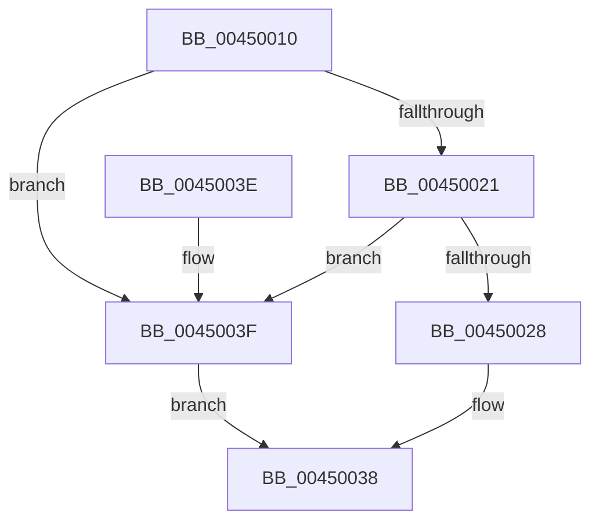

# AlpcGetMessageAttribute

- RVA: `0x00450010`–`0x00450043` (길이 `51` bytes)
- VA: `0x0000000140450010`
- 실행 섹션: `.text`
- PDB 이름 있음: `예`; PDB Function 태그: `아니요`
- unwind 정보 RVA: `0x00065BAC`
- 디코드: `20`개 명령, `51/51` bytes 표시
- 미해석 바이트: `0` (있으면 어셈블리에 `.byte`로 보존)

> 이 문서는 커널 이미지의 기계어와 PDB 기호를 분석해 생성했습니다. 4번과 5번은 함수 원형과 자료형을 바이너리 사용 방식에서 추정한 C 해석이며 원본 소스 복구 결과는 아닙니다.

## 1. Dependencies

- 직접 호출 지점: **1**; 고유 호출 대상: **1**
- 직접 호출자로 확인된 함수: **5**
- RIP 상대 이미지 참조: **0**

### Outgoing calls
- `0x0045002E` → [AlpcGetHeaderSize](AlpcGetHeaderSize_function_004500B0.md) (function, `0x004500B0`)

### Direct callers
- [PopUmpoSendPowerMessage](../23/PopUmpoSendPowerMessage_function_00230730.md) at `0x002308F1`
- [SshpAlpcMessageCallback](../../page/77/SshpAlpcMessageCallback_function_00774E80.md) at `0x00774F1E`
- [DbgkpSendErrorMessage](../../page/92/DbgkpSendErrorMessage_function_009210A8.md) at `0x009213EB`
- [PopUmpoProcessMessages](../../page/A2/PopUmpoProcessMessages_function_00A2E790.md) at `0x00A2E80D`
- [CmFcpCreateAlpcSectionView](../../page/AD/CmFcpCreateAlpcSectionView_function_00ADA8DC.md) at `0x00ADA912`

### Static image references
- 디코드된 RIP-relative 메모리 참조가 없습니다.

## 2. Other-region calls and transfers

- 다른 실행 섹션으로 향하는 call: **0**
- 별도 외부 분기/꼬리 이동을 확인하지 못했습니다.

## 3. Assembly (complete function range)

```asm
00450010  40 53                           push rbx
00450012  48 83 EC 20                     sub rsp, 0x20
00450016  44 8B 01                        mov r8d, dword ptr [rcx]
00450019  48 8B D9                        mov rbx, rcx
0045001C  44 85 C2                        test edx, r8d
0045001F  74 1E                           je 0x14045003f
00450021  8D 42 FF                        lea eax, [rdx - 1]
00450024  85 C2                           test edx, eax
00450026  75 17                           jne 0x14045003f
00450028  6B CA FE                        imul ecx, edx, -2
0045002B  41 23 C8                        and ecx, r8d
0045002E  E8 7D 00 00 00                  call 0x1404500b0
00450033  8B C0                           mov eax, eax
00450035  48 03 C3                        add rax, rbx
00450038  48 83 C4 20                     add rsp, 0x20
0045003C  5B                              pop rbx
0045003D  C3                              ret
0045003E  CC                              int3
0045003F  33 C0                           xor eax, eax
00450041  EB F5                           jmp 0x140450038
```

## 4. C-style interpretation (structured pseudocode)

```c
__int64 __fastcall AlpcGetMessageAttribute(__int64 a1, __int64 a2)
{
    __int64 result;
    __int64 v_rsp;

    v_rsp = (v_rsp) - (32);
    if ((((unsigned int)(a2)) & ((unsigned int)((unsigned int)(*(unsigned int *)(a1))))) == 0) goto loc_0045003F;
    if ((((unsigned int)(a2)) & ((unsigned int)(a2 - 1))) != 0) goto loc_0045003F;
    a1 = (unsigned int)((a1) * ((unsigned int)(a2)));
    a1 = (unsigned int)((a1) & ((unsigned int)((unsigned int)(*(unsigned int *)(a1)))));
    result = AlpcGetHeaderSize(a1, a2, (unsigned int)(*(unsigned int *)(a1)), a4);
    result = ((unsigned int)((unsigned int)(result))) + (a1);
loc_00450038:
    v_rsp = (v_rsp) + (32);
    return result;
loc_0045003F:
    result = 0;
    goto loc_00450038;
}
```

## 5. (Beta) C Style

```c
int64_t AlpcGetMessageAttribute(void *Arg1, int64_t Arg2)
{
    uint8_t *arg1 = (uint8_t *)Arg1;

    int64_t result;
    int64_t local_rsp;

    local_rsp = (local_rsp) - (32);
    if ((((uint32_t)(Arg2)) & ((uint32_t)((uint32_t)(*(uint32_t *)(arg1))))) == 0) goto loc_0045003F;
    if ((((uint32_t)(Arg2)) & ((uint32_t)(Arg2 - 1))) != 0) goto loc_0045003F;
    Arg1 = (uint32_t)((Arg1) * ((uint32_t)(Arg2)));
    Arg1 = (uint32_t)((Arg1) & ((uint32_t)((uint32_t)(*(uint32_t *)(arg1)))));
    result = AlpcGetHeaderSize(Arg1, Arg2, (uint32_t)(*(uint32_t *)(arg1)), a4);
    result = ((uint32_t)((uint32_t)(result))) + (Arg1);
loc_00450038:
    local_rsp = (local_rsp) + (32);
    return result;
loc_0045003F:
    result = 0;
    goto loc_00450038;
}
```

### 관측된 메모리 오프셋

구조체 형식이 확인되지 않은 접근은 인자 기준의 오프셋으로만 기록했습니다.

| 기준 인자 | 오프셋 표현 | 폭 (bit) | 접근 |
|---|---:|---:|---|
| `Arg1` | `+ 0x0` | `32` | `R` |

## 6. Execution-region graph

[열기: 2D/3D 그래프와 함수 탐색 컨트롤 패널](../../../control-panel.html?section=text&rva=0x00450010&view=graph)

- 2D 그래프는 위에서 아래로 흐르고, 3D 그래프는 빈 공간을 드래그해 회전합니다. Shift+드래그는 이동, 휠은 확대·축소, 함수 노드 선택은 대상 보고서 이동입니다.

### Static fallback


