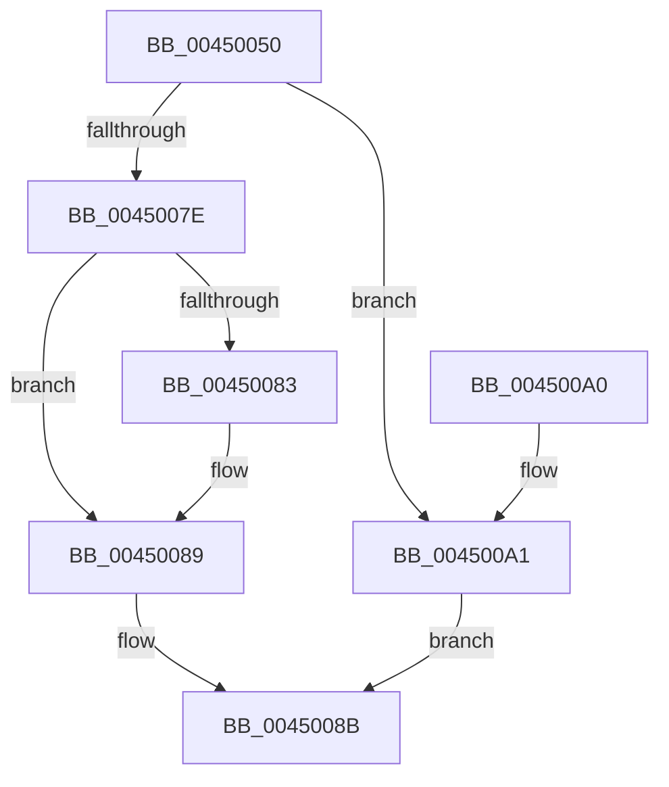

# AlpcInitializeMessageAttribute

- RVA: `0x00450050`–`0x004500A8` (길이 `88` bytes)
- VA: `0x0000000140450050`
- 실행 섹션: `.text`
- PDB 이름 있음: `예`; PDB Function 태그: `아니요`
- unwind 정보 RVA: `0x00069AD0`
- 디코드: `28`개 명령, `88/88` bytes 표시
- 미해석 바이트: `0` (있으면 어셈블리에 `.byte`로 보존)

> 이 문서는 커널 이미지의 기계어와 PDB 기호를 분석해 생성했습니다. 4번과 5번은 함수 원형과 자료형을 바이너리 사용 방식에서 추정한 C 해석이며 원본 소스 복구 결과는 아닙니다.

## 1. Dependencies

- 직접 호출 지점: **1**; 고유 호출 대상: **1**
- 직접 호출자로 확인된 함수: **3**
- RIP 상대 이미지 참조: **0**

### Outgoing calls
- `0x0045006F` → [AlpcGetHeaderSize](AlpcGetHeaderSize_function_004500B0.md) (function, `0x004500B0`)

### Direct callers
- [SshpAlpcMessageCallback](../../page/77/SshpAlpcMessageCallback_function_00774E80.md) at `0x00774F0F`
- [SshpAlpcMessageCallback](../../page/77/SshpAlpcMessageCallback_function_00774E80.md) at `0x00774F3E`
- [DbgkpSendErrorMessage](../../page/92/DbgkpSendErrorMessage_function_009210A8.md) at `0x009213DB`
- [PopUmpoProcessMessages](../../page/A2/PopUmpoProcessMessages_function_00A2E790.md) at `0x00A2E832`

### Static image references
- 디코드된 RIP-relative 메모리 참조가 없습니다.

## 2. Other-region calls and transfers

- 다른 실행 섹션으로 향하는 call: **0**
- 별도 외부 분기/꼬리 이동을 확인하지 못했습니다.

## 3. Assembly (complete function range)

```asm
00450050  48 89 5C 24 08                  mov qword ptr [rsp + 8], rbx
00450055  48 89 6C 24 10                  mov qword ptr [rsp + 0x10], rbp
0045005A  48 89 74 24 18                  mov qword ptr [rsp + 0x18], rsi
0045005F  57                              push rdi
00450060  48 83 EC 20                     sub rsp, 0x20
00450064  49 8B D9                        mov rbx, r9
00450067  49 8B F8                        mov rdi, r8
0045006A  48 8B F2                        mov rsi, rdx
0045006D  8B E9                           mov ebp, ecx
0045006F  E8 3C 00 00 00                  call 0x1404500b0
00450074  8B C0                           mov eax, eax
00450076  48 89 03                        mov qword ptr [rbx], rax
00450079  48 3B C7                        cmp rax, rdi
0045007C  77 23                           ja 0x1404500a1
0045007E  48 85 F6                        test rsi, rsi
00450081  74 06                           je 0x140450089
00450083  83 66 04 00                     and dword ptr [rsi + 4], 0
00450087  89 2E                           mov dword ptr [rsi], ebp
00450089  33 C0                           xor eax, eax
0045008B  48 8B 5C 24 30                  mov rbx, qword ptr [rsp + 0x30]
00450090  48 8B 6C 24 38                  mov rbp, qword ptr [rsp + 0x38]
00450095  48 8B 74 24 40                  mov rsi, qword ptr [rsp + 0x40]
0045009A  48 83 C4 20                     add rsp, 0x20
0045009E  5F                              pop rdi
0045009F  C3                              ret
004500A0  CC                              int3
004500A1  B8 23 00 00 C0                  mov eax, 0xc0000023
004500A6  EB E3                           jmp 0x14045008b
```

## 4. C-style interpretation (structured pseudocode)

```c
__int64 __fastcall AlpcInitializeMessageAttribute(int a1, __int64 a2, __int64 a3, __int64 a4)
{
    __int64 result;
    __int64 v_rsp;
    unsigned __int64 v_stack_p10;
    unsigned __int64 v_stack_p18;
    unsigned __int64 v_stack_p8;

    v_stack_p8 = v_rbx;
    v_stack_p10 = v_rbp;
    v_stack_p18 = v_rsi;
    v_rsp = (v_rsp) - (32);
    result = AlpcGetHeaderSize(a1, a2, a3, a4);
    *(unsigned __int64 *)(a4) = (unsigned int)((unsigned int)(result));
    if (((unsigned int)((unsigned int)(result))) > a3) goto loc_004500A1;
    if (a2 != 0) {
        *(unsigned int *)(a2) = (unsigned int)((unsigned int)(a1));
    }
    result = 0;
loc_0045008B:
    v_rsp = (v_rsp) + (32);
    return result;
loc_004500A1:
    goto loc_0045008B;
}
```

## 5. (Beta) C Style

```c
int64_t AlpcInitializeMessageAttribute(int32_t Arg1, int64_t Arg2, int64_t Arg3, void *Arg4)
{
    uint8_t *arg4 = (uint8_t *)Arg4;

    int64_t result;
    int64_t local_rsp;
    uint64_t v_stack_p10;
    uint64_t v_stack_p18;
    uint64_t v_stack_p8;

    v_stack_p8 = local_rbx;
    v_stack_p10 = local_rbp;
    v_stack_p18 = local_rsi;
    local_rsp = (local_rsp) - (32);
    result = AlpcGetHeaderSize(Arg1, Arg2, Arg3, Arg4);
    *(uint64_t *)(arg4) = (uint32_t)((uint32_t)(result));
    if (((uint32_t)((uint32_t)(result))) > Arg3) goto loc_004500A1;
    if (Arg2 != 0) {
        *(uint32_t *)(Arg2) = (uint32_t)((uint32_t)(Arg1));
    }
    result = 0;
loc_0045008B:
    local_rsp = (local_rsp) + (32);
    return result;
loc_004500A1:
    goto loc_0045008B;
}
```

### 관측된 메모리 오프셋

구조체 형식이 확인되지 않은 접근은 인자 기준의 오프셋으로만 기록했습니다.

| 기준 인자 | 오프셋 표현 | 폭 (bit) | 접근 |
|---|---:|---:|---|
| `Arg4` | `+ 0x0` | `64` | `W` |

## 6. Execution-region graph

[열기: 2D/3D 그래프와 함수 탐색 컨트롤 패널](../../../control-panel.html?section=text&rva=0x00450050&view=graph)

- 2D 그래프는 위에서 아래로 흐르고, 3D 그래프는 빈 공간을 드래그해 회전합니다. Shift+드래그는 이동, 휠은 확대·축소, 함수 노드 선택은 대상 보고서 이동입니다.

### Static fallback


