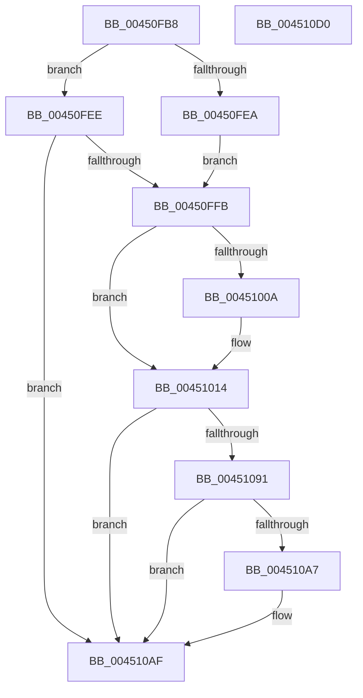

# B_TREE&lt;unsigned long,ST_STORE&lt;SM_TRAITS&gt;::_ST_REGION_ENTRY,4096,NP_CONTEXT,ST_STORE&lt;SM_TRAITS&gt;::ST_REGION_ENTRY_COMPARATOR&gt;::BTreeFindLeafSibling

- RVA: `0x00450FB8`–`0x004510D1` (길이 `281` bytes)
- VA: `0x0000000140450FB8`
- 실행 섹션: `.text`
- PDB 이름 있음: `예`; PDB Function 태그: `아니요`
- unwind 정보 RVA: `0x0009BD88`
- 디코드: `77`개 명령, `281/281` bytes 표시
- 미해석 바이트: `0` (있으면 어셈블리에 `.byte`로 보존)

> 이 문서는 커널 이미지의 기계어와 PDB 기호를 분석해 생성했습니다. 4번과 5번은 함수 원형과 자료형을 바이너리 사용 방식에서 추정한 C 해석이며 원본 소스 복구 결과는 아닙니다.

## 1. Dependencies

- 직접 호출 지점: **5**; 고유 호출 대상: **5**
- 직접 호출자로 확인된 함수: **2**
- RIP 상대 이미지 참조: **1**

### Outgoing calls
- `0x0045101B` → [_chkstk](../6B/_chkstk_function_006BA960.md) (function, `0x006BA960`)
- `0x00451050` → [B_TREE<unsigned long,ST_STORE<SM_TRAITS>::_ST_REGION_ENTRY,4096,NP_CONTEXT,ST_STORE<SM_TRAITS>::ST_REGION_ENTRY_COMPARATOR>::BTreeSearchKey](../3A/B_TREE_unsigned_long_ST_STORE_SM_TRAITS__ST_REGION_ENTRY_4096_NP_CONTEXT_ST_STORE_SM_TRAITS_ST_REGIO_function_003ACD20.md) (function, `0x003ACD20`)
- `0x00451084` → [B_TREE<unsigned long,ST_STORE<SM_TRAITS>::_ST_REGION_ENTRY,4096,NP_CONTEXT,ST_STORE<SM_TRAITS>::ST_REGION_ENTRY_COMPARATOR>::BTreeFindLeafSiblingEx](../3A/B_TREE_unsigned_long_ST_STORE_SM_TRAITS__ST_REGION_ENTRY_4096_NP_CONTEXT_ST_STORE_SM_TRAITS_ST_REGIO_function_003A9BD8.md) (function, `0x003A9BD8`)
- `0x004510AA` → [NP_CONTEXT::NpLeafDerefInternal](../3A/NP_CONTEXT_NpLeafDerefInternal_function_003A9A70.md) (function, `0x003A9A70`)
- `0x004510B9` → [_security_check_cookie](../6A/_security_check_cookie_function_006AC640.md) (function, `0x006AC640`)

### Direct callers
- [ST_STORE&lt;SM_TRAITS&gt;::StCompactRegions](../4A/ST_STORE_SM_TRAITS_StCompactRegions_function_004A48E0.md) at `0x004A4A8B`
- [ST_STORE&lt;SM_TRAITS&gt;::StDmGetStatsBitmap](../60/ST_STORE_SM_TRAITS_StDmGetStatsBitmap_function_0060D838.md) at `0x0060D938`

### Static image references
- `0x00450FCF` → RVA `0x00E0A740` (`.data`; read)

## 2. Other-region calls and transfers

- 다른 실행 섹션으로 향하는 call: **0**
- 별도 외부 분기/꼬리 이동을 확인하지 못했습니다.

## 3. Assembly (complete function range)

```asm
00450FB8  40 55                           push rbp
00450FBA  48 83 EC 50                     sub rsp, 0x50
00450FBE  48 8D 6C 24 20                  lea rbp, [rsp + 0x20]
00450FC3  48 89 5D 40                     mov qword ptr [rbp + 0x40], rbx
00450FC7  48 89 75 48                     mov qword ptr [rbp + 0x48], rsi
00450FCB  48 89 7D 50                     mov qword ptr [rbp + 0x50], rdi
00450FCF  48 8B 05 6A 97 9B 00            mov rax, qword ptr [rip + 0x9b976a]
00450FD6  48 33 C5                        xor rax, rbp
00450FD9  48 89 45 28                     mov qword ptr [rbp + 0x28], rax
00450FDD  48 8B 01                        mov rax, qword ptr [rcx]
00450FE0  33 DB                           xor ebx, ebx
00450FE2  48 8B F9                        mov rdi, rcx
00450FE5  48 85 C0                        test rax, rax
00450FE8  75 04                           jne 0x140450fee
00450FEA  33 F6                           xor esi, esi
00450FEC  EB 0D                           jmp 0x140450ffb
00450FEE  0F B6 70 02                     movzx esi, byte ptr [rax + 2]
00450FF2  83 FE 01                        cmp esi, 1
00450FF5  0F 84 B4 00 00 00               je 0x1404510af
00450FFB  8B C6                           mov eax, esi
00450FFD  48 C1 E0 04                     shl rax, 4
00451001  48 8D 48 0F                     lea rcx, [rax + 0xf]
00451005  48 3B C8                        cmp rcx, rax
00451008  77 0A                           ja 0x140451014
0045100A  48 B9 F0 FF FF FF FF FF FF 0F   movabs rcx, 0xffffffffffffff0
00451014  48 83 E1 F0                     and rcx, 0xfffffffffffffff0
00451018  48 8B C1                        mov rax, rcx
0045101B  E8 40 99 26 00                  call 0x1406ba960
00451020  8B 52 10                        mov edx, dword ptr [rdx + 0x10]
00451023  4C 8D 45 00                     lea r8, [rbp]
00451027  83 65 24 00                     and dword ptr [rbp + 0x24], 0
0045102B  48 2B E1                        sub rsp, rcx
0045102E  83 65 18 00                     and dword ptr [rbp + 0x18], 0
00451032  0F 57 C0                        xorps xmm0, xmm0
00451035  48 8B CF                        mov rcx, rdi
00451038  C7 45 20 01 00 00 00            mov dword ptr [rbp + 0x20], 1
0045103F  F3 0F 7F 45 08                  movdqu xmmword ptr [rbp + 8], xmm0
00451044  48 8D 5C 24 20                  lea rbx, [rsp + 0x20]
00451049  89 75 1C                        mov dword ptr [rbp + 0x1c], esi
0045104C  48 89 5D 00                     mov qword ptr [rbp], rbx
00451050  E8 CB BC F5 FF                  call 0x1403acd20
00451055  8D 4E FE                        lea ecx, [rsi - 2]
00451058  41 B8 03 00 00 00               mov r8d, 3
0045105E  48 03 C9                        add rcx, rcx
00451061  48 8B 54 CB 08                  mov rdx, qword ptr [rbx + rcx*8 + 8]
00451066  48 8B 04 CB                     mov rax, qword ptr [rbx + rcx*8]
0045106A  48 8D 72 F8                     lea rsi, [rdx - 8]
0045106E  48 8D 48 10                     lea rcx, [rax + 0x10]
00451072  48 83 C0 08                     add rax, 8
00451076  48 3B D1                        cmp rdx, rcx
00451079  48 8D 55 00                     lea rdx, [rbp]
0045107D  48 8B CF                        mov rcx, rdi
00451080  48 0F 46 F0                     cmovbe rsi, rax
00451084  E8 4F 8B F5 FF                  call 0x1403a9bd8
00451089  48 8B D8                        mov rbx, rax
0045108C  48 85 F6                        test rsi, rsi
0045108F  74 1E                           je 0x1404510af
00451091  4C 8D 47 10                     lea r8, [rdi + 0x10]
00451095  48 F7 DF                        neg rdi
00451098  48 1B C9                        sbb rcx, rcx
0045109B  49 23 C8                        and rcx, r8
0045109E  4C 8B 01                        mov r8, qword ptr [rcx]
004510A1  41 83 38 FF                     cmp dword ptr [r8], -1
004510A5  74 08                           je 0x1404510af
004510A7  48 8B D6                        mov rdx, rsi
004510AA  E8 C1 89 F5 FF                  call 0x1403a9a70
004510AF  48 8B C3                        mov rax, rbx
004510B2  48 8B 4D 28                     mov rcx, qword ptr [rbp + 0x28]
004510B6  48 33 CD                        xor rcx, rbp
004510B9  E8 82 B5 25 00                  call 0x1406ac640
004510BE  48 8B 5D 40                     mov rbx, qword ptr [rbp + 0x40]
004510C2  48 8B 75 48                     mov rsi, qword ptr [rbp + 0x48]
004510C6  48 8B 7D 50                     mov rdi, qword ptr [rbp + 0x50]
004510CA  48 8D 65 30                     lea rsp, [rbp + 0x30]
004510CE  5D                              pop rbp
004510CF  C3                              ret
004510D0  CC                              int3
```

## 4. C-style interpretation (structured pseudocode)

```c
__int64 __fastcall B_TREE_unsigned_long_ST_STORE_SM_TRAITS____ST_REGION_ENTRY_4096_NP_CONTEXT_ST_STORE_SM_TRAITS___ST_R(__int64 a1, __int64 a2)
{
    __int64 result;
    __int64 v_rbx;
    __int64 v_rdi;
    __int64 v_rsi;
    __int64 v_rsp;
    unsigned __int64 v_stack_m10;
    unsigned int v_stack_m14;
    unsigned int v_stack_m18;
    unsigned int v_stack_m1C;
    unsigned int v_stack_m20;
    unsigned __int64 v_stack_m30;
    unsigned __int64 v_stack_m38;
    unsigned __int64 v_stack_m8;
    unsigned __int64 v_stack_p10;
    unsigned __int64 v_stack_p18;
    unsigned __int64 v_stack_p8;

    v_rsp = (v_rsp) - (80);
    v_stack_p8 = v_rbx;
    v_stack_p10 = v_rsi;
    v_stack_p18 = v_rdi;
    result = (*(unsigned __int64 *)(v_rip + 10196842)) ^ (v_stack_m38);
    v_stack_m10 = result;
    v_rbx = 0;
    if (*(unsigned __int64 *)(a1) != 0) goto loc_00450FEE;
    v_rsi = 0;
    goto loc_00450FFB;
loc_00450FEE:
    if (((unsigned int)(*(unsigned __int8 *)(*(unsigned __int64 *)(a1) + 2))) == 1) goto loc_004510AF;
loc_00450FFB:
    result = ((unsigned int)((unsigned int)(*(unsigned __int8 *)(*(unsigned __int64 *)(a1) + 2)))) << (4);
    if ((result + 15) <= result) {
    }
    a1 = (result + 15) & (-16);
    result = _chkstk(a1, a2, a3, a4);
    v_rsp = (v_rsp) - (a1);
    v_stack_m18 = 1;
    v_stack_m30 = v_xmm0;
    v_stack_m1C = (unsigned int)(*(unsigned __int8 *)(*(unsigned __int64 *)(a1) + 2));
    v_stack_m38 = v_stack_m38;
    result = B_TREE_unsigned_long_ST_STORE_SM_TRAITS____ST_REGION_ENTRY_4096_NP_CONTEXT_ST_STORE_SM_TRAITS___ST_R(a1, (unsigned int)(*(unsigned int *)(a2 + 16)), v_stack_m38, a4);
    a1 = (*(unsigned __int8 *)(*(unsigned __int64 *)(a1) + 2) - 2) + (*(unsigned __int8 *)(*(unsigned __int64 *)(a1) + 2) - 2);
    result = (*(unsigned __int64 *)(v_stack_m38 + a1 * 8)) + (8);
    v_rsi = *(unsigned __int64 *)(v_stack_m38 + a1 * 8 + 8) - 8;
    if ((*(unsigned __int64 *)(v_stack_m38 + a1 * 8 + 8)) <= (*(unsigned __int64 *)(v_stack_m38 + a1 * 8) + 16)) { v_rsi = result; }
    result = B_TREE_unsigned_long_ST_STORE_SM_TRAITS____ST_REGION_ENTRY_4096_NP_CONTEXT_ST_STORE_SM_TRAITS___ST_R(a1, v_stack_m38, 3, a4);
    if (v_rsi == 0) goto loc_004510AF;
    v_rdi = -(a1);
    a1 = (a1) & (a1 + 16);
    if ((*(unsigned int *)(*(unsigned __int64 *)(a1))) != -1) {
        a2 = v_rsi;
        result = NP_CONTEXT__NpLeafDerefInternal(a1, a2, *(unsigned __int64 *)(a1), a4);
    }
    a1 = (v_stack_m10) ^ (v_stack_m38);
    result = _security_check_cookie(a1, a2, *(unsigned __int64 *)(a1), a4);
    return result;
}
```

## 5. (Beta) C Style

```c
int64_t B_TREE_unsigned_long_ST_STORE_SM_TRAITS____ST_REGION_ENTRY_4096_NP_CONTEXT_ST_STORE_SM_TRAITS___ST_R(void *Arg1, int64_t Arg2)
{
    uint8_t *arg1 = (uint8_t *)Arg1;

    int64_t result;
    int64_t local_rbx;
    int64_t local_rdi;
    int64_t local_rsi;
    int64_t local_rsp;
    uint64_t v_stack_m10;
    uint32_t v_stack_m14;
    uint32_t v_stack_m18;
    uint32_t v_stack_m1C;
    uint32_t v_stack_m20;
    uint64_t v_stack_m30;
    uint64_t v_stack_m38;
    uint64_t v_stack_m8;
    uint64_t v_stack_p10;
    uint64_t v_stack_p18;
    uint64_t v_stack_p8;

    local_rsp = (local_rsp) - (80);
    v_stack_p8 = local_rbx;
    v_stack_p10 = local_rsi;
    v_stack_p18 = local_rdi;
    result = (*(uint64_t *)(v_rip + 0x9B976A)) ^ (v_stack_m38);
    v_stack_m10 = result;
    local_rbx = 0;
    if (*(uint64_t *)(arg1) != 0) goto loc_00450FEE;
    local_rsi = 0;
    goto loc_00450FFB;
loc_00450FEE:
    if (((uint32_t)(*(uint8_t *)(*(uint64_t *)(arg1) + 0x2))) == 1) goto loc_004510AF;
loc_00450FFB:
    result = ((uint32_t)((uint32_t)(*(uint8_t *)(*(uint64_t *)(arg1) + 0x2)))) << (4);
    if ((result + 15) <= result) {
    }
    Arg1 = (result + 15) & (-16);
    result = _chkstk(Arg1, Arg2, a3, a4);
    local_rsp = (local_rsp) - (Arg1);
    v_stack_m18 = 1;
    v_stack_m30 = v_xmm0;
    v_stack_m1C = (uint32_t)(*(uint8_t *)(*(uint64_t *)(arg1) + 0x2));
    v_stack_m38 = v_stack_m38;
    result = B_TREE_unsigned_long_ST_STORE_SM_TRAITS____ST_REGION_ENTRY_4096_NP_CONTEXT_ST_STORE_SM_TRAITS___ST_R(Arg1, (uint32_t)(*(uint32_t *)(Arg2 + 0x10)), v_stack_m38, a4);
    Arg1 = (*(uint8_t *)(*(uint64_t *)(arg1) + 0x2) - 2) + (*(uint8_t *)(*(uint64_t *)(arg1) + 0x2) - 2);
    result = (*(uint64_t *)(v_stack_m38 + arg1 * 8)) + (8);
    local_rsi = *(uint64_t *)(v_stack_m38 + arg1 * 8 + 0x8) - 8;
    if ((*(uint64_t *)(v_stack_m38 + arg1 * 8 + 0x8)) <= (*(uint64_t *)(v_stack_m38 + arg1 * 8) + 16)) { local_rsi = result; }
    result = B_TREE_unsigned_long_ST_STORE_SM_TRAITS____ST_REGION_ENTRY_4096_NP_CONTEXT_ST_STORE_SM_TRAITS___ST_R(Arg1, v_stack_m38, 3, a4);
    if (local_rsi == 0) goto loc_004510AF;
    local_rdi = -(Arg1);
    Arg1 = (Arg1) & (Arg1 + 16);
    if ((*(uint32_t *)(*(uint64_t *)(arg1))) != -1) {
        Arg2 = local_rsi;
        result = NP_CONTEXT__NpLeafDerefInternal(Arg1, Arg2, *(uint64_t *)(arg1), a4);
    }
    Arg1 = (v_stack_m10) ^ (v_stack_m38);
    result = _security_check_cookie(Arg1, Arg2, *(uint64_t *)(arg1), a4);
    return result;
}
```

### 관측된 메모리 오프셋

구조체 형식이 확인되지 않은 접근은 인자 기준의 오프셋으로만 기록했습니다.

| 기준 인자 | 오프셋 표현 | 폭 (bit) | 접근 |
|---|---:|---:|---|
| `Arg1` | `+ 0x0` | `64` | `R` |
| `Arg1` | `+ 0x10` | `64` | `R` |

## 6. Execution-region graph

[열기: 2D/3D 그래프와 함수 탐색 컨트롤 패널](../../../control-panel.html?section=text&rva=0x00450FB8&view=graph)

- 2D 그래프는 위에서 아래로 흐르고, 3D 그래프는 빈 공간을 드래그해 회전합니다. Shift+드래그는 이동, 휠은 확대·축소, 함수 노드 선택은 대상 보고서 이동입니다.

### Static fallback


