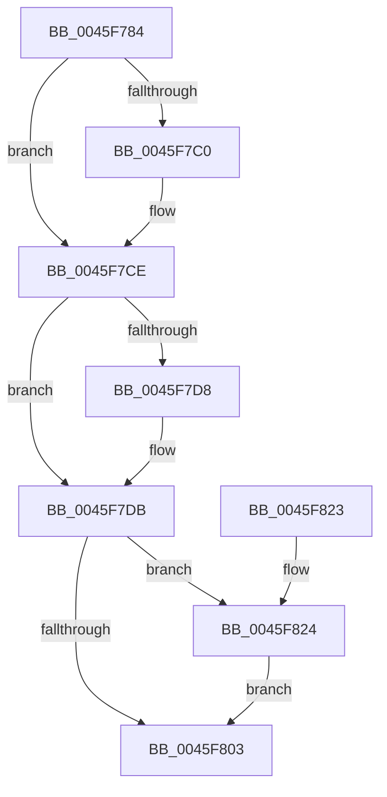

# CcAmILowPriorityWriter

- RVA: `0x0045F784`–`0x0045F82E` (길이 `170` bytes)
- VA: `0x000000014045F784`
- 실행 섹션: `.text`
- PDB 이름 있음: `예`; PDB Function 태그: `아니요`
- unwind 정보 RVA: `0x00073808`
- 디코드: `45`개 명령, `170/170` bytes 표시
- 미해석 바이트: `0` (있으면 어셈블리에 `.byte`로 보존)

> 이 문서는 커널 이미지의 기계어와 PDB 기호를 분석해 생성했습니다. 4번과 5번은 함수 원형과 자료형을 바이너리 사용 방식에서 추정한 C 해석이며 원본 소스 복구 결과는 아닙니다.

## 1. Dependencies

- 직접 호출 지점: **4**; 고유 호출 대상: **4**
- 직접 호출자로 확인된 함수: **1**
- RIP 상대 이미지 참조: **0**

### Outgoing calls
- `0x0045F7B0` → [KeAbPreAcquire](../21/KeAbPreAcquire_function_00210230.md) (function, `0x00210230`)
- `0x0045F7C9` → [ExfAcquirePushLockExclusiveEx](../20/ExfAcquirePushLockExclusiveEx_function_0020FC90.md) (function, `0x0020FC90`)
- `0x0045F806` → [KeAbPostRelease](../2E/KeAbPostRelease_function_002E1600.md) (function, `0x002E1600`)
- `0x0045F827` → [ExfTryToWakePushLock](../26/ExfTryToWakePushLock_function_00265DD0.md) (function, `0x00265DD0`)

### Direct callers
- [CcFlushCacheAcquireRange](../35/CcFlushCacheAcquireRange_function_0035A408.md) at `0x0035A51F`

### Static image references
- 디코드된 RIP-relative 메모리 참조가 없습니다.

## 2. Other-region calls and transfers

- 다른 실행 섹션으로 향하는 call: **0**
- 별도 외부 분기/꼬리 이동을 확인하지 못했습니다.

## 3. Assembly (complete function range)

```asm
0045F784  48 89 5C 24 08                  mov qword ptr [rsp + 8], rbx
0045F789  48 89 6C 24 10                  mov qword ptr [rsp + 0x10], rbp
0045F78E  48 89 74 24 18                  mov qword ptr [rsp + 0x18], rsi
0045F793  57                              push rdi
0045F794  48 83 EC 20                     sub rsp, 0x20
0045F798  48 8B B1 18 02 00 00            mov rsi, qword ptr [rcx + 0x218]
0045F79F  45 33 C0                        xor r8d, r8d
0045F7A2  33 D2                           xor edx, edx
0045F7A4  33 ED                           xor ebp, ebp
0045F7A6  48 8D 9E 00 05 00 00            lea rbx, [rsi + 0x500]
0045F7AD  48 8B CB                        mov rcx, rbx
0045F7B0  E8 7B 0A DB FF                  call 0x140210230
0045F7B5  F0 48 0F BA 2B 00               lock bts qword ptr [rbx], 0
0045F7BB  48 8B F8                        mov rdi, rax
0045F7BE  73 0E                           jae 0x14045f7ce
0045F7C0  4C 8B C3                        mov r8, rbx
0045F7C3  48 8B D0                        mov rdx, rax
0045F7C6  48 8B CB                        mov rcx, rbx
0045F7C9  E8 C2 04 DB FF                  call 0x14020fc90
0045F7CE  B9 01 00 00 00                  mov ecx, 1
0045F7D3  48 85 FF                        test rdi, rdi
0045F7D6  74 03                           je 0x14045f7db
0045F7D8  88 4F 0A                        mov byte ptr [rdi + 0xa], cl
0045F7DB  65 48 8B 04 25 88 01 00 00      mov rax, qword ptr gs:[0x188]
0045F7E4  48 39 86 E8 04 00 00            cmp qword ptr [rsi + 0x4e8], rax
0045F7EB  40 0F B6 FD                     movzx edi, bpl
0045F7EF  0F 44 F9                        cmove edi, ecx
0045F7F2  48 83 CA FF                     or rdx, 0xffffffffffffffff
0045F7F6  F0 48 0F C1 13                  lock xadd qword ptr [rbx], rdx
0045F7FB  80 E2 06                        and dl, 6
0045F7FE  80 FA 02                        cmp dl, 2
0045F801  74 21                           je 0x14045f824
0045F803  48 8B CB                        mov rcx, rbx
0045F806  E8 F5 1D E8 FF                  call 0x1402e1600
0045F80B  48 8B 5C 24 30                  mov rbx, qword ptr [rsp + 0x30]
0045F810  40 8A C7                        mov al, dil
0045F813  48 8B 6C 24 38                  mov rbp, qword ptr [rsp + 0x38]
0045F818  48 8B 74 24 40                  mov rsi, qword ptr [rsp + 0x40]
0045F81D  48 83 C4 20                     add rsp, 0x20
0045F821  5F                              pop rdi
0045F822  C3                              ret
0045F823  CC                              int3
0045F824  48 8B CB                        mov rcx, rbx
0045F827  E8 A4 65 E0 FF                  call 0x140265dd0
0045F82C  EB D5                           jmp 0x14045f803
```

## 4. C-style interpretation (structured pseudocode)

```c
__int64 __fastcall CcAmILowPriorityWriter(__int64 a1, int a2, int a3)
{
    __int64 result;
    __int64 v_rbp;
    __int64 v_rdi;
    __int64 v_rsp;
    unsigned __int64 v_stack_p10;
    unsigned __int64 v_stack_p18;
    unsigned __int64 v_stack_p8;

    v_stack_p8 = v_rbx;
    v_stack_p10 = v_rbp;
    v_stack_p18 = v_rsi;
    v_rsp = (v_rsp) - (32);
    a3 = 0;
    a2 = 0;
    v_rbp = 0;
    result = KeAbPreAcquire(*(unsigned __int64 *)(a1 + 536) + 1280, a2, a3, a4);
    if (!(condition_is_above_or_equal)) {
        a3 = *(unsigned __int64 *)(a1 + 536) + 1280;
        a2 = result;
        a1 = *(unsigned __int64 *)(a1 + 536) + 1280;
        result = ExfAcquirePushLockExclusiveEx(a1, a2, a3, a4);
    }
    if (result != 0) {
        *(unsigned __int8 *)(result + 10) = 1;
    }
    v_rdi = 0;
    if ((*(unsigned __int64 *)(*(unsigned __int64 *)(a1 + 536) + 1256)) == (*(unsigned __int64 *)(gs_base + (0 + 392)))) { v_rdi = 1; }
    a2 = (a2) | (-1);
    a2 = (unsigned __int8)((a2) & (6));
    if (((unsigned __int8)(a2)) == 2) goto loc_0045F824;
loc_0045F803:
    result = KeAbPostRelease(*(unsigned __int64 *)(a1 + 536) + 1280, a2, a3, a4);
    v_rsp = (v_rsp) + (32);
    return (unsigned __int8)(v_rdi);
loc_0045F824:
    result = ExfTryToWakePushLock(v_stack_p8, a2, a3, a4);
    goto loc_0045F803;
}
```

## 5. (Beta) C Style

```c
int64_t CcAmILowPriorityWriter(void *Arg1, int32_t Arg2, int32_t Arg3)
{
    uint8_t *arg1 = (uint8_t *)Arg1;

    int64_t result;
    int64_t local_rbp;
    int64_t local_rdi;
    int64_t local_rsp;
    uint64_t v_stack_p10;
    uint64_t v_stack_p18;
    uint64_t v_stack_p8;

    v_stack_p8 = local_rbx;
    v_stack_p10 = local_rbp;
    v_stack_p18 = local_rsi;
    local_rsp = (local_rsp) - (32);
    Arg3 = 0;
    Arg2 = 0;
    local_rbp = 0;
    result = KeAbPreAcquire(*(uint64_t *)(arg1 + 0x218) + 1280, Arg2, Arg3, a4);
    if (!(condition_is_above_or_equal)) {
        Arg3 = *(uint64_t *)(arg1 + 0x218) + 1280;
        Arg2 = result;
        Arg1 = *(uint64_t *)(arg1 + 0x218) + 1280;
        result = ExfAcquirePushLockExclusiveEx(Arg1, Arg2, Arg3, a4);
    }
    if (result != 0) {
        *(uint8_t *)(result + 0xA) = 1;
    }
    local_rdi = 0;
    if ((*(uint64_t *)(*(uint64_t *)(arg1 + 0x218) + 0x4E8)) == (*(uint64_t *)(gs_base + (0 + 0x188)))) { local_rdi = 1; }
    Arg2 = (Arg2) | (-1);
    Arg2 = (uint8_t)((Arg2) & (6));
    if (((uint8_t)(Arg2)) == 2) goto loc_0045F824;
loc_0045F803:
    result = KeAbPostRelease(*(uint64_t *)(arg1 + 0x218) + 1280, Arg2, Arg3, a4);
    local_rsp = (local_rsp) + (32);
    return (uint8_t)(local_rdi);
loc_0045F824:
    result = ExfTryToWakePushLock(v_stack_p8, Arg2, Arg3, a4);
    goto loc_0045F803;
}
```

### 관측된 메모리 오프셋

구조체 형식이 확인되지 않은 접근은 인자 기준의 오프셋으로만 기록했습니다.

| 기준 인자 | 오프셋 표현 | 폭 (bit) | 접근 |
|---|---:|---:|---|
| `Arg1` | `+ 0x218` | `64` | `R` |

## 6. Execution-region graph

[열기: 2D/3D 그래프와 함수 탐색 컨트롤 패널](../../../control-panel.html?section=text&rva=0x0045F784&view=graph)

- 2D 그래프는 위에서 아래로 흐르고, 3D 그래프는 빈 공간을 드래그해 회전합니다. Shift+드래그는 이동, 휠은 확대·축소, 함수 노드 선택은 대상 보고서 이동입니다.

### Static fallback


