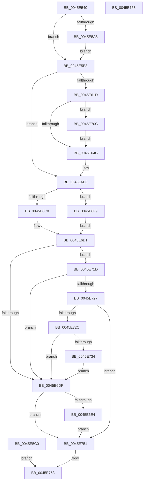

# CcAsyncReadPrefetch

- RVA: `0x0045E540`–`0x0045E764` (길이 `548` bytes)
- VA: `0x000000014045E540`
- 실행 섹션: `.text`
- PDB 이름 있음: `예`; PDB Function 태그: `아니요`
- unwind 정보 RVA: `0x000A971C`
- 디코드: `130`개 명령, `548/548` bytes 표시
- 미해석 바이트: `0` (있으면 어셈블리에 `.byte`로 보존)

> 이 문서는 커널 이미지의 기계어와 PDB 기호를 분석해 생성했습니다. 4번과 5번은 함수 원형과 자료형을 바이너리 사용 방식에서 추정한 C 해석이며 원본 소스 복구 결과는 아닙니다.

## 1. Dependencies

- 직접 호출 지점: **5**; 고유 호출 대상: **5**
- 직접 호출자로 확인된 함수: **1**
- RIP 상대 이미지 참조: **5**

### Outgoing calls
- `0x0045E5B1` → [MmProbeAndLockProcessPages](../../page/9F/MmProbeAndLockProcessPages_function_009FE840.md) (function, `0x009FE840`)
- `0x0045E5D0` → [FsRtlIsNtstatusExpected](../26/FsRtlIsNtstatusExpected_function_0026D390.md) (function, `0x0026D390`)
- `0x0045E694` → [MmPrefetchForCacheManager](../../page/93/MmPrefetchForCacheManager_function_0093D714.md) (function, `0x0093D714`)
- `0x0045E6F2` → [CcUpdateReadHistory](CcUpdateReadHistory_function_0045E76C.md) (function, `0x0045E76C`)
- `0x0045E74A` → [CcScheduleReadAheadNuma](../38/CcScheduleReadAheadNuma_function_0038883C.md) (function, `0x0038883C`)

### Direct callers
- [CcAsyncReadWorker](CcAsyncReadWorker_function_0045DB10.md) at `0x0045DDC3`

### Static image references
- `0x0045E6C0` → RVA `0x00E65BA8` (`.data`; read)
- `0x0045E6CA` → RVA `0x00E65BA8` (`.data`; write)
- `0x0045E6D5` → RVA `0x00E65B94` (`.data`; read)
- `0x0045E6F9` → RVA `0x00E65BA0` (`.data`; read)
- `0x0045E703` → RVA `0x00E65BA0` (`.data`; write)

## 2. Other-region calls and transfers

- 다른 실행 섹션으로 향하는 call: **2**
  - `0x0045E5B1` → [MmProbeAndLockProcessPages](../../page/9F/MmProbeAndLockProcessPages_function_009FE840.md) (`.text` → `PAGE`)
  - `0x0045E694` → [MmPrefetchForCacheManager](../../page/93/MmPrefetchForCacheManager_function_0093D714.md) (`.text` → `PAGE`)
- 별도 외부 분기/꼬리 이동을 확인하지 못했습니다.

## 3. Assembly (complete function range)

```asm
0045E540  4C 8B DC                        mov r11, rsp
0045E543  49 89 4B 08                     mov qword ptr [r11 + 8], rcx
0045E547  53                              push rbx
0045E548  56                              push rsi
0045E549  57                              push rdi
0045E54A  41 54                           push r12
0045E54C  41 55                           push r13
0045E54E  41 56                           push r14
0045E550  41 57                           push r15
0045E552  48 83 EC 70                     sub rsp, 0x70
0045E556  41 83 63 10 00                  and dword ptr [r11 + 0x10], 0
0045E55B  48 8B 59 10                     mov rbx, qword ptr [rcx + 0x10]
0045E55F  48 8B 71 20                     mov rsi, qword ptr [rcx + 0x20]
0045E563  48 8B 41 18                     mov rax, qword ptr [rcx + 0x18]
0045E567  49 89 43 18                     mov qword ptr [r11 + 0x18], rax
0045E56B  8B 79 28                        mov edi, dword ptr [rcx + 0x28]
0045E56E  4C 8B 71 30                     mov r14, qword ptr [rcx + 0x30]
0045E572  44 8B 69 38                     mov r13d, dword ptr [rcx + 0x38]
0045E576  4C 8B 51 40                     mov r10, qword ptr [rcx + 0x40]
0045E57A  48 8B 51 58                     mov rdx, qword ptr [rcx + 0x58]
0045E57E  44 8A 41 70                     mov r8b, byte ptr [rcx + 0x70]
0045E582  4C 8B 79 60                     mov r15, qword ptr [rcx + 0x60]
0045E586  4C 8B 59 68                     mov r11, qword ptr [rcx + 0x68]
0045E58A  4C 89 9C 24 C8 00 00 00         mov qword ptr [rsp + 0xc8], r11
0045E592  4C 8B A1 98 00 00 00            mov r12, qword ptr [rcx + 0x98]
0045E599  41 0F B7 42 0A                  movzx eax, word ptr [r10 + 0xa]
0045E59E  B9 17 08 00 00                  mov ecx, 0x817
0045E5A3  66 85 C1                        test cx, ax
0045E5A6  75 40                           jne 0x14045e5e8
0045E5A8  41 B9 01 00 00 00               mov r9d, 1
0045E5AE  49 8B CA                        mov rcx, r10
0045E5B1  E8 8A 02 5A 00                  call 0x1409fe840
0045E5B6  4C 8B 9C 24 C8 00 00 00         mov r11, qword ptr [rsp + 0xc8]
0045E5BE  EB 28                           jmp 0x14045e5e8
0045E5C0  8B F8                           mov edi, eax
0045E5C2  48 8B 84 24 B0 00 00 00         mov rax, qword ptr [rsp + 0xb0]
0045E5CA  48 8B 58 48                     mov rbx, qword ptr [rax + 0x48]
0045E5CE  8B CF                           mov ecx, edi
0045E5D0  E8 BB ED E0 FF                  call 0x14026d390
0045E5D5  B9 E8 00 00 C0                  mov ecx, 0xc00000e8
0045E5DA  84 C0                           test al, al
0045E5DC  0F 44 F9                        cmove edi, ecx
0045E5DF  89 3B                           mov dword ptr [rbx], edi
0045E5E1  32 C0                           xor al, al
0045E5E3  E9 6B 01 00 00                  jmp 0x14045e753
0045E5E8  65 48 8B 04 25 88 01 00 00      mov rax, qword ptr gs:[0x188]
0045E5F1  48 89 84 24 C8 00 00 00         mov qword ptr [rsp + 0xc8], rax
0045E5F9  83 A0 DC 05 00 00 00            and dword ptr [rax + 0x5dc], 0
0045E600  49 83 26 00                     and qword ptr [r14], 0
0045E604  89 BC 24 B0 00 00 00            mov dword ptr [rsp + 0xb0], edi
0045E60B  48 8B 84 24 C0 00 00 00         mov rax, qword ptr [rsp + 0xc0]
0045E613  48 3B 43 08                     cmp rax, qword ptr [rbx + 8]
0045E617  0F 8D 99 00 00 00               jge 0x14045e6b6
0045E61D  65 48 8B 04 25 88 01 00 00      mov rax, qword ptr gs:[0x188]
0045E626  48 89 44 24 40                  mov qword ptr [rsp + 0x40], rax
0045E62B  48 C7 80 50 05 00 00 07 00 00 00  mov qword ptr [rax + 0x550], 7
0045E636  48 8B 84 24 C0 00 00 00         mov rax, qword ptr [rsp + 0xc0]
0045E63E  48 8D 0C 38                     lea rcx, [rax + rdi]
0045E642  48 3B 4B 08                     cmp rcx, qword ptr [rbx + 8]
0045E646  0F 8F C0 00 00 00               jg 0x14045e70c
0045E64C  48 8B D0                        mov rdx, rax
0045E64F  49 C7 C0 00 F0 FF FF            mov r8, 0xfffffffffffff000
0045E656  49 23 D0                        and rdx, r8
0045E659  48 89 54 24 48                  mov qword ptr [rsp + 0x48], rdx
0045E65E  44 8B 8C 24 B0 00 00 00         mov r9d, dword ptr [rsp + 0xb0]
0045E666  48 05 FF 0F 00 00               add rax, 0xfff
0045E66C  4C 03 C8                        add r9, rax
0045E66F  4D 23 C8                        and r9, r8
0045E672  4C 89 4C 24 50                  mov qword ptr [rsp + 0x50], r9
0045E677  4C 2B CA                        sub r9, rdx
0045E67A  4C 89 4C 24 58                  mov qword ptr [rsp + 0x58], r9
0045E67F  4C 89 74 24 38                  mov qword ptr [rsp + 0x38], r14
0045E684  4C 89 5C 24 30                  mov qword ptr [rsp + 0x30], r11
0045E689  44 89 6C 24 20                  mov dword ptr [rsp + 0x20], r13d
0045E68E  45 33 C0                        xor r8d, r8d
0045E691  48 8B CE                        mov rcx, rsi
0045E694  E8 7B F0 4D 00                  call 0x14093d714
0045E699  89 84 24 B8 00 00 00            mov dword ptr [rsp + 0xb8], eax
0045E6A0  65 48 8B 04 25 88 01 00 00      mov rax, qword ptr gs:[0x188]
0045E6A9  48 89 44 24 60                  mov qword ptr [rsp + 0x60], rax
0045E6AE  48 83 A0 50 05 00 00 00         and qword ptr [rax + 0x550], 0
0045E6B6  83 BC 24 B8 00 00 00 00         cmp dword ptr [rsp + 0xb8], 0
0045E6BE  74 39                           je 0x14045e6f9
0045E6C0  48 8B 05 E1 74 A0 00            mov rax, qword ptr [rip + 0xa074e1]
0045E6C7  48 FF C0                        inc rax
0045E6CA  48 89 05 D7 74 A0 00            mov qword ptr [rip + 0xa074d7], rax
0045E6D1  48 8B 5E 30                     mov rbx, qword ptr [rsi + 0x30]
0045E6D5  8A 05 B9 74 A0 00               mov al, byte ptr [rip + 0xa074b9]
0045E6DB  84 C0                           test al, al
0045E6DD  75 3E                           jne 0x14045e71d
0045E6DF  48 85 DB                        test rbx, rbx
0045E6E2  74 6D                           je 0x14045e751
0045E6E4  44 8B C7                        mov r8d, edi
0045E6E7  48 8D 94 24 C0 00 00 00         lea rdx, [rsp + 0xc0]
0045E6EF  48 8B CE                        mov rcx, rsi
0045E6F2  E8 75 00 00 00                  call 0x14045e76c
0045E6F7  EB 58                           jmp 0x14045e751
0045E6F9  48 8B 05 A0 74 A0 00            mov rax, qword ptr [rip + 0xa074a0]
0045E700  48 FF C0                        inc rax
0045E703  48 89 05 96 74 A0 00            mov qword ptr [rip + 0xa07496], rax
0045E70A  EB C5                           jmp 0x14045e6d1
0045E70C  8B 4B 08                        mov ecx, dword ptr [rbx + 8]
0045E70F  2B C8                           sub ecx, eax
0045E711  89 8C 24 B0 00 00 00            mov dword ptr [rsp + 0xb0], ecx
0045E718  E9 2F FF FF FF                  jmp 0x14045e64c
0045E71D  83 BC 24 B8 00 00 00 00         cmp dword ptr [rsp + 0xb8], 0
0045E725  74 B8                           je 0x14045e6df
0045E727  48 85 DB                        test rbx, rbx
0045E72A  74 25                           je 0x14045e751
0045E72C  8B 03                           mov eax, dword ptr [rbx]
0045E72E  0F BA E0 11                     bt eax, 0x11
0045E732  72 AB                           jb 0x14045e6df
0045E734  4C 89 64 24 20                  mov qword ptr [rsp + 0x20], r12
0045E739  4D 8B CF                        mov r9, r15
0045E73C  44 8B C7                        mov r8d, edi
0045E73F  48 8D 94 24 C0 00 00 00         lea rdx, [rsp + 0xc0]
0045E747  48 8B CE                        mov rcx, rsi
0045E74A  E8 ED A0 F2 FF                  call 0x14038883c
0045E74F  EB 8E                           jmp 0x14045e6df
0045E751  B0 01                           mov al, 1
0045E753  48 83 C4 70                     add rsp, 0x70
0045E757  41 5F                           pop r15
0045E759  41 5E                           pop r14
0045E75B  41 5D                           pop r13
0045E75D  41 5C                           pop r12
0045E75F  5F                              pop rdi
0045E760  5E                              pop rsi
0045E761  5B                              pop rbx
0045E762  C3                              ret
0045E763  CC                              int3
```

## 4. C-style interpretation (structured pseudocode)

```c
__int64 __fastcall CcAsyncReadPrefetch(__int64 a1)
{
    __int64 result;
    __int64 v_rsp;
    unsigned __int64 v_stack_m48;
    unsigned __int64 v_stack_m50;
    unsigned __int64 v_stack_m58;
    unsigned __int64 v_stack_m60;
    unsigned __int64 v_stack_m68;
    unsigned __int64 v_stack_m70;
    unsigned __int64 v_stack_m78;
    unsigned int v_stack_m88;
    unsigned int v_stack_p10;
    unsigned __int64 v_stack_p18;
    unsigned __int64 v_stack_p20;
    unsigned __int64 v_stack_p8;

    *(unsigned __int64 *)(v_rsp + 8) = a1;
    v_rsp = (v_rsp) - (112);
    *(unsigned __int64 *)(v_rsp + 24) = *(unsigned __int64 *)(a1 + 24);
    v_stack_p20 = *(unsigned __int64 *)(a1 + 104);
    if ((((unsigned __int16)((unsigned int)(0x817ULL))) & ((unsigned __int16)(*(unsigned __int16 *)(*(unsigned __int64 *)(a1 + 64) + 10)))) != 0) goto loc_0045E5E8;
    result = MmProbeAndLockProcessPages(*(unsigned __int64 *)(a1 + 64), *(unsigned __int64 *)(a1 + 88), *(unsigned __int8 *)(a1 + 112), 1);
    goto loc_0045E5E8;
loc_0045E5E8:
    v_stack_p20 = *(unsigned __int64 *)(gs_base + (0 + 392));
    v_stack_p8 = (unsigned int)((unsigned int)(*(unsigned int *)(a1 + 40)));
    if (v_stack_p18 >= (*(unsigned __int64 *)(*(unsigned __int64 *)(a1 + 16) + 8))) goto loc_0045E6B6;
    v_stack_m68 = *(unsigned __int64 *)(gs_base + (0 + 392));
    *(unsigned __int64 *)(*(unsigned __int64 *)(gs_base + (0 + 392)) + 1360) = 7;
    if ((v_stack_p18 + (unsigned int)(*(unsigned int *)(a1 + 40)) * 1) > (*(unsigned __int64 *)(*(unsigned __int64 *)(a1 + 16) + 8))) goto loc_0045E70C;
loc_0045E64C:
    a2 = (v_stack_p18) & (0xFFFFFFFFFFFFF000ULL);
    v_stack_m60 = a2;
    result = (v_stack_p18) + (0xFFFULL);
    a4 = ((unsigned int)(v_stack_p8)) + (result);
    a4 = (a4) & (0xFFFFFFFFFFFFF000ULL);
    v_stack_m58 = a4;
    a4 = (a4) - (a2);
    v_stack_m50 = a4;
    v_stack_m70 = *(unsigned __int64 *)(a1 + 48);
    v_stack_m78 = v_stack_p20;
    v_stack_m88 = (unsigned int)((unsigned int)(*(unsigned int *)(a1 + 56)));
    a3 = 0;
    result = MmPrefetchForCacheManager(*(unsigned __int64 *)(a1 + 32), a2, a3, a4);
    v_stack_p10 = (unsigned int)(result);
    v_stack_m48 = *(unsigned __int64 *)(gs_base + (0 + 392));
loc_0045E6B6:
    if (v_stack_p10 == 0) goto loc_0045E6F9;
    result = (*(unsigned __int64 *)(v_rip + 10515681)) + 1;
    *(unsigned __int64 *)(v_rip + 10515671) = result;
loc_0045E6D1:
    if ((unsigned __int8)(*(unsigned __int8 *)(v_rip + 10515641)) != 0) goto loc_0045E71D;
loc_0045E6DF:
    if (*(unsigned __int64 *)(*(unsigned __int64 *)(a1 + 32) + 48) == 0) goto loc_0045E751;
    result = CcUpdateReadHistory(*(unsigned __int64 *)(a1 + 32), v_stack_p18, (unsigned int)((unsigned int)((unsigned int)(*(unsigned int *)(a1 + 40)))), a4);
    goto loc_0045E751;
loc_0045E6F9:
    result = (*(unsigned __int64 *)(v_rip + 10515616)) + 1;
    *(unsigned __int64 *)(v_rip + 10515606) = result;
    goto loc_0045E6D1;
loc_0045E70C:
    a1 = (unsigned int)(((unsigned int)(*(unsigned int *)(*(unsigned __int64 *)(*(unsigned __int64 *)(a1 + 32) + 48) + 8))) - ((unsigned int)(result)));
    v_stack_p8 = (unsigned int)(a1);
    goto loc_0045E64C;
loc_0045E71D:
    if (v_stack_p10 == 0) goto loc_0045E6DF;
    if (*(unsigned __int64 *)(*(unsigned __int64 *)(a1 + 32) + 48) == 0) goto loc_0045E751;
    if (condition_is_below) goto loc_0045E6DF;
    v_stack_m88 = *(unsigned __int64 *)(a1 + 152);
    result = CcScheduleReadAheadNuma(*(unsigned __int64 *)(a1 + 32), v_stack_p18, (unsigned int)((unsigned int)((unsigned int)(*(unsigned int *)(a1 + 40)))), *(unsigned __int64 *)(a1 + 96));
    goto loc_0045E6DF;
loc_0045E751:
loc_0045E753:
    v_rsp = (v_rsp) + (112);
    return 1;
}
```

## 5. (Beta) C Style

```c
int64_t CcAsyncReadPrefetch(void *Arg1)
{
    uint8_t *arg1 = (uint8_t *)Arg1;

    int64_t result;
    int64_t local_rsp;
    uint64_t v_stack_m48;
    uint64_t v_stack_m50;
    uint64_t v_stack_m58;
    uint64_t v_stack_m60;
    uint64_t v_stack_m68;
    uint64_t v_stack_m70;
    uint64_t v_stack_m78;
    uint32_t v_stack_m88;
    uint32_t v_stack_p10;
    uint64_t v_stack_p18;
    uint64_t v_stack_p20;
    uint64_t v_stack_p8;

    *(void **)(local_rsp + 0x8) = Arg1;
    local_rsp = (local_rsp) - (112);
    *(uint64_t *)(local_rsp + 0x18) = *(uint64_t *)(arg1 + 0x18);
    v_stack_p20 = *(uint64_t *)(arg1 + 0x68);
    if ((((uint16_t)((uint32_t)(0x817ULL))) & ((uint16_t)(*(uint16_t *)(*(uint64_t *)(arg1 + 0x40) + 0xA)))) != 0) goto loc_0045E5E8;
    result = MmProbeAndLockProcessPages(*(uint64_t *)(arg1 + 0x40), *(uint64_t *)(arg1 + 0x58), *(uint8_t *)(arg1 + 0x70), 1);
    goto loc_0045E5E8;
loc_0045E5E8:
    v_stack_p20 = *(uint64_t *)(gs_base + (0 + 0x188));
    v_stack_p8 = (uint32_t)((uint32_t)(*(uint32_t *)(arg1 + 0x28)));
    if (v_stack_p18 >= (*(uint64_t *)(*(uint64_t *)(arg1 + 0x10) + 0x8))) goto loc_0045E6B6;
    v_stack_m68 = *(uint64_t *)(gs_base + (0 + 0x188));
    *(uint64_t *)(*(uint64_t *)(gs_base + (0 + 0x188)) + 0x550) = 7;
    if ((v_stack_p18 + (uint32_t)(*(uint32_t *)(arg1 + 0x28)) * 1) > (*(uint64_t *)(*(uint64_t *)(arg1 + 0x10) + 0x8))) goto loc_0045E70C;
loc_0045E64C:
    a2 = (v_stack_p18) & (0xFFFFFFFFFFFFF000ULL);
    v_stack_m60 = a2;
    result = (v_stack_p18) + (0xFFFULL);
    a4 = ((uint32_t)(v_stack_p8)) + (result);
    a4 = (a4) & (0xFFFFFFFFFFFFF000ULL);
    v_stack_m58 = a4;
    a4 = (a4) - (a2);
    v_stack_m50 = a4;
    v_stack_m70 = *(uint64_t *)(arg1 + 0x30);
    v_stack_m78 = v_stack_p20;
    v_stack_m88 = (uint32_t)((uint32_t)(*(uint32_t *)(arg1 + 0x38)));
    a3 = 0;
    result = MmPrefetchForCacheManager(*(uint64_t *)(arg1 + 0x20), a2, a3, a4);
    v_stack_p10 = (uint32_t)(result);
    v_stack_m48 = *(uint64_t *)(gs_base + (0 + 0x188));
loc_0045E6B6:
    if (v_stack_p10 == 0) goto loc_0045E6F9;
    result = (*(uint64_t *)(v_rip + 0xA074E1)) + 1;
    *(uint64_t *)(v_rip + 0xA074D7) = result;
loc_0045E6D1:
    if ((uint8_t)(*(uint8_t *)(v_rip + 0xA074B9)) != 0) goto loc_0045E71D;
loc_0045E6DF:
    if (*(uint64_t *)(*(uint64_t *)(arg1 + 0x20) + 0x30) == 0) goto loc_0045E751;
    result = CcUpdateReadHistory(*(uint64_t *)(arg1 + 0x20), v_stack_p18, (uint32_t)((uint32_t)((uint32_t)(*(uint32_t *)(arg1 + 0x28)))), a4);
    goto loc_0045E751;
loc_0045E6F9:
    result = (*(uint64_t *)(v_rip + 0xA074A0)) + 1;
    *(uint64_t *)(v_rip + 0xA07496) = result;
    goto loc_0045E6D1;
loc_0045E70C:
    Arg1 = (uint32_t)(((uint32_t)(*(uint32_t *)(*(uint64_t *)(*(uint64_t *)(arg1 + 0x20) + 0x30) + 0x8))) - ((uint32_t)(result)));
    v_stack_p8 = (uint32_t)(Arg1);
    goto loc_0045E64C;
loc_0045E71D:
    if (v_stack_p10 == 0) goto loc_0045E6DF;
    if (*(uint64_t *)(*(uint64_t *)(arg1 + 0x20) + 0x30) == 0) goto loc_0045E751;
    if (condition_is_below) goto loc_0045E6DF;
    v_stack_m88 = *(uint64_t *)(arg1 + 0x98);
    result = CcScheduleReadAheadNuma(*(uint64_t *)(arg1 + 0x20), v_stack_p18, (uint32_t)((uint32_t)((uint32_t)(*(uint32_t *)(arg1 + 0x28)))), *(uint64_t *)(arg1 + 0x60));
    goto loc_0045E6DF;
loc_0045E751:
loc_0045E753:
    local_rsp = (local_rsp) + (112);
    return 1;
}
```

### 관측된 메모리 오프셋

구조체 형식이 확인되지 않은 접근은 인자 기준의 오프셋으로만 기록했습니다.

| 기준 인자 | 오프셋 표현 | 폭 (bit) | 접근 |
|---|---:|---:|---|
| `Arg1` | `+ 0x10` | `64` | `R` |
| `Arg1` | `+ 0x18` | `64` | `R` |
| `Arg1` | `+ 0x20` | `64` | `R` |
| `Arg1` | `+ 0x28` | `32` | `R` |
| `Arg1` | `+ 0x30` | `64` | `R` |
| `Arg1` | `+ 0x38` | `32` | `R` |
| `Arg1` | `+ 0x40` | `64` | `R` |
| `Arg1` | `+ 0x58` | `64` | `R` |
| `Arg1` | `+ 0x60` | `64` | `R` |
| `Arg1` | `+ 0x68` | `64` | `R` |
| `Arg1` | `+ 0x70` | `8` | `R` |
| `Arg1` | `+ 0x98` | `64` | `R` |

## 6. Execution-region graph

[열기: 2D/3D 그래프와 함수 탐색 컨트롤 패널](../../../control-panel.html?section=text&rva=0x0045E540&view=graph)

- 2D 그래프는 위에서 아래로 흐르고, 3D 그래프는 빈 공간을 드래그해 회전합니다. Shift+드래그는 이동, 휠은 확대·축소, 함수 노드 선택은 대상 보고서 이동입니다.

### Static fallback


