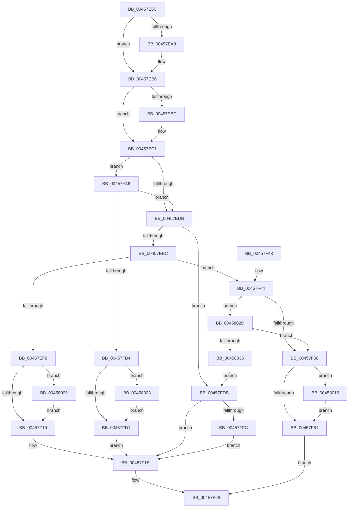

# CcChangeBackingFileObject

- RVA: `0x00457E5C`–`0x00458038` (길이 `476` bytes)
- VA: `0x0000000140457E5C`
- 실행 섹션: `.text`
- PDB 이름 있음: `예`; PDB Function 태그: `아니요`
- unwind 정보 RVA: `0x000A8270`
- 디코드: `118`개 명령, `476/476` bytes 표시
- 미해석 바이트: `0` (있으면 어셈블리에 `.byte`로 보존)

> 이 문서는 커널 이미지의 기계어와 PDB 기호를 분석해 생성했습니다. 4번과 5번은 함수 원형과 자료형을 바이너리 사용 방식에서 추정한 C 해석이며 원본 소스 복구 결과는 아닙니다.

## 1. Dependencies

- 직접 호출 지점: **16**; 고유 호출 대상: **9**
- 직접 호출자로 확인된 함수: **1**
- RIP 상대 이미지 참조: **3**

### Outgoing calls
- `0x00457E98` → [KeAbPreAcquire](../21/KeAbPreAcquire_function_00210230.md) (function, `0x00210230`)
- `0x00457EB1` → [ExfAcquirePushLockExclusiveEx](../20/ExfAcquirePushLockExclusiveEx_function_0020FC90.md) (function, `0x0020FC90`)
- `0x00457ECD` → [KeAcquireInStackQueuedSpinLock](../27/KeAcquireInStackQueuedSpinLock_function_002757A0.md) (function, `0x002757A0`)
- `0x00457EFD` → [KeReleaseInStackQueuedSpinLock](../34/KeReleaseInStackQueuedSpinLock_function_00342CE0.md) (function, `0x00342CE0`)
- `0x00457F21` → [KeAbPostRelease](../2E/KeAbPostRelease_function_002E1600.md) (function, `0x002E1600`)
- `0x00457F5B` → [ObFastReplaceObject](ObFastReplaceObject_function_0045819C.md) (function, `0x0045819C`)
- `0x00457F65` → [KeReleaseInStackQueuedSpinLock](../34/KeReleaseInStackQueuedSpinLock_function_00342CE0.md) (function, `0x00342CE0`)
- `0x00457F84` → [KeAbPostRelease](../2E/KeAbPostRelease_function_002E1600.md) (function, `0x002E1600`)
- `0x00457F93` → [ObfReferenceObjectWithTag](../21/ObfReferenceObjectWithTag_function_00210710.md) (function, `0x00210710`)
- `0x00457F9D` → [ObDereferenceObjectDeferDeleteWithTag](../26/ObDereferenceObjectDeferDeleteWithTag_function_00263EA0.md) (function, `0x00263EA0`)
- `0x00457FB9` → [KeReleaseInStackQueuedSpinLock](../34/KeReleaseInStackQueuedSpinLock_function_00342CE0.md) (function, `0x00342CE0`)
- `0x00457FE0` → [KeReleaseInStackQueuedSpinLock](../34/KeReleaseInStackQueuedSpinLock_function_00342CE0.md) (function, `0x00342CE0`)
- `0x00457FFF` → [ExfTryToWakePushLock](../26/ExfTryToWakePushLock_function_00265DD0.md) (function, `0x00265DD0`)
- `0x0045800C` → [ExfTryToWakePushLock](../26/ExfTryToWakePushLock_function_00265DD0.md) (function, `0x00265DD0`)
- `0x00458019` → [ExfTryToWakePushLock](../26/ExfTryToWakePushLock_function_00265DD0.md) (function, `0x00265DD0`)
- `0x00458026` → [ExfTryToWakePushLock](../26/ExfTryToWakePushLock_function_00265DD0.md) (function, `0x00265DD0`)

### Direct callers
- [FsRtlChangeBackingFileObject](FsRtlChangeBackingFileObject_function_00458040.md) at `0x00458078`

### Static image references
- `0x00457E78` → RVA `0x00F8F508` (`.data`; read)
- `0x00457EC6` → RVA `0x00E11CC0` (`.data`; read)
- `0x00457F06` → RVA `0x00F8F508` (`.data`; read/write)

## 2. Other-region calls and transfers

- 다른 실행 섹션으로 향하는 call: **0**
- 별도 외부 분기/꼬리 이동을 확인하지 못했습니다.

## 3. Assembly (complete function range)

```asm
00457E5C  4C 8B DC                        mov r11, rsp
00457E5F  49 89 5B 08                     mov qword ptr [r11 + 8], rbx
00457E63  49 89 6B 10                     mov qword ptr [r11 + 0x10], rbp
00457E67  49 89 73 18                     mov qword ptr [r11 + 0x18], rsi
00457E6B  49 89 7B 20                     mov qword ptr [r11 + 0x20], rdi
00457E6F  41 56                           push r14
00457E71  48 83 EC 40                     sub rsp, 0x40
00457E75  0F 57 C0                        xorps xmm0, xmm0
00457E78  4C 8D 35 89 76 B3 00            lea r14, [rip + 0xb37689]
00457E7F  48 8B EA                        mov rbp, rdx
00457E82  48 8B F1                        mov rsi, rcx
00457E85  33 C0                           xor eax, eax
00457E87  49 8B CE                        mov rcx, r14
00457E8A  0F 11 44 24 20                  movups xmmword ptr [rsp + 0x20], xmm0
00457E8F  45 33 C0                        xor r8d, r8d
00457E92  49 89 43 E8                     mov qword ptr [r11 - 0x18], rax
00457E96  33 D2                           xor edx, edx
00457E98  E8 93 83 DB FF                  call 0x140210230
00457E9D  F0 49 0F BA 2E 00               lock bts qword ptr [r14], 0
00457EA3  48 8B F8                        mov rdi, rax
00457EA6  73 0E                           jae 0x140457eb6
00457EA8  4D 8B C6                        mov r8, r14
00457EAB  48 8B D0                        mov rdx, rax
00457EAE  49 8B CE                        mov rcx, r14
00457EB1  E8 DA 7D DB FF                  call 0x14020fc90
00457EB6  33 DB                           xor ebx, ebx
00457EB8  48 85 FF                        test rdi, rdi
00457EBB  74 04                           je 0x140457ec1
00457EBD  C6 47 0A 01                     mov byte ptr [rdi + 0xa], 1
00457EC1  48 8D 54 24 20                  lea rdx, [rsp + 0x20]
00457EC6  48 8D 0D F3 9D 9B 00            lea rcx, [rip + 0x9b9df3]
00457ECD  E8 CE D8 E1 FF                  call 0x1402757a0
00457ED2  48 85 F6                        test rsi, rsi
00457ED5  0F 85 CB 00 00 00               jne 0x140457fa6
00457EDB  48 8B 45 28                     mov rax, qword ptr [rbp + 0x28]
00457EDF  48 8B 48 08                     mov rcx, qword ptr [rax + 8]
00457EE3  48 85 C9                        test rcx, rcx
00457EE6  0F 84 EF 00 00 00               je 0x140457fdb
00457EEC  F7 81 98 00 00 00 00 00 10 00   test dword ptr [rcx + 0x98], 0x100000
00457EF6  74 4C                           je 0x140457f44
00457EF8  48 8D 4C 24 20                  lea rcx, [rsp + 0x20]
00457EFD  E8 DE AD EE FF                  call 0x140342ce0
00457F02  48 83 C8 FF                     or rax, 0xffffffffffffffff
00457F06  F0 48 0F C1 05 F9 75 B3 00      lock xadd qword ptr [rip + 0xb375f9], rax
00457F0F  24 06                           and al, 6
00457F11  3C 02                           cmp al, 2
00457F13  0F 84 F0 00 00 00               je 0x140458009
00457F19  BB BB 00 00 C0                  mov ebx, 0xc00000bb
00457F1E  49 8B CE                        mov rcx, r14
00457F21  E8 DA 96 E8 FF                  call 0x1402e1600
00457F26  8B C3                           mov eax, ebx
00457F28  48 8B 5C 24 50                  mov rbx, qword ptr [rsp + 0x50]
00457F2D  48 8B 6C 24 58                  mov rbp, qword ptr [rsp + 0x58]
00457F32  48 8B 74 24 60                  mov rsi, qword ptr [rsp + 0x60]
00457F37  48 8B 7C 24 68                  mov rdi, qword ptr [rsp + 0x68]
00457F3C  48 83 C4 40                     add rsp, 0x40
00457F40  41 5E                           pop r14
00457F42  C3                              ret
00457F43  CC                              int3
00457F44  48 83 C1 60                     add rcx, 0x60
00457F48  48 8B 39                        mov rdi, qword ptr [rcx]
00457F4B  48 83 E7 F0                     and rdi, 0xfffffffffffffff0
00457F4F  48 85 F6                        test rsi, rsi
00457F52  0F 85 D5 00 00 00               jne 0x14045802d
00457F58  48 8B D5                        mov rdx, rbp
00457F5B  E8 3C 02 00 00                  call 0x14045819c
00457F60  48 8D 4C 24 20                  lea rcx, [rsp + 0x20]
00457F65  E8 76 AD EE FF                  call 0x140342ce0
00457F6A  48 83 C8 FF                     or rax, 0xffffffffffffffff
00457F6E  F0 48 0F C1 05 91 75 B3 00      lock xadd qword ptr [rip + 0xb37591], rax
00457F77  24 06                           and al, 6
00457F79  3C 02                           cmp al, 2
00457F7B  0F 84 95 00 00 00               je 0x140458016
00457F81  49 8B CE                        mov rcx, r14
00457F84  E8 77 96 E8 FF                  call 0x1402e1600
00457F89  BB 44 66 6C 74                  mov ebx, 0x746c6644
00457F8E  48 8B CD                        mov rcx, rbp
00457F91  8B D3                           mov edx, ebx
00457F93  E8 78 87 DB FF                  call 0x140210710
00457F98  8B D3                           mov edx, ebx
00457F9A  48 8B CF                        mov rcx, rdi
00457F9D  E8 FE BE E0 FF                  call 0x140263ea0
00457FA2  33 C0                           xor eax, eax
00457FA4  EB 82                           jmp 0x140457f28
00457FA6  48 8B 45 28                     mov rax, qword ptr [rbp + 0x28]
00457FAA  48 39 46 28                     cmp qword ptr [rsi + 0x28], rax
00457FAE  0F 84 27 FF FF FF               je 0x140457edb
00457FB4  48 8D 4C 24 20                  lea rcx, [rsp + 0x20]
00457FB9  E8 22 AD EE FF                  call 0x140342ce0
00457FBE  48 83 C8 FF                     or rax, 0xffffffffffffffff
00457FC2  F0 48 0F C1 05 3D 75 B3 00      lock xadd qword ptr [rip + 0xb3753d], rax
00457FCB  24 06                           and al, 6
00457FCD  3C 02                           cmp al, 2
00457FCF  74 52                           je 0x140458023
00457FD1  BB F0 00 00 C0                  mov ebx, 0xc00000f0
00457FD6  E9 43 FF FF FF                  jmp 0x140457f1e
00457FDB  48 8D 4C 24 20                  lea rcx, [rsp + 0x20]
00457FE0  E8 FB AC EE FF                  call 0x140342ce0
00457FE5  48 83 C8 FF                     or rax, 0xffffffffffffffff
00457FE9  F0 48 0F C1 05 16 75 B3 00      lock xadd qword ptr [rip + 0xb37516], rax
00457FF2  24 06                           and al, 6
00457FF4  3C 02                           cmp al, 2
00457FF6  0F 85 22 FF FF FF               jne 0x140457f1e
00457FFC  49 8B CE                        mov rcx, r14
00457FFF  E8 CC DD E0 FF                  call 0x140265dd0
00458004  E9 15 FF FF FF                  jmp 0x140457f1e
00458009  49 8B CE                        mov rcx, r14
0045800C  E8 BF DD E0 FF                  call 0x140265dd0
00458011  E9 03 FF FF FF                  jmp 0x140457f19
00458016  49 8B CE                        mov rcx, r14
00458019  E8 B2 DD E0 FF                  call 0x140265dd0
0045801E  E9 5E FF FF FF                  jmp 0x140457f81
00458023  49 8B CE                        mov rcx, r14
00458026  E8 A5 DD E0 FF                  call 0x140265dd0
0045802B  EB A4                           jmp 0x140457fd1
0045802D  48 3B FE                        cmp rdi, rsi
00458030  0F 84 22 FF FF FF               je 0x140457f58
00458036  EB A3                           jmp 0x140457fdb
```

## 4. C-style interpretation (structured pseudocode)

```c
__int64 __fastcall CcChangeBackingFileObject(__int64 a1, __int64 a2, int a3)
{
    __int64 result;
    __int64 v_rbx;
    __int64 v_rdi;
    __int64 v_rsp;
    unsigned __int64 v_stack_m28;
    unsigned __int64 v_stack_p10;
    unsigned __int64 v_stack_p18;
    unsigned __int64 v_stack_p20;
    unsigned __int64 v_stack_p8;

    *(unsigned __int64 *)(v_rsp + 8) = v_rbx;
    *(unsigned __int64 *)(v_rsp + 16) = v_rbp;
    *(unsigned __int64 *)(v_rsp + 24) = v_rsi;
    *(unsigned __int64 *)(v_rsp + 32) = v_rdi;
    v_rsp = (v_rsp) - (64);
    result = 0;
    v_stack_m28 = v_xmm0;
    a3 = 0;
    *(unsigned __int64 *)(v_rsp - 24) = 0;
    a2 = 0;
    result = KeAbPreAcquire(v_rip + 11761289, a2, a3, a4);
    if (!(condition_is_above_or_equal)) {
        a3 = v_rip + 11761289;
        a2 = result;
        a1 = v_rip + 11761289;
        result = ExfAcquirePushLockExclusiveEx(a1, a2, a3, a4);
    }
    v_rbx = 0;
    if (result != 0) {
        *(unsigned __int8 *)(result + 10) = 1;
    }
    result = KeAcquireInStackQueuedSpinLock(v_rip + 10198515, v_stack_m28, a3, a4);
    if (a1 != 0) goto loc_00457FA6;
loc_00457EDB:
    if (*(unsigned __int64 *)(*(unsigned __int64 *)(a2 + 40) + 8) == 0) goto loc_00457FDB;
    if (((*(unsigned int *)(*(unsigned __int64 *)(*(unsigned __int64 *)(a2 + 40) + 8) + 152)) & (0x100000ULL)) == 0) goto loc_00457F44;
    result = KeReleaseInStackQueuedSpinLock(v_stack_m28, v_stack_m28, a3, a4);
    result = (result) | (-1);
    result = (unsigned __int8)((result) & (6));
    if (((unsigned __int8)(result)) == 2) goto loc_00458009;
loc_00457F19:
loc_00457F1E:
    result = KeAbPostRelease(v_rip + 11761289, v_stack_m28, a3, a4);
loc_00457F28:
    v_rsp = (v_rsp) + (64);
    return (unsigned int)((unsigned int)((unsigned int)(0xC00000BBULL)));
loc_00457F44:
    a1 = (v_rip + 11761289) + (96);
    v_rdi = (*(unsigned __int64 *)(a1)) & (-16);
    if (v_stack_p18 != 0) goto loc_0045802D;
loc_00457F58:
    result = ObFastReplaceObject(a1, v_stack_p10, a3, a4);
    result = KeReleaseInStackQueuedSpinLock(v_stack_p20, v_stack_p10, a3, a4);
    result = (result) | (-1);
    result = (unsigned __int8)((result) & (6));
    if (((unsigned __int8)(result)) == 2) goto loc_00458016;
loc_00457F81:
    result = KeAbPostRelease(v_rip + 11761289, v_stack_p10, a3, a4);
    result = ObfReferenceObjectWithTag(v_stack_p10, (unsigned int)((unsigned int)((unsigned int)(0x746C6644ULL))), a3, a4);
    result = ObDereferenceObjectDeferDeleteWithTag(v_rdi, (unsigned int)((unsigned int)((unsigned int)(0x746C6644ULL))), a3, a4);
    result = 0;
    goto loc_00457F28;
loc_00457FA6:
    if ((*(unsigned __int64 *)(v_stack_p18 + 40)) == (*(unsigned __int64 *)(v_stack_p10 + 40))) goto loc_00457EDB;
    result = KeReleaseInStackQueuedSpinLock(v_stack_p20, (unsigned int)((unsigned int)((unsigned int)(0x746C6644ULL))), a3, a4);
    result = (result) | (-1);
    result = (unsigned __int8)((result) & (6));
    if (((unsigned __int8)(result)) == 2) goto loc_00458023;
loc_00457FD1:
    goto loc_00457F1E;
loc_00457FDB:
    result = KeReleaseInStackQueuedSpinLock(v_stack_p20, (unsigned int)((unsigned int)((unsigned int)(0x746C6644ULL))), a3, a4);
    result = (result) | (-1);
    result = (unsigned __int8)((result) & (6));
    if (((unsigned __int8)(result)) != 2) goto loc_00457F1E;
    result = ExfTryToWakePushLock(v_rip + 11761289, (unsigned int)((unsigned int)((unsigned int)(0x746C6644ULL))), a3, a4);
    goto loc_00457F1E;
loc_00458009:
    result = ExfTryToWakePushLock(v_rip + 11761289, (unsigned int)((unsigned int)((unsigned int)(0x746C6644ULL))), a3, a4);
    goto loc_00457F19;
loc_00458016:
    result = ExfTryToWakePushLock(v_rip + 11761289, (unsigned int)((unsigned int)((unsigned int)(0x746C6644ULL))), a3, a4);
    goto loc_00457F81;
loc_00458023:
    result = ExfTryToWakePushLock(v_rip + 11761289, (unsigned int)((unsigned int)((unsigned int)(0x746C6644ULL))), a3, a4);
    goto loc_00457FD1;
loc_0045802D:
    if (v_rdi == v_stack_p18) goto loc_00457F58;
    goto loc_00457FDB;
}
```

## 5. (Beta) C Style

```c
int64_t CcChangeBackingFileObject(int64_t Arg1, void *Arg2, int32_t Arg3)
{
    uint8_t *arg2 = (uint8_t *)Arg2;

    int64_t result;
    int64_t local_rbx;
    int64_t local_rdi;
    int64_t local_rsp;
    uint64_t v_stack_m28;
    uint64_t v_stack_p10;
    uint64_t v_stack_p18;
    uint64_t v_stack_p20;
    uint64_t v_stack_p8;

    *(uint64_t *)(local_rsp + 0x8) = local_rbx;
    *(uint64_t *)(local_rsp + 0x10) = local_rbp;
    *(uint64_t *)(local_rsp + 0x18) = local_rsi;
    *(uint64_t *)(local_rsp + 0x20) = local_rdi;
    local_rsp = (local_rsp) - (64);
    result = 0;
    v_stack_m28 = v_xmm0;
    Arg3 = 0;
    *(uint64_t *)(local_rsp - 0x18) = 0;
    Arg2 = 0;
    result = KeAbPreAcquire(v_rip + 11761289, Arg2, Arg3, a4);
    if (!(condition_is_above_or_equal)) {
        Arg3 = v_rip + 11761289;
        Arg2 = result;
        Arg1 = v_rip + 11761289;
        result = ExfAcquirePushLockExclusiveEx(Arg1, Arg2, Arg3, a4);
    }
    local_rbx = 0;
    if (result != 0) {
        *(uint8_t *)(result + 0xA) = 1;
    }
    result = KeAcquireInStackQueuedSpinLock(v_rip + 10198515, v_stack_m28, Arg3, a4);
    if (Arg1 != 0) goto loc_00457FA6;
loc_00457EDB:
    if (*(uint64_t *)(*(uint64_t *)(arg2 + 0x28) + 0x8) == 0) goto loc_00457FDB;
    if (((*(uint32_t *)(*(uint64_t *)(*(uint64_t *)(arg2 + 0x28) + 0x8) + 0x98)) & (0x100000ULL)) == 0) goto loc_00457F44;
    result = KeReleaseInStackQueuedSpinLock(v_stack_m28, v_stack_m28, Arg3, a4);
    result = (result) | (-1);
    result = (uint8_t)((result) & (6));
    if (((uint8_t)(result)) == 2) goto loc_00458009;
loc_00457F19:
loc_00457F1E:
    result = KeAbPostRelease(v_rip + 11761289, v_stack_m28, Arg3, a4);
loc_00457F28:
    local_rsp = (local_rsp) + (64);
    return (uint32_t)((uint32_t)((uint32_t)(0xC00000BBULL)));
loc_00457F44:
    Arg1 = (v_rip + 11761289) + (96);
    local_rdi = (*(uint64_t *)(Arg1)) & (-16);
    if (v_stack_p18 != 0) goto loc_0045802D;
loc_00457F58:
    result = ObFastReplaceObject(Arg1, v_stack_p10, Arg3, a4);
    result = KeReleaseInStackQueuedSpinLock(v_stack_p20, v_stack_p10, Arg3, a4);
    result = (result) | (-1);
    result = (uint8_t)((result) & (6));
    if (((uint8_t)(result)) == 2) goto loc_00458016;
loc_00457F81:
    result = KeAbPostRelease(v_rip + 11761289, v_stack_p10, Arg3, a4);
    result = ObfReferenceObjectWithTag(v_stack_p10, (uint32_t)((uint32_t)((uint32_t)(0x746C6644ULL))), Arg3, a4);
    result = ObDereferenceObjectDeferDeleteWithTag(local_rdi, (uint32_t)((uint32_t)((uint32_t)(0x746C6644ULL))), Arg3, a4);
    result = 0;
    goto loc_00457F28;
loc_00457FA6:
    if ((*(uint64_t *)(v_stack_p18 + 0x28)) == (*(uint64_t *)(v_stack_p10 + 0x28))) goto loc_00457EDB;
    result = KeReleaseInStackQueuedSpinLock(v_stack_p20, (uint32_t)((uint32_t)((uint32_t)(0x746C6644ULL))), Arg3, a4);
    result = (result) | (-1);
    result = (uint8_t)((result) & (6));
    if (((uint8_t)(result)) == 2) goto loc_00458023;
loc_00457FD1:
    goto loc_00457F1E;
loc_00457FDB:
    result = KeReleaseInStackQueuedSpinLock(v_stack_p20, (uint32_t)((uint32_t)((uint32_t)(0x746C6644ULL))), Arg3, a4);
    result = (result) | (-1);
    result = (uint8_t)((result) & (6));
    if (((uint8_t)(result)) != 2) goto loc_00457F1E;
    result = ExfTryToWakePushLock(v_rip + 11761289, (uint32_t)((uint32_t)((uint32_t)(0x746C6644ULL))), Arg3, a4);
    goto loc_00457F1E;
loc_00458009:
    result = ExfTryToWakePushLock(v_rip + 11761289, (uint32_t)((uint32_t)((uint32_t)(0x746C6644ULL))), Arg3, a4);
    goto loc_00457F19;
loc_00458016:
    result = ExfTryToWakePushLock(v_rip + 11761289, (uint32_t)((uint32_t)((uint32_t)(0x746C6644ULL))), Arg3, a4);
    goto loc_00457F81;
loc_00458023:
    result = ExfTryToWakePushLock(v_rip + 11761289, (uint32_t)((uint32_t)((uint32_t)(0x746C6644ULL))), Arg3, a4);
    goto loc_00457FD1;
loc_0045802D:
    if (local_rdi == v_stack_p18) goto loc_00457F58;
    goto loc_00457FDB;
}
```

### 관측된 메모리 오프셋

구조체 형식이 확인되지 않은 접근은 인자 기준의 오프셋으로만 기록했습니다.

| 기준 인자 | 오프셋 표현 | 폭 (bit) | 접근 |
|---|---:|---:|---|
| `Arg2` | `+ 0x28` | `64` | `R` |

## 6. Execution-region graph

[열기: 2D/3D 그래프와 함수 탐색 컨트롤 패널](../../../control-panel.html?section=text&rva=0x00457E5C&view=graph)

- 2D 그래프는 위에서 아래로 흐르고, 3D 그래프는 빈 공간을 드래그해 회전합니다. Shift+드래그는 이동, 휠은 확대·축소, 함수 노드 선택은 대상 보고서 이동입니다.

### Static fallback


