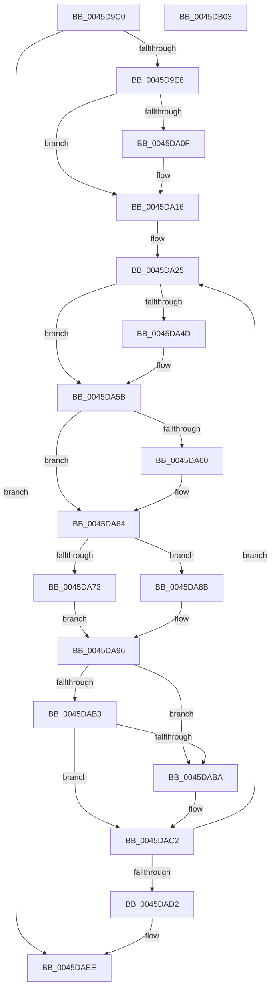

# CcCompleteAsyncReadWorker

- RVA: `0x0045D9C0`–`0x0045DB04` (길이 `324` bytes)
- VA: `0x000000014045D9C0`
- 실행 섹션: `.text`
- PDB 이름 있음: `예`; PDB Function 태그: `아니요`
- unwind 정보 RVA: `0x000A9680`
- 디코드: `95`개 명령, `324/324` bytes 표시
- 미해석 바이트: `0` (있으면 어셈블리에 `.byte`로 보존)

> 이 문서는 커널 이미지의 기계어와 PDB 기호를 분석해 생성했습니다. 4번과 5번은 함수 원형과 자료형을 바이너리 사용 방식에서 추정한 C 해석이며 원본 소스 복구 결과는 아닙니다.

## 1. Dependencies

- 직접 호출 지점: **9**; 고유 호출 대상: **9**
- 직접 호출자로 확인된 함수: **0**
- RIP 상대 이미지 참조: **1**

### Outgoing calls
- `0x0045DA28` → [CcCompleteAsyncRead](CcCompleteAsyncRead_function_0045E7DC.md) (function, `0x0045E7DC`)
- `0x0045DA30` → [CcFreeWorkQueueEntry](../35/CcFreeWorkQueueEntry_function_0035723C.md) (function, `0x0035723C`)
- `0x0045DA3D` → [KeAbPreAcquire](../21/KeAbPreAcquire_function_00210230.md) (function, `0x00210230`)
- `0x0045DA56` → [ExfAcquirePushLockExclusiveEx](../20/ExfAcquirePushLockExclusiveEx_function_0020FC90.md) (function, `0x0020FC90`)
- `0x0045DA8E` → [CcFindNextWorkQueueEntry](../35/CcFindNextWorkQueueEntry_function_00356BFC.md) (function, `0x00356BFC`)
- `0x0045DABD` → [ExfReleasePushLock](../26/ExfReleasePushLock_function_002638D0.md) (function, `0x002638D0`)
- `0x0045DAC5` → [KeAbPostRelease](../2E/KeAbPostRelease_function_002E1600.md) (function, `0x002E1600`)
- `0x0045DADA` → [CcDereferencePartitionAndPrivateVolumeCacheMap](../38/CcDereferencePartitionAndPrivateVolumeCacheMap_function_0038B94C.md) (function, `0x0038B94C`)
- `0x0045DAE9` → [ExFreePoolWithTag](../../poolcode/B8/ExFreePoolWithTag_function_00B82870.md) (function, `0x00B82870`)

### Direct callers
- 이 함수 시작 RVA로 연결되는 직접 call은 확인되지 않았습니다. 간접 호출은 완전히 역산할 수 없습니다.

### Static image references
- `0x0045D9E8` → RVA `0x00E65B88` (`.data`; read)

## 2. Other-region calls and transfers

- 다른 실행 섹션으로 향하는 call: **1**
  - `0x0045DAE9` → [ExFreePoolWithTag](../../poolcode/B8/ExFreePoolWithTag_function_00B82870.md) (`.text` → `POOLCODE`)
- 별도 외부 분기/꼬리 이동을 확인하지 못했습니다.

## 3. Assembly (complete function range)

```asm
0045D9C0  48 89 5C 24 20                  mov qword ptr [rsp + 0x20], rbx
0045D9C5  48 89 4C 24 08                  mov qword ptr [rsp + 8], rcx
0045D9CA  55                              push rbp
0045D9CB  56                              push rsi
0045D9CC  57                              push rdi
0045D9CD  41 54                           push r12
0045D9CF  41 55                           push r13
0045D9D1  41 56                           push r14
0045D9D3  41 57                           push r15
0045D9D5  48 83 EC 20                     sub rsp, 0x20
0045D9D9  48 8B D9                        mov rbx, rcx
0045D9DC  33 C9                           xor ecx, ecx
0045D9DE  83 7B 20 04                     cmp dword ptr [rbx + 0x20], 4
0045D9E2  0F 85 06 01 00 00               jne 0x14045daee
0045D9E8  38 0D 9A 81 A0 00               cmp byte ptr [rip + 0xa0819a], cl
0045D9EE  4C 8B 7B 40                     mov r15, qword ptr [rbx + 0x40]
0045D9F2  4C 8B 73 38                     mov r14, qword ptr [rbx + 0x38]
0045D9F6  48 8B 6B 48                     mov rbp, qword ptr [rbx + 0x48]
0045D9FA  8B 43 24                        mov eax, dword ptr [rbx + 0x24]
0045D9FD  48 8B 73 30                     mov rsi, qword ptr [rbx + 0x30]
0045DA01  49 8D BF 88 04 00 00            lea rdi, [r15 + 0x488]
0045DA08  4C 89 7C 24 70                  mov qword ptr [rsp + 0x70], r15
0045DA0D  75 07                           jne 0x14045da16
0045DA0F  49 8D BE C8 04 00 00            lea rdi, [r14 + 0x4c8]
0045DA16  4C 8B E0                        mov r12, rax
0045DA19  4C 8B E8                        mov r13, rax
0045DA1C  49 C1 E4 04                     shl r12, 4
0045DA20  8A D9                           mov bl, cl
0045DA22  45 33 FF                        xor r15d, r15d
0045DA25  48 8B CE                        mov rcx, rsi
0045DA28  E8 AF 0D 00 00                  call 0x14045e7dc
0045DA2D  48 8B CE                        mov rcx, rsi
0045DA30  E8 07 98 EF FF                  call 0x14035723c
0045DA35  45 33 C0                        xor r8d, r8d
0045DA38  33 D2                           xor edx, edx
0045DA3A  48 8B CF                        mov rcx, rdi
0045DA3D  E8 EE 27 DB FF                  call 0x140210230
0045DA42  F0 48 0F BA 2F 00               lock bts qword ptr [rdi], 0
0045DA48  48 8B F0                        mov rsi, rax
0045DA4B  73 0E                           jae 0x14045da5b
0045DA4D  4C 8B C7                        mov r8, rdi
0045DA50  48 8B D0                        mov rdx, rax
0045DA53  48 8B CF                        mov rcx, rdi
0045DA56  E8 35 22 DB FF                  call 0x14020fc90
0045DA5B  48 85 F6                        test rsi, rsi
0045DA5E  74 04                           je 0x14045da64
0045DA60  C6 46 0A 01                     mov byte ptr [rsi + 0xa], 1
0045DA64  4C 8B 85 08 01 00 00            mov r8, qword ptr [rbp + 0x108]
0045DA6B  4D 03 C4                        add r8, r12
0045DA6E  4D 39 00                        cmp qword ptr [r8], r8
0045DA71  75 18                           jne 0x14045da8b
0045DA73  48 8B 8D F8 00 00 00            mov rcx, qword ptr [rbp + 0xf8]
0045DA7A  B3 01                           mov bl, 1
0045DA7C  49 8B F7                        mov rsi, r15
0045DA7F  42 8B 04 A9                     mov eax, dword ptr [rcx + r13*4]
0045DA83  FF C8                           dec eax
0045DA85  42 89 04 A9                     mov dword ptr [rcx + r13*4], eax
0045DA89  EB 0B                           jmp 0x14045da96
0045DA8B  48 8B D5                        mov rdx, rbp
0045DA8E  E8 69 91 EF FF                  call 0x140356bfc
0045DA93  48 8B F0                        mov rsi, rax
0045DA96  0F 0D 0F                        prefetchw byte ptr [rdi]
0045DA99  48 8B 07                        mov rax, qword ptr [rdi]
0045DA9C  48 8B C8                        mov rcx, rax
0045DA9F  48 83 E1 F0                     and rcx, 0xfffffffffffffff0
0045DAA3  48 83 F9 10                     cmp rcx, 0x10
0045DAA7  48 8D 50 F0                     lea rdx, [rax - 0x10]
0045DAAB  49 0F 46 D7                     cmovbe rdx, r15
0045DAAF  A8 02                           test al, 2
0045DAB1  75 07                           jne 0x14045daba
0045DAB3  F0 48 0F B1 17                  lock cmpxchg qword ptr [rdi], rdx
0045DAB8  74 08                           je 0x14045dac2
0045DABA  48 8B CF                        mov rcx, rdi
0045DABD  E8 0E 5E E0 FF                  call 0x1402638d0
0045DAC2  48 8B CF                        mov rcx, rdi
0045DAC5  E8 36 3B E8 FF                  call 0x1402e1600
0045DACA  84 DB                           test bl, bl
0045DACC  0F 84 53 FF FF FF               je 0x14045da25
0045DAD2  48 8B 54 24 70                  mov rdx, qword ptr [rsp + 0x70]
0045DAD7  49 8B CE                        mov rcx, r14
0045DADA  E8 6D DE F2 FF                  call 0x14038b94c
0045DADF  48 8B 4C 24 60                  mov rcx, qword ptr [rsp + 0x60]
0045DAE4  BA 43 63 57 71                  mov edx, 0x71576343
0045DAE9  E8 82 4D 72 00                  call 0x140b82870
0045DAEE  48 8B 5C 24 78                  mov rbx, qword ptr [rsp + 0x78]
0045DAF3  48 83 C4 20                     add rsp, 0x20
0045DAF7  41 5F                           pop r15
0045DAF9  41 5E                           pop r14
0045DAFB  41 5D                           pop r13
0045DAFD  41 5C                           pop r12
0045DAFF  5F                              pop rdi
0045DB00  5E                              pop rsi
0045DB01  5D                              pop rbp
0045DB02  C3                              ret
0045DB03  CC                              int3
```

## 4. C-style interpretation (structured pseudocode)

```c
__int64 __fastcall CcCompleteAsyncReadWorker(__int64 a1, int a2, int a3)
{
    __int64 result;
    __int64 v_r12;
    __int64 v_r15;
    __int64 v_rdi;
    __int64 v_rsp;
    unsigned __int64 v_stack_p18;
    unsigned __int64 v_stack_p20;
    unsigned __int64 v_stack_p8;

    v_stack_p20 = v_rbx;
    v_stack_p8 = a1;
    v_rsp = (v_rsp) - (32);
    a1 = 0;
    if ((*(unsigned int *)(a1 + 32)) != 4) goto loc_0045DAEE;
    v_stack_p18 = *(unsigned __int64 *)(a1 + 64);
    v_rdi = *(unsigned __int64 *)(a1 + 64) + 1160;
    if ((*(unsigned __int8 *)(v_rip + 10518938)) == 0) {
        v_rdi = *(unsigned __int64 *)(a1 + 56) + 1224;
    }
    v_r12 = ((unsigned int)(*(unsigned int *)(a1 + 36))) << (4);
    v_r15 = 0;
loc_0045DA25:
    result = CcCompleteAsyncRead(*(unsigned __int64 *)(a1 + 48), a2, a3, a4);
    result = CcFreeWorkQueueEntry(*(unsigned __int64 *)(a1 + 48), a2, a3, a4);
    a3 = 0;
    a2 = 0;
    result = KeAbPreAcquire(v_rdi, a2, a3, a4);
    if (!(condition_is_above_or_equal)) {
        a3 = v_rdi;
        a2 = result;
        a1 = v_rdi;
        result = ExfAcquirePushLockExclusiveEx(a1, a2, a3, a4);
    }
    if (result != 0) {
        *(unsigned __int8 *)(result + 10) = 1;
    }
    a3 = (*(unsigned __int64 *)(*(unsigned __int64 *)(a1 + 72) + 264)) + (v_r12);
    if ((*(unsigned __int64 *)(a3)) != a3) goto loc_0045DA8B;
    result = (unsigned int)(((unsigned int)(*(unsigned int *)(*(unsigned __int64 *)(*(unsigned __int64 *)(a1 + 72) + 248) + (unsigned int)(*(unsigned int *)(a1 + 36)) * 4))) - 1);
    *(unsigned int *)(*(unsigned __int64 *)(*(unsigned __int64 *)(a1 + 72) + 248) + (unsigned int)(*(unsigned int *)(a1 + 36)) * 4) = (unsigned int)(result);
    goto loc_0045DA96;
loc_0045DA8B:
    result = CcFindNextWorkQueueEntry(*(unsigned __int64 *)(*(unsigned __int64 *)(a1 + 72) + 248), *(unsigned __int64 *)(a1 + 72), a3, a4);
loc_0045DA96:
    a1 = (*(unsigned __int64 *)(v_rdi)) & (-16);
    a2 = *(unsigned __int64 *)(v_rdi) - 16;
    if (a1 <= 16) { a2 = 0; }
    if ((((unsigned __int8)(*(unsigned __int64 *)(v_rdi))) & (2)) != 0) goto loc_0045DABA;
    result = *(unsigned __int64 *)(v_rdi);
    if ((((unsigned __int8)(*(unsigned __int64 *)(v_rdi))) & (2)) != 0) {
        a1 = v_rdi;
        result = ExfReleasePushLock(a1, a2, a3, a4);
    }
    result = KeAbPostRelease(v_rdi, a2, a3, a4);
    if (1 == 0) goto loc_0045DA25;
    result = CcDereferencePartitionAndPrivateVolumeCacheMap(*(unsigned __int64 *)(a1 + 56), v_stack_p18, a3, a4);
    result = ExFreePoolWithTag(v_stack_p8, (unsigned int)(0x71576343ULL), a3, a4);
loc_0045DAEE:
    v_rsp = (v_rsp) + (32);
    return result;
}
```

## 5. (Beta) C Style

```c
int64_t CcCompleteAsyncReadWorker(void *Arg1, int32_t Arg2, int32_t Arg3)
{
    uint8_t *arg1 = (uint8_t *)Arg1;

    int64_t result;
    int64_t local_r12;
    int64_t local_r15;
    int64_t local_rdi;
    int64_t local_rsp;
    uint64_t v_stack_p18;
    uint64_t v_stack_p20;
    uint64_t v_stack_p8;

    v_stack_p20 = local_rbx;
    v_stack_p8 = Arg1;
    local_rsp = (local_rsp) - (32);
    Arg1 = 0;
    if ((*(uint32_t *)(arg1 + 0x20)) != 4) goto loc_0045DAEE;
    v_stack_p18 = *(uint64_t *)(arg1 + 0x40);
    local_rdi = *(uint64_t *)(arg1 + 0x40) + 1160;
    if ((*(uint8_t *)(v_rip + 0xA0819A)) == 0) {
        local_rdi = *(uint64_t *)(arg1 + 0x38) + 1224;
    }
    local_r12 = ((uint32_t)(*(uint32_t *)(arg1 + 0x24))) << (4);
    local_r15 = 0;
loc_0045DA25:
    result = CcCompleteAsyncRead(*(uint64_t *)(arg1 + 0x30), Arg2, Arg3, a4);
    result = CcFreeWorkQueueEntry(*(uint64_t *)(arg1 + 0x30), Arg2, Arg3, a4);
    Arg3 = 0;
    Arg2 = 0;
    result = KeAbPreAcquire(local_rdi, Arg2, Arg3, a4);
    if (!(condition_is_above_or_equal)) {
        Arg3 = local_rdi;
        Arg2 = result;
        Arg1 = local_rdi;
        result = ExfAcquirePushLockExclusiveEx(Arg1, Arg2, Arg3, a4);
    }
    if (result != 0) {
        *(uint8_t *)(result + 0xA) = 1;
    }
    Arg3 = (*(uint64_t *)(*(uint64_t *)(arg1 + 0x48) + 0x108)) + (local_r12);
    if ((*(uint64_t *)(Arg3)) != Arg3) goto loc_0045DA8B;
    result = (uint32_t)(((uint32_t)(*(uint32_t *)(*(uint64_t *)(*(uint64_t *)(arg1 + 0x48) + 0xF8) + (uint32_t)(*(uint32_t *)(arg1 + 0x24)) * 4))) - 1);
    *(uint32_t *)(*(uint64_t *)(*(uint64_t *)(arg1 + 0x48) + 0xF8) + (uint32_t)(*(uint32_t *)(arg1 + 0x24)) * 4) = (uint32_t)(result);
    goto loc_0045DA96;
loc_0045DA8B:
    result = CcFindNextWorkQueueEntry(*(uint64_t *)(*(uint64_t *)(arg1 + 0x48) + 0xF8), *(uint64_t *)(arg1 + 0x48), Arg3, a4);
loc_0045DA96:
    Arg1 = (*(uint64_t *)(local_rdi)) & (-16);
    Arg2 = *(uint64_t *)(local_rdi) - 16;
    if (Arg1 <= 16) { Arg2 = 0; }
    if ((((uint8_t)(*(uint64_t *)(local_rdi))) & (2)) != 0) goto loc_0045DABA;
    result = *(uint64_t *)(local_rdi);
    if ((((uint8_t)(*(uint64_t *)(local_rdi))) & (2)) != 0) {
        Arg1 = local_rdi;
        result = ExfReleasePushLock(Arg1, Arg2, Arg3, a4);
    }
    result = KeAbPostRelease(local_rdi, Arg2, Arg3, a4);
    if (1 == 0) goto loc_0045DA25;
    result = CcDereferencePartitionAndPrivateVolumeCacheMap(*(uint64_t *)(arg1 + 0x38), v_stack_p18, Arg3, a4);
    result = ExFreePoolWithTag(v_stack_p8, (uint32_t)(0x71576343ULL), Arg3, a4);
loc_0045DAEE:
    local_rsp = (local_rsp) + (32);
    return result;
}
```

### 관측된 메모리 오프셋

구조체 형식이 확인되지 않은 접근은 인자 기준의 오프셋으로만 기록했습니다.

| 기준 인자 | 오프셋 표현 | 폭 (bit) | 접근 |
|---|---:|---:|---|
| `Arg1` | `+ 0x20` | `32` | `R` |
| `Arg1` | `+ 0x24` | `32` | `R` |
| `Arg1` | `+ 0x30` | `64` | `R` |
| `Arg1` | `+ 0x38` | `64` | `R` |
| `Arg1` | `+ 0x40` | `64` | `R` |
| `Arg1` | `+ 0x48` | `64` | `R` |

## 6. Execution-region graph

[열기: 2D/3D 그래프와 함수 탐색 컨트롤 패널](../../../control-panel.html?section=text&rva=0x0045D9C0&view=graph)

- 2D 그래프는 위에서 아래로 흐르고, 3D 그래프는 빈 공간을 드래그해 회전합니다. Shift+드래그는 이동, 휠은 확대·축소, 함수 노드 선택은 대상 보고서 이동입니다.

### Static fallback


