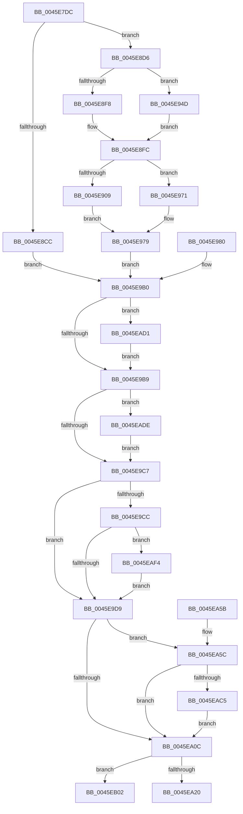

# CcCompleteAsyncRead

- RVA: `0x0045E7DC`–`0x0045EB21` (길이 `837` bytes)
- VA: `0x000000014045E7DC`
- 실행 섹션: `.text`
- PDB 이름 있음: `예`; PDB Function 태그: `아니요`
- unwind 정보 RVA: `0x000A9768`
- 디코드: `169`개 명령, `837/837` bytes 표시
- 미해석 바이트: `0` (있으면 어셈블리에 `.byte`로 보존)

> 이 문서는 커널 이미지의 기계어와 PDB 기호를 분석해 생성했습니다. 4번과 5번은 함수 원형과 자료형을 바이너리 사용 방식에서 추정한 C 해석이며 원본 소스 복구 결과는 아닙니다.

## 1. Dependencies

- 직접 호출 지점: **13**; 고유 호출 대상: **12**
- 직접 호출자로 확인된 함수: **3**
- RIP 상대 이미지 참조: **4**

### Outgoing calls
- `0x0045E806` → [PsGetPagePriorityThread](../3C/PsGetPagePriorityThread_function_003C3E80.md) (function, `0x003C3E80`)
- `0x0045E8A3` → [PsSetPagePriorityThread](../3C/PsSetPagePriorityThread_function_003C4138.md) (function, `0x003C4138`)
- `0x0045E946` → [CcMapAndCopyFromCache](../../page/A4/CcMapAndCopyFromCache_function_00A47060.md) (function, `0x00A47060`)
- `0x0045E963` → [MmMapLockedPagesSpecifyCache](../31/MmMapLockedPagesSpecifyCache_function_00318800.md) (function, `0x00318800`)
- `0x0045E9F6` → [PsSetPagePriorityThread](../3C/PsSetPagePriorityThread_function_003C4138.md) (function, `0x003C4138`)
- `0x0045EA2F` → [KeAcquireInStackQueuedSpinLock](../27/KeAcquireInStackQueuedSpinLock_function_002757A0.md) (function, `0x002757A0`)
- `0x0045EA37` → [CcDecrementOpenCount](../38/CcDecrementOpenCount_function_0038B75C.md) (function, `0x0038B75C`)
- `0x0045EA44` → [KeReleaseInStackQueuedSpinLock](../34/KeReleaseInStackQueuedSpinLock_function_00342CE0.md) (function, `0x00342CE0`)
- `0x0045EA6C` → [KeQueryPerformanceCounter](../37/KeQueryPerformanceCounter_function_0037E7E0.md) (function, `0x0037E7E0`)
- `0x0045EA9A` → [CcTelemetryBucketizeLatency](../../page/A6/CcTelemetryBucketizeLatency_function_00A67334.md) (function, `0x00A67334`)
- `0x0045EAD4` → [IoDiskIoAttributionDereference](../34/IoDiskIoAttributionDereference_function_00349978.md) (function, `0x00349978`)
- `0x0045EAF8` → [guard_dispatch_icall](../6B/guard_dispatch_icall_function_006BAAD0.md) (function, `0x006BAAD0`)
- `0x0045EB1B` → [KeBugCheckEx](../4F/KeBugCheckEx_function_004FD660.md) (function, `0x004FD660`)

### Direct callers
- [CcPostWorkQueueAsyncRead](CcPostWorkQueueAsyncRead_function_0045D624.md) at `0x0045D742`
- [CcCompleteAsyncReadWorker](CcCompleteAsyncReadWorker_function_0045D9C0.md) at `0x0045DA28`
- [CcAsyncReadWorker](CcAsyncReadWorker_function_0045DB10.md) at `0x0045DEF0`
- [CcAsyncReadWorker](CcAsyncReadWorker_function_0045DB10.md) at `0x0045DF65`

### Static image references
- `0x0045EA03` → RVA `0x00F8F2A1` (`.data`; read)
- `0x0045EA7D` → RVA `0x00F8F268` (`.data`; read)
- `0x0045EADE` → RVA `0x00E65B98` (`.data`; read)
- `0x0045EAE8` → RVA `0x00E65B98` (`.data`; write)

## 2. Other-region calls and transfers

- 다른 실행 섹션으로 향하는 call: **2**
  - `0x0045E946` → [CcMapAndCopyFromCache](../../page/A4/CcMapAndCopyFromCache_function_00A47060.md) (`.text` → `PAGE`)
  - `0x0045EA9A` → [CcTelemetryBucketizeLatency](../../page/A6/CcTelemetryBucketizeLatency_function_00A67334.md) (`.text` → `PAGE`)
- 별도 외부 분기/꼬리 이동을 확인하지 못했습니다.

## 3. Assembly (complete function range)

```asm
0045E7DC  48 89 4C 24 08                  mov qword ptr [rsp + 8], rcx
0045E7E1  53                              push rbx
0045E7E2  57                              push rdi
0045E7E3  41 54                           push r12
0045E7E5  41 55                           push r13
0045E7E7  41 56                           push r14
0045E7E9  41 57                           push r15
0045E7EB  48 81 EC E8 00 00 00            sub rsp, 0xe8
0045E7F2  4C 8B F1                        mov r14, rcx
0045E7F5  65 4C 8B 04 25 88 01 00 00      mov r8, qword ptr gs:[0x188]
0045E7FE  4C 89 44 24 78                  mov qword ptr [rsp + 0x78], r8
0045E803  49 8B C8                        mov rcx, r8
0045E806  E8 75 56 F6 FF                  call 0x1403c3e80
0045E80B  89 84 24 38 01 00 00            mov dword ptr [rsp + 0x138], eax
0045E812  83 A4 24 28 01 00 00 00         and dword ptr [rsp + 0x128], 0
0045E81A  83 64 24 50 00                  and dword ptr [rsp + 0x50], 0
0045E81F  0F 57 C0                        xorps xmm0, xmm0
0045E822  33 C0                           xor eax, eax
0045E824  0F 11 84 24 B0 00 00 00         movups xmmword ptr [rsp + 0xb0], xmm0
0045E82C  48 89 84 24 C0 00 00 00         mov qword ptr [rsp + 0xc0], rax
0045E834  4D 8B 7E 10                     mov r15, qword ptr [r14 + 0x10]
0045E838  4C 89 BC 24 80 00 00 00         mov qword ptr [rsp + 0x80], r15
0045E840  49 8B 46 20                     mov rax, qword ptr [r14 + 0x20]
0045E844  48 89 84 24 A0 00 00 00         mov qword ptr [rsp + 0xa0], rax
0045E84C  49 8B 5E 18                     mov rbx, qword ptr [r14 + 0x18]
0045E850  41 8B 46 28                     mov eax, dword ptr [r14 + 0x28]
0045E854  89 84 24 30 01 00 00            mov dword ptr [rsp + 0x130], eax
0045E85B  41 8B 4E 38                     mov ecx, dword ptr [r14 + 0x38]
0045E85F  89 4C 24 54                     mov dword ptr [rsp + 0x54], ecx
0045E863  49 8B 46 40                     mov rax, qword ptr [r14 + 0x40]
0045E867  48 89 84 24 90 00 00 00         mov qword ptr [rsp + 0x90], rax
0045E86F  4D 8B 66 48                     mov r12, qword ptr [r14 + 0x48]
0045E873  4C 89 A4 24 A8 00 00 00         mov qword ptr [rsp + 0xa8], r12
0045E87B  4D 8B 6E 50                     mov r13, qword ptr [r14 + 0x50]
0045E87F  4C 89 6C 24 70                  mov qword ptr [rsp + 0x70], r13
0045E884  49 8B 46 68                     mov rax, qword ptr [r14 + 0x68]
0045E888  48 89 44 24 58                  mov qword ptr [rsp + 0x58], rax
0045E88D  48 89 44 24 68                  mov qword ptr [rsp + 0x68], rax
0045E892  49 8B 7E 78                     mov rdi, qword ptr [r14 + 0x78]
0045E896  48 89 BC 24 88 00 00 00         mov qword ptr [rsp + 0x88], rdi
0045E89E  8B D1                           mov edx, ecx
0045E8A0  49 8B C8                        mov rcx, r8
0045E8A3  E8 90 58 F6 FF                  call 0x1403c4138
0045E8A8  90                              nop
0045E8A9  65 48 8B 04 25 88 01 00 00      mov rax, qword ptr gs:[0x188]
0045E8B2  48 89 84 24 C8 00 00 00         mov qword ptr [rsp + 0xc8], rax
0045E8BA  48 C7 80 50 05 00 00 07 00 00 00  mov qword ptr [rax + 0x550], 7
0045E8C5  41 83 3C 24 00                  cmp dword ptr [r12], 0
0045E8CA  7D 0A                           jge 0x14045e8d6
0045E8CC  48 8B 44 24 58                  mov rax, qword ptr [rsp + 0x58]
0045E8D1  E9 DA 00 00 00                  jmp 0x14045e9b0
0045E8D6  41 C7 04 24 00 00 00 00         mov dword ptr [r12], 0
0045E8DE  8B 94 24 30 01 00 00            mov edx, dword ptr [rsp + 0x130]
0045E8E5  49 89 54 24 08                  mov qword ptr [r12 + 8], rdx
0045E8EA  48 8B 8C 24 90 00 00 00         mov rcx, qword ptr [rsp + 0x90]
0045E8F2  F6 41 0A 05                     test byte ptr [rcx + 0xa], 5
0045E8F6  74 55                           je 0x14045e94d
0045E8F8  48 8B 41 18                     mov rax, qword ptr [rcx + 0x18]
0045E8FC  48 89 84 24 98 00 00 00         mov qword ptr [rsp + 0x98], rax
0045E904  48 85 C0                        test rax, rax
0045E907  74 68                           je 0x14045e971
0045E909  48 83 64 24 40 00               and qword ptr [rsp + 0x40], 0
0045E90F  48 8B 4C 24 58                  mov rcx, qword ptr [rsp + 0x58]
0045E914  48 89 4C 24 38                  mov qword ptr [rsp + 0x38], rcx
0045E919  44 8B 44 24 54                  mov r8d, dword ptr [rsp + 0x54]
0045E91E  44 89 44 24 30                  mov dword ptr [rsp + 0x30], r8d
0045E923  48 8D 8C 24 28 01 00 00         lea rcx, [rsp + 0x128]
0045E92B  48 89 4C 24 28                  mov qword ptr [rsp + 0x28], rcx
0045E930  48 89 44 24 20                  mov qword ptr [rsp + 0x20], rax
0045E935  41 B1 01                        mov r9b, 1
0045E938  44 8B C2                        mov r8d, edx
0045E93B  48 8B D3                        mov rdx, rbx
0045E93E  48 8B 8C 24 A0 00 00 00         mov rcx, qword ptr [rsp + 0xa0]
0045E946  E8 15 87 5E 00                  call 0x140a47060
0045E94B  EB 2C                           jmp 0x14045e979
0045E94D  C7 44 24 28 20 00 00 40         mov dword ptr [rsp + 0x28], 0x40000020
0045E955  83 64 24 20 00                  and dword ptr [rsp + 0x20], 0
0045E95A  45 33 C9                        xor r9d, r9d
0045E95D  33 D2                           xor edx, edx
0045E95F  45 8D 41 01                     lea r8d, [r9 + 1]
0045E963  E8 98 9E EB FF                  call 0x140318800
0045E968  8B 94 24 30 01 00 00            mov edx, dword ptr [rsp + 0x130]
0045E96F  EB 8B                           jmp 0x14045e8fc
0045E971  41 C7 04 24 9A 00 00 C0         mov dword ptr [r12], 0xc000009a
0045E979  48 8B 44 24 58                  mov rax, qword ptr [rsp + 0x58]
0045E97E  EB 30                           jmp 0x14045e9b0
0045E980  8B 4C 24 50                     mov ecx, dword ptr [rsp + 0x50]
0045E984  48 8B 84 24 A8 00 00 00         mov rax, qword ptr [rsp + 0xa8]
0045E98C  89 08                           mov dword ptr [rax], ecx
0045E98E  4C 8B B4 24 20 01 00 00         mov r14, qword ptr [rsp + 0x120]
0045E996  4C 8B 6C 24 70                  mov r13, qword ptr [rsp + 0x70]
0045E99B  4C 8B BC 24 80 00 00 00         mov r15, qword ptr [rsp + 0x80]
0045E9A3  48 8B 44 24 68                  mov rax, qword ptr [rsp + 0x68]
0045E9A8  48 8B BC 24 88 00 00 00         mov rdi, qword ptr [rsp + 0x88]
0045E9B0  48 85 C0                        test rax, rax
0045E9B3  0F 85 18 01 00 00               jne 0x14045ead1
0045E9B9  83 BC 24 28 01 00 00 00         cmp dword ptr [rsp + 0x128], 0
0045E9C1  0F 85 17 01 00 00               jne 0x14045eade
0045E9C7  4D 85 ED                        test r13, r13
0045E9CA  74 0D                           je 0x14045e9d9
0045E9CC  49 8B 45 00                     mov rax, qword ptr [r13]
0045E9D0  48 85 C0                        test rax, rax
0045E9D3  0F 85 1B 01 00 00               jne 0x14045eaf4
0045E9D9  65 48 8B 04 25 88 01 00 00      mov rax, qword ptr gs:[0x188]
0045E9E2  48 83 A0 50 05 00 00 00         and qword ptr [rax + 0x550], 0
0045E9EA  8B 94 24 38 01 00 00            mov edx, dword ptr [rsp + 0x138]
0045E9F1  48 8B 4C 24 78                  mov rcx, qword ptr [rsp + 0x78]
0045E9F6  E8 3D 57 F6 FF                  call 0x1403c4138
0045E9FB  F0 41 FF 8F 10 02 00 00         lock dec dword ptr [r15 + 0x210]
0045EA03  80 3D 97 08 B3 00 00            cmp byte ptr [rip + 0xb30897], 0
0045EA0A  74 50                           je 0x14045ea5c
0045EA0C  49 8B 8E 88 00 00 00            mov rcx, qword ptr [r14 + 0x88]
0045EA13  49 3B 8F 18 02 00 00            cmp rcx, qword ptr [r15 + 0x218]
0045EA1A  0F 85 E2 00 00 00               jne 0x14045eb02
0045EA20  48 81 C1 00 03 00 00            add rcx, 0x300
0045EA27  48 8D 94 24 B0 00 00 00         lea rdx, [rsp + 0xb0]
0045EA2F  E8 6C 6D E1 FF                  call 0x1402757a0
0045EA34  49 8B CF                        mov rcx, r15
0045EA37  E8 20 CD F2 FF                  call 0x14038b75c
0045EA3C  48 8D 8C 24 B0 00 00 00         lea rcx, [rsp + 0xb0]
0045EA44  E8 97 42 EE FF                  call 0x140342ce0
0045EA49  48 81 C4 E8 00 00 00            add rsp, 0xe8
0045EA50  41 5F                           pop r15
0045EA52  41 5E                           pop r14
0045EA54  41 5D                           pop r13
0045EA56  41 5C                           pop r12
0045EA58  5F                              pop rdi
0045EA59  5B                              pop rbx
0045EA5A  C3                              ret
0045EA5B  CC                              int3
0045EA5C  49 8B 9F 00 02 00 00            mov rbx, qword ptr [r15 + 0x200]
0045EA63  48 81 C3 E8 00 00 00            add rbx, 0xe8
0045EA6A  33 C9                           xor ecx, ecx
0045EA6C  E8 6F FD F1 FF                  call 0x14037e7e0
0045EA71  48 2B C7                        sub rax, rdi
0045EA74  48 69 C0 40 42 0F 00            imul rax, rax, 0xf4240
0045EA7B  48 99                           cqo
0045EA7D  48 F7 3D E4 07 B3 00            idiv qword ptr [rip + 0xb307e4]
0045EA84  48 89 44 24 60                  mov qword ptr [rsp + 0x60], rax
0045EA89  4C 8D 83 80 04 00 00            lea r8, [rbx + 0x480]
0045EA90  48 8D 93 20 04 00 00            lea rdx, [rbx + 0x420]
0045EA97  48 8B C8                        mov rcx, rax
0045EA9A  E8 95 88 60 00                  call 0x140a67334
0045EA9F  48 8B 83 10 04 00 00            mov rax, qword ptr [rbx + 0x410]
0045EAA6  48 FF C0                        inc rax
0045EAA9  48 89 83 10 04 00 00            mov qword ptr [rbx + 0x410], rax
0045EAB0  48 8B 93 18 04 00 00            mov rdx, qword ptr [rbx + 0x418]
0045EAB7  48 8B 44 24 60                  mov rax, qword ptr [rsp + 0x60]
0045EABC  48 3B C2                        cmp rax, rdx
0045EABF  0F 86 47 FF FF FF               jbe 0x14045ea0c
0045EAC5  48 89 83 18 04 00 00            mov qword ptr [rbx + 0x418], rax
0045EACC  E9 3B FF FF FF                  jmp 0x14045ea0c
0045EAD1  48 8B C8                        mov rcx, rax
0045EAD4  E8 9F AE EE FF                  call 0x140349978
0045EAD9  E9 DB FE FF FF                  jmp 0x14045e9b9
0045EADE  48 8B 05 B3 70 A0 00            mov rax, qword ptr [rip + 0xa070b3]
0045EAE5  48 FF C0                        inc rax
0045EAE8  48 89 05 A9 70 A0 00            mov qword ptr [rip + 0xa070a9], rax
0045EAEF  E9 D3 FE FF FF                  jmp 0x14045e9c7
0045EAF4  49 8B 4D 08                     mov rcx, qword ptr [r13 + 8]
0045EAF8  E8 D3 BF 25 00                  call 0x1406baad0
0045EAFD  E9 D7 FE FF FF                  jmp 0x14045e9d9
0045EB02  48 83 64 24 20 00               and qword ptr [rsp + 0x20], 0
0045EB08  45 33 C9                        xor r9d, r9d
0045EB0B  BA 1C 07 00 00                  mov edx, 0x71c
0045EB10  41 8D 49 34                     lea ecx, [r9 + 0x34]
0045EB14  49 C7 C0 20 04 00 C0            mov r8, 0xffffffffc0000420
0045EB1B  E8 40 EB 09 00                  call 0x1404fd660
0045EB20  90                              nop
```

## 4. C-style interpretation (structured pseudocode)

```c
__int64 __fastcall CcCompleteAsyncRead(__int64 a1)
{
    __int64 result;
    __int64 v_rbx;
    __int64 v_rsp;
    unsigned __int64 v_stack_m50;
    unsigned __int64 v_stack_m58;
    unsigned __int64 v_stack_m68;
    unsigned __int64 v_stack_m70;
    unsigned __int64 v_stack_m78;
    unsigned __int64 v_stack_m80;
    unsigned __int64 v_stack_m88;
    unsigned __int64 v_stack_m90;
    unsigned __int64 v_stack_m98;
    unsigned __int64 v_stack_mA0;
    unsigned __int64 v_stack_mA8;
    unsigned __int64 v_stack_mB0;
    unsigned __int64 v_stack_mC0;
    unsigned int v_stack_mC4;
    unsigned int v_stack_mC8;
    unsigned __int64 v_stack_mD8;
    unsigned __int64 v_stack_mE0;
    unsigned int v_stack_mE8;
    unsigned __int64 v_stack_mF0;
    unsigned __int64 v_stack_mF8;
    unsigned int v_stack_p10;
    unsigned int v_stack_p18;
    unsigned int v_stack_p20;
    unsigned __int64 v_stack_p60;
    unsigned __int64 v_stack_p8;

    v_stack_p8 = a1;
    v_rsp = (v_rsp) - (232);
    v_stack_mA0 = *(unsigned __int64 *)(gs_base + (0 + 392));
    result = PsGetPagePriorityThread(*(unsigned __int64 *)(gs_base + (0 + 392)), a2, *(unsigned __int64 *)(gs_base + (0 + 392)), a4);
    v_stack_p20 = (unsigned int)(result);
    result = 0;
    v_stack_m68 = v_xmm0;
    v_stack_m58 = 0;
    v_stack_m98 = *(unsigned __int64 *)(a1 + 16);
    v_stack_m78 = *(unsigned __int64 *)(a1 + 32);
    v_stack_p18 = (unsigned int)((unsigned int)(*(unsigned int *)(a1 + 40)));
    v_stack_mC4 = (unsigned int)((unsigned int)(*(unsigned int *)(a1 + 56)));
    v_stack_m88 = *(unsigned __int64 *)(a1 + 64);
    v_stack_m70 = *(unsigned __int64 *)(a1 + 72);
    v_stack_mA8 = *(unsigned __int64 *)(a1 + 80);
    v_stack_mC0 = *(unsigned __int64 *)(a1 + 104);
    v_stack_mB0 = *(unsigned __int64 *)(a1 + 104);
    v_stack_m90 = *(unsigned __int64 *)(a1 + 120);
    result = PsSetPagePriorityThread(*(unsigned __int64 *)(gs_base + (0 + 392)), (unsigned int)((unsigned int)((unsigned int)(*(unsigned int *)(a1 + 56)))), *(unsigned __int64 *)(gs_base + (0 + 392)), a4);
    v_stack_m50 = *(unsigned __int64 *)(gs_base + (0 + 392));
    *(unsigned __int64 *)(*(unsigned __int64 *)(gs_base + (0 + 392)) + 1360) = 7;
    if ((*(unsigned int *)(*(unsigned __int64 *)(a1 + 72))) >= 0) goto loc_0045E8D6;
    goto loc_0045E9B0;
loc_0045E8D6:
    *(unsigned int *)(*(unsigned __int64 *)(a1 + 72)) = 0;
    *(unsigned __int64 *)(*(unsigned __int64 *)(a1 + 72) + 8) = (unsigned int)(v_stack_p18);
    if (((*(unsigned __int8 *)(v_stack_m88 + 10)) & (5)) == 0) goto loc_0045E94D;
loc_0045E8FC:
    v_stack_m80 = *(unsigned __int64 *)(v_stack_m88 + 24);
    if (*(unsigned __int64 *)(v_stack_m88 + 24) == 0) goto loc_0045E971;
    v_stack_mE0 = v_stack_mC0;
    v_stack_mE8 = (unsigned int)((unsigned int)(v_stack_mC4));
    v_stack_mF0 = v_stack_p10;
    v_stack_mF8 = *(unsigned __int64 *)(v_stack_m88 + 24);
    result = CcMapAndCopyFromCache(v_stack_m78, *(unsigned __int64 *)(a1 + 24), (unsigned int)((unsigned int)((unsigned int)(v_stack_p18))), 1);
    goto loc_0045E979;
loc_0045E94D:
    v_stack_mF0 = 0x40000020ULL;
    a4 = 0;
    a2 = 0;
    result = MmMapLockedPagesSpecifyCache(v_stack_m78, a2, a4 + 1, a4);
    goto loc_0045E8FC;
loc_0045E971:
    *(unsigned int *)(*(unsigned __int64 *)(a1 + 72)) = 0xC000009AULL;
loc_0045E979:
    goto loc_0045E9B0;
loc_0045E9B0:
    if (v_stack_mC0 != 0) goto loc_0045EAD1;
loc_0045E9B9:
    if (v_stack_p10 != 0) goto loc_0045EADE;
loc_0045E9C7:
    if (*(unsigned __int64 *)(a1 + 80) == 0) goto loc_0045E9D9;
    if (*(unsigned __int64 *)(*(unsigned __int64 *)(a1 + 80)) != 0) goto loc_0045EAF4;
loc_0045E9D9:
    result = PsSetPagePriorityThread(v_stack_mA0, (unsigned int)(v_stack_p20), a4 + 1, a4);
    if ((*(unsigned __int8 *)(v_rip + 11733143)) == 0) goto loc_0045EA5C;
loc_0045EA0C:
    if ((*(unsigned __int64 *)(a1 + 136)) != (*(unsigned __int64 *)(*(unsigned __int64 *)(a1 + 16) + 536))) goto loc_0045EB02;
    a1 = (*(unsigned __int64 *)(a1 + 136)) + (768);
    result = KeAcquireInStackQueuedSpinLock(a1, v_stack_m68, a4 + 1, a4);
    result = CcDecrementOpenCount(*(unsigned __int64 *)(a1 + 16), v_stack_m68, a4 + 1, a4);
    result = KeReleaseInStackQueuedSpinLock(v_stack_m68, v_stack_m68, a4 + 1, a4);
    v_rsp = (v_rsp) + (232);
    return result;
loc_0045EA5C:
    v_rbx = (*(unsigned __int64 *)(*(unsigned __int64 *)(a1 + 16) + 512)) + (232);
    a1 = 0;
    result = KeQueryPerformanceCounter(a1, v_stack_m68, a4 + 1, a4);
    result = (result) - (*(unsigned __int64 *)(a1 + 120));
    result = (result) * (result);
    v_stack_p60 = result;
    result = CcTelemetryBucketizeLatency(result, v_rbx + 1056, v_rbx + 1152, a4);
    result = (*(unsigned __int64 *)(v_rbx + 1040)) + 1;
    *(unsigned __int64 *)(v_rbx + 1040) = result;
    if (v_stack_p60 <= (*(unsigned __int64 *)(v_rbx + 1048))) goto loc_0045EA0C;
    *(unsigned __int64 *)(v_rbx + 1048) = v_stack_p60;
    goto loc_0045EA0C;
loc_0045EAD1:
    result = IoDiskIoAttributionDereference(v_stack_p60, *(unsigned __int64 *)(v_rbx + 1048), v_rbx + 1152, a4);
    goto loc_0045E9B9;
loc_0045EADE:
    result = (*(unsigned __int64 *)(v_rip + 10514611)) + 1;
    *(unsigned __int64 *)(v_rip + 10514601) = result;
    goto loc_0045E9C7;
loc_0045EAF4:
    result = guard_dispatch_icall(*(unsigned __int64 *)(*(unsigned __int64 *)(a1 + 80) + 8), *(unsigned __int64 *)(v_rbx + 1048), v_rbx + 1152, a4);
    goto loc_0045E9D9;
loc_0045EB02:
    a4 = 0;
    result = KeBugCheckEx(a4 + 52, (unsigned int)(0x71CULL), 0xFFFFFFFFC0000420ULL, a4);
    return result;
}
```

## 5. (Beta) C Style

```c
int64_t CcCompleteAsyncRead(void *Arg1)
{
    uint8_t *arg1 = (uint8_t *)Arg1;

    int64_t result;
    int64_t local_rbx;
    int64_t local_rsp;
    uint64_t v_stack_m50;
    uint64_t v_stack_m58;
    uint64_t v_stack_m68;
    uint64_t v_stack_m70;
    uint64_t v_stack_m78;
    uint64_t v_stack_m80;
    uint64_t v_stack_m88;
    uint64_t v_stack_m90;
    uint64_t v_stack_m98;
    uint64_t v_stack_mA0;
    uint64_t v_stack_mA8;
    uint64_t v_stack_mB0;
    uint64_t v_stack_mC0;
    uint32_t v_stack_mC4;
    uint32_t v_stack_mC8;
    uint64_t v_stack_mD8;
    uint64_t v_stack_mE0;
    uint32_t v_stack_mE8;
    uint64_t v_stack_mF0;
    uint64_t v_stack_mF8;
    uint32_t v_stack_p10;
    uint32_t v_stack_p18;
    uint32_t v_stack_p20;
    uint64_t v_stack_p60;
    uint64_t v_stack_p8;

    v_stack_p8 = Arg1;
    local_rsp = (local_rsp) - (232);
    v_stack_mA0 = *(uint64_t *)(gs_base + (0 + 0x188));
    result = PsGetPagePriorityThread(*(uint64_t *)(gs_base + (0 + 0x188)), a2, *(uint64_t *)(gs_base + (0 + 0x188)), a4);
    v_stack_p20 = (uint32_t)(result);
    result = 0;
    v_stack_m68 = v_xmm0;
    v_stack_m58 = 0;
    v_stack_m98 = *(uint64_t *)(arg1 + 0x10);
    v_stack_m78 = *(uint64_t *)(arg1 + 0x20);
    v_stack_p18 = (uint32_t)((uint32_t)(*(uint32_t *)(arg1 + 0x28)));
    v_stack_mC4 = (uint32_t)((uint32_t)(*(uint32_t *)(arg1 + 0x38)));
    v_stack_m88 = *(uint64_t *)(arg1 + 0x40);
    v_stack_m70 = *(uint64_t *)(arg1 + 0x48);
    v_stack_mA8 = *(uint64_t *)(arg1 + 0x50);
    v_stack_mC0 = *(uint64_t *)(arg1 + 0x68);
    v_stack_mB0 = *(uint64_t *)(arg1 + 0x68);
    v_stack_m90 = *(uint64_t *)(arg1 + 0x78);
    result = PsSetPagePriorityThread(*(uint64_t *)(gs_base + (0 + 0x188)), (uint32_t)((uint32_t)((uint32_t)(*(uint32_t *)(arg1 + 0x38)))), *(uint64_t *)(gs_base + (0 + 0x188)), a4);
    v_stack_m50 = *(uint64_t *)(gs_base + (0 + 0x188));
    *(uint64_t *)(*(uint64_t *)(gs_base + (0 + 0x188)) + 0x550) = 7;
    if ((*(uint32_t *)(*(uint64_t *)(arg1 + 0x48))) >= 0) goto loc_0045E8D6;
    goto loc_0045E9B0;
loc_0045E8D6:
    *(uint32_t *)(*(uint64_t *)(arg1 + 0x48)) = 0;
    *(uint64_t *)(*(uint64_t *)(arg1 + 0x48) + 0x8) = (uint32_t)(v_stack_p18);
    if (((*(uint8_t *)(v_stack_m88 + 0xA)) & (5)) == 0) goto loc_0045E94D;
loc_0045E8FC:
    v_stack_m80 = *(uint64_t *)(v_stack_m88 + 0x18);
    if (*(uint64_t *)(v_stack_m88 + 0x18) == 0) goto loc_0045E971;
    v_stack_mE0 = v_stack_mC0;
    v_stack_mE8 = (uint32_t)((uint32_t)(v_stack_mC4));
    v_stack_mF0 = v_stack_p10;
    v_stack_mF8 = *(uint64_t *)(v_stack_m88 + 0x18);
    result = CcMapAndCopyFromCache(v_stack_m78, *(uint64_t *)(arg1 + 0x18), (uint32_t)((uint32_t)((uint32_t)(v_stack_p18))), 1);
    goto loc_0045E979;
loc_0045E94D:
    v_stack_mF0 = 0x40000020ULL;
    a4 = 0;
    a2 = 0;
    result = MmMapLockedPagesSpecifyCache(v_stack_m78, a2, a4 + 1, a4);
    goto loc_0045E8FC;
loc_0045E971:
    *(uint32_t *)(*(uint64_t *)(arg1 + 0x48)) = 0xC000009AULL;
loc_0045E979:
    goto loc_0045E9B0;
loc_0045E9B0:
    if (v_stack_mC0 != 0) goto loc_0045EAD1;
loc_0045E9B9:
    if (v_stack_p10 != 0) goto loc_0045EADE;
loc_0045E9C7:
    if (*(uint64_t *)(arg1 + 0x50) == 0) goto loc_0045E9D9;
    if (*(uint64_t *)(*(uint64_t *)(arg1 + 0x50)) != 0) goto loc_0045EAF4;
loc_0045E9D9:
    result = PsSetPagePriorityThread(v_stack_mA0, (uint32_t)(v_stack_p20), a4 + 1, a4);
    if ((*(uint8_t *)(v_rip + 0xB30897)) == 0) goto loc_0045EA5C;
loc_0045EA0C:
    if ((*(uint64_t *)(arg1 + 0x88)) != (*(uint64_t *)(*(uint64_t *)(arg1 + 0x10) + 0x218))) goto loc_0045EB02;
    Arg1 = (*(uint64_t *)(arg1 + 0x88)) + (768);
    result = KeAcquireInStackQueuedSpinLock(Arg1, v_stack_m68, a4 + 1, a4);
    result = CcDecrementOpenCount(*(uint64_t *)(arg1 + 0x10), v_stack_m68, a4 + 1, a4);
    result = KeReleaseInStackQueuedSpinLock(v_stack_m68, v_stack_m68, a4 + 1, a4);
    local_rsp = (local_rsp) + (232);
    return result;
loc_0045EA5C:
    local_rbx = (*(uint64_t *)(*(uint64_t *)(arg1 + 0x10) + 0x200)) + (232);
    Arg1 = 0;
    result = KeQueryPerformanceCounter(Arg1, v_stack_m68, a4 + 1, a4);
    result = (result) - (*(uint64_t *)(arg1 + 0x78));
    result = (result) * (result);
    v_stack_p60 = result;
    result = CcTelemetryBucketizeLatency(result, local_rbx + 1056, local_rbx + 1152, a4);
    result = (*(uint64_t *)(local_rbx + 0x410)) + 1;
    *(uint64_t *)(local_rbx + 0x410) = result;
    if (v_stack_p60 <= (*(uint64_t *)(local_rbx + 0x418))) goto loc_0045EA0C;
    *(uint64_t *)(local_rbx + 0x418) = v_stack_p60;
    goto loc_0045EA0C;
loc_0045EAD1:
    result = IoDiskIoAttributionDereference(v_stack_p60, *(uint64_t *)(local_rbx + 0x418), local_rbx + 1152, a4);
    goto loc_0045E9B9;
loc_0045EADE:
    result = (*(uint64_t *)(v_rip + 0xA070B3)) + 1;
    *(uint64_t *)(v_rip + 0xA070A9) = result;
    goto loc_0045E9C7;
loc_0045EAF4:
    result = guard_dispatch_icall(*(uint64_t *)(*(uint64_t *)(arg1 + 0x50) + 0x8), *(uint64_t *)(local_rbx + 0x418), local_rbx + 1152, a4);
    goto loc_0045E9D9;
loc_0045EB02:
    a4 = 0;
    result = KeBugCheckEx(a4 + 52, (uint32_t)(0x71CULL), 0xFFFFFFFFC0000420ULL, a4);
    return result;
}
```

### 관측된 메모리 오프셋

구조체 형식이 확인되지 않은 접근은 인자 기준의 오프셋으로만 기록했습니다.

| 기준 인자 | 오프셋 표현 | 폭 (bit) | 접근 |
|---|---:|---:|---|
| `Arg1` | `+ 0x10` | `64` | `R` |
| `Arg1` | `+ 0x18` | `64` | `R` |
| `Arg1` | `+ 0x20` | `64` | `R` |
| `Arg1` | `+ 0x28` | `32` | `R` |
| `Arg1` | `+ 0x38` | `32` | `R` |
| `Arg1` | `+ 0x40` | `64` | `R` |
| `Arg1` | `+ 0x48` | `64` | `R` |
| `Arg1` | `+ 0x50` | `64` | `R` |
| `Arg1` | `+ 0x68` | `64` | `R` |
| `Arg1` | `+ 0x78` | `64` | `R` |
| `Arg1` | `+ 0x88` | `64` | `R` |

## 6. Execution-region graph

[열기: 2D/3D 그래프와 함수 탐색 컨트롤 패널](../../../control-panel.html?section=text&rva=0x0045E7DC&view=graph)

- 2D 그래프는 위에서 아래로 흐르고, 3D 그래프는 빈 공간을 드래그해 회전합니다. Shift+드래그는 이동, 휠은 확대·축소, 함수 노드 선택은 대상 보고서 이동입니다.

### Static fallback


