# CcCopyReadEx

- RVA: `0x0045E160`–`0x0045E53A` (길이 `986` bytes)
- VA: `0x000000014045E160`
- 실행 섹션: `.text`
- PDB 이름 있음: `예`; PDB Function 태그: `아니요`
- unwind 정보 RVA: `0x000A96D8`
- 디코드: `215`개 명령, `986/986` bytes 표시
- 미해석 바이트: `0` (있으면 어셈블리에 `.byte`로 보존)

> 이 문서는 커널 이미지의 기계어와 PDB 기호를 분석해 생성했습니다. 4번과 5번은 함수 원형과 자료형을 바이너리 사용 방식에서 추정한 C 해석이며 원본 소스 복구 결과는 아닙니다.

## 1. Dependencies

- 직접 호출 지점: **13**; 고유 호출 대상: **12**
- 직접 호출자로 확인된 함수: **3**
- RIP 상대 이미지 참조: **7**

### Outgoing calls
- `0x0045E196` → [PsGetIoPriorityThread](../34/PsGetIoPriorityThread_function_00343930.md) (function, `0x00343930`)
- `0x0045E215` → [CcGetNodeForReadAhead](../35/CcGetNodeForReadAhead_function_00358BC0.md) (function, `0x00358BC0`)
- `0x0045E2C4` → [CcMapAndCopyFromCache](../../page/A4/CcMapAndCopyFromCache_function_00A47060.md) (function, `0x00A47060`)
- `0x0045E32E` → [CcUpdateReadHistory](CcUpdateReadHistory_function_0045E76C.md) (function, `0x0045E76C`)
- `0x0045E355` → [CcScheduleReadAheadNuma](../38/CcScheduleReadAheadNuma_function_0038883C.md) (function, `0x0038883C`)
- `0x0045E364` → [IoReferenceIoAttributionFromThread](../3C/IoReferenceIoAttributionFromThread_function_003CB490.md) (function, `0x003CB490`)
- `0x0045E3CD` → [CcSetTelemetryPeriodicTimer](../../page/AD/CcSetTelemetryPeriodicTimer_function_00ADB788.md) (function, `0x00ADB788`)
- `0x0045E407` → [KeQueryPerformanceCounter](../37/KeQueryPerformanceCounter_function_0037E7E0.md) (function, `0x0037E7E0`)
- `0x0045E460` → [CcTelemetryBucketizeLatency](../../page/A6/CcTelemetryBucketizeLatency_function_00A67334.md) (function, `0x00A67334`)
- `0x0045E4B2` → [CcScheduleReadAheadNuma](../38/CcScheduleReadAheadNuma_function_0038883C.md) (function, `0x0038883C`)
- `0x0045E50C` → [RtlRaiseStatus](../2F/RtlRaiseStatus_function_002F6A50.md) (function, `0x002F6A50`)
- `0x0045E512` → [IoDiskIoAttributionDereference](../34/IoDiskIoAttributionDereference_function_00349978.md) (function, `0x00349978`)
- `0x0045E534` → [KeBugCheckEx](../4F/KeBugCheckEx_function_004FD660.md) (function, `0x004FD660`)

### Direct callers
- [FsRtlCopyRead](../../page/A3/FsRtlCopyRead_function_00A305D0.md) at `0x00A306CB`
- [CcCopyRead](../../page/A6/CcCopyRead_function_00A61EE0.md) at `0x00A61EFE`
- [CcFastCopyRead](../../page/A8/CcFastCopyRead_function_00A8FFD0.md) at `0x00A90001`

### Static image references
- `0x0045E1CD` → RVA `0x00F8F2C0` (`.data`; read/write)
- `0x0045E1D4` → RVA `0x00F8F2A1` (`.data`; read)
- `0x0045E39F` → RVA `0x00F8F3C0` (`.data`; read)
- `0x0045E3AC` → RVA `0x00F8F3C4` (`.data`; read)
- `0x0045E3B9` → RVA `0x00F8F260` (`.data`; read)
- `0x0045E3C6` → RVA `0x00F8F280` (`.data`; read)
- `0x0045E418` → RVA `0x00F8F268` (`.data`; read)

## 2. Other-region calls and transfers

- 다른 실행 섹션으로 향하는 call: **3**
  - `0x0045E2C4` → [CcMapAndCopyFromCache](../../page/A4/CcMapAndCopyFromCache_function_00A47060.md) (`.text` → `PAGE`)
  - `0x0045E3CD` → [CcSetTelemetryPeriodicTimer](../../page/AD/CcSetTelemetryPeriodicTimer_function_00ADB788.md) (`.text` → `PAGE`)
  - `0x0045E460` → [CcTelemetryBucketizeLatency](../../page/A6/CcTelemetryBucketizeLatency_function_00A67334.md) (`.text` → `PAGE`)
- 별도 외부 분기/꼬리 이동을 확인하지 못했습니다.

## 3. Assembly (complete function range)

```asm
0045E160  48 8B C4                        mov rax, rsp
0045E163  53                              push rbx
0045E164  56                              push rsi
0045E165  57                              push rdi
0045E166  41 54                           push r12
0045E168  41 55                           push r13
0045E16A  41 56                           push r14
0045E16C  41 57                           push r15
0045E16E  48 81 EC 90 00 00 00            sub rsp, 0x90
0045E175  41 0F B6 D9                     movzx ebx, r9b
0045E179  45 8B F0                        mov r14d, r8d
0045E17C  4C 8B FA                        mov r15, rdx
0045E17F  48 8B F9                        mov rdi, rcx
0045E182  45 33 D2                        xor r10d, r10d
0045E185  44 88 50 88                     mov byte ptr [rax - 0x78], r10b
0045E189  44 89 50 18                     mov dword ptr [rax + 0x18], r10d
0045E18D  65 48 8B 0C 25 88 01 00 00      mov rcx, qword ptr gs:[0x188]
0045E196  E8 95 57 EE FF                  call 0x140343930
0045E19B  44 8B E0                        mov r12d, eax
0045E19E  4C 89 94 24 D8 00 00 00         mov qword ptr [rsp + 0xd8], r10
0045E1A6  4C 89 54 24 58                  mov qword ptr [rsp + 0x58], r10
0045E1AB  4C 89 94 24 D0 00 00 00         mov qword ptr [rsp + 0xd0], r10
0045E1B3  48 8B 57 28                     mov rdx, qword ptr [rdi + 0x28]
0045E1B7  4C 8B 6A 08                     mov r13, qword ptr [rdx + 8]
0045E1BB  4C 89 6C 24 68                  mov qword ptr [rsp + 0x68], r13
0045E1C0  4C 8B 4F 30                     mov r9, qword ptr [rdi + 0x30]
0045E1C4  4C 89 4C 24 60                  mov qword ptr [rsp + 0x60], r9
0045E1C9  41 8D 52 01                     lea edx, [r10 + 1]
0045E1CD  48 01 15 EC 10 B3 00            add qword ptr [rip + 0xb310ec], rdx
0045E1D4  44 38 15 C6 10 B3 00            cmp byte ptr [rip + 0xb310c6], r10b
0045E1DB  0F 84 BE 01 00 00               je 0x14045e39f
0045E1E1  8B F3                           mov esi, ebx
0045E1E3  45 85 E4                        test r12d, r12d
0045E1E6  0F 4E F2                        cmovle esi, edx
0045E1E9  40 88 B4 24 E8 00 00 00         mov byte ptr [rsp + 0xe8], sil
0045E1F1  49 8B 55 08                     mov rdx, qword ptr [r13 + 8]
0045E1F5  49 8B CE                        mov rcx, r14
0045E1F8  49 03 0F                        add rcx, qword ptr [r15]
0045E1FB  48 3B CA                        cmp rcx, rdx
0045E1FE  0F 8F 18 03 00 00               jg 0x14045e51c
0045E204  4C 39 94 24 F0 00 00 00         cmp qword ptr [rsp + 0xf0], r10
0045E20C  0F 84 F5 02 00 00               je 0x14045e507
0045E212  49 8B CD                        mov rcx, r13
0045E215  E8 A6 A9 EF FF                  call 0x140358bc0
0045E21A  48 89 44 24 60                  mov qword ptr [rsp + 0x60], rax
0045E21F  41 8B 19                        mov ebx, dword ptr [r9]
0045E222  44 8B E3                        mov r12d, ebx
0045E225  41 81 E4 00 00 02 00            and r12d, 0x20000
0045E22C  0F 85 6A 02 00 00               jne 0x14045e49c
0045E232  40 8A C6                        mov al, sil
0045E235  F6 D8                           neg al
0045E237  1B C9                           sbb ecx, ecx
0045E239  83 E1 04                        and ecx, 4
0045E23C  65 67 FF 81 D0 2E 00 00         inc dword ptr gs:[ecx + 0x2ed0]
0045E244  65 48 8B 04 25 88 01 00 00      mov rax, qword ptr gs:[0x188]
0045E24D  48 89 44 24 70                  mov qword ptr [rsp + 0x70], rax
0045E252  44 89 90 DC 05 00 00            mov dword ptr [rax + 0x5dc], r10d
0045E259  48 8B 8C 24 00 01 00 00         mov rcx, qword ptr [rsp + 0x100]
0045E261  48 85 C9                        test rcx, rcx
0045E264  74 17                           je 0x14045e27d
0045E266  65 48 8B 04 25 88 01 00 00      mov rax, qword ptr gs:[0x188]
0045E26F  48 89 44 24 78                  mov qword ptr [rsp + 0x78], rax
0045E274  48 3B C8                        cmp rcx, rax
0045E277  0F 85 DF 00 00 00               jne 0x14045e35c
0045E27D  C1 EB 12                        shr ebx, 0x12
0045E280  83 E3 07                        and ebx, 7
0045E283  48 8D 44 24 58                  lea rax, [rsp + 0x58]
0045E288  48 89 44 24 40                  mov qword ptr [rsp + 0x40], rax
0045E28D  48 8B 84 24 D8 00 00 00         mov rax, qword ptr [rsp + 0xd8]
0045E295  48 89 44 24 38                  mov qword ptr [rsp + 0x38], rax
0045E29A  89 5C 24 30                     mov dword ptr [rsp + 0x30], ebx
0045E29E  48 8D 84 24 E0 00 00 00         lea rax, [rsp + 0xe0]
0045E2A6  48 89 44 24 28                  mov qword ptr [rsp + 0x28], rax
0045E2AB  48 8B 84 24 F0 00 00 00         mov rax, qword ptr [rsp + 0xf0]
0045E2B3  48 89 44 24 20                  mov qword ptr [rsp + 0x20], rax
0045E2B8  44 8A CE                        mov r9b, sil
0045E2BB  45 8B C6                        mov r8d, r14d
0045E2BE  49 8B 17                        mov rdx, qword ptr [r15]
0045E2C1  48 8B CF                        mov rcx, rdi
0045E2C4  E8 97 8D 5E 00                  call 0x140a47060
0045E2C9  88 44 24 50                     mov byte ptr [rsp + 0x50], al
0045E2CD  33 DB                           xor ebx, ebx
0045E2CF  84 C0                           test al, al
0045E2D1  75 0D                           jne 0x14045e2e0
0045E2D3  65 FF 04 25 D8 2E 00 00         inc dword ptr gs:[0x2ed8]
0045E2DB  E9 8E 00 00 00                  jmp 0x14045e36e
0045E2E0  65 48 8B 04 25 88 01 00 00      mov rax, qword ptr gs:[0x188]
0045E2E9  48 89 84 24 80 00 00 00         mov qword ptr [rsp + 0x80], rax
0045E2F1  8B 80 DC 05 00 00               mov eax, dword ptr [rax + 0x5dc]
0045E2F7  65 01 04 25 84 89 00 00         add dword ptr gs:[0x8984], eax
0045E2FF  41 F7 85 98 00 00 00 00 00 00 40  test dword ptr [r13 + 0x98], 0x40000000
0045E30A  74 10                           je 0x14045e31c
0045E30C  48 8B 84 24 F8 00 00 00         mov rax, qword ptr [rsp + 0xf8]
0045E314  89 18                           mov dword ptr [rax], ebx
0045E316  4C 89 70 08                     mov qword ptr [rax + 8], r14
0045E31A  EB 52                           jmp 0x14045e36e
0045E31C  39 9C 24 E0 00 00 00            cmp dword ptr [rsp + 0xe0], ebx
0045E323  75 10                           jne 0x14045e335
0045E325  45 8B C6                        mov r8d, r14d
0045E328  49 8B D7                        mov rdx, r15
0045E32B  48 8B CF                        mov rcx, rdi
0045E32E  E8 39 04 00 00                  call 0x14045e76c
0045E333  EB D7                           jmp 0x14045e30c
0045E335  45 85 E4                        test r12d, r12d
0045E338  75 EB                           jne 0x14045e325
0045E33A  48 8B 44 24 60                  mov rax, qword ptr [rsp + 0x60]
0045E33F  48 89 44 24 20                  mov qword ptr [rsp + 0x20], rax
0045E344  4C 8B 8C 24 00 01 00 00         mov r9, qword ptr [rsp + 0x100]
0045E34C  45 8B C6                        mov r8d, r14d
0045E34F  49 8B D7                        mov rdx, r15
0045E352  48 8B CF                        mov rcx, rdi
0045E355  E8 E2 A4 F2 FF                  call 0x14038883c
0045E35A  EB C9                           jmp 0x14045e325
0045E35C  48 8D 94 24 D8 00 00 00         lea rdx, [rsp + 0xd8]
0045E364  E8 27 D1 F6 FF                  call 0x1403cb490
0045E369  E9 0F FF FF FF                  jmp 0x14045e27d
0045E36E  48 8B 8C 24 D8 00 00 00         mov rcx, qword ptr [rsp + 0xd8]
0045E376  48 85 C9                        test rcx, rcx
0045E379  0F 85 93 01 00 00               jne 0x14045e512
0045E37F  38 1D 1C 0F B3 00               cmp byte ptr [rip + 0xb30f1c], bl
0045E385  74 5C                           je 0x14045e3e3
0045E387  8A 44 24 50                     mov al, byte ptr [rsp + 0x50]
0045E38B  48 81 C4 90 00 00 00            add rsp, 0x90
0045E392  41 5F                           pop r15
0045E394  41 5E                           pop r14
0045E396  41 5D                           pop r13
0045E398  41 5C                           pop r12
0045E39A  5F                              pop rdi
0045E39B  5E                              pop rsi
0045E39C  5B                              pop rbx
0045E39D  C3                              ret
0045E39E  CC                              int3
0045E39F  44 39 15 1A 10 B3 00            cmp dword ptr [rip + 0xb3101a], r10d
0045E3A6  0F 85 35 FE FF FF               jne 0x14045e1e1
0045E3AC  44 39 15 11 10 B3 00            cmp dword ptr [rip + 0xb31011], r10d
0045E3B3  0F 85 28 FE FF FF               jne 0x14045e1e1
0045E3B9  44 38 15 A0 0E B3 00            cmp byte ptr [rip + 0xb30ea0], r10b
0045E3C0  0F 84 1B FE FF FF               je 0x14045e1e1
0045E3C6  48 8B 0D B3 0E B3 00            mov rcx, qword ptr [rip + 0xb30eb3]
0045E3CD  E8 B6 D3 67 00                  call 0x140adb788
0045E3D2  4C 8B 4C 24 60                  mov r9, qword ptr [rsp + 0x60]
0045E3D7  45 33 D2                        xor r10d, r10d
0045E3DA  41 8D 52 01                     lea edx, [r10 + 1]
0045E3DE  E9 FE FD FF FF                  jmp 0x14045e1e1
0045E3E3  49 8B BD 00 02 00 00            mov rdi, qword ptr [r13 + 0x200]
0045E3EA  48 81 C7 E8 00 00 00            add rdi, 0xe8
0045E3F1  38 5C 24 50                     cmp byte ptr [rsp + 0x50], bl
0045E3F5  0F 84 C4 00 00 00               je 0x14045e4bf
0045E3FB  48 8B 5C 24 58                  mov rbx, qword ptr [rsp + 0x58]
0045E400  48 85 DB                        test rbx, rbx
0045E403  74 22                           je 0x14045e427
0045E405  33 C9                           xor ecx, ecx
0045E407  E8 D4 03 F2 FF                  call 0x14037e7e0
0045E40C  48 2B C3                        sub rax, rbx
0045E40F  48 69 C0 40 42 0F 00            imul rax, rax, 0xf4240
0045E416  48 99                           cqo
0045E418  48 F7 3D 49 0E B3 00            idiv qword ptr [rip + 0xb30e49]
0045E41F  48 89 84 24 D0 00 00 00         mov qword ptr [rsp + 0xd0], rax
0045E427  40 8A C6                        mov al, sil
0045E42A  F6 D8                           neg al
0045E42C  4D 1B C0                        sbb r8, r8
0045E42F  48 C7 C1 40 FF FF FF            mov rcx, 0xffffffffffffff40
0045E436  4C 23 C1                        and r8, rcx
0045E439  49 81 C0 08 02 00 00            add r8, 0x208
0045E440  4C 03 C7                        add r8, rdi
0045E443  40 8A C6                        mov al, sil
0045E446  F6 D8                           neg al
0045E448  48 1B D2                        sbb rdx, rdx
0045E44B  48 23 D1                        and rdx, rcx
0045E44E  48 81 C2 A8 01 00 00            add rdx, 0x1a8
0045E455  48 03 D7                        add rdx, rdi
0045E458  48 8B 8C 24 D0 00 00 00         mov rcx, qword ptr [rsp + 0xd0]
0045E460  E8 CF 8E 60 00                  call 0x140a67334
0045E465  40 84 F6                        test sil, sil
0045E468  74 6B                           je 0x14045e4d5
0045E46A  48 8B 87 88 00 00 00            mov rax, qword ptr [rdi + 0x88]
0045E471  48 FF C0                        inc rax
0045E474  48 89 87 88 00 00 00            mov qword ptr [rdi + 0x88], rax
0045E47B  48 8B 84 24 D0 00 00 00         mov rax, qword ptr [rsp + 0xd0]
0045E483  48 3B 87 D8 00 00 00            cmp rax, qword ptr [rdi + 0xd8]
0045E48A  0F 86 F7 FE FF FF               jbe 0x14045e387
0045E490  48 89 87 D8 00 00 00            mov qword ptr [rdi + 0xd8], rax
0045E497  E9 EB FE FF FF                  jmp 0x14045e387
0045E49C  48 89 44 24 20                  mov qword ptr [rsp + 0x20], rax
0045E4A1  4C 8B 8C 24 00 01 00 00         mov r9, qword ptr [rsp + 0x100]
0045E4A9  45 8B C6                        mov r8d, r14d
0045E4AC  49 8B D7                        mov rdx, r15
0045E4AF  48 8B CF                        mov rcx, rdi
0045E4B2  E8 85 A3 F2 FF                  call 0x14038883c
0045E4B7  45 33 D2                        xor r10d, r10d
0045E4BA  E9 73 FD FF FF                  jmp 0x14045e232
0045E4BF  48 8B 87 98 00 00 00            mov rax, qword ptr [rdi + 0x98]
0045E4C6  48 FF C0                        inc rax
0045E4C9  48 89 87 98 00 00 00            mov qword ptr [rdi + 0x98], rax
0045E4D0  E9 B2 FE FF FF                  jmp 0x14045e387
0045E4D5  48 8B 87 90 00 00 00            mov rax, qword ptr [rdi + 0x90]
0045E4DC  48 FF C0                        inc rax
0045E4DF  48 89 87 90 00 00 00            mov qword ptr [rdi + 0x90], rax
0045E4E6  48 8B 84 24 D0 00 00 00         mov rax, qword ptr [rsp + 0xd0]
0045E4EE  48 3B 87 E0 00 00 00            cmp rax, qword ptr [rdi + 0xe0]
0045E4F5  0F 86 8C FE FF FF               jbe 0x14045e387
0045E4FB  48 89 87 E0 00 00 00            mov qword ptr [rdi + 0xe0], rax
0045E502  E9 80 FE FF FF                  jmp 0x14045e387
0045E507  B9 E8 00 00 C0                  mov ecx, 0xc00000e8
0045E50C  E8 3F 85 E9 FF                  call 0x1402f6a50
0045E511  CC                              int3
0045E512  E8 61 B4 EE FF                  call 0x140349978
0045E517  E9 63 FE FF FF                  jmp 0x14045e37f
0045E51C  4C 89 54 24 20                  mov qword ptr [rsp + 0x20], r10
0045E521  45 33 C9                        xor r9d, r9d
0045E524  BA 9D 02 00 00                  mov edx, 0x29d
0045E529  41 8D 49 34                     lea ecx, [r9 + 0x34]
0045E52D  49 C7 C0 20 04 00 C0            mov r8, 0xffffffffc0000420
0045E534  E8 27 F1 09 00                  call 0x1404fd660
0045E539  90                              nop
```

## 4. C-style interpretation (structured pseudocode)

```c
__int64 __fastcall CcCopyReadEx(__int64 a1, __int64 a2, int a3, unsigned __int8 a4, __int64 a5, __int64 a6, __int64 a7)
{
    __int64 result;
    __int64 v_r10;
    __int64 v_r12;
    __int64 v_rbx;
    __int64 v_rdi;
    __int64 v_rsi;
    __int64 v_rsp;
    unsigned __int64 v_stack_m48;
    unsigned __int64 v_stack_m50;
    unsigned __int64 v_stack_m58;
    unsigned __int64 v_stack_m60;
    unsigned __int64 v_stack_m68;
    unsigned __int64 v_stack_m70;
    unsigned __int8 v_stack_m78;
    unsigned __int64 v_stack_m88;
    unsigned __int64 v_stack_m90;
    unsigned int v_stack_m98;
    unsigned __int64 v_stack_mA0;
    unsigned __int64 v_stack_mA8;
    unsigned __int64 v_stack_p10;
    unsigned __int64 v_stack_p18;
    unsigned __int8 v_stack_p20;
    unsigned __int8 v_stack_p50;
    unsigned __int64 v_stack_p58;
    unsigned __int64 v_stack_p60;
    unsigned __int64 v_stack_p8;
    unsigned __int64 v_stack_pD0;

    v_rsp = (v_rsp) - (144);
    v_r10 = 0;
    *(unsigned __int8 *)(v_rsp - 120) = 0;
    *(unsigned int *)(v_rsp + 24) = 0;
    result = PsGetIoPriorityThread(*(unsigned __int64 *)(gs_base + (0 + 392)), a2, a3, a4);
    v_stack_p10 = 0;
    v_stack_m70 = 0;
    v_stack_p8 = 0;
    v_stack_m60 = *(unsigned __int64 *)(*(unsigned __int64 *)(a1 + 40) + 8);
    v_stack_m68 = *(unsigned __int64 *)(a1 + 48);
    if ((*(unsigned __int8 *)(v_rip + 11735238)) == 0) goto loc_0045E39F;
loc_0045E1E1:
    v_rsi = (unsigned int)(a4);
    if (condition_is_less_or_equal) { v_rsi = (unsigned int)(v_r10 + 1); }
    v_stack_p20 = (unsigned __int8)(v_rsi);
    a1 = ((unsigned int)(a3)) + (*(unsigned __int64 *)(a2));
    if (a1 > (*(unsigned __int64 *)(*(unsigned __int64 *)(*(unsigned __int64 *)(a1 + 40) + 8) + 8))) goto loc_0045E51C;
    if (a5 == 0) goto loc_0045E507;
    result = CcGetNodeForReadAhead(*(unsigned __int64 *)(*(unsigned __int64 *)(a1 + 40) + 8), *(unsigned __int64 *)(*(unsigned __int64 *)(*(unsigned __int64 *)(a1 + 40) + 8) + 8), a3, *(unsigned __int64 *)(a1 + 48));
    v_stack_m68 = result;
    v_r12 = (unsigned int)(((unsigned int)((unsigned int)((unsigned int)(*(unsigned int *)(*(unsigned __int64 *)(a1 + 48)))))) & (0x20000ULL));
    if (condition_is_not_equal) goto loc_0045E49C;
loc_0045E232:
    result = (unsigned __int8)(-((unsigned __int8)(v_rsi)));
    a1 = (unsigned int)((*(unsigned __int64 *)(*(unsigned __int64 *)(a1 + 40) + 8)) & (4));
    v_stack_m58 = *(unsigned __int64 *)(gs_base + (0 + 392));
    *(unsigned int *)(*(unsigned __int64 *)(gs_base + (0 + 392)) + 1500) = 0;
    if (a7 == 0) goto loc_0045E27D;
    v_stack_m50 = *(unsigned __int64 *)(gs_base + (0 + 392));
    if (a7 != (*(unsigned __int64 *)(gs_base + (0 + 392)))) goto loc_0045E35C;
loc_0045E27D:
    v_rbx = (unsigned int)(((unsigned int)(*(unsigned int *)(*(unsigned __int64 *)(a1 + 48)))) >> (18));
    v_rbx = (unsigned int)((v_rbx) & (7));
    v_stack_m88 = v_stack_m70;
    v_stack_m90 = v_stack_p10;
    v_stack_m98 = (unsigned int)(v_rbx);
    v_stack_mA0 = v_stack_p18;
    v_stack_mA8 = a5;
    result = CcMapAndCopyFromCache(a1, *(unsigned __int64 *)(a2), (unsigned int)((unsigned int)((unsigned int)(a3))), (unsigned __int8)(v_rsi));
    v_stack_m78 = (unsigned __int8)(result);
    v_rbx = 0;
    if ((unsigned __int8)(result) != 0) goto loc_0045E2E0;
    goto loc_0045E36E;
loc_0045E2E0:
    v_stack_m48 = *(unsigned __int64 *)(gs_base + (0 + 392));
    if (((*(unsigned int *)(*(unsigned __int64 *)(*(unsigned __int64 *)(a1 + 40) + 8) + 152)) & (0x40000000ULL)) == 0) goto loc_0045E31C;
loc_0045E30C:
    *(unsigned int *)(a6) = 0;
    *(unsigned __int64 *)(a6 + 8) = (unsigned int)(a3);
    goto loc_0045E36E;
loc_0045E31C:
    if (v_stack_p18 != 0) goto loc_0045E335;
loc_0045E325:
    result = CcUpdateReadHistory(a1, a2, (unsigned int)((unsigned int)((unsigned int)(a3))), (unsigned __int8)(v_rsi));
    goto loc_0045E30C;
loc_0045E335:
    if ((unsigned int)(v_r12) != 0) goto loc_0045E325;
    v_stack_mA8 = v_stack_m68;
    result = CcScheduleReadAheadNuma(a1, a2, (unsigned int)((unsigned int)((unsigned int)(a3))), a7);
    goto loc_0045E325;
loc_0045E35C:
    result = IoReferenceIoAttributionFromThread(a1, v_stack_p10, (unsigned int)((unsigned int)((unsigned int)(a3))), a7);
    goto loc_0045E27D;
loc_0045E36E:
    if (v_stack_p10 != 0) goto loc_0045E512;
loc_0045E37F:
    if ((*(unsigned __int8 *)(v_rip + 11734812)) == 0) goto loc_0045E3E3;
loc_0045E387:
    v_rsp = (v_rsp) + (144);
    return v_stack_m78;
loc_0045E39F:
    if ((*(unsigned int *)(v_rip + 11735066)) != 0) goto loc_0045E1E1;
    if ((*(unsigned int *)(v_rip + 11735057)) != 0) goto loc_0045E1E1;
    if ((*(unsigned __int8 *)(v_rip + 11734688)) == 0) goto loc_0045E1E1;
    result = CcSetTelemetryPeriodicTimer(*(unsigned __int64 *)(v_rip + 11734707), v_stack_p10, (unsigned int)((unsigned int)((unsigned int)(a3))), a7);
    v_r10 = 0;
    goto loc_0045E1E1;
loc_0045E3E3:
    v_rdi = (*(unsigned __int64 *)(*(unsigned __int64 *)(*(unsigned __int64 *)(a1 + 40) + 8) + 512)) + (232);
    if (v_stack_p50 == 0) goto loc_0045E4BF;
    if (v_stack_p58 != 0) {
        a1 = 0;
        result = KeQueryPerformanceCounter(a1, v_r10 + 1, (unsigned int)((unsigned int)((unsigned int)(a3))), v_stack_p60);
        result = (result) - (v_stack_p58);
        result = (result) * (result);
        v_stack_pD0 = result;
    }
    result = (unsigned __int8)(-((unsigned __int8)(v_rsi)));
    a3 = ((unsigned int)((unsigned int)((unsigned int)(a3)))) & (-192);
    a3 = (a3) + (520);
    a3 = (a3) + (v_rdi);
    result = (unsigned __int8)(-((unsigned __int8)(v_rsi)));
    a2 = (v_r10 + 1) & (-192);
    a2 = (a2) + (424);
    a2 = (a2) + (v_rdi);
    result = CcTelemetryBucketizeLatency(v_stack_pD0, a2, a3, v_stack_p60);
    if ((unsigned __int8)(v_rsi) == 0) goto loc_0045E4D5;
    result = (*(unsigned __int64 *)(v_rdi + 136)) + 1;
    *(unsigned __int64 *)(v_rdi + 136) = result;
    if (v_stack_pD0 <= (*(unsigned __int64 *)(v_rdi + 216))) goto loc_0045E387;
    *(unsigned __int64 *)(v_rdi + 216) = v_stack_pD0;
    goto loc_0045E387;
loc_0045E49C:
    v_stack_p20 = v_stack_pD0;
    result = CcScheduleReadAheadNuma(v_rdi, a2, (unsigned int)((unsigned int)((unsigned int)(a3))), a7);
    v_r10 = 0;
    goto loc_0045E232;
loc_0045E4BF:
    result = (*(unsigned __int64 *)(v_rdi + 152)) + 1;
    *(unsigned __int64 *)(v_rdi + 152) = result;
    goto loc_0045E387;
loc_0045E4D5:
    result = (*(unsigned __int64 *)(v_rdi + 144)) + 1;
    *(unsigned __int64 *)(v_rdi + 144) = result;
    if (v_stack_pD0 <= (*(unsigned __int64 *)(v_rdi + 224))) goto loc_0045E387;
    *(unsigned __int64 *)(v_rdi + 224) = v_stack_pD0;
    goto loc_0045E387;
loc_0045E507:
    result = RtlRaiseStatus((unsigned int)(0xC00000E8ULL), a2, (unsigned int)((unsigned int)((unsigned int)(a3))), a7);
loc_0045E512:
    result = IoDiskIoAttributionDereference((unsigned int)(0xC00000E8ULL), a2, (unsigned int)((unsigned int)((unsigned int)(a3))), a7);
    goto loc_0045E37F;
loc_0045E51C:
    v_stack_p20 = 0;
    a4 = 0;
    result = KeBugCheckEx(a4 + 52, 669, 0xFFFFFFFFC0000420ULL, a4);
    return result;
}
```

## 5. (Beta) C Style

```c
int64_t CcCopyReadEx(void *Arg1, void *Arg2, int32_t Arg3, uint8_t Arg4, int64_t Arg5, void *Arg6, int64_t Arg7)
{
    uint8_t *arg1 = (uint8_t *)Arg1;
    uint8_t *arg2 = (uint8_t *)Arg2;
    uint8_t *arg6 = (uint8_t *)Arg6;

    int64_t result;
    int64_t local_r10;
    int64_t local_r12;
    int64_t local_rbx;
    int64_t local_rdi;
    int64_t local_rsi;
    int64_t local_rsp;
    uint64_t v_stack_m48;
    uint64_t v_stack_m50;
    uint64_t v_stack_m58;
    uint64_t v_stack_m60;
    uint64_t v_stack_m68;
    uint64_t v_stack_m70;
    uint8_t v_stack_m78;
    uint64_t v_stack_m88;
    uint64_t v_stack_m90;
    uint32_t v_stack_m98;
    uint64_t v_stack_mA0;
    uint64_t v_stack_mA8;
    uint64_t v_stack_p10;
    uint64_t v_stack_p18;
    uint8_t v_stack_p20;
    uint8_t v_stack_p50;
    uint64_t v_stack_p58;
    uint64_t v_stack_p60;
    uint64_t v_stack_p8;
    uint64_t v_stack_pD0;

    local_rsp = (local_rsp) - (144);
    local_r10 = 0;
    *(uint8_t *)(local_rsp - 0x78) = 0;
    *(uint32_t *)(local_rsp + 0x18) = 0;
    result = PsGetIoPriorityThread(*(uint64_t *)(gs_base + (0 + 0x188)), Arg2, Arg3, Arg4);
    v_stack_p10 = 0;
    v_stack_m70 = 0;
    v_stack_p8 = 0;
    v_stack_m60 = *(uint64_t *)(*(uint64_t *)(arg1 + 0x28) + 0x8);
    v_stack_m68 = *(uint64_t *)(arg1 + 0x30);
    if ((*(uint8_t *)(v_rip + 0xB310C6)) == 0) goto loc_0045E39F;
loc_0045E1E1:
    local_rsi = (uint32_t)(Arg4);
    if (condition_is_less_or_equal) { local_rsi = (uint32_t)(local_r10 + 1); }
    v_stack_p20 = (uint8_t)(local_rsi);
    Arg1 = ((uint32_t)(Arg3)) + (*(uint64_t *)(arg2));
    if (Arg1 > (*(uint64_t *)(*(uint64_t *)(*(uint64_t *)(arg1 + 0x28) + 0x8) + 0x8))) goto loc_0045E51C;
    if (Arg5 == 0) goto loc_0045E507;
    result = CcGetNodeForReadAhead(*(uint64_t *)(*(uint64_t *)(arg1 + 0x28) + 0x8), *(uint64_t *)(*(uint64_t *)(*(uint64_t *)(arg1 + 0x28) + 0x8) + 0x8), Arg3, *(uint64_t *)(arg1 + 0x30));
    v_stack_m68 = result;
    local_r12 = (uint32_t)(((uint32_t)((uint32_t)((uint32_t)(*(uint32_t *)(*(uint64_t *)(arg1 + 0x30)))))) & (0x20000ULL));
    if (condition_is_not_equal) goto loc_0045E49C;
loc_0045E232:
    result = (uint8_t)(-((uint8_t)(local_rsi)));
    Arg1 = (uint32_t)((*(uint64_t *)(*(uint64_t *)(arg1 + 0x28) + 0x8)) & (4));
    v_stack_m58 = *(uint64_t *)(gs_base + (0 + 0x188));
    *(uint32_t *)(*(uint64_t *)(gs_base + (0 + 0x188)) + 0x5DC) = 0;
    if (Arg7 == 0) goto loc_0045E27D;
    v_stack_m50 = *(uint64_t *)(gs_base + (0 + 0x188));
    if (Arg7 != (*(uint64_t *)(gs_base + (0 + 0x188)))) goto loc_0045E35C;
loc_0045E27D:
    local_rbx = (uint32_t)(((uint32_t)(*(uint32_t *)(*(uint64_t *)(arg1 + 0x30)))) >> (18));
    local_rbx = (uint32_t)((local_rbx) & (7));
    v_stack_m88 = v_stack_m70;
    v_stack_m90 = v_stack_p10;
    v_stack_m98 = (uint32_t)(local_rbx);
    v_stack_mA0 = v_stack_p18;
    v_stack_mA8 = Arg5;
    result = CcMapAndCopyFromCache(Arg1, *(uint64_t *)(arg2), (uint32_t)((uint32_t)((uint32_t)(Arg3))), (uint8_t)(local_rsi));
    v_stack_m78 = (uint8_t)(result);
    local_rbx = 0;
    if ((uint8_t)(result) != 0) goto loc_0045E2E0;
    goto loc_0045E36E;
loc_0045E2E0:
    v_stack_m48 = *(uint64_t *)(gs_base + (0 + 0x188));
    if (((*(uint32_t *)(*(uint64_t *)(*(uint64_t *)(arg1 + 0x28) + 0x8) + 0x98)) & (0x40000000ULL)) == 0) goto loc_0045E31C;
loc_0045E30C:
    *(uint32_t *)(arg6) = 0;
    *(uint64_t *)(arg6 + 0x8) = (uint32_t)(Arg3);
    goto loc_0045E36E;
loc_0045E31C:
    if (v_stack_p18 != 0) goto loc_0045E335;
loc_0045E325:
    result = CcUpdateReadHistory(Arg1, Arg2, (uint32_t)((uint32_t)((uint32_t)(Arg3))), (uint8_t)(local_rsi));
    goto loc_0045E30C;
loc_0045E335:
    if ((uint32_t)(local_r12) != 0) goto loc_0045E325;
    v_stack_mA8 = v_stack_m68;
    result = CcScheduleReadAheadNuma(Arg1, Arg2, (uint32_t)((uint32_t)((uint32_t)(Arg3))), Arg7);
    goto loc_0045E325;
loc_0045E35C:
    result = IoReferenceIoAttributionFromThread(Arg1, v_stack_p10, (uint32_t)((uint32_t)((uint32_t)(Arg3))), Arg7);
    goto loc_0045E27D;
loc_0045E36E:
    if (v_stack_p10 != 0) goto loc_0045E512;
loc_0045E37F:
    if ((*(uint8_t *)(v_rip + 0xB30F1C)) == 0) goto loc_0045E3E3;
loc_0045E387:
    local_rsp = (local_rsp) + (144);
    return v_stack_m78;
loc_0045E39F:
    if ((*(uint32_t *)(v_rip + 0xB3101A)) != 0) goto loc_0045E1E1;
    if ((*(uint32_t *)(v_rip + 0xB31011)) != 0) goto loc_0045E1E1;
    if ((*(uint8_t *)(v_rip + 0xB30EA0)) == 0) goto loc_0045E1E1;
    result = CcSetTelemetryPeriodicTimer(*(uint64_t *)(v_rip + 0xB30EB3), v_stack_p10, (uint32_t)((uint32_t)((uint32_t)(Arg3))), Arg7);
    local_r10 = 0;
    goto loc_0045E1E1;
loc_0045E3E3:
    local_rdi = (*(uint64_t *)(*(uint64_t *)(*(uint64_t *)(arg1 + 0x28) + 0x8) + 0x200)) + (232);
    if (v_stack_p50 == 0) goto loc_0045E4BF;
    if (v_stack_p58 != 0) {
        Arg1 = 0;
        result = KeQueryPerformanceCounter(Arg1, local_r10 + 1, (uint32_t)((uint32_t)((uint32_t)(Arg3))), v_stack_p60);
        result = (result) - (v_stack_p58);
        result = (result) * (result);
        v_stack_pD0 = result;
    }
    result = (uint8_t)(-((uint8_t)(local_rsi)));
    Arg3 = ((uint32_t)((uint32_t)((uint32_t)(Arg3)))) & (-192);
    Arg3 = (Arg3) + (520);
    Arg3 = (Arg3) + (local_rdi);
    result = (uint8_t)(-((uint8_t)(local_rsi)));
    Arg2 = (local_r10 + 1) & (-192);
    Arg2 = (Arg2) + (424);
    Arg2 = (Arg2) + (local_rdi);
    result = CcTelemetryBucketizeLatency(v_stack_pD0, Arg2, Arg3, v_stack_p60);
    if ((uint8_t)(local_rsi) == 0) goto loc_0045E4D5;
    result = (*(uint64_t *)(local_rdi + 0x88)) + 1;
    *(uint64_t *)(local_rdi + 0x88) = result;
    if (v_stack_pD0 <= (*(uint64_t *)(local_rdi + 0xD8))) goto loc_0045E387;
    *(uint64_t *)(local_rdi + 0xD8) = v_stack_pD0;
    goto loc_0045E387;
loc_0045E49C:
    v_stack_p20 = v_stack_pD0;
    result = CcScheduleReadAheadNuma(local_rdi, Arg2, (uint32_t)((uint32_t)((uint32_t)(Arg3))), Arg7);
    local_r10 = 0;
    goto loc_0045E232;
loc_0045E4BF:
    result = (*(uint64_t *)(local_rdi + 0x98)) + 1;
    *(uint64_t *)(local_rdi + 0x98) = result;
    goto loc_0045E387;
loc_0045E4D5:
    result = (*(uint64_t *)(local_rdi + 0x90)) + 1;
    *(uint64_t *)(local_rdi + 0x90) = result;
    if (v_stack_pD0 <= (*(uint64_t *)(local_rdi + 0xE0))) goto loc_0045E387;
    *(uint64_t *)(local_rdi + 0xE0) = v_stack_pD0;
    goto loc_0045E387;
loc_0045E507:
    result = RtlRaiseStatus((uint32_t)(0xC00000E8ULL), Arg2, (uint32_t)((uint32_t)((uint32_t)(Arg3))), Arg7);
loc_0045E512:
    result = IoDiskIoAttributionDereference((uint32_t)(0xC00000E8ULL), Arg2, (uint32_t)((uint32_t)((uint32_t)(Arg3))), Arg7);
    goto loc_0045E37F;
loc_0045E51C:
    v_stack_p20 = 0;
    Arg4 = 0;
    result = KeBugCheckEx(Arg4 + 52, 669, 0xFFFFFFFFC0000420ULL, Arg4);
    return result;
}
```

### 관측된 메모리 오프셋

구조체 형식이 확인되지 않은 접근은 인자 기준의 오프셋으로만 기록했습니다.

| 기준 인자 | 오프셋 표현 | 폭 (bit) | 접근 |
|---|---:|---:|---|
| `Arg1` | `+ 0x28` | `64` | `R` |
| `Arg1` | `+ 0x30` | `64` | `R` |
| `Arg2` | `+ 0x0` | `64` | `R` |
| `Arg6` | `+ 0x0` | `32` | `W` |
| `Arg6` | `+ 0x8` | `64` | `W` |

## 6. Execution-region graph

[열기: 2D/3D 그래프와 함수 탐색 컨트롤 패널](../../../control-panel.html?section=text&rva=0x0045E160&view=graph)

- 2D 그래프는 위에서 아래로 흐르고, 3D 그래프는 빈 공간을 드래그해 회전합니다. Shift+드래그는 이동, 휠은 확대·축소, 함수 노드 선택은 대상 보고서 이동입니다.

### Static fallback

```mermaid
flowchart TD
  bb_0045E160[BB_0045E160]
  bb_0045E1E1[BB_0045E1E1]
  bb_0045E204[BB_0045E204]
  bb_0045E212[BB_0045E212]
  bb_0045E232[BB_0045E232]
  bb_0045E266[BB_0045E266]
  bb_0045E27D[BB_0045E27D]
  bb_0045E2D3[BB_0045E2D3]
  bb_0045E2E0[BB_0045E2E0]
  bb_0045E30C[BB_0045E30C]
  bb_0045E31C[BB_0045E31C]
  bb_0045E325[BB_0045E325]
  bb_0045E335[BB_0045E335]
  bb_0045E33A[BB_0045E33A]
  bb_0045E35C[BB_0045E35C]
  bb_0045E36E[BB_0045E36E]
  bb_0045E37F[BB_0045E37F]
  bb_0045E387[BB_0045E387]
  bb_0045E39E[BB_0045E39E]
  bb_0045E39F[BB_0045E39F]
  bb_0045E3AC[BB_0045E3AC]
  bb_0045E3B9[BB_0045E3B9]
  bb_0045E3C6[BB_0045E3C6]
  bb_0045E3E3[BB_0045E3E3]
  bb_0045E3FB[BB_0045E3FB]
  bb_0045E405[BB_0045E405]
  bb_0045E427[BB_0045E427]
  bb_0045E46A[BB_0045E46A]
  bb_0045E490[BB_0045E490]
  bb_0045E49C[BB_0045E49C]
  bb_0045E4BF[BB_0045E4BF]
  bb_0045E4D5[BB_0045E4D5]
  bb_0045E4FB[BB_0045E4FB]
  bb_0045E507[BB_0045E507]
  bb_0045E512[BB_0045E512]
  bb_0045E51C[BB_0045E51C]
  bb_0045E160 -->|branch| bb_0045E39F
  bb_0045E160 -->|fallthrough| bb_0045E1E1
  bb_0045E1E1 -->|branch| bb_0045E51C
  bb_0045E1E1 -->|fallthrough| bb_0045E204
  bb_0045E204 -->|branch| bb_0045E507
  bb_0045E204 -->|fallthrough| bb_0045E212
  bb_0045E212 -->|branch| bb_0045E49C
  bb_0045E212 -->|fallthrough| bb_0045E232
  bb_0045E232 -->|branch| bb_0045E27D
  bb_0045E232 -->|fallthrough| bb_0045E266
  bb_0045E266 -->|branch| bb_0045E35C
  bb_0045E266 -->|fallthrough| bb_0045E27D
  bb_0045E27D -->|branch| bb_0045E2E0
  bb_0045E27D -->|fallthrough| bb_0045E2D3
  bb_0045E2D3 -->|branch| bb_0045E36E
  bb_0045E2E0 -->|branch| bb_0045E31C
  bb_0045E2E0 -->|fallthrough| bb_0045E30C
  bb_0045E30C -->|branch| bb_0045E36E
  bb_0045E31C -->|branch| bb_0045E335
  bb_0045E31C -->|fallthrough| bb_0045E325
  bb_0045E325 -->|branch| bb_0045E30C
  bb_0045E335 -->|branch| bb_0045E325
  bb_0045E335 -->|fallthrough| bb_0045E33A
  bb_0045E33A -->|branch| bb_0045E325
  bb_0045E35C -->|branch| bb_0045E27D
  bb_0045E36E -->|branch| bb_0045E512
  bb_0045E36E -->|fallthrough| bb_0045E37F
  bb_0045E37F -->|branch| bb_0045E3E3
  bb_0045E37F -->|fallthrough| bb_0045E387
  bb_0045E39E -->|flow| bb_0045E39F
  bb_0045E39F -->|branch| bb_0045E1E1
  bb_0045E39F -->|fallthrough| bb_0045E3AC
  bb_0045E3AC -->|branch| bb_0045E1E1
  bb_0045E3AC -->|fallthrough| bb_0045E3B9
  bb_0045E3B9 -->|branch| bb_0045E1E1
  bb_0045E3B9 -->|fallthrough| bb_0045E3C6
  bb_0045E3C6 -->|branch| bb_0045E1E1
  bb_0045E3E3 -->|branch| bb_0045E4BF
  bb_0045E3E3 -->|fallthrough| bb_0045E3FB
  bb_0045E3FB -->|branch| bb_0045E427
  bb_0045E3FB -->|fallthrough| bb_0045E405
  bb_0045E405 -->|flow| bb_0045E427
  bb_0045E427 -->|branch| bb_0045E4D5
  bb_0045E427 -->|fallthrough| bb_0045E46A
  bb_0045E46A -->|branch| bb_0045E387
  bb_0045E46A -->|fallthrough| bb_0045E490
  bb_0045E490 -->|branch| bb_0045E387
  bb_0045E49C -->|branch| bb_0045E232
  bb_0045E4BF -->|branch| bb_0045E387
  bb_0045E4D5 -->|branch| bb_0045E387
  bb_0045E4D5 -->|fallthrough| bb_0045E4FB
  bb_0045E4FB -->|branch| bb_0045E387
  bb_0045E507 -->|flow| bb_0045E512
  bb_0045E512 -->|branch| bb_0045E37F
```


