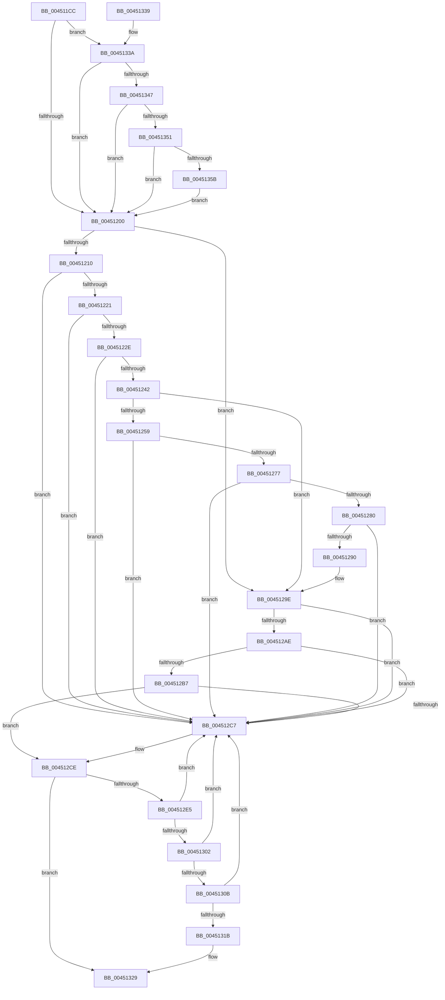

# CcInsertIntoCleanSharedCacheMapList

- RVA: `0x004511CC`–`0x0045136D` (길이 `417` bytes)
- VA: `0x00000001404511CC`
- 실행 섹션: `.text`
- PDB 이름 있음: `예`; PDB Function 태그: `아니요`
- unwind 정보 RVA: `0x00078C74`
- 디코드: `102`개 명령, `417/417` bytes 표시
- 미해석 바이트: `0` (있으면 어셈블리에 `.byte`로 보존)

> 이 문서는 커널 이미지의 기계어와 PDB 기호를 분석해 생성했습니다. 4번과 5번은 함수 원형과 자료형을 바이너리 사용 방식에서 추정한 C 해석이며 원본 소스 복구 결과는 아닙니다.

## 1. Dependencies

- 직접 호출 지점: **1**; 고유 호출 대상: **1**
- 직접 호출자로 확인된 함수: **3**
- RIP 상대 이미지 참조: **4**

### Outgoing calls
- `0x00451362` → [DbgPrint](../35/DbgPrint_function_00358CB0.md) (function, `0x00358CB0`)

### Direct callers
- [CcUnpinFileDataEx](../35/CcUnpinFileDataEx_function_00359DEC.md) at `0x0035A109`
- [CcInitializeCacheMapInternal](../3C/CcInitializeCacheMapInternal_function_003CC720.md) at `0x003CCF97`
- [CcAcquireByteRangeForWrite](../40/CcAcquireByteRangeForWrite_function_00401E74.md) at `0x004028BA`

### Static image references
- `0x004511DB` → RVA `0x00F475F8` (`.data`; read)
- `0x00451242` → RVA `0x00E65B88` (`.data`; read)
- `0x0045133A` → RVA `0x00F475DC` (`.data`; read)
- `0x0045135B` → RVA `0x006C7C70` (` ?? ::FNODOBFM::`string'`; read)

## 2. Other-region calls and transfers

- 다른 실행 섹션으로 향하는 call: **0**
- 별도 외부 분기/꼬리 이동을 확인하지 못했습니다.

## 3. Assembly (complete function range)

```asm
004511CC  48 89 5C 24 08                  mov qword ptr [rsp + 8], rbx
004511D1  48 89 74 24 10                  mov qword ptr [rsp + 0x10], rsi
004511D6  57                              push rdi
004511D7  48 83 EC 20                     sub rsp, 0x20
004511DB  80 3D 16 64 AF 00 00            cmp byte ptr [rip + 0xaf6416], 0
004511E2  48 8B D9                        mov rbx, rcx
004511E5  48 8B 81 18 02 00 00            mov rax, qword ptr [rcx + 0x218]
004511EC  48 8D B0 80 02 00 00            lea rsi, [rax + 0x280]
004511F3  48 8D B8 90 02 00 00            lea rdi, [rax + 0x290]
004511FA  0F 85 3A 01 00 00               jne 0x14045133a
00451200  F7 83 98 00 00 00 00 00 00 03   test dword ptr [rbx + 0x98], 0x3000000
0045120A  0F 84 8E 00 00 00               je 0x14045129e
00451210  48 8D 43 78                     lea rax, [rbx + 0x78]
00451214  48 8B 08                        mov rcx, qword ptr [rax]
00451217  48 39 41 08                     cmp qword ptr [rcx + 8], rax
0045121B  0F 85 A6 00 00 00               jne 0x1404512c7
00451221  48 8B 50 08                     mov rdx, qword ptr [rax + 8]
00451225  48 39 02                        cmp qword ptr [rdx], rax
00451228  0F 85 99 00 00 00               jne 0x1404512c7
0045122E  48 89 0A                        mov qword ptr [rdx], rcx
00451231  48 89 51 08                     mov qword ptr [rcx + 8], rdx
00451235  48 8B 4F 08                     mov rcx, qword ptr [rdi + 8]
00451239  48 39 39                        cmp qword ptr [rcx], rdi
0045123C  0F 85 85 00 00 00               jne 0x1404512c7
00451242  80 3D 3F 49 A1 00 00            cmp byte ptr [rip + 0xa1493f], 0
00451249  48 89 38                        mov qword ptr [rax], rdi
0045124C  48 89 48 08                     mov qword ptr [rax + 8], rcx
00451250  48 89 01                        mov qword ptr [rcx], rax
00451253  48 89 47 08                     mov qword ptr [rdi + 8], rax
00451257  74 45                           je 0x14045129e
00451259  48 8B 8B 58 02 00 00            mov rcx, qword ptr [rbx + 0x258]
00451260  48 8D 83 48 02 00 00            lea rax, [rbx + 0x248]
00451267  4C 8B 00                        mov r8, qword ptr [rax]
0045126A  48 81 C1 70 02 00 00            add rcx, 0x270
00451271  49 39 40 08                     cmp qword ptr [r8 + 8], rax
00451275  75 50                           jne 0x1404512c7
00451277  48 8B 50 08                     mov rdx, qword ptr [rax + 8]
0045127B  48 39 02                        cmp qword ptr [rdx], rax
0045127E  75 47                           jne 0x1404512c7
00451280  4C 89 02                        mov qword ptr [rdx], r8
00451283  49 89 50 08                     mov qword ptr [r8 + 8], rdx
00451287  48 8B 51 08                     mov rdx, qword ptr [rcx + 8]
0045128B  48 39 0A                        cmp qword ptr [rdx], rcx
0045128E  75 37                           jne 0x1404512c7
00451290  48 89 08                        mov qword ptr [rax], rcx
00451293  48 89 50 08                     mov qword ptr [rax + 8], rdx
00451297  48 89 02                        mov qword ptr [rdx], rax
0045129A  48 89 41 08                     mov qword ptr [rcx + 8], rax
0045129E  48 8D 83 88 00 00 00            lea rax, [rbx + 0x88]
004512A5  48 8B 08                        mov rcx, qword ptr [rax]
004512A8  48 39 41 08                     cmp qword ptr [rcx + 8], rax
004512AC  75 19                           jne 0x1404512c7
004512AE  48 8B 50 08                     mov rdx, qword ptr [rax + 8]
004512B2  48 39 02                        cmp qword ptr [rdx], rax
004512B5  75 10                           jne 0x1404512c7
004512B7  48 89 0A                        mov qword ptr [rdx], rcx
004512BA  48 89 51 08                     mov qword ptr [rcx + 8], rdx
004512BE  48 8B 4E 08                     mov rcx, qword ptr [rsi + 8]
004512C2  48 39 31                        cmp qword ptr [rcx], rsi
004512C5  74 07                           je 0x1404512ce
004512C7  B9 03 00 00 00                  mov ecx, 3
004512CC  CD 29                           int 0x29
004512CE  80 3D B3 48 A1 00 00            cmp byte ptr [rip + 0xa148b3], 0
004512D5  48 89 30                        mov qword ptr [rax], rsi
004512D8  48 89 48 08                     mov qword ptr [rax + 8], rcx
004512DC  48 89 01                        mov qword ptr [rcx], rax
004512DF  48 89 46 08                     mov qword ptr [rsi + 8], rax
004512E3  74 44                           je 0x140451329
004512E5  48 8B 83 58 02 00 00            mov rax, qword ptr [rbx + 0x258]
004512EC  48 81 C3 38 02 00 00            add rbx, 0x238
004512F3  48 05 60 02 00 00               add rax, 0x260
004512F9  48 8B 13                        mov rdx, qword ptr [rbx]
004512FC  48 39 5A 08                     cmp qword ptr [rdx + 8], rbx
00451300  75 C5                           jne 0x1404512c7
00451302  48 8B 4B 08                     mov rcx, qword ptr [rbx + 8]
00451306  48 39 19                        cmp qword ptr [rcx], rbx
00451309  75 BC                           jne 0x1404512c7
0045130B  48 89 11                        mov qword ptr [rcx], rdx
0045130E  48 89 4A 08                     mov qword ptr [rdx + 8], rcx
00451312  48 8B 48 08                     mov rcx, qword ptr [rax + 8]
00451316  48 39 01                        cmp qword ptr [rcx], rax
00451319  75 AC                           jne 0x1404512c7
0045131B  48 89 03                        mov qword ptr [rbx], rax
0045131E  48 89 4B 08                     mov qword ptr [rbx + 8], rcx
00451322  48 89 19                        mov qword ptr [rcx], rbx
00451325  48 89 58 08                     mov qword ptr [rax + 8], rbx
00451329  48 8B 5C 24 30                  mov rbx, qword ptr [rsp + 0x30]
0045132E  48 8B 74 24 38                  mov rsi, qword ptr [rsp + 0x38]
00451333  48 83 C4 20                     add rsp, 0x20
00451337  5F                              pop rdi
00451338  C3                              ret
00451339  CC                              int3
0045133A  80 3D 9B 62 AF 00 00            cmp byte ptr [rip + 0xaf629b], 0
00451341  0F 85 B9 FE FF FF               jne 0x140451200
00451347  83 79 04 00                     cmp dword ptr [rcx + 4], 0
0045134B  0F 85 AF FE FF FF               jne 0x140451200
00451351  83 79 70 00                     cmp dword ptr [rcx + 0x70], 0
00451355  0F 85 A5 FE FF FF               jne 0x140451200
0045135B  48 8D 0D 0E 69 27 00            lea rcx, [rip + 0x27690e]
00451362  E8 49 79 F0 FF                  call 0x140358cb0
00451367  CC                              int3
00451368  E9 93 FE FF FF                  jmp 0x140451200
```

## 4. C-style interpretation (structured pseudocode)

```c
__int64 __fastcall CcInsertIntoCleanSharedCacheMapList(__int64 a1)
{
    __int64 result;
    __int64 v_rbx;
    __int64 v_rsp;
    unsigned __int64 v_stack_p10;
    unsigned __int64 v_stack_p8;

    v_stack_p8 = v_rbx;
    v_stack_p10 = v_rsi;
    v_rsp = (v_rsp) - (32);
    if ((*(unsigned __int8 *)(v_rip + 11494422)) != 0) goto loc_0045133A;
loc_00451200:
    if (((*(unsigned int *)(a1 + 152)) & (0x3000000ULL)) == 0) goto loc_0045129E;
    if ((*(unsigned __int64 *)(*(unsigned __int64 *)(a1 + 120) + 8)) != (a1 + 120)) goto loc_004512C7;
    if ((*(unsigned __int64 *)(*(unsigned __int64 *)(a1 + 120 + 8))) != (a1 + 120)) goto loc_004512C7;
    *(unsigned __int64 *)(*(unsigned __int64 *)(a1 + 120 + 8)) = *(unsigned __int64 *)(a1 + 120);
    *(unsigned __int64 *)(*(unsigned __int64 *)(a1 + 120) + 8) = *(unsigned __int64 *)(a1 + 120 + 8);
    if ((*(unsigned __int64 *)(*(unsigned __int64 *)(*(unsigned __int64 *)(a1 + 536) + 656 + 8))) != (*(unsigned __int64 *)(a1 + 536) + 656)) goto loc_004512C7;
    *(unsigned __int64 *)(a1 + 120) = *(unsigned __int64 *)(a1 + 536) + 656;
    *(unsigned __int64 *)(a1 + 120 + 8) = *(unsigned __int64 *)(*(unsigned __int64 *)(a1 + 536) + 656 + 8);
    *(unsigned __int64 *)(*(unsigned __int64 *)(*(unsigned __int64 *)(a1 + 536) + 656 + 8)) = a1 + 120;
    *(unsigned __int64 *)(*(unsigned __int64 *)(a1 + 536) + 656 + 8) = a1 + 120;
    if ((*(unsigned __int8 *)(v_rip + 10570047)) == 0) goto loc_0045129E;
    a1 = (*(unsigned __int64 *)(a1 + 600)) + (624);
    if ((*(unsigned __int64 *)(*(unsigned __int64 *)(a1 + 584) + 8)) != (a1 + 584)) goto loc_004512C7;
    if ((*(unsigned __int64 *)(*(unsigned __int64 *)(a1 + 584 + 8))) != (a1 + 584)) goto loc_004512C7;
    *(unsigned __int64 *)(*(unsigned __int64 *)(a1 + 584 + 8)) = *(unsigned __int64 *)(a1 + 584);
    *(unsigned __int64 *)(*(unsigned __int64 *)(a1 + 584) + 8) = *(unsigned __int64 *)(a1 + 584 + 8);
    if ((*(unsigned __int64 *)(*(unsigned __int64 *)(a1 + 8))) != a1) goto loc_004512C7;
    *(unsigned __int64 *)(a1 + 584) = a1;
    *(unsigned __int64 *)(a1 + 584 + 8) = *(unsigned __int64 *)(a1 + 8);
    *(unsigned __int64 *)(*(unsigned __int64 *)(a1 + 8)) = a1 + 584;
    *(unsigned __int64 *)(a1 + 8) = a1 + 584;
loc_0045129E:
    if ((*(unsigned __int64 *)(*(unsigned __int64 *)(a1 + 136) + 8)) != (a1 + 136)) goto loc_004512C7;
    if ((*(unsigned __int64 *)(*(unsigned __int64 *)(a1 + 136 + 8))) != (a1 + 136)) goto loc_004512C7;
    *(unsigned __int64 *)(*(unsigned __int64 *)(a1 + 136 + 8)) = *(unsigned __int64 *)(a1 + 136);
    *(unsigned __int64 *)(*(unsigned __int64 *)(a1 + 136) + 8) = *(unsigned __int64 *)(a1 + 136 + 8);
    if ((*(unsigned __int64 *)(*(unsigned __int64 *)(*(unsigned __int64 *)(a1 + 536) + 640 + 8))) != (*(unsigned __int64 *)(a1 + 536) + 640)) {
        a1 = 3;
    }
    *(unsigned __int64 *)(a1 + 136) = *(unsigned __int64 *)(a1 + 536) + 640;
    *(unsigned __int64 *)(a1 + 136 + 8) = a1;
    *(unsigned __int64 *)(a1) = a1 + 136;
    *(unsigned __int64 *)(*(unsigned __int64 *)(a1 + 536) + 640 + 8) = a1 + 136;
    if ((*(unsigned __int8 *)(v_rip + 10569907)) == 0) goto loc_00451329;
    v_rbx = (a1) + (568);
    result = (*(unsigned __int64 *)(a1 + 600)) + (608);
    if ((*(unsigned __int64 *)(*(unsigned __int64 *)(v_rbx) + 8)) != v_rbx) goto loc_004512C7;
    if ((*(unsigned __int64 *)(*(unsigned __int64 *)(v_rbx + 8))) != v_rbx) goto loc_004512C7;
    *(unsigned __int64 *)(*(unsigned __int64 *)(v_rbx + 8)) = *(unsigned __int64 *)(v_rbx);
    *(unsigned __int64 *)(*(unsigned __int64 *)(v_rbx) + 8) = *(unsigned __int64 *)(v_rbx + 8);
    if ((*(unsigned __int64 *)(*(unsigned __int64 *)(result + 8))) != result) goto loc_004512C7;
    *(unsigned __int64 *)(v_rbx) = result;
    *(unsigned __int64 *)(v_rbx + 8) = *(unsigned __int64 *)(result + 8);
    *(unsigned __int64 *)(*(unsigned __int64 *)(result + 8)) = v_rbx;
    *(unsigned __int64 *)(result + 8) = v_rbx;
loc_00451329:
    v_rsp = (v_rsp) + (32);
    return result;
loc_0045133A:
    if ((*(unsigned __int8 *)(v_rip + 11494043)) != 0) goto loc_00451200;
    if ((*(unsigned int *)(*(unsigned __int64 *)(result + 8) + 4)) != 0) goto loc_00451200;
    if ((*(unsigned int *)(*(unsigned __int64 *)(result + 8) + 112)) != 0) goto loc_00451200;
    result = DbgPrint(v_rip + 2582798, *(unsigned __int64 *)(v_rbx), *(unsigned __int64 *)(a1 + 584), a4);
    goto loc_00451200;
}
```

## 5. (Beta) C Style

```c
int64_t CcInsertIntoCleanSharedCacheMapList(void *Arg1)
{
    uint8_t *arg1 = (uint8_t *)Arg1;

    int64_t result;
    int64_t local_rbx;
    int64_t local_rsp;
    uint64_t v_stack_p10;
    uint64_t v_stack_p8;

    v_stack_p8 = local_rbx;
    v_stack_p10 = local_rsi;
    local_rsp = (local_rsp) - (32);
    if ((*(uint8_t *)(v_rip + 0xAF6416)) != 0) goto loc_0045133A;
loc_00451200:
    if (((*(uint32_t *)(arg1 + 0x98)) & (0x3000000ULL)) == 0) goto loc_0045129E;
    if ((*(uint64_t *)(*(uint64_t *)(arg1 + 0x78) + 0x8)) != (Arg1 + 120)) goto loc_004512C7;
    if ((*(uint64_t *)(*(uint64_t *)(arg1 + 0x78 + 0x8))) != (Arg1 + 120)) goto loc_004512C7;
    *(uint64_t *)(*(uint64_t *)(arg1 + 0x78 + 0x8)) = *(uint64_t *)(arg1 + 0x78);
    *(uint64_t *)(*(uint64_t *)(arg1 + 0x78) + 0x8) = *(uint64_t *)(arg1 + 0x78 + 0x8);
    if ((*(uint64_t *)(*(uint64_t *)(*(uint64_t *)(arg1 + 0x218) + 0x290 + 0x8))) != (*(uint64_t *)(arg1 + 0x218) + 656)) goto loc_004512C7;
    *(uint64_t *)(arg1 + 0x78) = *(uint64_t *)(arg1 + 0x218) + 656;
    *(uint64_t *)(arg1 + 0x78 + 0x8) = *(uint64_t *)(*(uint64_t *)(arg1 + 0x218) + 0x290 + 0x8);
    *(void **)(*(uint64_t *)(*(uint64_t *)(arg1 + 0x218) + 0x290 + 0x8)) = Arg1 + 120;
    *(void **)(*(uint64_t *)(arg1 + 0x218) + 0x290 + 0x8) = Arg1 + 120;
    if ((*(uint8_t *)(v_rip + 0xA1493F)) == 0) goto loc_0045129E;
    Arg1 = (*(uint64_t *)(arg1 + 0x258)) + (624);
    if ((*(uint64_t *)(*(uint64_t *)(arg1 + 0x248) + 0x8)) != (Arg1 + 584)) goto loc_004512C7;
    if ((*(uint64_t *)(*(uint64_t *)(arg1 + 0x248 + 0x8))) != (Arg1 + 584)) goto loc_004512C7;
    *(uint64_t *)(*(uint64_t *)(arg1 + 0x248 + 0x8)) = *(uint64_t *)(arg1 + 0x248);
    *(uint64_t *)(*(uint64_t *)(arg1 + 0x248) + 0x8) = *(uint64_t *)(arg1 + 0x248 + 0x8);
    if ((*(uint64_t *)(*(uint64_t *)(arg1 + 0x8))) != Arg1) goto loc_004512C7;
    *(void **)(arg1 + 0x248) = Arg1;
    *(uint64_t *)(arg1 + 0x248 + 0x8) = *(uint64_t *)(arg1 + 0x8);
    *(void **)(*(uint64_t *)(arg1 + 0x8)) = Arg1 + 584;
    *(void **)(arg1 + 0x8) = Arg1 + 584;
loc_0045129E:
    if ((*(uint64_t *)(*(uint64_t *)(arg1 + 0x88) + 0x8)) != (Arg1 + 136)) goto loc_004512C7;
    if ((*(uint64_t *)(*(uint64_t *)(arg1 + 0x88 + 0x8))) != (Arg1 + 136)) goto loc_004512C7;
    *(uint64_t *)(*(uint64_t *)(arg1 + 0x88 + 0x8)) = *(uint64_t *)(arg1 + 0x88);
    *(uint64_t *)(*(uint64_t *)(arg1 + 0x88) + 0x8) = *(uint64_t *)(arg1 + 0x88 + 0x8);
    if ((*(uint64_t *)(*(uint64_t *)(*(uint64_t *)(arg1 + 0x218) + 0x280 + 0x8))) != (*(uint64_t *)(arg1 + 0x218) + 640)) {
        Arg1 = 3;
    }
    *(uint64_t *)(arg1 + 0x88) = *(uint64_t *)(arg1 + 0x218) + 640;
    *(void **)(arg1 + 0x88 + 0x8) = Arg1;
    *(void **)(arg1) = Arg1 + 136;
    *(void **)(*(uint64_t *)(arg1 + 0x218) + 0x280 + 0x8) = Arg1 + 136;
    if ((*(uint8_t *)(v_rip + 0xA148B3)) == 0) goto loc_00451329;
    local_rbx = (Arg1) + (568);
    result = (*(uint64_t *)(arg1 + 0x258)) + (608);
    if ((*(uint64_t *)(*(uint64_t *)(local_rbx) + 0x8)) != local_rbx) goto loc_004512C7;
    if ((*(uint64_t *)(*(uint64_t *)(local_rbx + 0x8))) != local_rbx) goto loc_004512C7;
    *(uint64_t *)(*(uint64_t *)(local_rbx + 0x8)) = *(uint64_t *)(local_rbx);
    *(uint64_t *)(*(uint64_t *)(local_rbx) + 0x8) = *(uint64_t *)(local_rbx + 0x8);
    if ((*(uint64_t *)(*(uint64_t *)(result + 0x8))) != result) goto loc_004512C7;
    *(uint64_t *)(local_rbx) = result;
    *(uint64_t *)(local_rbx + 0x8) = *(uint64_t *)(result + 0x8);
    *(uint64_t *)(*(uint64_t *)(result + 0x8)) = local_rbx;
    *(uint64_t *)(result + 0x8) = local_rbx;
loc_00451329:
    local_rsp = (local_rsp) + (32);
    return result;
loc_0045133A:
    if ((*(uint8_t *)(v_rip + 0xAF629B)) != 0) goto loc_00451200;
    if ((*(uint32_t *)(*(uint64_t *)(result + 0x8) + 0x4)) != 0) goto loc_00451200;
    if ((*(uint32_t *)(*(uint64_t *)(result + 0x8) + 0x70)) != 0) goto loc_00451200;
    result = DbgPrint(v_rip + 2582798, *(uint64_t *)(local_rbx), *(uint64_t *)(arg1 + 0x248), a4);
    goto loc_00451200;
}
```

### 관측된 메모리 오프셋

구조체 형식이 확인되지 않은 접근은 인자 기준의 오프셋으로만 기록했습니다.

| 기준 인자 | 오프셋 표현 | 폭 (bit) | 접근 |
|---|---:|---:|---|
| `Arg1` | `+ 0x0` | `64` | `R` |
| `Arg1` | `+ 0x0` | `64` | `W` |
| `Arg1` | `+ 0x4` | `32` | `R` |
| `Arg1` | `+ 0x8` | `64` | `R` |
| `Arg1` | `+ 0x8` | `64` | `W` |
| `Arg1` | `+ 0x70` | `32` | `R` |
| `Arg1` | `+ 0x78` | `64` | `R` |
| `Arg1` | `+ 0x88` | `64` | `R` |
| `Arg1` | `+ 0x98` | `32` | `R` |
| `Arg1` | `+ 0x218` | `64` | `R` |
| `Arg1` | `+ 0x248` | `64` | `R` |
| `Arg1` | `+ 0x258` | `64` | `R` |

## 6. Execution-region graph

[열기: 2D/3D 그래프와 함수 탐색 컨트롤 패널](../../../control-panel.html?section=text&rva=0x004511CC&view=graph)

- 2D 그래프는 위에서 아래로 흐르고, 3D 그래프는 빈 공간을 드래그해 회전합니다. Shift+드래그는 이동, 휠은 확대·축소, 함수 노드 선택은 대상 보고서 이동입니다.

### Static fallback


