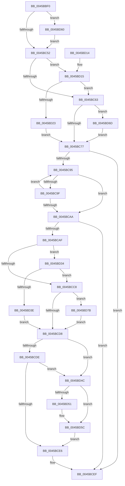

# CcIsThereDirtyLoggedPages

- RVA: `0x0045BBF0`–`0x0045BD89` (길이 `409` bytes)
- VA: `0x000000014045BBF0`
- 실행 섹션: `.text`
- PDB 이름 있음: `예`; PDB Function 태그: `아니요`
- unwind 정보 RVA: `0x000A9468`
- 디코드: `108`개 명령, `409/409` bytes 표시
- 미해석 바이트: `0` (있으면 어셈블리에 `.byte`로 보존)

> 이 문서는 커널 이미지의 기계어와 PDB 기호를 분석해 생성했습니다. 4번과 5번은 함수 원형과 자료형을 바이너리 사용 방식에서 추정한 C 해석이며 원본 소스 복구 결과는 아닙니다.

## 1. Dependencies

- 직접 호출 지점: **7**; 고유 호출 대상: **5**
- 직접 호출자로 확인된 함수: **0**
- RIP 상대 이미지 참조: **7**

### Outgoing calls
- `0x0045BCEA` → [KeReleaseInStackQueuedSpinLockFromDpcLevel](../21/KeReleaseInStackQueuedSpinLockFromDpcLevel_function_002171B0.md) (function, `0x002171B0`)
- `0x0045BCF3` → [KeReleaseInStackQueuedSpinLock](../34/KeReleaseInStackQueuedSpinLock_function_00342CE0.md) (function, `0x00342CE0`)
- `0x0045BD2A` → [KiAcquireQueuedSpinLockInstrumented](../27/KiAcquireQueuedSpinLockInstrumented_function_00275850.md) (function, `0x00275850`)
- `0x0045BD45` → [KiAcquireQueuedSpinLockInstrumented](../27/KiAcquireQueuedSpinLockInstrumented_function_00275850.md) (function, `0x00275850`)
- `0x0045BD63` → [KiRaiseIrqlProcessIrqlFlags](../4F/KiRaiseIrqlProcessIrqlFlags_function_004F56FC.md) (function, `0x004F56FC`)
- `0x0045BD71` → [KxWaitForLockOwnerShip](../25/KxWaitForLockOwnerShip_function_00257EB0.md) (function, `0x00257EB0`)
- `0x0045BD7F` → [KxWaitForLockOwnerShip](../25/KxWaitForLockOwnerShip_function_00257EB0.md) (function, `0x00257EB0`)

### Direct callers
- 이 함수 시작 RVA로 연결되는 직접 call은 확인되지 않았습니다. 간접 호출은 완전히 역산할 수 없습니다.

### Static image references
- `0x0045BC0D` → RVA `0x00E11CC0` (`.data`; read)
- `0x0045BC46` → RVA `0x00FC6D20` (`ALMOSTRO`; read)
- `0x0045BC52` → RVA `0x00FC6B06` (`ALMOSTRO`; read)
- `0x0045BC67` → RVA `0x00E11CC0` (`.data`; read/write)
- `0x0045BC77` → RVA `0x00FC6EA0` (`ALMOSTRO`; read)
- `0x0045BC7E` → RVA `0x00F8F560` (`.data`; read)
- `0x0045BD15` → RVA `0x00F0DE58` (`.data`; read)

## 2. Other-region calls and transfers

- 다른 실행 섹션으로 향하는 call: **0**
- 별도 외부 분기/꼬리 이동을 확인하지 못했습니다.

## 3. Assembly (complete function range)

```asm
0045BBF0  48 89 5C 24 08                  mov qword ptr [rsp + 8], rbx
0045BBF5  48 89 74 24 10                  mov qword ptr [rsp + 0x10], rsi
0045BBFA  48 89 7C 24 18                  mov qword ptr [rsp + 0x18], rdi
0045BBFF  55                              push rbp
0045BC00  41 56                           push r14
0045BC02  41 57                           push r15
0045BC04  48 8B EC                        mov rbp, rsp
0045BC07  48 83 EC 50                     sub rsp, 0x50
0045BC0B  33 DB                           xor ebx, ebx
0045BC0D  4C 8D 3D AC 60 9B 00            lea r15, [rip + 0x9b60ac]
0045BC14  33 C0                           xor eax, eax
0045BC16  0F 57 C0                        xorps xmm0, xmm0
0045BC19  0F 11 45 D0                     movups xmmword ptr [rbp - 0x30], xmm0
0045BC1D  48 89 45 E0                     mov qword ptr [rbp - 0x20], rax
0045BC21  48 8B F2                        mov rsi, rdx
0045BC24  0F 57 C9                        xorps xmm1, xmm1
0045BC27  48 89 45 F8                     mov qword ptr [rbp - 8], rax
0045BC2B  0F 11 4D E8                     movups xmmword ptr [rbp - 0x18], xmm1
0045BC2F  4C 89 7D D8                     mov qword ptr [rbp - 0x28], r15
0045BC33  4C 8B F1                        mov r14, rcx
0045BC36  48 89 5D D0                     mov qword ptr [rbp - 0x30], rbx
0045BC3A  90                              nop
0045BC3B  44 0F 20 C7                     mov rdi, cr8
0045BC3F  8D 53 02                        lea edx, [rbx + 2]
0045BC42  44 0F 22 C2                     mov cr8, rdx
0045BC46  39 1D D4 B0 B6 00               cmp dword ptr [rip + 0xb6b0d4], ebx
0045BC4C  0F 85 0E 01 00 00               jne 0x14045bd60
0045BC52  F6 05 AD AE B6 00 21            test byte ptr [rip + 0xb6aead], 0x21
0045BC59  40 88 7D E0                     mov byte ptr [rbp - 0x20], dil
0045BC5D  0F 85 B2 00 00 00               jne 0x14045bd15
0045BC63  48 8D 55 D0                     lea rdx, [rbp - 0x30]
0045BC67  48 87 15 52 60 9B 00            xchg qword ptr [rip + 0x9b6052], rdx
0045BC6E  48 85 D2                        test rdx, rdx
0045BC71  0F 85 F6 00 00 00               jne 0x14045bd6d
0045BC77  48 8B 05 22 B2 B6 00            mov rax, qword ptr [rip + 0xb6b222]
0045BC7E  48 8B 0D DB 38 B3 00            mov rcx, qword ptr [rip + 0xb338db]
0045BC85  48 8B 50 08                     mov rdx, qword ptr [rax + 8]
0045BC89  48 8D 05 D0 38 B3 00            lea rax, [rip + 0xb338d0]
0045BC90  48 3B C8                        cmp rcx, rax
0045BC93  74 5A                           je 0x14045bcef
0045BC95  48 8D 79 E8                     lea rdi, [rcx - 0x18]
0045BC99  4C 39 77 10                     cmp qword ptr [rdi + 0x10], r14
0045BC9D  74 0B                           je 0x14045bcaa
0045BC9F  48 8B 09                        mov rcx, qword ptr [rcx]
0045BCA2  48 8B FB                        mov rdi, rbx
0045BCA5  48 3B C8                        cmp rcx, rax
0045BCA8  75 EB                           jne 0x14045bc95
0045BCAA  48 85 FF                        test rdi, rdi
0045BCAD  74 40                           je 0x14045bcef
0045BCAF  48 8D 8A 00 03 00 00            lea rcx, [rdx + 0x300]
0045BCB6  48 89 5D E8                     mov qword ptr [rbp - 0x18], rbx
0045BCBA  48 89 4D F0                     mov qword ptr [rbp - 0x10], rcx
0045BCBE  90                              nop
0045BCBF  F6 05 40 AE B6 00 21            test byte ptr [rip + 0xb6ae40], 0x21
0045BCC6  75 6C                           jne 0x14045bd34
0045BCC8  48 8D 55 E8                     lea rdx, [rbp - 0x18]
0045BCCC  48 87 11                        xchg qword ptr [rcx], rdx
0045BCCF  48 85 D2                        test rdx, rdx
0045BCD2  0F 85 A3 00 00 00               jne 0x14045bd7b
0045BCD8  48 39 5F 48                     cmp qword ptr [rdi + 0x48], rbx
0045BCDC  75 6E                           jne 0x14045bd4c
0045BCDE  39 9F D0 00 00 00               cmp dword ptr [rdi + 0xd0], ebx
0045BCE4  75 66                           jne 0x14045bd4c
0045BCE6  48 8D 4D E8                     lea rcx, [rbp - 0x18]
0045BCEA  E8 C1 B4 DB FF                  call 0x1402171b0
0045BCEF  48 8D 4D D0                     lea rcx, [rbp - 0x30]
0045BCF3  E8 E8 6F EE FF                  call 0x140342ce0
0045BCF8  4C 8D 5C 24 50                  lea r11, [rsp + 0x50]
0045BCFD  8A C3                           mov al, bl
0045BCFF  49 8B 5B 20                     mov rbx, qword ptr [r11 + 0x20]
0045BD03  49 8B 73 28                     mov rsi, qword ptr [r11 + 0x28]
0045BD07  49 8B 7B 30                     mov rdi, qword ptr [r11 + 0x30]
0045BD0B  49 8B E3                        mov rsp, r11
0045BD0E  41 5F                           pop r15
0045BD10  41 5E                           pop r14
0045BD12  5D                              pop rbp
0045BD13  C3                              ret
0045BD14  CC                              int3
0045BD15  8B 05 3D 21 AB 00               mov eax, dword ptr [rip + 0xab213d]
0045BD1B  85 C0                           test eax, eax
0045BD1D  0F 85 40 FF FF FF               jne 0x14045bc63
0045BD23  49 8B D7                        mov rdx, r15
0045BD26  48 8D 4D D0                     lea rcx, [rbp - 0x30]
0045BD2A  E8 21 9B E1 FF                  call 0x140275850
0045BD2F  E9 43 FF FF FF                  jmp 0x14045bc77
0045BD34  8B 05 1E 21 AB 00               mov eax, dword ptr [rip + 0xab211e]
0045BD3A  85 C0                           test eax, eax
0045BD3C  75 8A                           jne 0x14045bcc8
0045BD3E  48 8B D1                        mov rdx, rcx
0045BD41  48 8D 4D E8                     lea rcx, [rbp - 0x18]
0045BD45  E8 06 9B E1 FF                  call 0x140275850
0045BD4A  EB 8C                           jmp 0x14045bcd8
0045BD4C  48 85 F6                        test rsi, rsi
0045BD4F  74 0B                           je 0x14045bd5c
0045BD51  8B 87 D0 00 00 00               mov eax, dword ptr [rdi + 0xd0]
0045BD57  03 47 48                        add eax, dword ptr [rdi + 0x48]
0045BD5A  89 06                           mov dword ptr [rsi], eax
0045BD5C  B3 01                           mov bl, 1
0045BD5E  EB 86                           jmp 0x14045bce6
0045BD60  40 8A CF                        mov cl, dil
0045BD63  E8 94 99 09 00                  call 0x1404f56fc
0045BD68  E9 E5 FE FF FF                  jmp 0x14045bc52
0045BD6D  48 8D 4D D0                     lea rcx, [rbp - 0x30]
0045BD71  E8 3A C1 DF FF                  call 0x140257eb0
0045BD76  E9 FC FE FF FF                  jmp 0x14045bc77
0045BD7B  48 8D 4D E8                     lea rcx, [rbp - 0x18]
0045BD7F  E8 2C C1 DF FF                  call 0x140257eb0
0045BD84  E9 4F FF FF FF                  jmp 0x14045bcd8
```

## 4. C-style interpretation (structured pseudocode)

```c
__int64 __fastcall CcIsThereDirtyLoggedPages(__int64 a1, __int64 a2)
{
    __int64 result;
    __int64 v_rbx;
    __int64 v_rsp;
    unsigned __int64 v_stack_m18;
    unsigned __int64 v_stack_m20;
    unsigned __int64 v_stack_m28;
    unsigned __int64 v_stack_m30;
    unsigned __int64 v_stack_m38;
    unsigned __int64 v_stack_m40;
    unsigned __int64 v_stack_m48;
    unsigned __int64 v_stack_p10;
    unsigned __int64 v_stack_p18;
    unsigned __int64 v_stack_p8;

    v_stack_p8 = v_rbx;
    v_stack_p10 = v_rsi;
    v_stack_p18 = v_rdi;
    v_rsp = (v_rsp) - (80);
    v_rbx = 0;
    result = 0;
    v_stack_m48 = v_xmm0;
    v_stack_m38 = 0;
    v_stack_m20 = 0;
    v_stack_m30 = v_xmm1;
    v_stack_m40 = v_rip + 10182828;
    v_stack_m48 = 0;
    if ((*(unsigned int *)(v_rip + 11972820)) != 0) goto loc_0045BD60;
loc_0045BC52:
    v_stack_m38 = (unsigned __int8)(v_cr8);
    if (((*(unsigned __int8 *)(v_rip + 11972269)) & (33)) != 0) goto loc_0045BD15;
loc_0045BC63:
    if (v_stack_m48 != 0) goto loc_0045BD6D;
loc_0045BC77:
    if ((*(unsigned __int64 *)(v_rip + 11745499)) == (v_rip + 11745488)) goto loc_0045BCEF;
loc_0045BC95:
    if ((*(unsigned __int64 *)(*(unsigned __int64 *)(v_rip + 11745499) - 24 + 16)) == a1) goto loc_0045BCAA;
    if ((*(unsigned __int64 *)(*(unsigned __int64 *)(v_rip + 11745499))) != (v_rip + 11745488)) goto loc_0045BC95;
loc_0045BCAA:
    if (0 == 0) goto loc_0045BCEF;
    v_stack_m30 = 0;
    v_stack_m28 = *(unsigned __int64 *)(*(unsigned __int64 *)(v_rip + 11973154) + 8) + 768;
    if (((*(unsigned __int8 *)(v_rip + 11972160)) & (33)) != 0) goto loc_0045BD34;
loc_0045BCC8:
    if (v_stack_m30 != 0) goto loc_0045BD7B;
loc_0045BCD8:
    if ((*(unsigned __int64 *)(0 + 72)) != 0) goto loc_0045BD4C;
    if ((*(unsigned int *)(0 + 208)) != 0) goto loc_0045BD4C;
loc_0045BCE6:
    result = KeReleaseInStackQueuedSpinLockFromDpcLevel(v_stack_m30, v_stack_m30, a3, a4);
loc_0045BCEF:
    result = KeReleaseInStackQueuedSpinLock(v_stack_m48, v_stack_m30, a3, a4);
    return 0;
loc_0045BD15:
    if ((unsigned int)((unsigned int)(*(unsigned int *)(v_rip + 11215165))) != 0) goto loc_0045BC63;
    result = KiAcquireQueuedSpinLockInstrumented(v_stack_m48, v_rip + 10182828, a3, a4);
    goto loc_0045BC77;
loc_0045BD34:
    if ((unsigned int)((unsigned int)(*(unsigned int *)(v_rip + 11215134))) != 0) goto loc_0045BCC8;
    result = KiAcquireQueuedSpinLockInstrumented(v_stack_m30, v_stack_m48, a3, a4);
    goto loc_0045BCD8;
loc_0045BD4C:
    if (*(unsigned __int64 *)(v_stack_m18 + 40) != 0) {
        result = *(unsigned int *)(*(unsigned __int64 *)(v_stack_m18 + 48) + 208);
        result = (unsigned int)((result) + (*(unsigned int *)(*(unsigned __int64 *)(v_stack_m18 + 48) + 72)));
        *(unsigned int *)(*(unsigned __int64 *)(v_stack_m18 + 40)) = (unsigned int)(result);
    }
    goto loc_0045BCE6;
loc_0045BD60:
    result = KiRaiseIrqlProcessIrqlFlags((unsigned __int8)(*(unsigned __int64 *)(v_stack_m18 + 48)), v_stack_m48, a3, a4);
    goto loc_0045BC52;
loc_0045BD6D:
    result = KxWaitForLockOwnerShip(v_stack_m48, v_stack_m48, a3, a4);
    goto loc_0045BC77;
loc_0045BD7B:
    result = KxWaitForLockOwnerShip(v_stack_m30, v_stack_m48, a3, a4);
    goto loc_0045BCD8;
}
```

## 5. (Beta) C Style

```c
int64_t CcIsThereDirtyLoggedPages(int64_t Arg1, int64_t Arg2)
{
    int64_t result;
    int64_t local_rbx;
    int64_t local_rsp;
    uint64_t v_stack_m18;
    uint64_t v_stack_m20;
    uint64_t v_stack_m28;
    uint64_t v_stack_m30;
    uint64_t v_stack_m38;
    uint64_t v_stack_m40;
    uint64_t v_stack_m48;
    uint64_t v_stack_p10;
    uint64_t v_stack_p18;
    uint64_t v_stack_p8;

    v_stack_p8 = local_rbx;
    v_stack_p10 = local_rsi;
    v_stack_p18 = local_rdi;
    local_rsp = (local_rsp) - (80);
    local_rbx = 0;
    result = 0;
    v_stack_m48 = v_xmm0;
    v_stack_m38 = 0;
    v_stack_m20 = 0;
    v_stack_m30 = v_xmm1;
    v_stack_m40 = v_rip + 10182828;
    v_stack_m48 = 0;
    if ((*(uint32_t *)(v_rip + 0xB6B0D4)) != 0) goto loc_0045BD60;
loc_0045BC52:
    v_stack_m38 = (uint8_t)(v_cr8);
    if (((*(uint8_t *)(v_rip + 0xB6AEAD)) & (33)) != 0) goto loc_0045BD15;
loc_0045BC63:
    if (v_stack_m48 != 0) goto loc_0045BD6D;
loc_0045BC77:
    if ((*(uint64_t *)(v_rip + 0xB338DB)) == (v_rip + 11745488)) goto loc_0045BCEF;
loc_0045BC95:
    if ((*(uint64_t *)(*(uint64_t *)(v_rip + 0xB338DB) - 0x18 + 0x10)) == Arg1) goto loc_0045BCAA;
    if ((*(uint64_t *)(*(uint64_t *)(v_rip + 0xB338DB))) != (v_rip + 11745488)) goto loc_0045BC95;
loc_0045BCAA:
    if (0 == 0) goto loc_0045BCEF;
    v_stack_m30 = 0;
    v_stack_m28 = *(uint64_t *)(*(uint64_t *)(v_rip + 0xB6B222) + 0x8) + 768;
    if (((*(uint8_t *)(v_rip + 0xB6AE40)) & (33)) != 0) goto loc_0045BD34;
loc_0045BCC8:
    if (v_stack_m30 != 0) goto loc_0045BD7B;
loc_0045BCD8:
    if ((*(uint64_t *)(0 + 0x48)) != 0) goto loc_0045BD4C;
    if ((*(uint32_t *)(0 + 0xD0)) != 0) goto loc_0045BD4C;
loc_0045BCE6:
    result = KeReleaseInStackQueuedSpinLockFromDpcLevel(v_stack_m30, v_stack_m30, a3, a4);
loc_0045BCEF:
    result = KeReleaseInStackQueuedSpinLock(v_stack_m48, v_stack_m30, a3, a4);
    return 0;
loc_0045BD15:
    if ((uint32_t)((uint32_t)(*(uint32_t *)(v_rip + 0xAB213D))) != 0) goto loc_0045BC63;
    result = KiAcquireQueuedSpinLockInstrumented(v_stack_m48, v_rip + 10182828, a3, a4);
    goto loc_0045BC77;
loc_0045BD34:
    if ((uint32_t)((uint32_t)(*(uint32_t *)(v_rip + 0xAB211E))) != 0) goto loc_0045BCC8;
    result = KiAcquireQueuedSpinLockInstrumented(v_stack_m30, v_stack_m48, a3, a4);
    goto loc_0045BCD8;
loc_0045BD4C:
    if (*(uint64_t *)(v_stack_m18 + 0x28) != 0) {
        result = *(uint32_t *)(*(uint64_t *)(v_stack_m18 + 0x30) + 0xD0);
        result = (uint32_t)((result) + (*(uint32_t *)(*(uint64_t *)(v_stack_m18 + 0x30) + 0x48)));
        *(uint32_t *)(*(uint64_t *)(v_stack_m18 + 0x28)) = (uint32_t)(result);
    }
    goto loc_0045BCE6;
loc_0045BD60:
    result = KiRaiseIrqlProcessIrqlFlags((uint8_t)(*(uint64_t *)(v_stack_m18 + 0x30)), v_stack_m48, a3, a4);
    goto loc_0045BC52;
loc_0045BD6D:
    result = KxWaitForLockOwnerShip(v_stack_m48, v_stack_m48, a3, a4);
    goto loc_0045BC77;
loc_0045BD7B:
    result = KxWaitForLockOwnerShip(v_stack_m30, v_stack_m48, a3, a4);
    goto loc_0045BCD8;
}
```

## 6. Execution-region graph

[열기: 2D/3D 그래프와 함수 탐색 컨트롤 패널](../../../control-panel.html?section=text&rva=0x0045BBF0&view=graph)

- 2D 그래프는 위에서 아래로 흐르고, 3D 그래프는 빈 공간을 드래그해 회전합니다. Shift+드래그는 이동, 휠은 확대·축소, 함수 노드 선택은 대상 보고서 이동입니다.

### Static fallback


