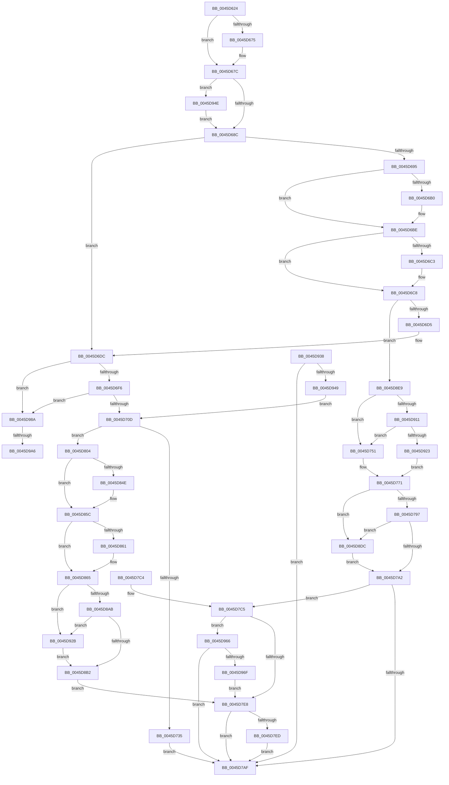

# CcPostWorkQueueAsyncRead

- RVA: `0x0045D624`–`0x0045D9BA` (길이 `918` bytes)
- VA: `0x000000014045D624`
- 실행 섹션: `.text`
- PDB 이름 있음: `예`; PDB Function 태그: `예`
- unwind 정보 RVA: `0x000A9654`
- 디코드: `233`개 명령, `918/918` bytes 표시
- 미해석 바이트: `0` (있으면 어셈블리에 `.byte`로 보존)

> 이 문서는 커널 이미지의 기계어와 PDB 기호를 분석해 생성했습니다. 4번과 5번은 함수 원형과 자료형을 바이너리 사용 방식에서 추정한 C 해석이며 원본 소스 복구 결과는 아닙니다.

## 1. Dependencies

- 직접 호출 지점: **20**; 고유 호출 대상: **12**
- 직접 호출자로 확인된 함수: **3**
- RIP 상대 이미지 참조: **4**

### Outgoing calls
- `0x0045D6A0` → [KeAbPreAcquire](../21/KeAbPreAcquire_function_00210230.md) (function, `0x00210230`)
- `0x0045D6B9` → [ExfAcquirePushLockExclusiveEx](../20/ExfAcquirePushLockExclusiveEx_function_0020FC90.md) (function, `0x0020FC90`)
- `0x0045D721` → [ExAllocatePoolWithTagFromNode](../35/ExAllocatePoolWithTagFromNode_function_0035A944.md) (function, `0x0035A944`)
- `0x0045D742` → [CcCompleteAsyncRead](CcCompleteAsyncRead_function_0045E7DC.md) (function, `0x0045E7DC`)
- `0x0045D74A` → [CcFreeWorkQueueEntry](../35/CcFreeWorkQueueEntry_function_0035723C.md) (function, `0x0035723C`)
- `0x0045D76C` → [KeSetEvent](../33/KeSetEvent_function_0033F310.md) (function, `0x0033F310`)
- `0x0045D7A5` → [KeAbPostRelease](../2E/KeAbPostRelease_function_002E1600.md) (function, `0x002E1600`)
- `0x0045D7D3` → [CcShouldSpinAsyncReadWorkerThread](CcShouldSpinAsyncReadWorkerThread_function_0045EB28.md) (function, `0x0045EB28`)
- `0x0045D7FD` → [ExQueueWorkItemToPartition](../35/ExQueueWorkItemToPartition_function_00356E2C.md) (function, `0x00356E2C`)
- `0x0045D83E` → [KeAbPreAcquire](../21/KeAbPreAcquire_function_00210230.md) (function, `0x00210230`)
- `0x0045D857` → [ExfAcquirePushLockExclusiveEx](../20/ExfAcquirePushLockExclusiveEx_function_0020FC90.md) (function, `0x0020FC90`)
- `0x0045D885` → [CcReferencePartitionAndPrivateVolumeCacheMap](../38/CcReferencePartitionAndPrivateVolumeCacheMap_function_0038B9E0.md) (function, `0x0038B9E0`)
- `0x0045D8B5` → [KeAbPostRelease](../2E/KeAbPostRelease_function_002E1600.md) (function, `0x002E1600`)
- `0x0045D8CD` → [ExQueueWorkItemToPartition](../35/ExQueueWorkItemToPartition_function_00356E2C.md) (function, `0x00356E2C`)
- `0x0045D8DF` → [ExfReleasePushLock](../26/ExfReleasePushLock_function_002638D0.md) (function, `0x002638D0`)
- `0x0045D92E` → [ExfReleasePushLock](../26/ExfReleasePushLock_function_002638D0.md) (function, `0x002638D0`)
- `0x0045D93B` → [KeAbPostRelease](../2E/KeAbPostRelease_function_002E1600.md) (function, `0x002E1600`)
- `0x0045D95A` → [CcPerfLogWorkItemEnqueue](../35/CcPerfLogWorkItemEnqueue_function_00357340.md) (function, `0x00357340`)
- `0x0045D992` → [KeAbPreAcquire](../21/KeAbPreAcquire_function_00210230.md) (function, `0x00210230`)
- `0x0045D9AF` → [ExfAcquirePushLockExclusiveEx](../20/ExfAcquirePushLockExclusiveEx_function_0020FC90.md) (function, `0x0020FC90`)

### Direct callers
- [CcAsyncCopyRead](../35/CcAsyncCopyRead_function_00358880.md) at `0x00358AB7`
- [CcAsyncReadWorker](CcAsyncReadWorker_function_0045DB10.md) at `0x0045E0EA`
- [sub_006F2088](../6F/Unknown_function_006F2088.md) at `0x006F208D`

### Static image references
- `0x0045D640` → RVA `0x00E65B88` (`.data`; read)
- `0x0045D67C` → RVA `0x00FC6B10` (`ALMOSTRO`; read)
- `0x0045D701` → RVA `0x00E65B74` (`.data`; read)
- `0x0045D82C` → RVA `0x0045D9C0` (`CcCompleteAsyncReadWorker`; read)

## 2. Other-region calls and transfers

- 다른 실행 섹션으로 향하는 call: **0**
- call이 아닌 외부 분기/꼬리 이동: **2**
  - `0x0045D9A0` → [sub_006F2006](../6F/Unknown_function_006F2006.md) (`tail-transfer`)
  - `0x0045D9B5` → [sub_006F2006](../6F/Unknown_function_006F2006.md) (`tail-transfer`)

## 3. Assembly (complete function range)

```asm
0045D624  48 89 5C 24 10                  mov qword ptr [rsp + 0x10], rbx
0045D629  55                              push rbp
0045D62A  56                              push rsi
0045D62B  57                              push rdi
0045D62C  41 54                           push r12
0045D62E  41 55                           push r13
0045D630  41 56                           push r14
0045D632  41 57                           push r15
0045D634  48 83 EC 20                     sub rsp, 0x20
0045D638  48 8B F9                        mov rdi, rcx
0045D63B  48 8B EA                        mov rbp, rdx
0045D63E  33 C9                           xor ecx, ecx
0045D640  38 0D 42 85 A0 00               cmp byte ptr [rip + 0xa08542], cl
0045D646  44 8A E1                        mov r12b, cl
0045D649  48 89 4C 24 60                  mov qword ptr [rsp + 0x60], rcx
0045D64E  48 8B 87 90 00 00 00            mov rax, qword ptr [rdi + 0x90]
0045D655  4C 8B BF 88 00 00 00            mov r15, qword ptr [rdi + 0x88]
0045D65C  48 8B B7 98 00 00 00            mov rsi, qword ptr [rdi + 0x98]
0045D663  44 8B 6F 74                     mov r13d, dword ptr [rdi + 0x74]
0045D667  48 8D 98 88 04 00 00            lea rbx, [rax + 0x488]
0045D66E  48 89 44 24 70                  mov qword ptr [rsp + 0x70], rax
0045D673  75 07                           jne 0x14045d67c
0045D675  49 8D 9F C8 04 00 00            lea rbx, [r15 + 0x4c8]
0045D67C  F7 05 8A 94 B6 00 00 00 02 00   test dword ptr [rip + 0xb6948a], 0x20000
0045D686  0F 85 C2 02 00 00               jne 0x14045d94e
0045D68C  83 BF 80 00 00 00 05            cmp dword ptr [rdi + 0x80], 5
0045D693  75 47                           jne 0x14045d6dc
0045D695  44 8A E1                        mov r12b, cl
0045D698  45 33 C0                        xor r8d, r8d
0045D69B  48 8B CB                        mov rcx, rbx
0045D69E  33 D2                           xor edx, edx
0045D6A0  E8 8B 2B DB FF                  call 0x140210230
0045D6A5  F0 48 0F BA 2B 00               lock bts qword ptr [rbx], 0
0045D6AB  4C 8B F0                        mov r14, rax
0045D6AE  73 0E                           jae 0x14045d6be
0045D6B0  4C 8B C3                        mov r8, rbx
0045D6B3  48 8B D0                        mov rdx, rax
0045D6B6  48 8B CB                        mov rcx, rbx
0045D6B9  E8 D2 25 DB FF                  call 0x14020fc90
0045D6BE  4D 85 F6                        test r14, r14
0045D6C1  74 05                           je 0x14045d6c8
0045D6C3  41 C6 46 0A 01                  mov byte ptr [r14 + 0xa], 1
0045D6C8  48 8B 45 08                     mov rax, qword ptr [rbp + 8]
0045D6CC  48 39 28                        cmp qword ptr [rax], rbp
0045D6CF  0F 84 14 02 00 00               je 0x14045d8e9
0045D6D5  B9 03 00 00 00                  mov ecx, 3
0045D6DA  CD 29                           int 0x29
0045D6DC  48 8B 8E 08 01 00 00            mov rcx, qword ptr [rsi + 0x108]
0045D6E3  4D 8B F5                        mov r14, r13
0045D6E6  49 C1 E6 04                     shl r14, 4
0045D6EA  49 03 CE                        add rcx, r14
0045D6ED  48 39 09                        cmp qword ptr [rcx], rcx
0045D6F0  0F 85 94 02 00 00               jne 0x14045d98a
0045D6F6  48 8B 86 F8 00 00 00            mov rax, qword ptr [rsi + 0xf8]
0045D6FD  42 8B 04 A8                     mov eax, dword ptr [rax + r13*4]
0045D701  3B 05 6D 84 A0 00               cmp eax, dword ptr [rip + 0xa0846d]
0045D707  0F 83 7D 02 00 00               jae 0x14045d98a
0045D70D  44 8B 4E 18                     mov r9d, dword ptr [rsi + 0x18]
0045D711  BA 50 00 00 00                  mov edx, 0x50
0045D716  41 0F BA E9 1F                  bts r9d, 0x1f
0045D71B  41 B8 43 63 57 71               mov r8d, 0x71576343
0045D721  E8 1E D2 EF FF                  call 0x14035a944
0045D726  45 33 E4                        xor r12d, r12d
0045D729  4C 8B F0                        mov r14, rax
0045D72C  48 85 C0                        test rax, rax
0045D72F  0F 85 CF 00 00 00               jne 0x14045d804
0045D735  48 8B 47 48                     mov rax, qword ptr [rdi + 0x48]
0045D739  48 8B CF                        mov rcx, rdi
0045D73C  C7 00 9A 00 00 C0               mov dword ptr [rax], 0xc000009a
0045D742  E8 95 10 00 00                  call 0x14045e7dc
0045D747  48 8B CF                        mov rcx, rdi
0045D74A  E8 ED 9A EF FF                  call 0x14035723c
0045D74F  EB 5E                           jmp 0x14045d7af
0045D751  48 8B 86 10 01 00 00            mov rax, qword ptr [rsi + 0x110]
0045D758  4A 8D 0C 6D 00 00 00 00         lea rcx, [r13*2]
0045D760  49 03 CD                        add rcx, r13
0045D763  45 33 C0                        xor r8d, r8d
0045D766  33 D2                           xor edx, edx
0045D768  48 8D 0C C8                     lea rcx, [rax + rcx*8]
0045D76C  E8 9F 1B EE FF                  call 0x14033f310
0045D771  0F 0D 0B                        prefetchw byte ptr [rbx]
0045D774  48 8B 03                        mov rax, qword ptr [rbx]
0045D777  BD 00 00 00 00                  mov ebp, 0
0045D77C  48 8B C8                        mov rcx, rax
0045D77F  48 83 E1 F0                     and rcx, 0xfffffffffffffff0
0045D783  48 83 F9 10                     cmp rcx, 0x10
0045D787  48 8D 50 F0                     lea rdx, [rax - 0x10]
0045D78B  48 0F 46 D5                     cmovbe rdx, rbp
0045D78F  A8 02                           test al, 2
0045D791  0F 85 45 01 00 00               jne 0x14045d8dc
0045D797  F0 48 0F B1 13                  lock cmpxchg qword ptr [rbx], rdx
0045D79C  0F 85 3A 01 00 00               jne 0x14045d8dc
0045D7A2  48 8B CB                        mov rcx, rbx
0045D7A5  E8 56 3E E8 FF                  call 0x1402e1600
0045D7AA  45 84 E4                        test r12b, r12b
0045D7AD  74 16                           je 0x14045d7c5
0045D7AF  48 8B 5C 24 68                  mov rbx, qword ptr [rsp + 0x68]
0045D7B4  48 83 C4 20                     add rsp, 0x20
0045D7B8  41 5F                           pop r15
0045D7BA  41 5E                           pop r14
0045D7BC  41 5D                           pop r13
0045D7BE  41 5C                           pop r12
0045D7C0  5F                              pop rdi
0045D7C1  5E                              pop rsi
0045D7C2  5D                              pop rbp
0045D7C3  C3                              ret
0045D7C4  CC                              int3
0045D7C5  45 8B CD                        mov r9d, r13d
0045D7C8  4C 8D 44 24 60                  lea r8, [rsp + 0x60]
0045D7CD  48 8B D6                        mov rdx, rsi
0045D7D0  49 8B CF                        mov rcx, r15
0045D7D3  E8 50 13 00 00                  call 0x14045eb28
0045D7D8  4C 8B 54 24 60                  mov r10, qword ptr [rsp + 0x60]
0045D7DD  45 33 E4                        xor r12d, r12d
0045D7E0  84 C0                           test al, al
0045D7E2  0F 85 7E 01 00 00               jne 0x14045d966
0045D7E8  4D 85 D2                        test r10, r10
0045D7EB  74 C2                           je 0x14045d7af
0045D7ED  4D 89 22                        mov qword ptr [r10], r12
0045D7F0  33 D2                           xor edx, edx
0045D7F2  4D 8B 4F 08                     mov r9, qword ptr [r15 + 8]
0045D7F6  49 8B CA                        mov rcx, r10
0045D7F9  44 8B 46 18                     mov r8d, dword ptr [rsi + 0x18]
0045D7FD  E8 2A 96 EF FF                  call 0x140356e2c
0045D802  EB AB                           jmp 0x14045d7af
0045D804  48 8B 6C 24 70                  mov rbp, qword ptr [rsp + 0x70]
0045D809  45 33 C0                        xor r8d, r8d
0045D80C  48 89 68 40                     mov qword ptr [rax + 0x40], rbp
0045D810  33 D2                           xor edx, edx
0045D812  C7 40 20 04 00 00 00            mov dword ptr [rax + 0x20], 4
0045D819  48 8B CB                        mov rcx, rbx
0045D81C  4C 89 78 38                     mov qword ptr [rax + 0x38], r15
0045D820  48 89 70 48                     mov qword ptr [rax + 0x48], rsi
0045D824  48 89 78 30                     mov qword ptr [rax + 0x30], rdi
0045D828  44 89 68 24                     mov dword ptr [rax + 0x24], r13d
0045D82C  48 8D 05 8D 01 00 00            lea rax, [rip + 0x18d]
0045D833  49 89 46 10                     mov qword ptr [r14 + 0x10], rax
0045D837  4D 89 76 18                     mov qword ptr [r14 + 0x18], r14
0045D83B  4D 89 26                        mov qword ptr [r14], r12
0045D83E  E8 ED 29 DB FF                  call 0x140210230
0045D843  F0 48 0F BA 2B 00               lock bts qword ptr [rbx], 0
0045D849  48 8B F8                        mov rdi, rax
0045D84C  73 0E                           jae 0x14045d85c
0045D84E  4C 8B C3                        mov r8, rbx
0045D851  48 8B D0                        mov rdx, rax
0045D854  48 8B CB                        mov rcx, rbx
0045D857  E8 34 24 DB FF                  call 0x14020fc90
0045D85C  48 85 FF                        test rdi, rdi
0045D85F  74 04                           je 0x14045d865
0045D861  C6 47 0A 01                     mov byte ptr [rdi + 0xa], 1
0045D865  48 8B 86 F8 00 00 00            mov rax, qword ptr [rsi + 0xf8]
0045D86C  48 8B D5                        mov rdx, rbp
0045D86F  42 8B 0C A8                     mov ecx, dword ptr [rax + r13*4]
0045D873  41 89 4E 28                     mov dword ptr [r14 + 0x28], ecx
0045D877  49 8B CF                        mov rcx, r15
0045D87A  48 8B 86 F8 00 00 00            mov rax, qword ptr [rsi + 0xf8]
0045D881  42 FF 04 A8                     inc dword ptr [rax + r13*4]
0045D885  E8 56 E1 F2 FF                  call 0x14038b9e0
0045D88A  0F 0D 0B                        prefetchw byte ptr [rbx]
0045D88D  48 8B 03                        mov rax, qword ptr [rbx]
0045D890  48 8B C8                        mov rcx, rax
0045D893  48 83 E1 F0                     and rcx, 0xfffffffffffffff0
0045D897  48 83 F9 10                     cmp rcx, 0x10
0045D89B  48 8D 50 F0                     lea rdx, [rax - 0x10]
0045D89F  49 0F 46 D4                     cmovbe rdx, r12
0045D8A3  A8 02                           test al, 2
0045D8A5  0F 85 80 00 00 00               jne 0x14045d92b
0045D8AB  F0 48 0F B1 13                  lock cmpxchg qword ptr [rbx], rdx
0045D8B0  75 79                           jne 0x14045d92b
0045D8B2  48 8B CB                        mov rcx, rbx
0045D8B5  E8 46 3D E8 FF                  call 0x1402e1600
0045D8BA  4D 89 26                        mov qword ptr [r14], r12
0045D8BD  BA 2E 00 00 00                  mov edx, 0x2e
0045D8C2  4D 8B 4F 08                     mov r9, qword ptr [r15 + 8]
0045D8C6  49 8B CE                        mov rcx, r14
0045D8C9  44 8B 46 18                     mov r8d, dword ptr [rsi + 0x18]
0045D8CD  E8 5A 95 EF FF                  call 0x140356e2c
0045D8D2  4C 8B 54 24 60                  mov r10, qword ptr [rsp + 0x60]
0045D8D7  E9 0C FF FF FF                  jmp 0x14045d7e8
0045D8DC  48 8B CB                        mov rcx, rbx
0045D8DF  E8 EC 5F E0 FF                  call 0x1402638d0
0045D8E4  E9 B9 FE FF FF                  jmp 0x14045d7a2
0045D8E9  48 89 47 08                     mov qword ptr [rdi + 8], rax
0045D8ED  48 89 2F                        mov qword ptr [rdi], rbp
0045D8F0  48 89 38                        mov qword ptr [rax], rdi
0045D8F3  49 8B C5                        mov rax, r13
0045D8F6  48 89 7D 08                     mov qword ptr [rbp + 8], rdi
0045D8FA  49 8B FD                        mov rdi, r13
0045D8FD  48 C1 E0 04                     shl rax, 4
0045D901  48 03 86 08 01 00 00            add rax, qword ptr [rsi + 0x108]
0045D908  48 39 00                        cmp qword ptr [rax], rax
0045D90B  0F 84 40 FE FF FF               je 0x14045d751
0045D911  48 8B 86 F0 00 00 00            mov rax, qword ptr [rsi + 0xf0]
0045D918  42 83 3C A8 01                  cmp dword ptr [rax + r13*4], 1
0045D91D  0F 86 2E FE FF FF               jbe 0x14045d751
0045D923  41 B4 01                        mov r12b, 1
0045D926  E9 46 FE FF FF                  jmp 0x14045d771
0045D92B  48 8B CB                        mov rcx, rbx
0045D92E  E8 9D 5F E0 FF                  call 0x1402638d0
0045D933  E9 7A FF FF FF                  jmp 0x14045d8b2
0045D938  48 8B CB                        mov rcx, rbx
0045D93B  E8 C0 3C E8 FF                  call 0x1402e1600
0045D940  45 84 E4                        test r12b, r12b
0045D943  0F 85 66 FE FF FF               jne 0x14045d7af
0045D949  E9 BF FD FF FF                  jmp 0x14045d70d
0045D94E  45 33 C9                        xor r9d, r9d
0045D951  45 33 C0                        xor r8d, r8d
0045D954  48 8B D7                        mov rdx, rdi
0045D957  48 8B CD                        mov rcx, rbp
0045D95A  E8 E1 99 EF FF                  call 0x140357340
0045D95F  33 C9                           xor ecx, ecx
0045D961  E9 26 FD FF FF                  jmp 0x14045d68c
0045D966  4D 85 D2                        test r10, r10
0045D969  0F 84 40 FE FF FF               je 0x14045d7af
0045D96F  41 8B 4A 28                     mov ecx, dword ptr [r10 + 0x28]
0045D973  48 6B C7 65                     imul rax, rdi, 0x65
0045D977  48 03 C8                        add rcx, rax
0045D97A  48 8B 86 18 01 00 00            mov rax, qword ptr [rsi + 0x118]
0045D981  44 89 24 88                     mov dword ptr [rax + rcx*4], r12d
0045D985  E9 5E FE FF FF                  jmp 0x14045d7e8
0045D98A  45 33 C0                        xor r8d, r8d
0045D98D  33 D2                           xor edx, edx
0045D98F  48 8B CB                        mov rcx, rbx
0045D992  E8 99 28 DB FF                  call 0x140210230
0045D997  F0 48 0F BA 2B 00               lock bts qword ptr [rbx], 0
0045D99D  48 8B E8                        mov rbp, rax
0045D9A0  0F 83 60 46 29 00               jae 0x1406f2006
0045D9A6  4C 8B C3                        mov r8, rbx
0045D9A9  48 8B D0                        mov rdx, rax
0045D9AC  48 8B CB                        mov rcx, rbx
0045D9AF  E8 DC 22 DB FF                  call 0x14020fc90
0045D9B4  90                              nop
0045D9B5  E9 4C 46 29 00                  jmp 0x1406f2006
```

## 4. C-style interpretation (structured pseudocode)

```c
__int64 __fastcall CcPostWorkQueueAsyncRead(__int64 a1, __int64 a2, int a3)
{
    __int64 result;
    __int64 v_r12;
    __int64 v_r14;
    __int64 v_rbx;
    __int64 v_rsp;
    unsigned __int64 v_stack_p10;
    unsigned __int64 v_stack_p18;
    unsigned __int64 v_stack_p60;
    unsigned __int64 v_stack_p70;
    unsigned __int64 v_stack_p8;

    v_stack_p10 = v_rbx;
    v_rsp = (v_rsp) - (32);
    a1 = 0;
    v_stack_p8 = 0;
    v_stack_p18 = *(unsigned __int64 *)(a1 + 144);
    v_rbx = *(unsigned __int64 *)(a1 + 144) + 1160;
    if ((*(unsigned __int8 *)(v_rip + 10519874)) == 0) {
        v_rbx = *(unsigned __int64 *)(a1 + 136) + 1224;
    }
    if (((*(unsigned int *)(v_rip + 11965578)) & (0x20000ULL)) != 0) goto loc_0045D94E;
loc_0045D68C:
    if ((*(unsigned int *)(a1 + 128)) != 5) goto loc_0045D6DC;
    a3 = 0;
    a2 = 0;
    result = KeAbPreAcquire(v_rbx, a2, a3, a4);
    if (!(condition_is_above_or_equal)) {
        a3 = v_rbx;
        a2 = result;
        a1 = v_rbx;
        result = ExfAcquirePushLockExclusiveEx(a1, a2, a3, a4);
    }
    if (result != 0) {
        *(unsigned __int8 *)(result + 10) = 1;
    }
    if ((*(unsigned __int64 *)(*(unsigned __int64 *)(a2 + 8))) == a2) goto loc_0045D8E9;
loc_0045D6DC:
    v_r14 = ((unsigned int)(*(unsigned int *)(a1 + 116))) << (4);
    a1 = (*(unsigned __int64 *)(*(unsigned __int64 *)(a1 + 152) + 264)) + (v_r14);
    if ((*(unsigned __int64 *)(a1)) != a1) goto loc_0045D98A;
    if (((unsigned int)((unsigned int)(*(unsigned int *)(*(unsigned __int64 *)(*(unsigned __int64 *)(a1 + 152) + 248) + (unsigned int)(*(unsigned int *)(a1 + 116)) * 4)))) >= (*(unsigned int *)(v_rip + 10519661))) goto loc_0045D98A;
loc_0045D70D:
    result = ExAllocatePoolWithTagFromNode(a1, 80, (unsigned int)(0x71576343ULL), (unsigned int)(*(unsigned int *)(*(unsigned __int64 *)(a1 + 152) + 24)));
    v_r12 = 0;
    if (result != 0) goto loc_0045D804;
    *(unsigned int *)(*(unsigned __int64 *)(a1 + 72)) = 0xC000009AULL;
    result = CcCompleteAsyncRead(a1, 80, (unsigned int)(0x71576343ULL), (unsigned int)(*(unsigned int *)(*(unsigned __int64 *)(a1 + 152) + 24)));
    result = CcFreeWorkQueueEntry(a1, 80, (unsigned int)(0x71576343ULL), (unsigned int)(*(unsigned int *)(*(unsigned __int64 *)(a1 + 152) + 24)));
    goto loc_0045D7AF;
loc_0045D751:
    a1 = ((unsigned int)(*(unsigned int *)(a1 + 116)) * 2) + ((unsigned int)(*(unsigned int *)(a1 + 116)));
    a3 = 0;
    a2 = 0;
    result = KeSetEvent(*(unsigned __int64 *)(*(unsigned __int64 *)(a1 + 152) + 272) + a1 * 8, a2, a3, (unsigned int)(*(unsigned int *)(*(unsigned __int64 *)(a1 + 152) + 24)));
loc_0045D771:
    a1 = (*(unsigned __int64 *)(v_rbx)) & (-16);
    a2 = *(unsigned __int64 *)(v_rbx) - 16;
    if (a1 <= 16) { a2 = 0; }
    if ((((unsigned __int8)(*(unsigned __int64 *)(v_rbx))) & (2)) != 0) goto loc_0045D8DC;
    if ((((unsigned __int8)(*(unsigned __int64 *)(v_rbx))) & (2)) != 0) goto loc_0045D8DC;
loc_0045D7A2:
    result = KeAbPostRelease(v_rbx, a2, a3, (unsigned int)(*(unsigned int *)(*(unsigned __int64 *)(a1 + 152) + 24)));
    if (0 == 0) goto loc_0045D7C5;
loc_0045D7AF:
    v_rsp = (v_rsp) + (32);
    return result;
loc_0045D7C5:
    result = CcShouldSpinAsyncReadWorkerThread(*(unsigned __int64 *)(a1 + 136), *(unsigned __int64 *)(a1 + 152), v_stack_p60, (unsigned int)((unsigned int)((unsigned int)(*(unsigned int *)(a1 + 116)))));
    v_r12 = 0;
    if ((unsigned __int8)(result) != 0) goto loc_0045D966;
loc_0045D7E8:
    if (v_stack_p60 == 0) goto loc_0045D7AF;
    *(unsigned __int64 *)(v_stack_p60) = 0;
    a2 = 0;
    result = ExQueueWorkItemToPartition(v_stack_p60, a2, (unsigned int)(*(unsigned int *)(*(unsigned __int64 *)(a1 + 152) + 24)), *(unsigned __int64 *)(*(unsigned __int64 *)(a1 + 136) + 8));
    goto loc_0045D7AF;
loc_0045D804:
    a3 = 0;
    *(unsigned __int64 *)(result + 64) = v_stack_p70;
    a2 = 0;
    *(unsigned int *)(result + 32) = 4;
    *(unsigned __int64 *)(result + 56) = *(unsigned __int64 *)(a1 + 136);
    *(unsigned __int64 *)(result + 72) = *(unsigned __int64 *)(a1 + 152);
    *(unsigned __int64 *)(result + 48) = a1;
    *(unsigned int *)(result + 36) = (unsigned int)((unsigned int)(*(unsigned int *)(a1 + 116)));
    *(unsigned __int64 *)(result + 16) = v_rip + 397;
    *(unsigned __int64 *)(result + 24) = result;
    *(unsigned __int64 *)(result) = 0;
    result = KeAbPreAcquire(v_stack_p10, a2, a3, *(unsigned __int64 *)(*(unsigned __int64 *)(a1 + 136) + 8));
    if (!(condition_is_above_or_equal)) {
        a3 = v_stack_p10;
        a2 = result;
        a1 = v_stack_p10;
        result = ExfAcquirePushLockExclusiveEx(a1, a2, a3, *(unsigned __int64 *)(*(unsigned __int64 *)(a1 + 136) + 8));
    }
    if (result != 0) {
        *(unsigned __int8 *)(result + 10) = 1;
    }
    *(unsigned int *)(result + 40) = (unsigned int)((unsigned int)(*(unsigned int *)(*(unsigned __int64 *)(*(unsigned __int64 *)(a1 + 152) + 248) + (unsigned int)(*(unsigned int *)(a1 + 116)) * 4)));
    result = CcReferencePartitionAndPrivateVolumeCacheMap(*(unsigned __int64 *)(a1 + 136), v_stack_p70, a3, *(unsigned __int64 *)(*(unsigned __int64 *)(a1 + 136) + 8));
    a1 = (*(unsigned __int64 *)(v_stack_p10)) & (-16);
    a2 = *(unsigned __int64 *)(v_stack_p10) - 16;
    if (a1 <= 16) { a2 = 0; }
    if ((((unsigned __int8)(*(unsigned __int64 *)(v_stack_p10))) & (2)) != 0) goto loc_0045D92B;
    if ((((unsigned __int8)(*(unsigned __int64 *)(v_stack_p10))) & (2)) != 0) goto loc_0045D92B;
loc_0045D8B2:
    result = KeAbPostRelease(v_stack_p10, a2, a3, *(unsigned __int64 *)(*(unsigned __int64 *)(a1 + 136) + 8));
    *(unsigned __int64 *)(result) = 0;
    result = ExQueueWorkItemToPartition(result, 46, (unsigned int)(*(unsigned int *)(*(unsigned __int64 *)(a1 + 152) + 24)), *(unsigned __int64 *)(*(unsigned __int64 *)(a1 + 136) + 8));
    goto loc_0045D7E8;
loc_0045D8DC:
    result = ExfReleasePushLock(v_stack_p10, 46, (unsigned int)(*(unsigned int *)(*(unsigned __int64 *)(a1 + 152) + 24)), *(unsigned __int64 *)(*(unsigned __int64 *)(a1 + 136) + 8));
    goto loc_0045D7A2;
loc_0045D8E9:
    *(unsigned __int64 *)(result + 8) = result;
    *(unsigned __int64 *)(result) = v_stack_p70;
    *(unsigned __int64 *)(result) = result;
    *(unsigned __int64 *)(v_stack_p70 + 8) = result;
    result = ((unsigned int)(*(unsigned int *)(a1 + 116))) << (4);
    result = (result) + (*(unsigned __int64 *)(*(unsigned __int64 *)(a1 + 152) + 264));
    if ((*(unsigned __int64 *)(result)) == result) goto loc_0045D751;
    if ((*(unsigned int *)(*(unsigned __int64 *)(*(unsigned __int64 *)(a1 + 152) + 240) + (unsigned int)(*(unsigned int *)(a1 + 116)) * 4)) <= 1) goto loc_0045D751;
    goto loc_0045D771;
loc_0045D92B:
    result = ExfReleasePushLock(v_stack_p10, 46, (unsigned int)(*(unsigned int *)(*(unsigned __int64 *)(a1 + 152) + 24)), *(unsigned __int64 *)(*(unsigned __int64 *)(a1 + 136) + 8));
    goto loc_0045D8B2;
loc_0045D94E:
    a4 = 0;
    a3 = 0;
    result = CcPerfLogWorkItemEnqueue(v_stack_p70, (unsigned int)(*(unsigned int *)(a1 + 116)), a3, a4);
    a1 = 0;
    goto loc_0045D68C;
loc_0045D966:
    if (v_stack_p60 == 0) goto loc_0045D7AF;
    result = (result) * ((unsigned int)(*(unsigned int *)(a1 + 116)));
    a1 = ((unsigned int)(*(unsigned int *)(v_stack_p60 + 40))) + (result);
    *(unsigned int *)(*(unsigned __int64 *)(*(unsigned __int64 *)(a1 + 152) + 280) + a1 * 4) = 1;
    goto loc_0045D7E8;
loc_0045D98A:
    a3 = 0;
    a2 = 0;
    result = KeAbPreAcquire(v_stack_p10, a2, a3, a4);
    result = ExfAcquirePushLockExclusiveEx(v_stack_p10, result, v_stack_p10, a4);
}
```

## 5. (Beta) C Style

```c
int64_t CcPostWorkQueueAsyncRead(void *Arg1, void *Arg2, int32_t Arg3)
{
    uint8_t *arg1 = (uint8_t *)Arg1;
    uint8_t *arg2 = (uint8_t *)Arg2;

    int64_t result;
    int64_t local_r12;
    int64_t local_r14;
    int64_t local_rbx;
    int64_t local_rsp;
    uint64_t v_stack_p10;
    uint64_t v_stack_p18;
    uint64_t v_stack_p60;
    uint64_t v_stack_p70;
    uint64_t v_stack_p8;

    v_stack_p10 = local_rbx;
    local_rsp = (local_rsp) - (32);
    Arg1 = 0;
    v_stack_p8 = 0;
    v_stack_p18 = *(uint64_t *)(arg1 + 0x90);
    local_rbx = *(uint64_t *)(arg1 + 0x90) + 1160;
    if ((*(uint8_t *)(v_rip + 0xA08542)) == 0) {
        local_rbx = *(uint64_t *)(arg1 + 0x88) + 1224;
    }
    if (((*(uint32_t *)(v_rip + 0xB6948A)) & (0x20000ULL)) != 0) goto loc_0045D94E;
loc_0045D68C:
    if ((*(uint32_t *)(arg1 + 0x80)) != 5) goto loc_0045D6DC;
    Arg3 = 0;
    Arg2 = 0;
    result = KeAbPreAcquire(local_rbx, Arg2, Arg3, a4);
    if (!(condition_is_above_or_equal)) {
        Arg3 = local_rbx;
        Arg2 = result;
        Arg1 = local_rbx;
        result = ExfAcquirePushLockExclusiveEx(Arg1, Arg2, Arg3, a4);
    }
    if (result != 0) {
        *(uint8_t *)(result + 0xA) = 1;
    }
    if ((*(uint64_t *)(*(uint64_t *)(arg2 + 0x8))) == Arg2) goto loc_0045D8E9;
loc_0045D6DC:
    local_r14 = ((uint32_t)(*(uint32_t *)(arg1 + 0x74))) << (4);
    Arg1 = (*(uint64_t *)(*(uint64_t *)(arg1 + 0x98) + 0x108)) + (local_r14);
    if ((*(uint64_t *)(arg1)) != Arg1) goto loc_0045D98A;
    if (((uint32_t)((uint32_t)(*(uint32_t *)(*(uint64_t *)(*(uint64_t *)(arg1 + 0x98) + 0xF8) + (uint32_t)(*(uint32_t *)(arg1 + 0x74)) * 4)))) >= (*(uint32_t *)(v_rip + 0xA0846D))) goto loc_0045D98A;
loc_0045D70D:
    result = ExAllocatePoolWithTagFromNode(Arg1, 80, (uint32_t)(0x71576343ULL), (uint32_t)(*(uint32_t *)(*(uint64_t *)(arg1 + 0x98) + 0x18)));
    local_r12 = 0;
    if (result != 0) goto loc_0045D804;
    *(uint32_t *)(*(uint64_t *)(arg1 + 0x48)) = 0xC000009AULL;
    result = CcCompleteAsyncRead(Arg1, 80, (uint32_t)(0x71576343ULL), (uint32_t)(*(uint32_t *)(*(uint64_t *)(arg1 + 0x98) + 0x18)));
    result = CcFreeWorkQueueEntry(Arg1, 80, (uint32_t)(0x71576343ULL), (uint32_t)(*(uint32_t *)(*(uint64_t *)(arg1 + 0x98) + 0x18)));
    goto loc_0045D7AF;
loc_0045D751:
    Arg1 = ((uint32_t)(*(uint32_t *)(arg1 + 0x74)) * 2) + ((uint32_t)(*(uint32_t *)(arg1 + 0x74)));
    Arg3 = 0;
    Arg2 = 0;
    result = KeSetEvent(*(uint64_t *)(*(uint64_t *)(arg1 + 0x98) + 0x110) + Arg1 * 8, Arg2, Arg3, (uint32_t)(*(uint32_t *)(*(uint64_t *)(arg1 + 0x98) + 0x18)));
loc_0045D771:
    Arg1 = (*(uint64_t *)(local_rbx)) & (-16);
    Arg2 = *(uint64_t *)(local_rbx) - 16;
    if (Arg1 <= 16) { Arg2 = 0; }
    if ((((uint8_t)(*(uint64_t *)(local_rbx))) & (2)) != 0) goto loc_0045D8DC;
    if ((((uint8_t)(*(uint64_t *)(local_rbx))) & (2)) != 0) goto loc_0045D8DC;
loc_0045D7A2:
    result = KeAbPostRelease(local_rbx, Arg2, Arg3, (uint32_t)(*(uint32_t *)(*(uint64_t *)(arg1 + 0x98) + 0x18)));
    if (0 == 0) goto loc_0045D7C5;
loc_0045D7AF:
    local_rsp = (local_rsp) + (32);
    return result;
loc_0045D7C5:
    result = CcShouldSpinAsyncReadWorkerThread(*(uint64_t *)(arg1 + 0x88), *(uint64_t *)(arg1 + 0x98), v_stack_p60, (uint32_t)((uint32_t)((uint32_t)(*(uint32_t *)(arg1 + 0x74)))));
    local_r12 = 0;
    if ((uint8_t)(result) != 0) goto loc_0045D966;
loc_0045D7E8:
    if (v_stack_p60 == 0) goto loc_0045D7AF;
    *(uint64_t *)(v_stack_p60) = 0;
    Arg2 = 0;
    result = ExQueueWorkItemToPartition(v_stack_p60, Arg2, (uint32_t)(*(uint32_t *)(*(uint64_t *)(arg1 + 0x98) + 0x18)), *(uint64_t *)(*(uint64_t *)(arg1 + 0x88) + 0x8));
    goto loc_0045D7AF;
loc_0045D804:
    Arg3 = 0;
    *(uint64_t *)(result + 0x40) = v_stack_p70;
    Arg2 = 0;
    *(uint32_t *)(result + 0x20) = 4;
    *(uint64_t *)(result + 0x38) = *(uint64_t *)(arg1 + 0x88);
    *(uint64_t *)(result + 0x48) = *(uint64_t *)(arg1 + 0x98);
    *(void **)(result + 0x30) = Arg1;
    *(uint32_t *)(result + 0x24) = (uint32_t)((uint32_t)(*(uint32_t *)(arg1 + 0x74)));
    *(uint64_t *)(result + 0x10) = v_rip + 397;
    *(uint64_t *)(result + 0x18) = result;
    *(uint64_t *)(result) = 0;
    result = KeAbPreAcquire(v_stack_p10, Arg2, Arg3, *(uint64_t *)(*(uint64_t *)(arg1 + 0x88) + 0x8));
    if (!(condition_is_above_or_equal)) {
        Arg3 = v_stack_p10;
        Arg2 = result;
        Arg1 = v_stack_p10;
        result = ExfAcquirePushLockExclusiveEx(Arg1, Arg2, Arg3, *(uint64_t *)(*(uint64_t *)(arg1 + 0x88) + 0x8));
    }
    if (result != 0) {
        *(uint8_t *)(result + 0xA) = 1;
    }
    *(uint32_t *)(result + 0x28) = (uint32_t)((uint32_t)(*(uint32_t *)(*(uint64_t *)(*(uint64_t *)(arg1 + 0x98) + 0xF8) + (uint32_t)(*(uint32_t *)(arg1 + 0x74)) * 4)));
    result = CcReferencePartitionAndPrivateVolumeCacheMap(*(uint64_t *)(arg1 + 0x88), v_stack_p70, Arg3, *(uint64_t *)(*(uint64_t *)(arg1 + 0x88) + 0x8));
    Arg1 = (*(uint64_t *)(v_stack_p10)) & (-16);
    Arg2 = *(uint64_t *)(v_stack_p10) - 16;
    if (Arg1 <= 16) { Arg2 = 0; }
    if ((((uint8_t)(*(uint64_t *)(v_stack_p10))) & (2)) != 0) goto loc_0045D92B;
    if ((((uint8_t)(*(uint64_t *)(v_stack_p10))) & (2)) != 0) goto loc_0045D92B;
loc_0045D8B2:
    result = KeAbPostRelease(v_stack_p10, Arg2, Arg3, *(uint64_t *)(*(uint64_t *)(arg1 + 0x88) + 0x8));
    *(uint64_t *)(result) = 0;
    result = ExQueueWorkItemToPartition(result, 46, (uint32_t)(*(uint32_t *)(*(uint64_t *)(arg1 + 0x98) + 0x18)), *(uint64_t *)(*(uint64_t *)(arg1 + 0x88) + 0x8));
    goto loc_0045D7E8;
loc_0045D8DC:
    result = ExfReleasePushLock(v_stack_p10, 46, (uint32_t)(*(uint32_t *)(*(uint64_t *)(arg1 + 0x98) + 0x18)), *(uint64_t *)(*(uint64_t *)(arg1 + 0x88) + 0x8));
    goto loc_0045D7A2;
loc_0045D8E9:
    *(uint64_t *)(result + 0x8) = result;
    *(uint64_t *)(result) = v_stack_p70;
    *(uint64_t *)(result) = result;
    *(uint64_t *)(v_stack_p70 + 0x8) = result;
    result = ((uint32_t)(*(uint32_t *)(arg1 + 0x74))) << (4);
    result = (result) + (*(uint64_t *)(*(uint64_t *)(arg1 + 0x98) + 0x108));
    if ((*(uint64_t *)(result)) == result) goto loc_0045D751;
    if ((*(uint32_t *)(*(uint64_t *)(*(uint64_t *)(arg1 + 0x98) + 0xF0) + (uint32_t)(*(uint32_t *)(arg1 + 0x74)) * 4)) <= 1) goto loc_0045D751;
    goto loc_0045D771;
loc_0045D92B:
    result = ExfReleasePushLock(v_stack_p10, 46, (uint32_t)(*(uint32_t *)(*(uint64_t *)(arg1 + 0x98) + 0x18)), *(uint64_t *)(*(uint64_t *)(arg1 + 0x88) + 0x8));
    goto loc_0045D8B2;
loc_0045D94E:
    a4 = 0;
    Arg3 = 0;
    result = CcPerfLogWorkItemEnqueue(v_stack_p70, (uint32_t)(*(uint32_t *)(arg1 + 0x74)), Arg3, a4);
    Arg1 = 0;
    goto loc_0045D68C;
loc_0045D966:
    if (v_stack_p60 == 0) goto loc_0045D7AF;
    result = (result) * ((uint32_t)(*(uint32_t *)(arg1 + 0x74)));
    Arg1 = ((uint32_t)(*(uint32_t *)(v_stack_p60 + 0x28))) + (result);
    *(uint32_t *)(*(uint64_t *)(*(uint64_t *)(arg1 + 0x98) + 0x118) + arg1 * 4) = 1;
    goto loc_0045D7E8;
loc_0045D98A:
    Arg3 = 0;
    Arg2 = 0;
    result = KeAbPreAcquire(v_stack_p10, Arg2, Arg3, a4);
    result = ExfAcquirePushLockExclusiveEx(v_stack_p10, result, v_stack_p10, a4);
}
```

### 관측된 메모리 오프셋

구조체 형식이 확인되지 않은 접근은 인자 기준의 오프셋으로만 기록했습니다.

| 기준 인자 | 오프셋 표현 | 폭 (bit) | 접근 |
|---|---:|---:|---|
| `Arg1` | `+ 0x0` | `64` | `W` |
| `Arg1` | `+ 0x8` | `64` | `W` |
| `Arg1` | `+ 0x48` | `64` | `R` |
| `Arg1` | `+ 0x74` | `32` | `R` |
| `Arg1` | `+ 0x80` | `32` | `R` |
| `Arg1` | `+ 0x88` | `64` | `R` |
| `Arg1` | `+ 0x90` | `64` | `R` |
| `Arg1` | `+ 0x98` | `64` | `R` |
| `Arg2` | `+ 0x8` | `64` | `R` |
| `Arg2` | `+ 0x8` | `64` | `W` |

## 6. Execution-region graph

[열기: 2D/3D 그래프와 함수 탐색 컨트롤 패널](../../../control-panel.html?section=text&rva=0x0045D624&view=graph)

- 2D 그래프는 위에서 아래로 흐르고, 3D 그래프는 빈 공간을 드래그해 회전합니다. Shift+드래그는 이동, 휠은 확대·축소, 함수 노드 선택은 대상 보고서 이동입니다.

### Static fallback


