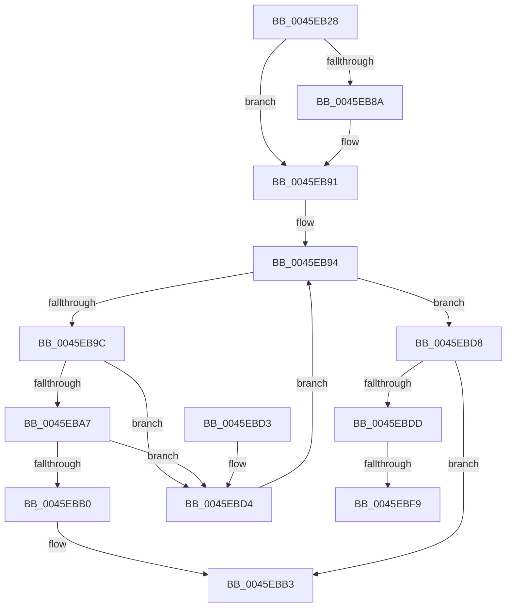

# CcShouldSpinAsyncReadWorkerThread

- RVA: `0x0045EB28`–`0x0045EC0D` (길이 `229` bytes)
- VA: `0x000000014045EB28`
- 실행 섹션: `.text`
- PDB 이름 있음: `예`; PDB Function 태그: `예`
- unwind 정보 RVA: `0x000A97C4`
- 디코드: `66`개 명령, `229/229` bytes 표시
- 미해석 바이트: `0` (있으면 어셈블리에 `.byte`로 보존)

> 이 문서는 커널 이미지의 기계어와 PDB 기호를 분석해 생성했습니다. 4번과 5번은 함수 원형과 자료형을 바이너리 사용 방식에서 추정한 C 해석이며 원본 소스 복구 결과는 아닙니다.

## 1. Dependencies

- 직접 호출 지점: **2**; 고유 호출 대상: **2**
- 직접 호출자로 확인된 함수: **2**
- RIP 상대 이미지 참조: **2**

### Outgoing calls
- `0x0045EBE5` → [KeAbPreAcquire](../21/KeAbPreAcquire_function_00210230.md) (function, `0x00210230`)
- `0x0045EC02` → [ExfAcquirePushLockExclusiveEx](../20/ExfAcquirePushLockExclusiveEx_function_0020FC90.md) (function, `0x0020FC90`)

### Direct callers
- [CcPostWorkQueueAsyncRead](CcPostWorkQueueAsyncRead_function_0045D624.md) at `0x0045D7D3`
- [CcAsyncReadWorker](CcAsyncReadWorker_function_0045DB10.md) at `0x0045DFC0`

### Static image references
- `0x0045EB81` → RVA `0x00E65B88` (`.data`; read)
- `0x0045EB94` → RVA `0x00F8F51C` (`.data`; read)

## 2. Other-region calls and transfers

- 다른 실행 섹션으로 향하는 call: **0**
- call이 아닌 외부 분기/꼬리 이동: **2**
  - `0x0045EBF3` → [sub_006F2098](../6F/Unknown_function_006F2098.md) (`tail-transfer`)
  - `0x0045EC08` → [sub_006F2098](../6F/Unknown_function_006F2098.md) (`tail-transfer`)

## 3. Assembly (complete function range)

```asm
0045EB28  48 8B C4                        mov rax, rsp
0045EB2B  48 89 58 08                     mov qword ptr [rax + 8], rbx
0045EB2F  48 89 68 18                     mov qword ptr [rax + 0x18], rbp
0045EB33  48 89 70 20                     mov qword ptr [rax + 0x20], rsi
0045EB37  48 89 50 10                     mov qword ptr [rax + 0x10], rdx
0045EB3B  57                              push rdi
0045EB3C  41 54                           push r12
0045EB3E  41 55                           push r13
0045EB40  41 56                           push r14
0045EB42  41 57                           push r15
0045EB44  48 83 EC 20                     sub rsp, 0x20
0045EB48  4C 8B 62 10                     mov r12, qword ptr [rdx + 0x10]
0045EB4C  4D 8B F0                        mov r14, r8
0045EB4F  45 8B F9                        mov r15d, r9d
0045EB52  45 33 C0                        xor r8d, r8d
0045EB55  4D 69 CF 94 01 00 00            imul r9, r15, 0x194
0045EB5C  41 8B F7                        mov esi, r15d
0045EB5F  4C 8B E9                        mov r13, rcx
0045EB62  4C 03 8A 18 01 00 00            add r9, qword ptr [rdx + 0x118]
0045EB69  49 8D 9C 24 88 04 00 00         lea rbx, [r12 + 0x488]
0045EB71  48 C1 E6 04                     shl rsi, 4
0045EB75  BF 01 00 00 00                  mov edi, 1
0045EB7A  48 03 B2 E8 00 00 00            add rsi, qword ptr [rdx + 0xe8]
0045EB81  44 38 05 00 70 A0 00            cmp byte ptr [rip + 0xa07000], r8b
0045EB88  75 07                           jne 0x14045eb91
0045EB8A  48 8D 99 C8 04 00 00            lea rbx, [rcx + 0x4c8]
0045EB91  41 8B C8                        mov ecx, r8d
0045EB94  3B 0D 82 09 B3 00               cmp ecx, dword ptr [rip + 0xb30982]
0045EB9A  73 3C                           jae 0x14045ebd8
0045EB9C  8B D1                           mov edx, ecx
0045EB9E  41 8B 04 91                     mov eax, dword ptr [r9 + rdx*4]
0045EBA2  83 F8 FF                        cmp eax, -1
0045EBA5  74 2D                           je 0x14045ebd4
0045EBA7  41 8B 04 91                     mov eax, dword ptr [r9 + rdx*4]
0045EBAB  83 F8 3F                        cmp eax, 0x3f
0045EBAE  73 24                           jae 0x14045ebd4
0045EBB0  41 8A F8                        mov dil, r8b
0045EBB3  48 8B 5C 24 50                  mov rbx, qword ptr [rsp + 0x50]
0045EBB8  40 8A C7                        mov al, dil
0045EBBB  48 8B 6C 24 60                  mov rbp, qword ptr [rsp + 0x60]
0045EBC0  48 8B 74 24 68                  mov rsi, qword ptr [rsp + 0x68]
0045EBC5  48 83 C4 20                     add rsp, 0x20
0045EBC9  41 5F                           pop r15
0045EBCB  41 5E                           pop r14
0045EBCD  41 5D                           pop r13
0045EBCF  41 5C                           pop r12
0045EBD1  5F                              pop rdi
0045EBD2  C3                              ret
0045EBD3  CC                              int3
0045EBD4  03 CF                           add ecx, edi
0045EBD6  EB BC                           jmp 0x14045eb94
0045EBD8  4D 85 F6                        test r14, r14
0045EBDB  74 D6                           je 0x14045ebb3
0045EBDD  33 D2                           xor edx, edx
0045EBDF  4D 89 06                        mov qword ptr [r14], r8
0045EBE2  48 8B CB                        mov rcx, rbx
0045EBE5  E8 46 16 DB FF                  call 0x140210230
0045EBEA  F0 48 0F BA 2B 00               lock bts qword ptr [rbx], 0
0045EBF0  48 8B E8                        mov rbp, rax
0045EBF3  0F 83 9F 34 29 00               jae 0x1406f2098
0045EBF9  4C 8B C3                        mov r8, rbx
0045EBFC  48 8B D0                        mov rdx, rax
0045EBFF  48 8B CB                        mov rcx, rbx
0045EC02  E8 89 10 DB FF                  call 0x14020fc90
0045EC07  90                              nop
0045EC08  E9 8B 34 29 00                  jmp 0x1406f2098
```

## 4. C-style interpretation (structured pseudocode)

```c
__int64 __fastcall CcShouldSpinAsyncReadWorkerThread(__int64 a1, __int64 a2, __int64 a3, int a4)
{
    __int64 result;
    __int64 v_rbx;
    __int64 v_rsi;
    __int64 v_rsp;
    unsigned __int64 v_stack_p18;
    unsigned __int64 v_stack_p20;
    unsigned __int64 v_stack_p8;

    *(unsigned __int64 *)(v_rsp + 8) = v_rbx;
    *(unsigned __int64 *)(v_rsp + 24) = v_rbp;
    *(unsigned __int64 *)(v_rsp + 32) = v_rsi;
    *(unsigned __int64 *)(v_rsp + 16) = a2;
    v_rsp = (v_rsp) - (32);
    a3 = 0;
    a4 = (a4) * ((unsigned int)(a4));
    a4 = (a4) + (*(unsigned __int64 *)(a2 + 280));
    v_rsi = ((unsigned int)((unsigned int)((unsigned int)(a4)))) << (4);
    v_rsi = (v_rsi) + (*(unsigned __int64 *)(a2 + 232));
    v_rbx = *(unsigned __int64 *)(a2 + 16) + 1160;
    if ((*(unsigned __int8 *)(v_rip + 10514432)) == 0) {
        v_rbx = a1 + 1224;
    }
loc_0045EB94:
    if (0 >= (*(unsigned int *)(v_rip + 11733378))) goto loc_0045EBD8;
    if (((unsigned int)((unsigned int)(*(unsigned int *)(a4 + 0 * 4)))) == -1) goto loc_0045EBD4;
    if (((unsigned int)((unsigned int)(*(unsigned int *)(a4 + 0 * 4)))) >= 63) goto loc_0045EBD4;
loc_0045EBB3:
    v_rsp = (v_rsp) + (32);
    return 0;
loc_0045EBD4:
    a1 = (unsigned int)((0) + (0));
    goto loc_0045EB94;
loc_0045EBD8:
    if (0 == 0) goto loc_0045EBB3;
    a2 = 0;
    *(unsigned __int64 *)(a3) = 0;
    result = KeAbPreAcquire(v_stack_p8, a2, a3, a4);
    result = ExfAcquirePushLockExclusiveEx(v_stack_p8, result, v_stack_p8, a4);
}
```

## 5. (Beta) C Style

```c
int64_t CcShouldSpinAsyncReadWorkerThread(void *Arg1, void *Arg2, int64_t Arg3, void *Arg4)
{
    uint8_t *arg1 = (uint8_t *)Arg1;
    uint8_t *arg2 = (uint8_t *)Arg2;
    uint8_t *arg4 = (uint8_t *)Arg4;

    int64_t result;
    int64_t local_rbx;
    int64_t local_rsi;
    int64_t local_rsp;
    uint64_t v_stack_p18;
    uint64_t v_stack_p20;
    uint64_t v_stack_p8;

    *(uint64_t *)(local_rsp + 0x8) = local_rbx;
    *(uint64_t *)(local_rsp + 0x18) = local_rbp;
    *(uint64_t *)(local_rsp + 0x20) = local_rsi;
    *(void **)(local_rsp + 0x10) = Arg2;
    local_rsp = (local_rsp) - (32);
    Arg3 = 0;
    Arg4 = (Arg4) * ((uint32_t)(Arg4));
    Arg4 = (Arg4) + (*(uint64_t *)(arg2 + 0x118));
    local_rsi = ((uint32_t)((uint32_t)((uint32_t)(Arg4)))) << (4);
    local_rsi = (local_rsi) + (*(uint64_t *)(arg2 + 0xE8));
    local_rbx = *(uint64_t *)(arg2 + 0x10) + 1160;
    if ((*(uint8_t *)(v_rip + 0xA07000)) == 0) {
        local_rbx = Arg1 + 1224;
    }
loc_0045EB94:
    if (0 >= (*(uint32_t *)(v_rip + 0xB30982))) goto loc_0045EBD8;
    if (((uint32_t)((uint32_t)(*(uint32_t *)(arg4 + 0x0 * 4)))) == -1) goto loc_0045EBD4;
    if (((uint32_t)((uint32_t)(*(uint32_t *)(arg4 + 0x0 * 4)))) >= 63) goto loc_0045EBD4;
loc_0045EBB3:
    local_rsp = (local_rsp) + (32);
    return 0;
loc_0045EBD4:
    Arg1 = (uint32_t)((0) + (0));
    goto loc_0045EB94;
loc_0045EBD8:
    if (0 == 0) goto loc_0045EBB3;
    Arg2 = 0;
    *(uint64_t *)(Arg3) = 0;
    result = KeAbPreAcquire(v_stack_p8, Arg2, Arg3, Arg4);
    result = ExfAcquirePushLockExclusiveEx(v_stack_p8, result, v_stack_p8, Arg4);
}
```

### 관측된 메모리 오프셋

구조체 형식이 확인되지 않은 접근은 인자 기준의 오프셋으로만 기록했습니다.

| 기준 인자 | 오프셋 표현 | 폭 (bit) | 접근 |
|---|---:|---:|---|
| `Arg1` | `+ 0x4C8` | `64` | `R` |
| `Arg2` | `+ 0x10` | `64` | `R` |
| `Arg2` | `+ 0xE8` | `64` | `R` |
| `Arg2` | `+ 0x118` | `64` | `R` |
| `Arg4` | `+ 0x0 + rdx*4` | `32` | `R` |

## 6. Execution-region graph

[열기: 2D/3D 그래프와 함수 탐색 컨트롤 패널](../../../control-panel.html?section=text&rva=0x0045EB28&view=graph)

- 2D 그래프는 위에서 아래로 흐르고, 3D 그래프는 빈 공간을 드래그해 회전합니다. Shift+드래그는 이동, 휠은 확대·축소, 함수 노드 선택은 대상 보고서 이동입니다.

### Static fallback


