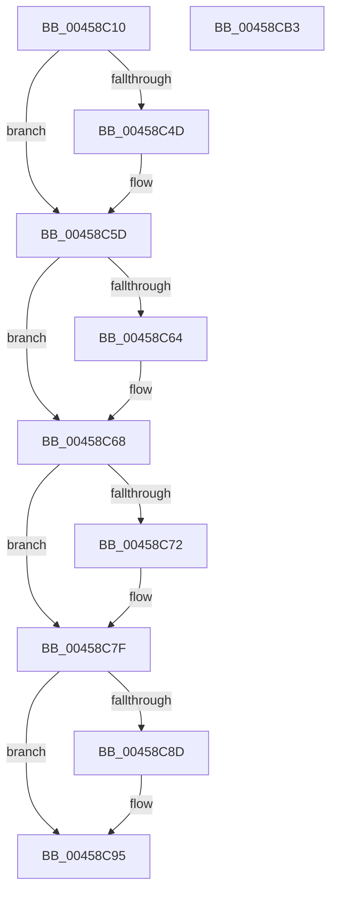

# CcSlowReferenceSharedCacheMapFileObject

- RVA: `0x00458C10`–`0x00458CB4` (길이 `164` bytes)
- VA: `0x0000000140458C10`
- 실행 섹션: `.text`
- PDB 이름 있음: `예`; PDB Function 태그: `아니요`
- unwind 정보 RVA: `0x00061768`
- 디코드: `48`개 명령, `164/164` bytes 표시
- 미해석 바이트: `0` (있으면 어셈블리에 `.byte`로 보존)

> 이 문서는 커널 이미지의 기계어와 PDB 기호를 분석해 생성했습니다. 4번과 5번은 함수 원형과 자료형을 바이너리 사용 방식에서 추정한 C 해석이며 원본 소스 복구 결과는 아닙니다.

## 1. Dependencies

- 직접 호출 지점: **5**; 고유 호출 대상: **5**
- 직접 호출자로 확인된 함수: **1**
- RIP 상대 이미지 참조: **1**

### Outgoing calls
- `0x00458C34` → [KeAbPreAcquire](../21/KeAbPreAcquire_function_00210230.md) (function, `0x00210230`)
- `0x00458C58` → [ExfAcquirePushLockSharedEx](../21/ExfAcquirePushLockSharedEx_function_0021044C.md) (function, `0x0021044C`)
- `0x00458C7A` → [ObfReferenceObjectWithTag](../21/ObfReferenceObjectWithTag_function_00210710.md) (function, `0x00210710`)
- `0x00458C90` → [ExfReleasePushLockShared](../26/ExfReleasePushLockShared_function_00263440.md) (function, `0x00263440`)
- `0x00458C98` → [KeAbPostRelease](../2E/KeAbPostRelease_function_002E1600.md) (function, `0x002E1600`)

### Direct callers
- [CcReferenceSharedCacheMapFileObject](../23/CcReferenceSharedCacheMapFileObject_function_002379BC.md) at `0x00237A70`

### Static image references
- `0x00458C25` → RVA `0x00F8F508` (`.data`; read)

## 2. Other-region calls and transfers

- 다른 실행 섹션으로 향하는 call: **0**
- 별도 외부 분기/꼬리 이동을 확인하지 못했습니다.

## 3. Assembly (complete function range)

```asm
00458C10  48 89 5C 24 08                  mov qword ptr [rsp + 8], rbx
00458C15  48 89 6C 24 18                  mov qword ptr [rsp + 0x18], rbp
00458C1A  56                              push rsi
00458C1B  57                              push rdi
00458C1C  41 56                           push r14
00458C1E  48 83 EC 20                     sub rsp, 0x20
00458C22  48 8B F9                        mov rdi, rcx
00458C25  48 8D 35 DC 68 B3 00            lea rsi, [rip + 0xb368dc]
00458C2C  48 8B CE                        mov rcx, rsi
00458C2F  45 33 C0                        xor r8d, r8d
00458C32  33 D2                           xor edx, edx
00458C34  E8 F7 75 DB FF                  call 0x140210230
00458C39  48 8B D8                        mov rbx, rax
00458C3C  33 C0                           xor eax, eax
00458C3E  44 8D 70 11                     lea r14d, [rax + 0x11]
00458C42  F0 4C 0F B1 35 BD 68 B3 00      lock cmpxchg qword ptr [rip + 0xb368bd], r14
00458C4B  74 10                           je 0x140458c5d
00458C4D  4C 8B CE                        mov r9, rsi
00458C50  4C 8B C3                        mov r8, rbx
00458C53  33 D2                           xor edx, edx
00458C55  48 8B CE                        mov rcx, rsi
00458C58  E8 EF 77 DB FF                  call 0x14021044c
00458C5D  33 ED                           xor ebp, ebp
00458C5F  48 85 DB                        test rbx, rbx
00458C62  74 04                           je 0x140458c68
00458C64  C6 43 0A 01                     mov byte ptr [rbx + 0xa], 1
00458C68  48 8B 5F 60                     mov rbx, qword ptr [rdi + 0x60]
00458C6C  48 83 E3 F0                     and rbx, 0xfffffffffffffff0
00458C70  74 0D                           je 0x140458c7f
00458C72  BA 43 63 53 63                  mov edx, 0x63536343
00458C77  48 8B CB                        mov rcx, rbx
00458C7A  E8 91 7A DB FF                  call 0x140210710
00458C7F  49 8B C6                        mov rax, r14
00458C82  F0 48 0F B1 2D 7D 68 B3 00      lock cmpxchg qword ptr [rip + 0xb3687d], rbp
00458C8B  74 08                           je 0x140458c95
00458C8D  48 8B CE                        mov rcx, rsi
00458C90  E8 AB A7 E0 FF                  call 0x140263440
00458C95  48 8B CE                        mov rcx, rsi
00458C98  E8 63 89 E8 FF                  call 0x1402e1600
00458C9D  48 8B 6C 24 50                  mov rbp, qword ptr [rsp + 0x50]
00458CA2  48 8B C3                        mov rax, rbx
00458CA5  48 8B 5C 24 40                  mov rbx, qword ptr [rsp + 0x40]
00458CAA  48 83 C4 20                     add rsp, 0x20
00458CAE  41 5E                           pop r14
00458CB0  5F                              pop rdi
00458CB1  5E                              pop rsi
00458CB2  C3                              ret
00458CB3  CC                              int3
```

## 4. C-style interpretation (structured pseudocode)

```c
__int64 __fastcall CcSlowReferenceSharedCacheMapFileObject(__int64 a1, int a2, int a3)
{
    __int64 result;
    __int64 v_rbp;
    __int64 v_rbx;
    __int64 v_rsp;
    unsigned __int64 v_stack_p18;
    unsigned __int64 v_stack_p8;

    v_stack_p8 = v_rbx;
    v_stack_p18 = v_rbp;
    v_rsp = (v_rsp) - (32);
    a3 = 0;
    a2 = 0;
    result = KeAbPreAcquire(v_rip + 11757788, a2, a3, a4);
    result = 0;
    if (!(condition_is_equal)) {
        a4 = v_rip + 11757788;
        a3 = 0;
        a2 = 0;
        a1 = v_rip + 11757788;
        result = ExfAcquirePushLockSharedEx(a1, a2, a3, a4);
    }
    v_rbp = 0;
    if (result != 0) {
        *(unsigned __int8 *)(result + 10) = 1;
    }
    v_rbx = (*(unsigned __int64 *)(a1 + 96)) & (-16);
    if (!(condition_is_equal)) {
        a2 = 0x63536343ULL;
        a1 = v_rbx;
        result = ObfReferenceObjectWithTag(a1, a2, a3, a4);
    }
    result = result + 17;
    if (!(condition_is_equal)) {
        a1 = v_rip + 11757788;
        result = ExfReleasePushLockShared(a1, a2, a3, a4);
    }
    result = KeAbPostRelease(v_rip + 11757788, a2, a3, a4);
    v_rsp = (v_rsp) + (32);
    return v_rbx;
}
```

## 5. (Beta) C Style

```c
int64_t CcSlowReferenceSharedCacheMapFileObject(void *Arg1, int32_t Arg2, int32_t Arg3)
{
    uint8_t *arg1 = (uint8_t *)Arg1;

    int64_t result;
    int64_t local_rbp;
    int64_t local_rbx;
    int64_t local_rsp;
    uint64_t v_stack_p18;
    uint64_t v_stack_p8;

    v_stack_p8 = local_rbx;
    v_stack_p18 = local_rbp;
    local_rsp = (local_rsp) - (32);
    Arg3 = 0;
    Arg2 = 0;
    result = KeAbPreAcquire(v_rip + 11757788, Arg2, Arg3, a4);
    result = 0;
    if (!(condition_is_equal)) {
        a4 = v_rip + 11757788;
        Arg3 = 0;
        Arg2 = 0;
        Arg1 = v_rip + 11757788;
        result = ExfAcquirePushLockSharedEx(Arg1, Arg2, Arg3, a4);
    }
    local_rbp = 0;
    if (result != 0) {
        *(uint8_t *)(result + 0xA) = 1;
    }
    local_rbx = (*(uint64_t *)(arg1 + 0x60)) & (-16);
    if (!(condition_is_equal)) {
        Arg2 = 0x63536343ULL;
        Arg1 = local_rbx;
        result = ObfReferenceObjectWithTag(Arg1, Arg2, Arg3, a4);
    }
    result = result + 17;
    if (!(condition_is_equal)) {
        Arg1 = v_rip + 11757788;
        result = ExfReleasePushLockShared(Arg1, Arg2, Arg3, a4);
    }
    result = KeAbPostRelease(v_rip + 11757788, Arg2, Arg3, a4);
    local_rsp = (local_rsp) + (32);
    return local_rbx;
}
```

### 관측된 메모리 오프셋

구조체 형식이 확인되지 않은 접근은 인자 기준의 오프셋으로만 기록했습니다.

| 기준 인자 | 오프셋 표현 | 폭 (bit) | 접근 |
|---|---:|---:|---|
| `Arg1` | `+ 0x60` | `64` | `R` |

## 6. Execution-region graph

[열기: 2D/3D 그래프와 함수 탐색 컨트롤 패널](../../../control-panel.html?section=text&rva=0x00458C10&view=graph)

- 2D 그래프는 위에서 아래로 흐르고, 3D 그래프는 빈 공간을 드래그해 회전합니다. Shift+드래그는 이동, 휠은 확대·축소, 함수 노드 선택은 대상 보고서 이동입니다.

### Static fallback


