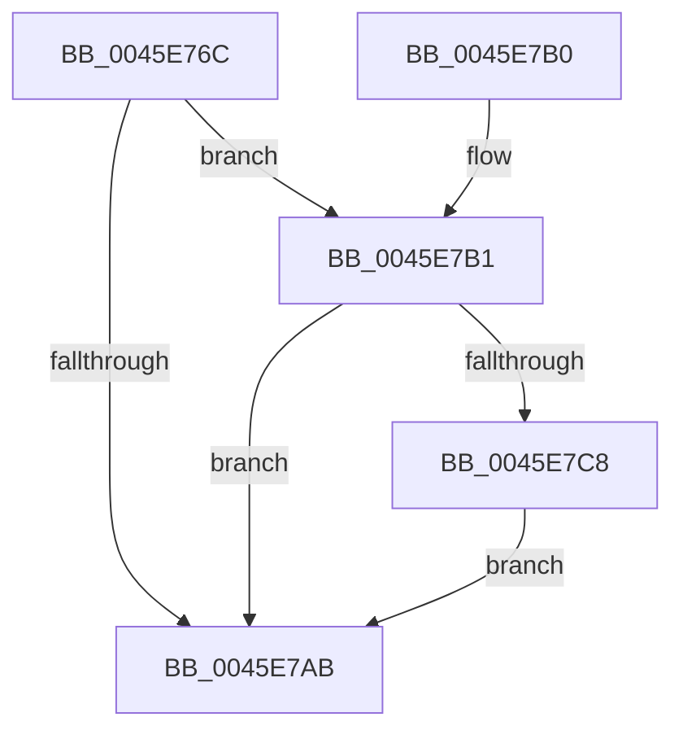

# CcUpdateReadHistory

- RVA: `0x0045E76C`–`0x0045E7D5` (길이 `105` bytes)
- VA: `0x000000014045E76C`
- 실행 섹션: `.text`
- PDB 이름 있음: `예`; PDB Function 태그: `아니요`
- unwind 정보 RVA: `0x00076838`
- 디코드: `30`개 명령, `105/105` bytes 표시
- 미해석 바이트: `0` (있으면 어셈블리에 `.byte`로 보존)

> 이 문서는 커널 이미지의 기계어와 PDB 기호를 분석해 생성했습니다. 4번과 5번은 함수 원형과 자료형을 바이너리 사용 방식에서 추정한 C 해석이며 원본 소스 복구 결과는 아닙니다.

## 1. Dependencies

- 직접 호출 지점: **1**; 고유 호출 대상: **1**
- 직접 호출자로 확인된 함수: **4**
- RIP 상대 이미지 참조: **0**

### Outgoing calls
- `0x0045E7CE` → [CcUpdateSharedCacheMapFlag](CcUpdateSharedCacheMapFlag_function_0045EC14.md) (function, `0x0045EC14`)

### Direct callers
- [CcCopyReadEx](CcCopyReadEx_function_0045E160.md) at `0x0045E32E`
- [CcAsyncReadPrefetch](CcAsyncReadPrefetch_function_0045E540.md) at `0x0045E6F2`
- [CcMdlRead](../../page/AB/CcMdlRead_function_00ABA520.md) at `0x00ABA74F`
- [CcMdlRead$fin$0](../../page/B1/CcMdlRead_fin_0_function_00B139D8.md) at `0x00B13AAD`

### Static image references
- 디코드된 RIP-relative 메모리 참조가 없습니다.

## 2. Other-region calls and transfers

- 다른 실행 섹션으로 향하는 call: **0**
- 별도 외부 분기/꼬리 이동을 확인하지 못했습니다.

## 3. Assembly (complete function range)

```asm
0045E76C  48 83 EC 28                     sub rsp, 0x28
0045E770  48 8B 41 28                     mov rax, qword ptr [rcx + 0x28]
0045E774  4C 8B 49 30                     mov r9, qword ptr [rcx + 0x30]
0045E778  4C 8B 50 08                     mov r10, qword ptr [rax + 8]
0045E77C  49 8B 41 20                     mov rax, qword ptr [r9 + 0x20]
0045E780  49 87 41 10                     xchg qword ptr [r9 + 0x10], rax
0045E784  49 8B 41 28                     mov rax, qword ptr [r9 + 0x28]
0045E788  49 87 41 18                     xchg qword ptr [r9 + 0x18], rax
0045E78C  48 8B 0A                        mov rcx, qword ptr [rdx]
0045E78F  49 87 49 20                     xchg qword ptr [r9 + 0x20], rcx
0045E793  41 8B C0                        mov eax, r8d
0045E796  48 03 02                        add rax, qword ptr [rdx]
0045E799  BA 00 00 20 00                  mov edx, 0x200000
0045E79E  49 87 41 28                     xchg qword ptr [r9 + 0x28], rax
0045E7A2  41 85 92 98 00 00 00            test dword ptr [r10 + 0x98], edx
0045E7A9  75 06                           jne 0x14045e7b1
0045E7AB  48 83 C4 28                     add rsp, 0x28
0045E7AF  C3                              ret
0045E7B0  CC                              int3
0045E7B1  45 8B 41 18                     mov r8d, dword ptr [r9 + 0x18]
0045E7B5  41 8B 41 20                     mov eax, dword ptr [r9 + 0x20]
0045E7B9  41 C1 E8 0C                     shr r8d, 0xc
0045E7BD  C1 E8 0C                        shr eax, 0xc
0045E7C0  41 2B C0                        sub eax, r8d
0045E7C3  83 F8 01                        cmp eax, 1
0045E7C6  76 E3                           jbe 0x14045e7ab
0045E7C8  45 33 C0                        xor r8d, r8d
0045E7CB  49 8B CA                        mov rcx, r10
0045E7CE  E8 41 04 00 00                  call 0x14045ec14
0045E7D3  EB D6                           jmp 0x14045e7ab
```

## 4. C-style interpretation (structured pseudocode)

```c
__int64 __fastcall CcUpdateReadHistory(__int64 a1, __int64 a2, int a3)
{
    __int64 result;
    __int64 v_rsp;

    v_rsp = (v_rsp) - (40);
    result = ((unsigned int)(a3)) + (*(unsigned __int64 *)(a2));
    if (((*(unsigned int *)(*(unsigned __int64 *)(*(unsigned __int64 *)(a1 + 40) + 8) + 152)) & ((unsigned int)((unsigned int)(0x200000ULL)))) != 0) goto loc_0045E7B1;
loc_0045E7AB:
    v_rsp = (v_rsp) + (40);
    return result;
loc_0045E7B1:
    a3 = (unsigned int)(((unsigned int)(*(unsigned int *)(*(unsigned __int64 *)(a1 + 48) + 24))) >> (12));
    result = (unsigned int)(((unsigned int)(*(unsigned int *)(*(unsigned __int64 *)(a1 + 48) + 32))) >> (12));
    result = (unsigned int)((result) - (a3));
    if (((unsigned int)(result)) <= 1) goto loc_0045E7AB;
    a3 = 0;
    result = CcUpdateSharedCacheMapFlag(*(unsigned __int64 *)(*(unsigned __int64 *)(a1 + 40) + 8), (unsigned int)(0x200000ULL), a3, *(unsigned __int64 *)(a1 + 48));
    goto loc_0045E7AB;
}
```

## 5. (Beta) C Style

```c
int64_t CcUpdateReadHistory(void *Arg1, void *Arg2, int32_t Arg3)
{
    uint8_t *arg1 = (uint8_t *)Arg1;
    uint8_t *arg2 = (uint8_t *)Arg2;

    int64_t result;
    int64_t local_rsp;

    local_rsp = (local_rsp) - (40);
    result = ((uint32_t)(Arg3)) + (*(uint64_t *)(arg2));
    if (((*(uint32_t *)(*(uint64_t *)(*(uint64_t *)(arg1 + 0x28) + 0x8) + 0x98)) & ((uint32_t)((uint32_t)(0x200000ULL)))) != 0) goto loc_0045E7B1;
loc_0045E7AB:
    local_rsp = (local_rsp) + (40);
    return result;
loc_0045E7B1:
    Arg3 = (uint32_t)(((uint32_t)(*(uint32_t *)(*(uint64_t *)(arg1 + 0x30) + 0x18))) >> (12));
    result = (uint32_t)(((uint32_t)(*(uint32_t *)(*(uint64_t *)(arg1 + 0x30) + 0x20))) >> (12));
    result = (uint32_t)((result) - (Arg3));
    if (((uint32_t)(result)) <= 1) goto loc_0045E7AB;
    Arg3 = 0;
    result = CcUpdateSharedCacheMapFlag(*(uint64_t *)(*(uint64_t *)(arg1 + 0x28) + 0x8), (uint32_t)(0x200000ULL), Arg3, *(uint64_t *)(arg1 + 0x30));
    goto loc_0045E7AB;
}
```

### 관측된 메모리 오프셋

구조체 형식이 확인되지 않은 접근은 인자 기준의 오프셋으로만 기록했습니다.

| 기준 인자 | 오프셋 표현 | 폭 (bit) | 접근 |
|---|---:|---:|---|
| `Arg1` | `+ 0x28` | `64` | `R` |
| `Arg1` | `+ 0x30` | `64` | `R` |
| `Arg2` | `+ 0x0` | `64` | `R` |

## 6. Execution-region graph

[열기: 2D/3D 그래프와 함수 탐색 컨트롤 패널](../../../control-panel.html?section=text&rva=0x0045E76C&view=graph)

- 2D 그래프는 위에서 아래로 흐르고, 3D 그래프는 빈 공간을 드래그해 회전합니다. Shift+드래그는 이동, 휠은 확대·축소, 함수 노드 선택은 대상 보고서 이동입니다.

### Static fallback


