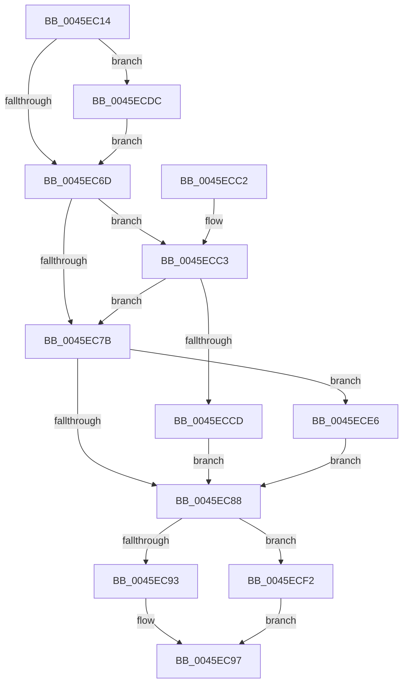

# CcUpdateSharedCacheMapFlag

- RVA: `0x0045EC14`–`0x0045ECF6` (길이 `226` bytes)
- VA: `0x000000014045EC14`
- 실행 섹션: `.text`
- PDB 이름 있음: `예`; PDB Function 태그: `아니요`
- unwind 정보 RVA: `0x000A97F4`
- 디코드: `62`개 명령, `226/226` bytes 표시
- 미해석 바이트: `0` (있으면 어셈블리에 `.byte`로 보존)

> 이 문서는 커널 이미지의 기계어와 PDB 기호를 분석해 생성했습니다. 4번과 5번은 함수 원형과 자료형을 바이너리 사용 방식에서 추정한 C 해석이며 원본 소스 복구 결과는 아닙니다.

## 1. Dependencies

- 직접 호출 지점: **4**; 고유 호출 대상: **4**
- 직접 호출자로 확인된 함수: **8**
- RIP 상대 이미지 참조: **3**

### Outgoing calls
- `0x0045ECA2` → [KeReleaseInStackQueuedSpinLock](../34/KeReleaseInStackQueuedSpinLock_function_00342CE0.md) (function, `0x00342CE0`)
- `0x0045ECD5` → [KiAcquireQueuedSpinLockInstrumented](../27/KiAcquireQueuedSpinLockInstrumented_function_00275850.md) (function, `0x00275850`)
- `0x0045ECDF` → [KiRaiseIrqlProcessIrqlFlags](../4F/KiRaiseIrqlProcessIrqlFlags_function_004F56FC.md) (function, `0x004F56FC`)
- `0x0045ECEB` → [KxWaitForLockOwnerShip](../25/KxWaitForLockOwnerShip_function_00257EB0.md) (function, `0x00257EB0`)

### Direct callers
- [CcPurgeAndClearCacheSection](../38/CcPurgeAndClearCacheSection_function_0038A614.md) at `0x0038A7C2`
- [CcUpdateReadHistory](CcUpdateReadHistory_function_0045E76C.md) at `0x0045E7CE`
- [CcBoostLowPriorityWorkerThread](../57/CcBoostLowPriorityWorkerThread_function_0057B704.md) at `0x0057B812`
- [sub_006F937E](../6F/Unknown_function_006F937E.md) at `0x006F9448`
- [sub_009E9762](../../page/9E/Unknown_function_009E9762.md) at `0x009E977A`
- [CcMapAndCopyFromCache](../../page/A4/CcMapAndCopyFromCache_function_00A47060.md) at `0x00A47285`
- [CcMapAndCopyFromCache](../../page/A4/CcMapAndCopyFromCache_function_00A47060.md) at `0x00A4729C`
- [CcMdlRead](../../page/AB/CcMdlRead_function_00ABA520.md) at `0x00ABA769`
- [CcMdlRead$fin$0](../../page/B1/CcMdlRead_fin_0_function_00B139D8.md) at `0x00B13A64`
- [CcMdlRead$fin$0](../../page/B1/CcMdlRead_fin_0_function_00B139D8.md) at `0x00B13ACA`

### Static image references
- `0x0045EC65` → RVA `0x00FC6D20` (`ALMOSTRO`; read)
- `0x0045EC6D` → RVA `0x00FC6B06` (`ALMOSTRO`; read)
- `0x0045ECC3` → RVA `0x00F0DE58` (`.data`; read)

## 2. Other-region calls and transfers

- 다른 실행 섹션으로 향하는 call: **0**
- 별도 외부 분기/꼬리 이동을 확인하지 못했습니다.

## 3. Assembly (complete function range)

```asm
0045EC14  4C 8B DC                        mov r11, rsp
0045EC17  49 89 5B 08                     mov qword ptr [r11 + 8], rbx
0045EC1B  49 89 6B 10                     mov qword ptr [r11 + 0x10], rbp
0045EC1F  49 89 73 18                     mov qword ptr [r11 + 0x18], rsi
0045EC23  49 89 7B 20                     mov qword ptr [r11 + 0x20], rdi
0045EC27  41 56                           push r14
0045EC29  48 83 EC 40                     sub rsp, 0x40
0045EC2D  48 8B B9 18 02 00 00            mov rdi, qword ptr [rcx + 0x218]
0045EC34  33 C0                           xor eax, eax
0045EC36  48 81 C7 00 03 00 00            add rdi, 0x300
0045EC3D  0F 57 C0                        xorps xmm0, xmm0
0045EC40  0F 11 44 24 20                  movups xmmword ptr [rsp + 0x20], xmm0
0045EC45  49 21 43 D8                     and qword ptr [r11 - 0x28], rax
0045EC49  45 8A F0                        mov r14b, r8b
0045EC4C  49 89 7B E0                     mov qword ptr [r11 - 0x20], rdi
0045EC50  8B DA                           mov ebx, edx
0045EC52  49 89 43 E8                     mov qword ptr [r11 - 0x18], rax
0045EC56  48 8B F1                        mov rsi, rcx
0045EC59  90                              nop
0045EC5A  44 0F 20 C5                     mov rbp, cr8
0045EC5E  8D 50 02                        lea edx, [rax + 2]
0045EC61  44 0F 22 C2                     mov cr8, rdx
0045EC65  39 05 B5 80 B6 00               cmp dword ptr [rip + 0xb680b5], eax
0045EC6B  75 6F                           jne 0x14045ecdc
0045EC6D  F6 05 92 7E B6 00 21            test byte ptr [rip + 0xb67e92], 0x21
0045EC74  40 88 6C 24 30                  mov byte ptr [rsp + 0x30], bpl
0045EC79  75 48                           jne 0x14045ecc3
0045EC7B  48 8D 54 24 20                  lea rdx, [rsp + 0x20]
0045EC80  48 87 17                        xchg qword ptr [rdi], rdx
0045EC83  48 85 D2                        test rdx, rdx
0045EC86  75 5E                           jne 0x14045ece6
0045EC88  8B 86 98 00 00 00               mov eax, dword ptr [rsi + 0x98]
0045EC8E  45 84 F6                        test r14b, r14b
0045EC91  75 5F                           jne 0x14045ecf2
0045EC93  F7 D3                           not ebx
0045EC95  23 C3                           and eax, ebx
0045EC97  48 8D 4C 24 20                  lea rcx, [rsp + 0x20]
0045EC9C  89 86 98 00 00 00               mov dword ptr [rsi + 0x98], eax
0045ECA2  E8 39 40 EE FF                  call 0x140342ce0
0045ECA7  48 8B 5C 24 50                  mov rbx, qword ptr [rsp + 0x50]
0045ECAC  48 8B 6C 24 58                  mov rbp, qword ptr [rsp + 0x58]
0045ECB1  48 8B 74 24 60                  mov rsi, qword ptr [rsp + 0x60]
0045ECB6  48 8B 7C 24 68                  mov rdi, qword ptr [rsp + 0x68]
0045ECBB  48 83 C4 40                     add rsp, 0x40
0045ECBF  41 5E                           pop r14
0045ECC1  C3                              ret
0045ECC2  CC                              int3
0045ECC3  8B 05 8F F1 AA 00               mov eax, dword ptr [rip + 0xaaf18f]
0045ECC9  85 C0                           test eax, eax
0045ECCB  75 AE                           jne 0x14045ec7b
0045ECCD  48 8B D7                        mov rdx, rdi
0045ECD0  48 8D 4C 24 20                  lea rcx, [rsp + 0x20]
0045ECD5  E8 76 6B E1 FF                  call 0x140275850
0045ECDA  EB AC                           jmp 0x14045ec88
0045ECDC  40 8A CD                        mov cl, bpl
0045ECDF  E8 18 6A 09 00                  call 0x1404f56fc
0045ECE4  EB 87                           jmp 0x14045ec6d
0045ECE6  48 8D 4C 24 20                  lea rcx, [rsp + 0x20]
0045ECEB  E8 C0 91 DF FF                  call 0x140257eb0
0045ECF0  EB 96                           jmp 0x14045ec88
0045ECF2  0B C3                           or eax, ebx
0045ECF4  EB A1                           jmp 0x14045ec97
```

## 4. C-style interpretation (structured pseudocode)

```c
__int64 __fastcall CcUpdateSharedCacheMapFlag(__int64 a1, int a2, unsigned __int8 a3)
{
    __int64 result;
    __int64 v_rbx;
    __int64 v_rdi;
    __int64 v_rsp;
    unsigned __int8 v_stack_m18;
    unsigned __int64 v_stack_m28;
    unsigned __int64 v_stack_p10;
    unsigned __int64 v_stack_p18;
    unsigned __int64 v_stack_p20;
    unsigned __int64 v_stack_p8;

    *(unsigned __int64 *)(v_rsp + 8) = v_rbx;
    *(unsigned __int64 *)(v_rsp + 16) = v_rbp;
    *(unsigned __int64 *)(v_rsp + 24) = v_rsi;
    *(unsigned __int64 *)(v_rsp + 32) = v_rdi;
    v_rsp = (v_rsp) - (64);
    result = 0;
    v_rdi = (*(unsigned __int64 *)(a1 + 536)) + (768);
    v_stack_m28 = v_xmm0;
    *(unsigned __int64 *)(v_rsp - 32) = v_rdi;
    *(unsigned __int64 *)(v_rsp - 24) = 0;
    if ((*(unsigned int *)(v_rip + 11960501)) != 0) goto loc_0045ECDC;
loc_0045EC6D:
    v_stack_m18 = (unsigned __int8)(v_cr8);
    if (((*(unsigned __int8 *)(v_rip + 11959954)) & (33)) != 0) goto loc_0045ECC3;
loc_0045EC7B:
    if (v_stack_m28 != 0) goto loc_0045ECE6;
loc_0045EC88:
    if (a3 != 0) goto loc_0045ECF2;
    v_rbx = (unsigned int)(~((unsigned int)(a2)));
    result = (unsigned int)(((unsigned int)(*(unsigned int *)(a1 + 152))) & ((unsigned int)(v_rbx)));
loc_0045EC97:
    *(unsigned int *)(a1 + 152) = (unsigned int)(result);
    result = KeReleaseInStackQueuedSpinLock(v_stack_m28, v_stack_m28, a3, a4);
    v_rsp = (v_rsp) + (64);
    return result;
loc_0045ECC3:
    if ((unsigned int)((unsigned int)(*(unsigned int *)(v_rip + 11202959))) != 0) goto loc_0045EC7B;
    result = KiAcquireQueuedSpinLockInstrumented(v_stack_p20, v_stack_p20, a3, a4);
    goto loc_0045EC88;
loc_0045ECDC:
    result = KiRaiseIrqlProcessIrqlFlags((unsigned __int8)(v_stack_p10), v_stack_p20, a3, a4);
    goto loc_0045EC6D;
loc_0045ECE6:
    result = KxWaitForLockOwnerShip(v_stack_p20, v_stack_p20, a3, a4);
    goto loc_0045EC88;
loc_0045ECF2:
    result = (unsigned int)((result) | ((unsigned int)(v_stack_p8)));
    goto loc_0045EC97;
}
```

## 5. (Beta) C Style

```c
int64_t CcUpdateSharedCacheMapFlag(void *Arg1, int32_t Arg2, uint8_t Arg3)
{
    uint8_t *arg1 = (uint8_t *)Arg1;

    int64_t result;
    int64_t local_rbx;
    int64_t local_rdi;
    int64_t local_rsp;
    uint8_t v_stack_m18;
    uint64_t v_stack_m28;
    uint64_t v_stack_p10;
    uint64_t v_stack_p18;
    uint64_t v_stack_p20;
    uint64_t v_stack_p8;

    *(uint64_t *)(local_rsp + 0x8) = local_rbx;
    *(uint64_t *)(local_rsp + 0x10) = local_rbp;
    *(uint64_t *)(local_rsp + 0x18) = local_rsi;
    *(uint64_t *)(local_rsp + 0x20) = local_rdi;
    local_rsp = (local_rsp) - (64);
    result = 0;
    local_rdi = (*(uint64_t *)(arg1 + 0x218)) + (768);
    v_stack_m28 = v_xmm0;
    *(uint64_t *)(local_rsp - 0x20) = local_rdi;
    *(uint64_t *)(local_rsp - 0x18) = 0;
    if ((*(uint32_t *)(v_rip + 0xB680B5)) != 0) goto loc_0045ECDC;
loc_0045EC6D:
    v_stack_m18 = (uint8_t)(v_cr8);
    if (((*(uint8_t *)(v_rip + 0xB67E92)) & (33)) != 0) goto loc_0045ECC3;
loc_0045EC7B:
    if (v_stack_m28 != 0) goto loc_0045ECE6;
loc_0045EC88:
    if (Arg3 != 0) goto loc_0045ECF2;
    local_rbx = (uint32_t)(~((uint32_t)(Arg2)));
    result = (uint32_t)(((uint32_t)(*(uint32_t *)(arg1 + 0x98))) & ((uint32_t)(local_rbx)));
loc_0045EC97:
    *(uint32_t *)(arg1 + 0x98) = (uint32_t)(result);
    result = KeReleaseInStackQueuedSpinLock(v_stack_m28, v_stack_m28, Arg3, a4);
    local_rsp = (local_rsp) + (64);
    return result;
loc_0045ECC3:
    if ((uint32_t)((uint32_t)(*(uint32_t *)(v_rip + 0xAAF18F))) != 0) goto loc_0045EC7B;
    result = KiAcquireQueuedSpinLockInstrumented(v_stack_p20, v_stack_p20, Arg3, a4);
    goto loc_0045EC88;
loc_0045ECDC:
    result = KiRaiseIrqlProcessIrqlFlags((uint8_t)(v_stack_p10), v_stack_p20, Arg3, a4);
    goto loc_0045EC6D;
loc_0045ECE6:
    result = KxWaitForLockOwnerShip(v_stack_p20, v_stack_p20, Arg3, a4);
    goto loc_0045EC88;
loc_0045ECF2:
    result = (uint32_t)((result) | ((uint32_t)(v_stack_p8)));
    goto loc_0045EC97;
}
```

### 관측된 메모리 오프셋

구조체 형식이 확인되지 않은 접근은 인자 기준의 오프셋으로만 기록했습니다.

| 기준 인자 | 오프셋 표현 | 폭 (bit) | 접근 |
|---|---:|---:|---|
| `Arg1` | `+ 0x98` | `32` | `R` |
| `Arg1` | `+ 0x98` | `32` | `W` |
| `Arg1` | `+ 0x218` | `64` | `R` |

## 6. Execution-region graph

[열기: 2D/3D 그래프와 함수 탐색 컨트롤 패널](../../../control-panel.html?section=text&rva=0x0045EC14&view=graph)

- 2D 그래프는 위에서 아래로 흐르고, 3D 그래프는 빈 공간을 드래그해 회전합니다. Shift+드래그는 이동, 휠은 확대·축소, 함수 노드 선택은 대상 보고서 이동입니다.

### Static fallback


