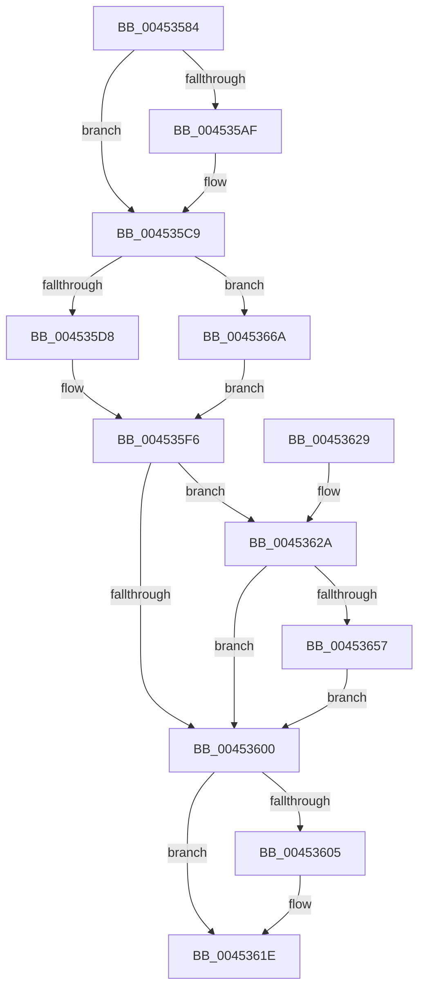

# CcZeroEndOfLastPage

- RVA: `0x00453584`–`0x00453671` (길이 `237` bytes)
- VA: `0x0000000140453584`
- 실행 섹션: `.text`
- PDB 이름 있음: `예`; PDB Function 태그: `아니요`
- unwind 정보 RVA: `0x000A779C`
- 디코드: `59`개 명령, `237/237` bytes 표시
- 미해석 바이트: `0` (있으면 어셈블리에 `.byte`로 보존)

> 이 문서는 커널 이미지의 기계어와 PDB 기호를 분석해 생성했습니다. 4번과 5번은 함수 원형과 자료형을 바이너리 사용 방식에서 추정한 C 해석이며 원본 소스 복구 결과는 아닙니다.

## 1. Dependencies

- 직접 호출 지점: **6**; 고유 호출 대상: **6**
- 직접 호출자로 확인된 함수: **5**
- RIP 상대 이미지 참조: **0**

### Outgoing calls
- `0x004535C4` → [FsRtlAcquireFileExclusive](../../page/9D/FsRtlAcquireFileExclusive_function_009D8E20.md) (function, `0x009D8E20`)
- `0x004535DC` → [ExAcquireFastMutex](../20/ExAcquireFastMutex_function_0020E5A0.md) (function, `0x0020E5A0`)
- `0x004535F1` → [ExReleaseFastMutex](../25/ExReleaseFastMutex_function_002519C0.md) (function, `0x002519C0`)
- `0x00453619` → [FsRtlReleaseFile](../../page/98/FsRtlReleaseFile_function_00985B70.md) (function, `0x00985B70`)
- `0x0045364B` → [CcFlushCachePriv](../35/CcFlushCachePriv_function_0035B040.md) (function, `0x0035B040`)
- `0x00453663` → [CcPurgeCacheSection](../38/CcPurgeCacheSection_function_0038B130.md) (function, `0x0038B130`)

### Direct callers
- [MiCreateSystemSection](MiCreateSystemSection_function_00453158.md) at `0x0045325B`
- [FsRtlCreateSectionForDataScan](FsRtlCreateSectionForDataScan_function_00453330.md) at `0x00453471`
- [MiCreateSectionCommon](../../page/8A/MiCreateSectionCommon_function_008A9AA4.md) at `0x008A9DAD`
- [MiCreateImageFileMap](../../page/98/MiCreateImageFileMap_function_00986830.md) at `0x00986926`
- [MmCreateSpecialImageSection](../../page/AB/MmCreateSpecialImageSection_function_00AB7360.md) at `0x00AB746C`

### Static image references
- 디코드된 RIP-relative 메모리 참조가 없습니다.

## 2. Other-region calls and transfers

- 다른 실행 섹션으로 향하는 call: **2**
  - `0x004535C4` → [FsRtlAcquireFileExclusive](../../page/9D/FsRtlAcquireFileExclusive_function_009D8E20.md) (`.text` → `PAGE`)
  - `0x00453619` → [FsRtlReleaseFile](../../page/98/FsRtlReleaseFile_function_00985B70.md) (`.text` → `PAGE`)
- 별도 외부 분기/꼬리 이동을 확인하지 못했습니다.

## 3. Assembly (complete function range)

```asm
00453584  48 89 5C 24 08                  mov qword ptr [rsp + 8], rbx
00453589  57                              push rdi
0045358A  48 83 EC 50                     sub rsp, 0x50
0045358E  0F 57 C0                        xorps xmm0, xmm0
00453591  40 32 FF                        xor dil, dil
00453594  0F 11 44 24 40                  movups xmmword ptr [rsp + 0x40], xmm0
00453599  65 48 8B 04 25 88 01 00 00      mov rax, qword ptr gs:[0x188]
004535A2  48 8B D9                        mov rbx, rcx
004535A5  48 83 B8 50 05 00 00 00         cmp qword ptr [rax + 0x550], 0
004535AD  75 1A                           jne 0x1404535c9
004535AF  65 48 8B 04 25 88 01 00 00      mov rax, qword ptr gs:[0x188]
004535B8  BF 01 00 00 00                  mov edi, 1
004535BD  48 89 B8 50 05 00 00            mov qword ptr [rax + 0x550], rdi
004535C4  E8 57 58 58 00                  call 0x1409d8e20
004535C9  48 8B 4B 18                     mov rcx, qword ptr [rbx + 0x18]
004535CD  8A 41 04                        mov al, byte ptr [rcx + 4]
004535D0  A8 40                           test al, 0x40
004535D2  0F 84 92 00 00 00               je 0x14045366a
004535D8  48 8B 49 30                     mov rcx, qword ptr [rcx + 0x30]
004535DC  E8 BF AF DB FF                  call 0x14020e5a0
004535E1  48 8B 43 18                     mov rax, qword ptr [rbx + 0x18]
004535E5  80 48 04 20                     or byte ptr [rax + 4], 0x20
004535E9  48 8B 4B 18                     mov rcx, qword ptr [rbx + 0x18]
004535ED  48 8B 49 30                     mov rcx, qword ptr [rcx + 0x30]
004535F1  E8 CA E3 DF FF                  call 0x1402519c0
004535F6  48 8B 43 18                     mov rax, qword ptr [rbx + 0x18]
004535FA  F6 40 06 04                     test byte ptr [rax + 6], 4
004535FE  75 2A                           jne 0x14045362a
00453600  40 84 FF                        test dil, dil
00453603  74 19                           je 0x14045361e
00453605  65 48 8B 04 25 88 01 00 00      mov rax, qword ptr gs:[0x188]
0045360E  48 8B CB                        mov rcx, rbx
00453611  48 83 A0 50 05 00 00 00         and qword ptr [rax + 0x550], 0
00453619  E8 52 25 53 00                  call 0x140985b70
0045361E  48 8B 5C 24 60                  mov rbx, qword ptr [rsp + 0x60]
00453623  48 83 C4 50                     add rsp, 0x50
00453627  5F                              pop rdi
00453628  C3                              ret
00453629  CC                              int3
0045362A  48 83 64 24 30 00               and qword ptr [rsp + 0x30], 0
00453630  48 8D 44 24 40                  lea rax, [rsp + 0x40]
00453635  48 8B 4B 28                     mov rcx, qword ptr [rbx + 0x28]
00453639  45 33 C9                        xor r9d, r9d
0045363C  48 89 44 24 28                  mov qword ptr [rsp + 0x28], rax
00453641  45 33 C0                        xor r8d, r8d
00453644  33 D2                           xor edx, edx
00453646  C6 44 24 20 00                  mov byte ptr [rsp + 0x20], 0
0045364B  E8 F0 79 F0 FF                  call 0x14035b040
00453650  83 7C 24 40 00                  cmp dword ptr [rsp + 0x40], 0
00453655  75 A9                           jne 0x140453600
00453657  48 8B 4B 28                     mov rcx, qword ptr [rbx + 0x28]
0045365B  45 33 C9                        xor r9d, r9d
0045365E  45 33 C0                        xor r8d, r8d
00453661  33 D2                           xor edx, edx
00453663  E8 C8 7A F3 FF                  call 0x14038b130
00453668  EB 96                           jmp 0x140453600
0045366A  0C 20                           or al, 0x20
0045366C  88 41 04                        mov byte ptr [rcx + 4], al
0045366F  EB 85                           jmp 0x1404535f6
```

## 4. C-style interpretation (structured pseudocode)

```c
__int64 __fastcall CcZeroEndOfLastPage(__int64 a1, int a2, int a3, int a4)
{
    __int64 result;
    __int64 v_rdi;
    __int64 v_rsp;
    unsigned __int64 v_stack_m18;
    unsigned __int8 v_stack_p20;
    unsigned __int64 v_stack_p28;
    unsigned __int64 v_stack_p30;
    unsigned __int64 v_stack_p40;
    unsigned __int64 v_stack_p8;

    v_stack_p8 = v_rbx;
    v_rsp = (v_rsp) - (80);
    v_rdi = 0;
    v_stack_m18 = v_xmm0;
    result = *(unsigned __int64 *)(gs_base + (0 + 392));
    if ((*(unsigned __int64 *)(*(unsigned __int64 *)(gs_base + (0 + 392)) + 1360)) == 0) {
        result = *(unsigned __int64 *)(gs_base + (0 + 392));
        v_rdi = 1;
        *(unsigned __int64 *)(result + 1360) = v_rdi;
        result = FsRtlAcquireFileExclusive(a1, a2, a3, a4);
    }
    if ((((unsigned __int8)(*(unsigned __int8 *)(*(unsigned __int64 *)(a1 + 24) + 4))) & (64)) == 0) goto loc_0045366A;
    result = ExAcquireFastMutex(*(unsigned __int64 *)(*(unsigned __int64 *)(a1 + 24) + 48), a2, a3, a4);
    result = ExReleaseFastMutex(*(unsigned __int64 *)(*(unsigned __int64 *)(a1 + 24) + 48), a2, a3, a4);
loc_004535F6:
    if (((*(unsigned __int8 *)(*(unsigned __int64 *)(a1 + 24) + 6)) & (4)) != 0) goto loc_0045362A;
loc_00453600:
    result = *(unsigned __int64 *)(a1 + 24);
    if ((unsigned __int8)(v_rdi) != 0) {
        result = *(unsigned __int64 *)(gs_base + (0 + 392));
        a1 = a1;
        result = FsRtlReleaseFile(a1, a2, a3, a4);
    }
    v_rsp = (v_rsp) + (80);
    return result;
loc_0045362A:
    a4 = 0;
    v_stack_p28 = v_stack_p40;
    a3 = 0;
    a2 = 0;
    v_stack_p20 = 0;
    result = CcFlushCachePriv(*(unsigned __int64 *)(v_stack_p8 + 40), a2, a3, a4);
    if (v_stack_p40 != 0) goto loc_00453600;
    a4 = 0;
    a3 = 0;
    a2 = 0;
    result = CcPurgeCacheSection(*(unsigned __int64 *)(v_stack_p8 + 40), a2, a3, a4);
    goto loc_00453600;
loc_0045366A:
    result = (unsigned __int8)((result) | (32));
    *(unsigned __int8 *)(*(unsigned __int64 *)(v_stack_p8 + 40) + 4) = (unsigned __int8)(result);
    goto loc_004535F6;
}
```

## 5. (Beta) C Style

```c
int64_t CcZeroEndOfLastPage(void *Arg1, int32_t Arg2, int32_t Arg3, int32_t Arg4)
{
    uint8_t *arg1 = (uint8_t *)Arg1;

    int64_t result;
    int64_t local_rdi;
    int64_t local_rsp;
    uint64_t v_stack_m18;
    uint8_t v_stack_p20;
    uint64_t v_stack_p28;
    uint64_t v_stack_p30;
    uint64_t v_stack_p40;
    uint64_t v_stack_p8;

    v_stack_p8 = local_rbx;
    local_rsp = (local_rsp) - (80);
    local_rdi = 0;
    v_stack_m18 = v_xmm0;
    result = *(uint64_t *)(gs_base + (0 + 0x188));
    if ((*(uint64_t *)(*(uint64_t *)(gs_base + (0 + 0x188)) + 0x550)) == 0) {
        result = *(uint64_t *)(gs_base + (0 + 0x188));
        local_rdi = 1;
        *(uint64_t *)(result + 0x550) = local_rdi;
        result = FsRtlAcquireFileExclusive(Arg1, Arg2, Arg3, Arg4);
    }
    if ((((uint8_t)(*(uint8_t *)(*(uint64_t *)(arg1 + 0x18) + 0x4))) & (64)) == 0) goto loc_0045366A;
    result = ExAcquireFastMutex(*(uint64_t *)(*(uint64_t *)(arg1 + 0x18) + 0x30), Arg2, Arg3, Arg4);
    result = ExReleaseFastMutex(*(uint64_t *)(*(uint64_t *)(arg1 + 0x18) + 0x30), Arg2, Arg3, Arg4);
loc_004535F6:
    if (((*(uint8_t *)(*(uint64_t *)(arg1 + 0x18) + 0x6)) & (4)) != 0) goto loc_0045362A;
loc_00453600:
    result = *(uint64_t *)(arg1 + 0x18);
    if ((uint8_t)(local_rdi) != 0) {
        result = *(uint64_t *)(gs_base + (0 + 0x188));
        Arg1 = Arg1;
        result = FsRtlReleaseFile(Arg1, Arg2, Arg3, Arg4);
    }
    local_rsp = (local_rsp) + (80);
    return result;
loc_0045362A:
    Arg4 = 0;
    v_stack_p28 = v_stack_p40;
    Arg3 = 0;
    Arg2 = 0;
    v_stack_p20 = 0;
    result = CcFlushCachePriv(*(uint64_t *)(v_stack_p8 + 0x28), Arg2, Arg3, Arg4);
    if (v_stack_p40 != 0) goto loc_00453600;
    Arg4 = 0;
    Arg3 = 0;
    Arg2 = 0;
    result = CcPurgeCacheSection(*(uint64_t *)(v_stack_p8 + 0x28), Arg2, Arg3, Arg4);
    goto loc_00453600;
loc_0045366A:
    result = (uint8_t)((result) | (32));
    *(uint8_t *)(*(uint64_t *)(v_stack_p8 + 0x28) + 0x4) = (uint8_t)(result);
    goto loc_004535F6;
}
```

### 관측된 메모리 오프셋

구조체 형식이 확인되지 않은 접근은 인자 기준의 오프셋으로만 기록했습니다.

| 기준 인자 | 오프셋 표현 | 폭 (bit) | 접근 |
|---|---:|---:|---|
| `Arg1` | `+ 0x18` | `64` | `R` |
| `Arg1` | `+ 0x28` | `64` | `R` |

## 6. Execution-region graph

[열기: 2D/3D 그래프와 함수 탐색 컨트롤 패널](../../../control-panel.html?section=text&rva=0x00453584&view=graph)

- 2D 그래프는 위에서 아래로 흐르고, 3D 그래프는 빈 공간을 드래그해 회전합니다. Shift+드래그는 이동, 휠은 확대·축소, 함수 노드 선택은 대상 보고서 이동입니다.

### Static fallback


