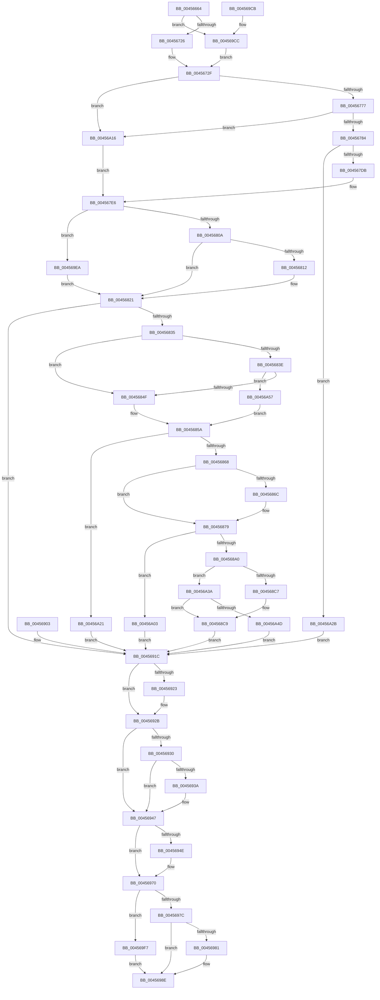

# CmpDoQueryKeyName

- RVA: `0x00456664`–`0x00456A74` (길이 `1,040` bytes)
- VA: `0x0000000140456664`
- 실행 섹션: `.text`
- PDB 이름 있음: `예`; PDB Function 태그: `아니요`
- unwind 정보 RVA: `0x000A7C88`
- 디코드: `233`개 명령, `1,040/1,040` bytes 표시
- 미해석 바이트: `0` (있으면 어셈블리에 `.byte`로 보존)

> 이 문서는 커널 이미지의 기계어와 PDB 기호를 분석해 생성했습니다. 4번과 5번은 함수 원형과 자료형을 바이너리 사용 방식에서 추정한 C 해석이며 원본 소스 복구 결과는 아닙니다.

## 1. Dependencies

- 직접 호출 지점: **20**; 고유 호출 대상: **17**
- 직접 호출자로 확인된 함수: **1**
- RIP 상대 이미지 참조: **3**

### Outgoing calls
- `0x00456777` → [CmpIsRegistryLockAcquired](CmpIsRegistryLockAcquired_function_00456A7C.md) (function, `0x00456A7C`)
- `0x004567CE` → [CmpCallCallBacks](../../page/86/CmpCallCallBacks_function_00865E10.md) (function, `0x00865E10`)
- `0x004567EE` → [CmpAttachToRegistryProcess](../../pagecmrc/BC/CmpAttachToRegistryProcess_function_00BC98E0.md) (function, `0x00BC98E0`)
- `0x004567F3` → [CmpLockRegistry](../../pagecmrc/BC/CmpLockRegistry_function_00BC9B34.md) (function, `0x00BC9B34`)
- `0x00456815` → [CmpLockKcbShared](../../pagecmrc/BC/CmpLockKcbShared_function_00BC9A1C.md) (function, `0x00BC9A1C`)
- `0x00456826` → [CmpPerformKeyBodyDeletionCheck](../../pagecmrc/BC/CmpPerformKeyBodyDeletionCheck_function_00BC97D0.md) (function, `0x00BC97D0`)
- `0x00456852` → [CmpConstructName](../../page/85/CmpConstructName_function_00856BE0.md) (function, `0x00856BE0`)
- `0x0045686F` → [CmpUnlockKcb](../../pagecmrc/BC/CmpUnlockKcb_function_00BC92C0.md) (function, `0x00BC92C0`)
- `0x00456879` → [CmpUnlockRegistry](../../pagecmrc/BC/CmpUnlockRegistry_function_00BC9A84.md) (function, `0x00BC9A84`)
- `0x00456886` → [CmpDetachFromRegistryProcess](../../pagecmrc/BC/CmpDetachFromRegistryProcess_function_00BC9920.md) (function, `0x00BC9920`)
- `0x004568DA` → [memcpy](../6C/memcpy_function_006C6840.md) (function, `0x006C6840`)
- `0x00456926` → [CmpUnlockKcb](../../pagecmrc/BC/CmpUnlockKcb_function_00BC92C0.md) (function, `0x00BC92C0`)
- `0x00456930` → [CmpUnlockRegistry](../../pagecmrc/BC/CmpUnlockRegistry_function_00BC9A84.md) (function, `0x00BC9A84`)
- `0x00456942` → [CmpDetachFromRegistryProcess](../../pagecmrc/BC/CmpDetachFromRegistryProcess_function_00BC9920.md) (function, `0x00BC9920`)
- `0x0045696B` → [CmPostCallbackNotification](../../page/86/CmPostCallbackNotification_function_00865D50.md) (function, `0x00865D50`)
- `0x00456970` → [KeLeaveCriticalRegion](../25/KeLeaveCriticalRegion_function_0025D8B0.md) (function, `0x0025D8B0`)
- `0x00456989` → [ExFreePoolWithTag](../../poolcode/B8/ExFreePoolWithTag_function_00B82870.md) (function, `0x00B82870`)
- `0x004569B3` → [_security_check_cookie](../6A/_security_check_cookie_function_006AC640.md) (function, `0x006AC640`)
- `0x004569FC` → [RtlFreeAnsiString](../../page/9C/RtlFreeAnsiString_function_009C0800.md) (function, `0x009C0800`)
- `0x00456A5F` → [CmVirtualKCBToRealPath](../../page/A7/CmVirtualKCBToRealPath_function_00A76BE8.md) (function, `0x00A76BE8`)

### Direct callers
- [CmpQueryKeyName](../../page/8A/CmpQueryKeyName_function_008A8960.md) at `0x008A896E`

### Static image references
- `0x00456679` → RVA `0x00E0A740` (`.data`; read)
- `0x0045676B` → RVA `0x00EEFB88` (`.data`; read)
- `0x00456835` → RVA `0x00E0ECA0` (`.data`; read)

## 2. Other-region calls and transfers

- 다른 실행 섹션으로 향하는 call: **16**
  - `0x004567CE` → [CmpCallCallBacks](../../page/86/CmpCallCallBacks_function_00865E10.md) (`.text` → `PAGE`)
  - `0x004567EE` → [CmpAttachToRegistryProcess](../../pagecmrc/BC/CmpAttachToRegistryProcess_function_00BC98E0.md) (`.text` → `PAGECMRC`)
  - `0x004567F3` → [CmpLockRegistry](../../pagecmrc/BC/CmpLockRegistry_function_00BC9B34.md) (`.text` → `PAGECMRC`)
  - `0x00456815` → [CmpLockKcbShared](../../pagecmrc/BC/CmpLockKcbShared_function_00BC9A1C.md) (`.text` → `PAGECMRC`)
  - `0x00456826` → [CmpPerformKeyBodyDeletionCheck](../../pagecmrc/BC/CmpPerformKeyBodyDeletionCheck_function_00BC97D0.md) (`.text` → `PAGECMRC`)
  - `0x00456852` → [CmpConstructName](../../page/85/CmpConstructName_function_00856BE0.md) (`.text` → `PAGE`)
  - `0x0045686F` → [CmpUnlockKcb](../../pagecmrc/BC/CmpUnlockKcb_function_00BC92C0.md) (`.text` → `PAGECMRC`)
  - `0x00456879` → [CmpUnlockRegistry](../../pagecmrc/BC/CmpUnlockRegistry_function_00BC9A84.md) (`.text` → `PAGECMRC`)
  - `0x00456886` → [CmpDetachFromRegistryProcess](../../pagecmrc/BC/CmpDetachFromRegistryProcess_function_00BC9920.md) (`.text` → `PAGECMRC`)
  - `0x00456926` → [CmpUnlockKcb](../../pagecmrc/BC/CmpUnlockKcb_function_00BC92C0.md) (`.text` → `PAGECMRC`)
  - `0x00456930` → [CmpUnlockRegistry](../../pagecmrc/BC/CmpUnlockRegistry_function_00BC9A84.md) (`.text` → `PAGECMRC`)
  - `0x00456942` → [CmpDetachFromRegistryProcess](../../pagecmrc/BC/CmpDetachFromRegistryProcess_function_00BC9920.md) (`.text` → `PAGECMRC`)
  - `0x0045696B` → [CmPostCallbackNotification](../../page/86/CmPostCallbackNotification_function_00865D50.md) (`.text` → `PAGE`)
  - `0x00456989` → [ExFreePoolWithTag](../../poolcode/B8/ExFreePoolWithTag_function_00B82870.md) (`.text` → `POOLCODE`)
  - `0x004569FC` → [RtlFreeAnsiString](../../page/9C/RtlFreeAnsiString_function_009C0800.md) (`.text` → `PAGE`)
  - `0x00456A5F` → [CmVirtualKCBToRealPath](../../page/A7/CmVirtualKCBToRealPath_function_00A76BE8.md) (`.text` → `PAGE`)
- 별도 외부 분기/꼬리 이동을 확인하지 못했습니다.

## 3. Assembly (complete function range)

```asm
00456664  4C 8B DC                        mov r11, rsp
00456667  53                              push rbx
00456668  56                              push rsi
00456669  57                              push rdi
0045666A  41 54                           push r12
0045666C  41 55                           push r13
0045666E  41 56                           push r14
00456670  41 57                           push r15
00456672  48 81 EC 10 01 00 00            sub rsp, 0x110
00456679  48 8B 05 C0 40 9B 00            mov rax, qword ptr [rip + 0x9b40c0]
00456680  48 33 C4                        xor rax, rsp
00456683  48 89 84 24 08 01 00 00         mov qword ptr [rsp + 0x108], rax
0045668B  41 8B F1                        mov esi, r9d
0045668E  44 89 4C 24 34                  mov dword ptr [rsp + 0x34], r9d
00456693  4C 89 44 24 40                  mov qword ptr [rsp + 0x40], r8
00456698  4C 8B E9                        mov r13, rcx
0045669B  48 89 4C 24 58                  mov qword ptr [rsp + 0x58], rcx
004566A0  48 89 8C 24 98 00 00 00         mov qword ptr [rsp + 0x98], rcx
004566A8  48 8B 84 24 70 01 00 00         mov rax, qword ptr [rsp + 0x170]
004566B0  48 89 44 24 38                  mov qword ptr [rsp + 0x38], rax
004566B5  0F 57 C0                        xorps xmm0, xmm0
004566B8  F3 0F 7F 84 24 88 00 00 00      movdqu xmmword ptr [rsp + 0x88], xmm0
004566C1  0F 11 44 24 70                  movups xmmword ptr [rsp + 0x70], xmm0
004566C6  0F 57 C9                        xorps xmm1, xmm1
004566C9  33 C0                           xor eax, eax
004566CB  0F 11 8C 24 A0 00 00 00         movups xmmword ptr [rsp + 0xa0], xmm1
004566D3  0F 11 8C 24 B0 00 00 00         movups xmmword ptr [rsp + 0xb0], xmm1
004566DB  0F 11 8C 24 C0 00 00 00         movups xmmword ptr [rsp + 0xc0], xmm1
004566E3  49 89 43 88                     mov qword ptr [r11 - 0x78], rax
004566E7  33 FF                           xor edi, edi
004566E9  44 8B F7                        mov r14d, edi
004566EC  44 8B FF                        mov r15d, edi
004566EF  40 8A DF                        mov bl, dil
004566F2  88 5C 24 30                     mov byte ptr [rsp + 0x30], bl
004566F6  40 88 7C 24 31                  mov byte ptr [rsp + 0x31], dil
004566FB  44 8A E7                        mov r12b, dil
004566FE  41 0F 11 43 90                  movups xmmword ptr [r11 - 0x70], xmm0
00456703  41 0F 11 43 A0                  movups xmmword ptr [r11 - 0x60], xmm0
00456708  41 0F 11 43 B0                  movups xmmword ptr [r11 - 0x50], xmm0
0045670D  65 48 8B 0C 25 88 01 00 00      mov rcx, qword ptr gs:[0x188]
00456716  48 8B 81 E8 06 00 00            mov rax, qword ptr [rcx + 0x6e8]
0045671D  48 85 C0                        test rax, rax
00456720  0F 85 A6 02 00 00               jne 0x1404569cc
00456726  F3 0F 7F 84 24 88 00 00 00      movdqu xmmword ptr [rsp + 0x88], xmm0
0045672F  48 89 84 24 80 00 00 00         mov qword ptr [rsp + 0x80], rax
00456737  48 8D 84 24 80 00 00 00         lea rax, [rsp + 0x80]
0045673F  48 89 81 E8 06 00 00            mov qword ptr [rcx + 0x6e8], rax
00456746  48 8D 44 24 60                  lea rax, [rsp + 0x60]
0045674B  48 89 44 24 68                  mov qword ptr [rsp + 0x68], rax
00456750  48 8D 44 24 60                  lea rax, [rsp + 0x60]
00456755  48 89 44 24 60                  mov qword ptr [rsp + 0x60], rax
0045675A  65 48 8B 04 25 88 01 00 00      mov rax, qword ptr gs:[0x188]
00456763  66 FF 88 E4 01 00 00            dec word ptr [rax + 0x1e4]
0045676A  90                              nop
0045676B  39 3D 17 94 A9 00               cmp dword ptr [rip + 0xa99417], edi
00456771  0F 84 9F 02 00 00               je 0x140456a16
00456777  E8 00 03 00 00                  call 0x140456a7c
0045677C  85 C0                           test eax, eax
0045677E  0F 85 92 02 00 00               jne 0x140456a16
00456784  4C 89 AC 24 A0 00 00 00         mov qword ptr [rsp + 0xa0], r13
0045678C  48 8B 44 24 40                  mov rax, qword ptr [rsp + 0x40]
00456791  48 89 84 24 A8 00 00 00         mov qword ptr [rsp + 0xa8], rax
00456799  89 B4 24 B0 00 00 00            mov dword ptr [rsp + 0xb0], esi
004567A0  48 8B 44 24 38                  mov rax, qword ptr [rsp + 0x38]
004567A5  48 89 84 24 B8 00 00 00         mov qword ptr [rsp + 0xb8], rax
004567AD  48 8D 44 24 60                  lea rax, [rsp + 0x60]
004567B2  48 89 44 24 28                  mov qword ptr [rsp + 0x28], rax
004567B7  4C 89 6C 24 20                  mov qword ptr [rsp + 0x20], r13
004567BC  41 B9 30 00 00 00               mov r9d, 0x30
004567C2  48 8D 94 24 A0 00 00 00         lea rdx, [rsp + 0xa0]
004567CA  41 8D 49 FF                     lea ecx, [r9 - 1]
004567CE  E8 3D F6 40 00                  call 0x140865e10
004567D3  85 C0                           test eax, eax
004567D5  0F 88 50 02 00 00               js 0x140456a2b
004567DB  41 BC 01 00 00 00               mov r12d, 1
004567E1  44 88 64 24 31                  mov byte ptr [rsp + 0x31], r12b
004567E6  48 8D 8C 24 D8 00 00 00         lea rcx, [rsp + 0xd8]
004567EE  E8 ED 30 77 00                  call 0x140bc98e0
004567F3  E8 3C 33 77 00                  call 0x140bc9b34
004567F8  4D 8B 75 08                     mov r14, qword ptr [r13 + 8]
004567FC  4C 89 74 24 48                  mov qword ptr [rsp + 0x48], r14
00456801  45 84 F4                        test r12b, r14b
00456804  0F 85 E0 01 00 00               jne 0x1404569ea
0045680A  41 8B 45 30                     mov eax, dword ptr [r13 + 0x30]
0045680E  A8 02                           test al, 2
00456810  75 0F                           jne 0x140456821
00456812  49 8B CE                        mov rcx, r14
00456815  E8 02 32 77 00                  call 0x140bc9a1c
0045681A  41 8A DC                        mov bl, r12b
0045681D  88 5C 24 30                     mov byte ptr [rsp + 0x30], bl
00456821  33 D2                           xor edx, edx
00456823  49 8B CD                        mov rcx, r13
00456826  E8 A5 2F 77 00                  call 0x140bc97d0
0045682B  8B F0                           mov esi, eax
0045682D  85 C0                           test eax, eax
0045682F  0F 88 E7 00 00 00               js 0x14045691c
00456835  40 38 3D 64 84 9B 00            cmp byte ptr [rip + 0x9b8464], dil
0045683C  74 11                           je 0x14045684f
0045683E  41 F7 86 B8 00 00 00 00 00 00 01  test dword ptr [r14 + 0xb8], 0x1000000
00456849  0F 85 08 02 00 00               jne 0x140456a57
0045684F  49 8B CE                        mov rcx, r14
00456852  E8 89 03 40 00                  call 0x140856be0
00456857  4C 8B F8                        mov r15, rax
0045685A  4C 89 7C 24 50                  mov qword ptr [rsp + 0x50], r15
0045685F  4D 85 FF                        test r15, r15
00456862  0F 84 B9 01 00 00               je 0x140456a21
00456868  84 DB                           test bl, bl
0045686A  74 0D                           je 0x140456879
0045686C  49 8B CE                        mov rcx, r14
0045686F  E8 4C 2A 77 00                  call 0x140bc92c0
00456874  40 88 7C 24 30                  mov byte ptr [rsp + 0x30], dil
00456879  E8 06 32 77 00                  call 0x140bc9a84
0045687E  48 8D 8C 24 D8 00 00 00         lea rcx, [rsp + 0xd8]
00456886  E8 95 30 77 00                  call 0x140bc9920
0045688B  44 8A E7                        mov r12b, dil
0045688E  8B 54 24 34                     mov edx, dword ptr [rsp + 0x34]
00456892  48 8B 4C 24 38                  mov rcx, qword ptr [rsp + 0x38]
00456897  83 FA 10                        cmp edx, 0x10
0045689A  0F 86 63 01 00 00               jbe 0x140456a03
004568A0  4C 8B 4C 24 40                  mov r9, qword ptr [rsp + 0x40]
004568A5  4D 8B 57 08                     mov r10, qword ptr [r15 + 8]
004568A9  45 0F B7 2F                     movzx r13d, word ptr [r15]
004568AD  41 83 C5 02                     add r13d, 2
004568B1  41 8D 45 10                     lea eax, [r13 + 0x10]
004568B5  89 01                           mov dword ptr [rcx], eax
004568B7  48 8D 4A F0                     lea rcx, [rdx - 0x10]
004568BB  41 8B C5                        mov eax, r13d
004568BE  48 3B C1                        cmp rax, rcx
004568C1  0F 87 73 01 00 00               ja 0x140456a3a
004568C7  8B F7                           mov esi, edi
004568C9  41 83 C5 FE                     add r13d, -2
004568CD  41 8B DD                        mov ebx, r13d
004568D0  45 8B C5                        mov r8d, r13d
004568D3  49 8B D2                        mov rdx, r10
004568D6  49 8D 49 10                     lea rcx, [r9 + 0x10]
004568DA  E8 61 FF 26 00                  call 0x1406c6840
004568DF  48 D1 EB                        shr rbx, 1
004568E2  48 8B 4C 24 40                  mov rcx, qword ptr [rsp + 0x40]
004568E7  48 8D 41 10                     lea rax, [rcx + 0x10]
004568EB  66 89 3C 58                     mov word ptr [rax + rbx*2], di
004568EF  66 44 89 29                     mov word ptr [rcx], r13w
004568F3  66 44 89 69 02                  mov word ptr [rcx + 2], r13w
004568F8  48 89 41 08                     mov qword ptr [rcx + 8], rax
004568FC  4C 8B 6C 24 58                  mov r13, qword ptr [rsp + 0x58]
00456901  EB 19                           jmp 0x14045691c
00456903  8B F0                           mov esi, eax
00456905  33 FF                           xor edi, edi
00456907  4C 8B 74 24 48                  mov r14, qword ptr [rsp + 0x48]
0045690C  4C 8B 7C 24 50                  mov r15, qword ptr [rsp + 0x50]
00456911  44 8A E7                        mov r12b, dil
00456914  4C 8B AC 24 98 00 00 00         mov r13, qword ptr [rsp + 0x98]
0045691C  40 38 7C 24 30                  cmp byte ptr [rsp + 0x30], dil
00456921  74 08                           je 0x14045692b
00456923  49 8B CE                        mov rcx, r14
00456926  E8 95 29 77 00                  call 0x140bc92c0
0045692B  45 84 E4                        test r12b, r12b
0045692E  74 17                           je 0x140456947
00456930  E8 4F 31 77 00                  call 0x140bc9a84
00456935  45 84 E4                        test r12b, r12b
00456938  74 0D                           je 0x140456947
0045693A  48 8D 8C 24 D8 00 00 00         lea rcx, [rsp + 0xd8]
00456942  E8 D9 2F 77 00                  call 0x140bc9920
00456947  40 38 7C 24 31                  cmp byte ptr [rsp + 0x31], dil
0045694C  74 22                           je 0x140456970
0045694E  48 8D 44 24 60                  lea rax, [rsp + 0x60]
00456953  48 89 44 24 20                  mov qword ptr [rsp + 0x20], rax
00456958  4C 8D 8C 24 A0 00 00 00         lea r9, [rsp + 0xa0]
00456960  44 8B C6                        mov r8d, esi
00456963  49 8B D5                        mov rdx, r13
00456966  B9 30 00 00 00                  mov ecx, 0x30
0045696B  E8 E0 F3 40 00                  call 0x140865d50
00456970  E8 3B 6F E0 FF                  call 0x14025d8b0
00456975  48 39 7C 24 78                  cmp qword ptr [rsp + 0x78], rdi
0045697A  75 7B                           jne 0x1404569f7
0045697C  4D 85 FF                        test r15, r15
0045697F  74 0D                           je 0x14045698e
00456981  BA 43 4D 4E 62                  mov edx, 0x624e4d43
00456986  49 8B CF                        mov rcx, r15
00456989  E8 E2 BE 72 00                  call 0x140b82870
0045698E  65 48 8B 0C 25 88 01 00 00      mov rcx, qword ptr gs:[0x188]
00456997  48 8B 84 24 80 00 00 00         mov rax, qword ptr [rsp + 0x80]
0045699F  48 89 81 E8 06 00 00            mov qword ptr [rcx + 0x6e8], rax
004569A6  8B C6                           mov eax, esi
004569A8  48 8B 8C 24 08 01 00 00         mov rcx, qword ptr [rsp + 0x108]
004569B0  48 33 CC                        xor rcx, rsp
004569B3  E8 88 5C 25 00                  call 0x1406ac640
004569B8  48 81 C4 10 01 00 00            add rsp, 0x110
004569BF  41 5F                           pop r15
004569C1  41 5E                           pop r14
004569C3  41 5D                           pop r13
004569C5  41 5C                           pop r12
004569C7  5F                              pop rdi
004569C8  5E                              pop rsi
004569C9  5B                              pop rbx
004569CA  C3                              ret
004569CB  CC                              int3
004569CC  0F 10 00                        movups xmm0, xmmword ptr [rax]
004569CF  0F 11 84 24 80 00 00 00         movups xmmword ptr [rsp + 0x80], xmm0
004569D7  F2 0F 10 48 10                  movsd xmm1, qword ptr [rax + 0x10]
004569DC  F2 0F 11 8C 24 90 00 00 00      movsd qword ptr [rsp + 0x90], xmm1
004569E5  E9 45 FD FF FF                  jmp 0x14045672f
004569EA  4D 33 F4                        xor r14, r12
004569ED  4C 89 74 24 48                  mov qword ptr [rsp + 0x48], r14
004569F2  E9 2A FE FF FF                  jmp 0x140456821
004569F7  48 8D 4C 24 70                  lea rcx, [rsp + 0x70]
004569FC  E8 FF 9D 56 00                  call 0x1409c0800
00456A01  EB 8B                           jmp 0x14045698e
00456A03  41 0F B7 07                     movzx eax, word ptr [r15]
00456A07  83 C0 12                        add eax, 0x12
00456A0A  89 01                           mov dword ptr [rcx], eax
00456A0C  BE 04 00 00 C0                  mov esi, 0xc0000004
00456A11  E9 06 FF FF FF                  jmp 0x14045691c
00456A16  41 BC 01 00 00 00               mov r12d, 1
00456A1C  E9 C5 FD FF FF                  jmp 0x1404567e6
00456A21  BE 9A 00 00 C0                  mov esi, 0xc000009a
00456A26  E9 F1 FE FF FF                  jmp 0x14045691c
00456A2B  8B F7                           mov esi, edi
00456A2D  3D 03 05 00 C0                  cmp eax, 0xc0000503
00456A32  0F 45 F0                        cmovne esi, eax
00456A35  E9 E2 FE FF FF                  jmp 0x14045691c
00456A3A  44 8D 6A F0                     lea r13d, [rdx - 0x10]
00456A3E  BE 04 00 00 C0                  mov esi, 0xc0000004
00456A43  41 83 FD 02                     cmp r13d, 2
00456A47  0F 83 7C FE FF FF               jae 0x1404568c9
00456A4D  4C 8B 6C 24 58                  mov r13, qword ptr [rsp + 0x58]
00456A52  E9 C5 FE FF FF                  jmp 0x14045691c
00456A57  48 8D 54 24 70                  lea rdx, [rsp + 0x70]
00456A5C  49 8B CE                        mov rcx, r14
00456A5F  E8 84 01 62 00                  call 0x140a76be8
00456A64  4C 8D 7C 24 70                  lea r15, [rsp + 0x70]
00456A69  85 C0                           test eax, eax
00456A6B  4C 0F 48 FF                     cmovs r15, rdi
00456A6F  E9 E6 FD FF FF                  jmp 0x14045685a
```

## 4. C-style interpretation (structured pseudocode)

```c
__int64 __fastcall CmpDoQueryKeyName(__int64 a1, __int64 a2, __int64 a3, int a4, __int64 a5)
{
    __int64 result;
    __int64 v_r13;
    __int64 v_r14;
    __int64 v_r15;
    __int64 v_rbx;
    __int64 v_rdi;
    __int64 v_rsi;
    __int64 v_rsp;
    unsigned __int64 v_stack_m100;
    unsigned __int64 v_stack_m108;
    unsigned __int64 v_stack_m110;
    unsigned int v_stack_m114;
    unsigned __int8 v_stack_m117;
    unsigned __int8 v_stack_m118;
    unsigned __int64 v_stack_m120;
    unsigned __int64 v_stack_m128;
    unsigned __int64 v_stack_m40;
    unsigned __int64 v_stack_m70;
    unsigned __int64 v_stack_m88;
    unsigned __int64 v_stack_m90;
    unsigned __int64 v_stack_m98;
    unsigned __int64 v_stack_mA0;
    unsigned __int64 v_stack_mA8;
    unsigned __int64 v_stack_mB0;
    unsigned __int64 v_stack_mC0;
    unsigned __int64 v_stack_mC8;
    unsigned __int64 v_stack_mD0;
    unsigned __int64 v_stack_mD8;
    unsigned __int64 v_stack_mE0;
    unsigned __int64 v_stack_mE8;
    unsigned __int64 v_stack_mF0;
    unsigned __int64 v_stack_mF8;
    unsigned __int64 v_stack_p48;
    unsigned __int64 v_stack_p58;
    unsigned __int64 v_stack_p70;
    unsigned __int64 v_stack_p80;
    unsigned __int64 v_stack_p90;

    v_rsp = (v_rsp) - (272);
    result = (*(unsigned __int64 *)(v_rip + 10174656)) ^ (v_rsp);
    v_stack_m40 = result;
    v_stack_m114 = a4;
    v_stack_m108 = a3;
    v_stack_mF0 = a1;
    v_stack_mB0 = a1;
    v_stack_m110 = a5;
    v_stack_mC0 = v_xmm0;
    v_stack_mD8 = v_xmm0;
    result = 0;
    v_stack_mA8 = v_xmm1;
    v_stack_m98 = v_xmm1;
    v_stack_m88 = v_xmm1;
    *(unsigned __int64 *)(v_rsp - 120) = 0;
    v_rdi = 0;
    v_stack_m118 = 0;
    v_stack_m117 = 0;
    *(unsigned __int64 *)(v_rsp - 112) = v_xmm0;
    *(unsigned __int64 *)(v_rsp - 96) = v_xmm0;
    *(unsigned __int64 *)(v_rsp - 80) = v_xmm0;
    if (*(unsigned __int64 *)(*(unsigned __int64 *)(gs_base + (0 + 392)) + 1768) != 0) goto loc_004569CC;
    v_stack_mC0 = v_xmm0;
loc_0045672F:
    v_stack_mC8 = *(unsigned __int64 *)(*(unsigned __int64 *)(gs_base + (0 + 392)) + 1768);
    *(unsigned __int64 *)(*(unsigned __int64 *)(gs_base + (0 + 392)) + 1768) = v_stack_mC8;
    v_stack_mE0 = v_stack_mE8;
    v_stack_mE8 = v_stack_mE8;
    if ((*(unsigned int *)(v_rip + 11113495)) == 0) goto loc_00456A16;
    result = CmpIsRegistryLockAcquired(*(unsigned __int64 *)(gs_base + (0 + 392)), a2, a3, a4);
    if ((unsigned int)(result) != 0) goto loc_00456A16;
    v_stack_mA8 = a1;
    v_stack_mA0 = v_stack_m108;
    v_stack_m98 = (unsigned int)((unsigned int)(a4));
    v_stack_m90 = v_stack_m110;
    v_stack_m120 = v_stack_mE8;
    v_stack_m128 = a1;
    result = CmpCallCallBacks(48 - 1, v_stack_mA8, a3, 48);
    if (sign_flag) goto loc_00456A2B;
    v_stack_m117 = 1;
loc_004567E6:
    result = CmpAttachToRegistryProcess(v_stack_m70, v_stack_mA8, a3, 48);
    result = CmpLockRegistry(v_stack_m70, v_stack_mA8, a3, 48);
    v_stack_m100 = *(unsigned __int64 *)(a1 + 8);
    if (((1) & ((unsigned __int8)(*(unsigned __int64 *)(a1 + 8)))) != 0) goto loc_004569EA;
    result = (unsigned int)(*(unsigned int *)(a1 + 48));
    v_rbx = 0;
    if ((((unsigned __int8)((unsigned int)(*(unsigned int *)(a1 + 48)))) & (2)) == 0) {
        a1 = *(unsigned __int64 *)(a1 + 8);
        result = CmpLockKcbShared(a1, v_stack_mA8, a3, 48);
        v_rbx = 1;
        v_stack_m118 = (unsigned __int8)(v_rbx);
    }
    a2 = 0;
    result = CmpPerformKeyBodyDeletionCheck(a1, a2, a3, 48);
    if (sign_flag) goto loc_0045691C;
    if ((*(unsigned __int8 *)(v_rip + 10191972)) == 0) goto loc_0045684F;
    if (((*(unsigned int *)(*(unsigned __int64 *)(a1 + 8) + 184)) & (0x1000000ULL)) != 0) goto loc_00456A57;
loc_0045684F:
    result = CmpConstructName(*(unsigned __int64 *)(a1 + 8), a2, a3, 48);
loc_0045685A:
    v_stack_mF8 = result;
    if (result == 0) goto loc_00456A21;
    if ((unsigned __int8)(v_rbx) != 0) {
        a1 = *(unsigned __int64 *)(a1 + 8);
        result = CmpUnlockKcb(a1, a2, a3, 48);
        v_stack_m118 = 0;
    }
    result = CmpUnlockRegistry(a1, a2, a3, 48);
    result = CmpDetachFromRegistryProcess(v_stack_m70, a2, a3, 48);
    if (((unsigned int)((unsigned int)(v_stack_m114))) <= 16) goto loc_00456A03;
    v_r13 = (unsigned int)((*(unsigned __int16 *)(result)) + (2));
    *(unsigned int *)(v_stack_m110) = (unsigned int)(v_r13 + 16);
    if (((unsigned int)((unsigned int)(v_r13))) > ((unsigned int)(v_stack_m114) - 16)) goto loc_00456A3A;
loc_004568C9:
    v_r13 = (unsigned int)((v_r13) + (-2));
    result = memcpy(v_stack_m108 + 16, *(unsigned __int64 *)(result + 8), (unsigned int)((unsigned int)(v_r13)), v_stack_m108);
    v_rbx = ((unsigned int)((unsigned int)(v_r13))) >> (1);
    *(unsigned __int16 *)(v_stack_m108 + 16 + v_rbx * 2) = 0;
    *(unsigned __int16 *)(v_stack_m108) = (unsigned __int16)(v_r13);
    *(unsigned __int16 *)(v_stack_m108 + 2) = (unsigned __int16)(v_r13);
    *(unsigned __int64 *)(v_stack_m108 + 8) = v_stack_m108 + 16;
    goto loc_0045691C;
loc_0045691C:
    result = v_stack_m108 + 16;
    if (v_stack_m118 != 0) {
        a1 = *(unsigned __int64 *)(a1 + 8);
        result = CmpUnlockKcb(a1, *(unsigned __int64 *)(result + 8), (unsigned int)((unsigned int)(v_r13)), v_stack_m108);
    }
    if (0 == 0) goto loc_00456947;
    result = CmpUnlockRegistry(a1, *(unsigned __int64 *)(result + 8), (unsigned int)((unsigned int)(v_r13)), v_stack_m108);
    if (0 != 0) {
        a1 = v_stack_m70;
        result = CmpDetachFromRegistryProcess(a1, *(unsigned __int64 *)(result + 8), (unsigned int)((unsigned int)(v_r13)), v_stack_m108);
    }
    if (v_stack_m117 != 0) {
        result = v_stack_mE8;
        v_stack_m128 = result;
        a4 = v_stack_mA8;
        a3 = 0;
        a2 = v_stack_mF0;
        a1 = 48;
        result = CmPostCallbackNotification(a1, a2, a3, a4);
    }
    result = KeLeaveCriticalRegion(a1, a2, a3, a4);
    if (v_stack_mD0 != 0) goto loc_004569F7;
    if (result != 0) {
        a2 = 0x624E4D43ULL;
        a1 = result;
        result = ExFreePoolWithTag(a1, a2, a3, a4);
    }
    *(unsigned __int64 *)(*(unsigned __int64 *)(gs_base + (0 + 392)) + 1768) = v_stack_mC8;
    a1 = (v_stack_m40) ^ (v_rsp);
    result = _security_check_cookie(a1, a2, a3, a4);
    v_rsp = (v_rsp) + (272);
    return result;
loc_004569CC:
    v_stack_p80 = v_xmm0;
    v_stack_p90 = v_xmm1;
    goto loc_0045672F;
loc_004569EA:
    v_r14 = (*(unsigned __int64 *)(a1 + 8)) ^ (0);
    v_stack_p48 = v_r14;
    goto loc_00456821;
loc_004569F7:
    result = RtlFreeAnsiString(v_stack_p70, a2, a3, a4);
    goto loc_0045698E;
loc_00456A03:
    result = (unsigned int)((*(unsigned __int16 *)(result)) + (18));
    *(unsigned int *)(v_stack_p70) = (unsigned int)(result);
    goto loc_0045691C;
loc_00456A16:
    goto loc_004567E6;
loc_00456A21:
    goto loc_0045691C;
loc_00456A2B:
    v_rsi = 0;
    if (((unsigned int)(result)) != 0xC0000503ULL) { v_rsi = (unsigned int)(result); }
    goto loc_0045691C;
loc_00456A3A:
    if (((unsigned int)(a2 - 16)) >= 2) goto loc_004568C9;
    goto loc_0045691C;
loc_00456A57:
    result = CmVirtualKCBToRealPath(v_r14, v_stack_p70, a3, a4);
    v_r15 = v_stack_p70;
    if (sign_flag) { v_r15 = 0; }
    goto loc_0045685A;
}
```

## 5. (Beta) C Style

```c
int64_t CmpDoQueryKeyName(void *Arg1, int64_t Arg2, int64_t Arg3, int32_t Arg4, int64_t Arg5)
{
    uint8_t *arg1 = (uint8_t *)Arg1;

    int64_t result;
    int64_t local_r13;
    int64_t local_r14;
    int64_t local_r15;
    int64_t local_rbx;
    int64_t local_rdi;
    int64_t local_rsi;
    int64_t local_rsp;
    uint64_t v_stack_m100;
    uint64_t v_stack_m108;
    uint64_t v_stack_m110;
    uint32_t v_stack_m114;
    uint8_t v_stack_m117;
    uint8_t v_stack_m118;
    uint64_t v_stack_m120;
    uint64_t v_stack_m128;
    uint64_t v_stack_m40;
    uint64_t v_stack_m70;
    uint64_t v_stack_m88;
    uint64_t v_stack_m90;
    uint64_t v_stack_m98;
    uint64_t v_stack_mA0;
    uint64_t v_stack_mA8;
    uint64_t v_stack_mB0;
    uint64_t v_stack_mC0;
    uint64_t v_stack_mC8;
    uint64_t v_stack_mD0;
    uint64_t v_stack_mD8;
    uint64_t v_stack_mE0;
    uint64_t v_stack_mE8;
    uint64_t v_stack_mF0;
    uint64_t v_stack_mF8;
    uint64_t v_stack_p48;
    uint64_t v_stack_p58;
    uint64_t v_stack_p70;
    uint64_t v_stack_p80;
    uint64_t v_stack_p90;

    local_rsp = (local_rsp) - (272);
    result = (*(uint64_t *)(v_rip + 0x9B40C0)) ^ (local_rsp);
    v_stack_m40 = result;
    v_stack_m114 = Arg4;
    v_stack_m108 = Arg3;
    v_stack_mF0 = Arg1;
    v_stack_mB0 = Arg1;
    v_stack_m110 = Arg5;
    v_stack_mC0 = v_xmm0;
    v_stack_mD8 = v_xmm0;
    result = 0;
    v_stack_mA8 = v_xmm1;
    v_stack_m98 = v_xmm1;
    v_stack_m88 = v_xmm1;
    *(uint64_t *)(local_rsp - 0x78) = 0;
    local_rdi = 0;
    v_stack_m118 = 0;
    v_stack_m117 = 0;
    *(uint64_t *)(local_rsp - 0x70) = v_xmm0;
    *(uint64_t *)(local_rsp - 0x60) = v_xmm0;
    *(uint64_t *)(local_rsp - 0x50) = v_xmm0;
    if (*(uint64_t *)(*(uint64_t *)(gs_base + (0 + 0x188)) + 0x6E8) != 0) goto loc_004569CC;
    v_stack_mC0 = v_xmm0;
loc_0045672F:
    v_stack_mC8 = *(uint64_t *)(*(uint64_t *)(gs_base + (0 + 0x188)) + 0x6E8);
    *(uint64_t *)(*(uint64_t *)(gs_base + (0 + 0x188)) + 0x6E8) = v_stack_mC8;
    v_stack_mE0 = v_stack_mE8;
    v_stack_mE8 = v_stack_mE8;
    if ((*(uint32_t *)(v_rip + 0xA99417)) == 0) goto loc_00456A16;
    result = CmpIsRegistryLockAcquired(*(uint64_t *)(gs_base + (0 + 0x188)), Arg2, Arg3, Arg4);
    if ((uint32_t)(result) != 0) goto loc_00456A16;
    v_stack_mA8 = Arg1;
    v_stack_mA0 = v_stack_m108;
    v_stack_m98 = (uint32_t)((uint32_t)(Arg4));
    v_stack_m90 = v_stack_m110;
    v_stack_m120 = v_stack_mE8;
    v_stack_m128 = Arg1;
    result = CmpCallCallBacks(48 - 1, v_stack_mA8, Arg3, 48);
    if (sign_flag) goto loc_00456A2B;
    v_stack_m117 = 1;
loc_004567E6:
    result = CmpAttachToRegistryProcess(v_stack_m70, v_stack_mA8, Arg3, 48);
    result = CmpLockRegistry(v_stack_m70, v_stack_mA8, Arg3, 48);
    v_stack_m100 = *(uint64_t *)(arg1 + 0x8);
    if (((1) & ((uint8_t)(*(uint64_t *)(arg1 + 0x8)))) != 0) goto loc_004569EA;
    result = (uint32_t)(*(uint32_t *)(arg1 + 0x30));
    local_rbx = 0;
    if ((((uint8_t)((uint32_t)(*(uint32_t *)(arg1 + 0x30)))) & (2)) == 0) {
        Arg1 = *(uint64_t *)(arg1 + 0x8);
        result = CmpLockKcbShared(Arg1, v_stack_mA8, Arg3, 48);
        local_rbx = 1;
        v_stack_m118 = (uint8_t)(local_rbx);
    }
    Arg2 = 0;
    result = CmpPerformKeyBodyDeletionCheck(Arg1, Arg2, Arg3, 48);
    if (sign_flag) goto loc_0045691C;
    if ((*(uint8_t *)(v_rip + 0x9B8464)) == 0) goto loc_0045684F;
    if (((*(uint32_t *)(*(uint64_t *)(arg1 + 0x8) + 0xB8)) & (0x1000000ULL)) != 0) goto loc_00456A57;
loc_0045684F:
    result = CmpConstructName(*(uint64_t *)(arg1 + 0x8), Arg2, Arg3, 48);
loc_0045685A:
    v_stack_mF8 = result;
    if (result == 0) goto loc_00456A21;
    if ((uint8_t)(local_rbx) != 0) {
        Arg1 = *(uint64_t *)(arg1 + 0x8);
        result = CmpUnlockKcb(Arg1, Arg2, Arg3, 48);
        v_stack_m118 = 0;
    }
    result = CmpUnlockRegistry(Arg1, Arg2, Arg3, 48);
    result = CmpDetachFromRegistryProcess(v_stack_m70, Arg2, Arg3, 48);
    if (((uint32_t)((uint32_t)(v_stack_m114))) <= 16) goto loc_00456A03;
    local_r13 = (uint32_t)((*(uint16_t *)(result)) + (2));
    *(uint32_t *)(v_stack_m110) = (uint32_t)(local_r13 + 16);
    if (((uint32_t)((uint32_t)(local_r13))) > ((uint32_t)(v_stack_m114) - 16)) goto loc_00456A3A;
loc_004568C9:
    local_r13 = (uint32_t)((local_r13) + (-2));
    result = memcpy(v_stack_m108 + 16, *(uint64_t *)(result + 0x8), (uint32_t)((uint32_t)(local_r13)), v_stack_m108);
    local_rbx = ((uint32_t)((uint32_t)(local_r13))) >> (1);
    *(uint16_t *)(v_stack_m108 + 0x10 + local_rbx * 2) = 0;
    *(uint16_t *)(v_stack_m108) = (uint16_t)(local_r13);
    *(uint16_t *)(v_stack_m108 + 0x2) = (uint16_t)(local_r13);
    *(uint64_t *)(v_stack_m108 + 0x8) = v_stack_m108 + 16;
    goto loc_0045691C;
loc_0045691C:
    result = v_stack_m108 + 16;
    if (v_stack_m118 != 0) {
        Arg1 = *(uint64_t *)(arg1 + 0x8);
        result = CmpUnlockKcb(Arg1, *(uint64_t *)(result + 0x8), (uint32_t)((uint32_t)(local_r13)), v_stack_m108);
    }
    if (0 == 0) goto loc_00456947;
    result = CmpUnlockRegistry(Arg1, *(uint64_t *)(result + 0x8), (uint32_t)((uint32_t)(local_r13)), v_stack_m108);
    if (0 != 0) {
        Arg1 = v_stack_m70;
        result = CmpDetachFromRegistryProcess(Arg1, *(uint64_t *)(result + 0x8), (uint32_t)((uint32_t)(local_r13)), v_stack_m108);
    }
    if (v_stack_m117 != 0) {
        result = v_stack_mE8;
        v_stack_m128 = result;
        Arg4 = v_stack_mA8;
        Arg3 = 0;
        Arg2 = v_stack_mF0;
        Arg1 = 48;
        result = CmPostCallbackNotification(Arg1, Arg2, Arg3, Arg4);
    }
    result = KeLeaveCriticalRegion(Arg1, Arg2, Arg3, Arg4);
    if (v_stack_mD0 != 0) goto loc_004569F7;
    if (result != 0) {
        Arg2 = 0x624E4D43ULL;
        Arg1 = result;
        result = ExFreePoolWithTag(Arg1, Arg2, Arg3, Arg4);
    }
    *(uint64_t *)(*(uint64_t *)(gs_base + (0 + 0x188)) + 0x6E8) = v_stack_mC8;
    Arg1 = (v_stack_m40) ^ (local_rsp);
    result = _security_check_cookie(Arg1, Arg2, Arg3, Arg4);
    local_rsp = (local_rsp) + (272);
    return result;
loc_004569CC:
    v_stack_p80 = v_xmm0;
    v_stack_p90 = v_xmm1;
    goto loc_0045672F;
loc_004569EA:
    local_r14 = (*(uint64_t *)(arg1 + 0x8)) ^ (0);
    v_stack_p48 = local_r14;
    goto loc_00456821;
loc_004569F7:
    result = RtlFreeAnsiString(v_stack_p70, Arg2, Arg3, Arg4);
    goto loc_0045698E;
loc_00456A03:
    result = (uint32_t)((*(uint16_t *)(result)) + (18));
    *(uint32_t *)(v_stack_p70) = (uint32_t)(result);
    goto loc_0045691C;
loc_00456A16:
    goto loc_004567E6;
loc_00456A21:
    goto loc_0045691C;
loc_00456A2B:
    local_rsi = 0;
    if (((uint32_t)(result)) != 0xC0000503ULL) { local_rsi = (uint32_t)(result); }
    goto loc_0045691C;
loc_00456A3A:
    if (((uint32_t)(Arg2 - 16)) >= 2) goto loc_004568C9;
    goto loc_0045691C;
loc_00456A57:
    result = CmVirtualKCBToRealPath(local_r14, v_stack_p70, Arg3, Arg4);
    local_r15 = v_stack_p70;
    if (sign_flag) { local_r15 = 0; }
    goto loc_0045685A;
}
```

### 관측된 메모리 오프셋

구조체 형식이 확인되지 않은 접근은 인자 기준의 오프셋으로만 기록했습니다.

| 기준 인자 | 오프셋 표현 | 폭 (bit) | 접근 |
|---|---:|---:|---|
| `Arg1` | `+ 0x8` | `64` | `R` |
| `Arg1` | `+ 0x30` | `32` | `R` |

## 6. Execution-region graph

[열기: 2D/3D 그래프와 함수 탐색 컨트롤 패널](../../../control-panel.html?section=text&rva=0x00456664&view=graph)

- 2D 그래프는 위에서 아래로 흐르고, 3D 그래프는 빈 공간을 드래그해 회전합니다. Shift+드래그는 이동, 휠은 확대·축소, 함수 노드 선택은 대상 보고서 이동입니다.

### Static fallback


