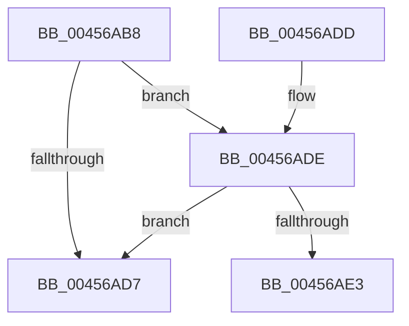

# CmpGetThreadInfo

- RVA: `0x00456AB8`–`0x00456B01` (길이 `73` bytes)
- VA: `0x0000000140456AB8`
- 실행 섹션: `.text`
- PDB 이름 있음: `예`; PDB Function 태그: `아니요`
- unwind 정보 RVA: `0x000A7CC0`
- 디코드: `20`개 명령, `73/73` bytes 표시
- 미해석 바이트: `0` (있으면 어셈블리에 `.byte`로 보존)

> 이 문서는 커널 이미지의 기계어와 PDB 기호를 분석해 생성했습니다. 4번과 5번은 함수 원형과 자료형을 바이너리 사용 방식에서 추정한 C 해석이며 원본 소스 복구 결과는 아닙니다.

## 1. Dependencies

- 직접 호출 지점: **2**; 고유 호출 대상: **2**
- 직접 호출자로 확인된 함수: **8**
- RIP 상대 이미지 참조: **1**

### Outgoing calls
- `0x00456AE3` → [CmpThreadInfoLogStack](../4C/CmpThreadInfoLogStack_function_004CA590.md) (function, `0x004CA590`)
- `0x00456AFB` → [KeBugCheckEx](../4F/KeBugCheckEx_function_004FD660.md) (function, `0x004FD660`)

### Direct callers
- [CmpRecordRegistryLockAcquire](CmpRecordRegistryLockAcquire_function_004565F4.md) at `0x004565F8`
- [CmpRecordRegistryLockRelease](CmpRecordRegistryLockRelease_function_00456618.md) at `0x0045661C`
- [CmpIsRegistryLockAcquired](CmpIsRegistryLockAcquired_function_00456A7C.md) at `0x00456A80`
- [CmpRecordRegistryLockExclusiveAcquire](../4F/CmpRecordRegistryLockExclusiveAcquire_function_004FCF1C.md) at `0x004FCF20`
- [CmpGetSharedLockHandle](../66/CmpGetSharedLockHandle_function_0066AB6C.md) at `0x0066AB70`
- [CmpIsRegistryLockAcquiredRecursively](../66/CmpIsRegistryLockAcquiredRecursively_function_0066AB88.md) at `0x0066AB8C`
- [CmpRecordRegistryLockSharedAcquire](../66/CmpRecordRegistryLockSharedAcquire_function_0066ABA4.md) at `0x0066ABAD`
- [CmpTestRegistryLockExclusive](../66/CmpTestRegistryLockExclusive_function_0066ACC4.md) at `0x0066ACE7`

### Static image references
- `0x00456AC7` → RVA `0x00EF7108` (`.data`; read)

## 2. Other-region calls and transfers

- 다른 실행 섹션으로 향하는 call: **0**
- 별도 외부 분기/꼬리 이동을 확인하지 못했습니다.

## 3. Assembly (complete function range)

```asm
00456AB8  40 53                           push rbx
00456ABA  48 83 EC 30                     sub rsp, 0x30
00456ABE  65 48 8B 1C 25 88 01 00 00      mov rbx, qword ptr gs:[0x188]
00456AC7  83 3D 3A 06 AA 00 00            cmp dword ptr [rip + 0xaa063a], 0
00456ACE  48 8B 83 E8 06 00 00            mov rax, qword ptr [rbx + 0x6e8]
00456AD5  75 07                           jne 0x140456ade
00456AD7  48 83 C4 30                     add rsp, 0x30
00456ADB  5B                              pop rbx
00456ADC  C3                              ret
00456ADD  CC                              int3
00456ADE  48 85 C0                        test rax, rax
00456AE1  75 F4                           jne 0x140456ad7
00456AE3  E8 A8 3A 07 00                  call 0x1404ca590
00456AE8  48 83 64 24 20 00               and qword ptr [rsp + 0x20], 0
00456AEE  45 33 C9                        xor r9d, r9d
00456AF1  4C 8B C3                        mov r8, rbx
00456AF4  41 8D 51 35                     lea edx, [r9 + 0x35]
00456AF8  8D 4A 1C                        lea ecx, [rdx + 0x1c]
00456AFB  E8 60 6B 0A 00                  call 0x1404fd660
00456B00  CC                              int3
```

## 4. C-style interpretation (structured pseudocode)

```c
__int64 __fastcall CmpGetThreadInfo(__int64 a1, __int64 a2, __int64 a3, int a4)
{
    __int64 result;
    __int64 v_rsp;
    unsigned __int64 v_stack_p20;

    v_rsp = (v_rsp) - (48);
    if ((*(unsigned int *)(v_rip + 11142714)) != 0) goto loc_00456ADE;
loc_00456AD7:
    v_rsp = (v_rsp) + (48);
    return *(unsigned __int64 *)(*(unsigned __int64 *)(gs_base + (0 + 392)) + 1768);
loc_00456ADE:
    if (*(unsigned __int64 *)(*(unsigned __int64 *)(gs_base + (0 + 392)) + 1768) != 0) goto loc_00456AD7;
    result = CmpThreadInfoLogStack(a1, a2, a3, a4);
    a4 = 0;
    result = KeBugCheckEx(a4 + 53 + 28, a4 + 53, *(unsigned __int64 *)(gs_base + (0 + 392)), a4);
    return result;
}
```

## 5. (Beta) C Style

```c
int64_t CmpGetThreadInfo(int64_t Arg1, int64_t Arg2, int64_t Arg3, int32_t Arg4)
{
    int64_t result;
    int64_t local_rsp;
    uint64_t v_stack_p20;

    local_rsp = (local_rsp) - (48);
    if ((*(uint32_t *)(v_rip + 0xAA063A)) != 0) goto loc_00456ADE;
loc_00456AD7:
    local_rsp = (local_rsp) + (48);
    return *(uint64_t *)(*(uint64_t *)(gs_base + (0 + 0x188)) + 0x6E8);
loc_00456ADE:
    if (*(uint64_t *)(*(uint64_t *)(gs_base + (0 + 0x188)) + 0x6E8) != 0) goto loc_00456AD7;
    result = CmpThreadInfoLogStack(Arg1, Arg2, Arg3, Arg4);
    Arg4 = 0;
    result = KeBugCheckEx(Arg4 + 53 + 28, Arg4 + 53, *(uint64_t *)(gs_base + (0 + 0x188)), Arg4);
    return result;
}
```

## 6. Execution-region graph

[열기: 2D/3D 그래프와 함수 탐색 컨트롤 패널](../../../control-panel.html?section=text&rva=0x00456AB8&view=graph)

- 2D 그래프는 위에서 아래로 흐르고, 3D 그래프는 빈 공간을 드래그해 회전합니다. Shift+드래그는 이동, 휠은 확대·축소, 함수 노드 선택은 대상 보고서 이동입니다.

### Static fallback


