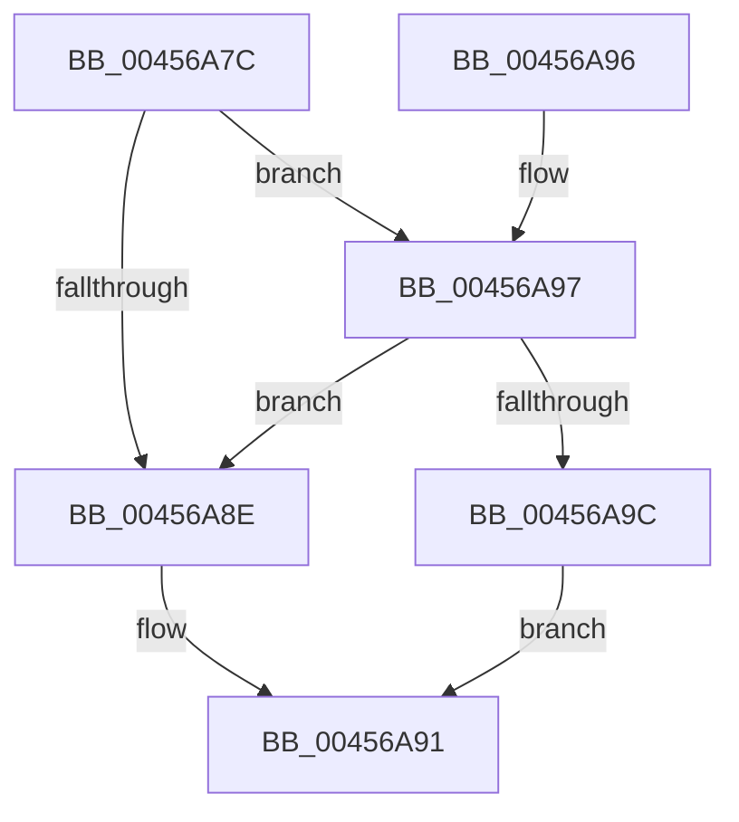

# CmpIsRegistryLockAcquired

- RVA: `0x00456A7C`–`0x00456AAF` (길이 `51` bytes)
- VA: `0x0000000140456A7C`
- 실행 섹션: `.text`
- PDB 이름 있음: `예`; PDB Function 태그: `아니요`
- unwind 정보 RVA: `0x00065F4C`
- 디코드: `14`개 명령, `51/51` bytes 표시
- 미해석 바이트: `0` (있으면 어셈블리에 `.byte`로 보존)

> 이 문서는 커널 이미지의 기계어와 PDB 기호를 분석해 생성했습니다. 4번과 5번은 함수 원형과 자료형을 바이너리 사용 방식에서 추정한 C 해석이며 원본 소스 복구 결과는 아닙니다.

## 1. Dependencies

- 직접 호출 지점: **3**; 고유 호출 대상: **3**
- 직접 호출자로 확인된 함수: **24**
- RIP 상대 이미지 참조: **2**

### Outgoing calls
- `0x00456A80` → [CmpGetThreadInfo](CmpGetThreadInfo_function_00456AB8.md) (function, `0x00456AB8`)
- `0x00456A9C` → [CmpThreadInfoLogStack](../4C/CmpThreadInfoLogStack_function_004CA590.md) (function, `0x004CA590`)
- `0x00456AA8` → [ExIsResourceAcquiredSharedLite](../34/ExIsResourceAcquiredSharedLite_function_00341B10.md) (function, `0x00341B10`)

### Direct callers
- [CmpDoQueryKeyName](CmpDoQueryKeyName_function_00456664.md) at `0x00456777`
- [CmpTestRegistryLock](../66/CmpTestRegistryLock_function_0066AC84.md) at `0x0066ACAD`
- [NtRenameKey](../../page/7E/NtRenameKey_function_007E04B0.md) at `0x007E07AB`
- [NtReplaceKey](../../page/7E/NtReplaceKey_function_007E0970.md) at `0x007E0AD9`
- [NtRestoreKey](../../page/7E/NtRestoreKey_function_007E0CC0.md) at `0x007E0E26`
- [NtSaveMergedKeys](../../page/7E/NtSaveMergedKeys_function_007E1070.md) at `0x007E1266`
- [NtSetInformationKey](../../page/84/NtSetInformationKey_function_00843720.md) at `0x00843959`
- [NtSetInformationKey](../../page/84/NtSetInformationKey_function_00843720.md) at `0x00843AB9`
- [NtSetValueKey](../../page/84/NtSetValueKey_function_00844EA0.md) at `0x008453F7`
- [NtSetValueKey](../../page/84/NtSetValueKey_function_00844EA0.md) at `0x00845504`
- [NtDeleteValueKey](../../page/84/NtDeleteValueKey_function_00848770.md) at `0x00848A5C`
- [NtDeleteValueKey](../../page/84/NtDeleteValueKey_function_00848770.md) at `0x00848B22`
- [NtDeleteKey](../../page/84/NtDeleteKey_function_00849920.md) at `0x00849A59`
- [NtDeleteKey](../../page/84/NtDeleteKey_function_00849920.md) at `0x00849BA7`
- [sub_0086560A](../../page/86/Unknown_function_0086560A.md) at `0x0086563A`
- [sub_0086560A](../../page/86/Unknown_function_0086560A.md) at `0x00865A81`
- [CmPostCallbackNotification](../../page/86/CmPostCallbackNotification_function_00865D50.md) at `0x00865D7B`
- [CmPostCallbackNotificationEx](../../page/86/CmPostCallbackNotificationEx_function_00865E50.md) at `0x00865E7F`
- [NtQueryKey](../../page/86/NtQueryKey_function_008676E0.md) at `0x008679A7`
- [NtQueryKey](../../page/86/NtQueryKey_function_008676E0.md) at `0x00867A98`
- [CmpSecurityMethod](../../page/87/CmpSecurityMethod_function_00870CC0.md) at `0x00870FFD`
- [CmpSecurityMethod](../../page/87/CmpSecurityMethod_function_00870CC0.md) at `0x008710AA`
- [CmpSecurityMethod](../../page/87/CmpSecurityMethod_function_00870CC0.md) at `0x008711FC`
- [CmLoadDifferencingKey](../../page/87/CmLoadDifferencingKey_function_00875670.md) at `0x00875C47`
- [CmLoadDifferencingKey](../../page/87/CmLoadDifferencingKey_function_00875670.md) at `0x00875F7F`
- [CmpParseKey](../../page/89/CmpParseKey_function_0089DDC0.md) at `0x0089DF5F`
- [CmpParseKey](../../page/89/CmpParseKey_function_0089DDC0.md) at `0x0089E118`
- [CmpParseKey](../../page/89/CmpParseKey_function_0089DDC0.md) at `0x0089E338`
- [NtQueryMultipleValueKey](../../page/8B/NtQueryMultipleValueKey_function_008B13B0.md) at `0x008B163F`
- [NtQueryMultipleValueKey](../../page/8B/NtQueryMultipleValueKey_function_008B13B0.md) at `0x008B17F3`
- [NtEnumerateKey](../../page/8B/NtEnumerateKey_function_008B1F70.md) at `0x008B227B`
- [NtEnumerateKey](../../page/8B/NtEnumerateKey_function_008B1F70.md) at `0x008B23B1`
- [NtQueryValueKey](../../page/8B/NtQueryValueKey_function_008B2A00.md) at `0x008B2FCA`
- [NtQueryValueKey](../../page/8B/NtQueryValueKey_function_008B2A00.md) at `0x008B30D0`
- [NtEnumerateValueKey](../../page/8B/NtEnumerateValueKey_function_008B3B50.md) at `0x008B3DA5`
- [NtEnumerateValueKey](../../page/8B/NtEnumerateValueKey_function_008B3B50.md) at `0x008B4126`
- [CmUnloadKey](../../page/9A/CmUnloadKey_function_009AF2FC.md) at `0x009AF624`
- [CmUnloadKey](../../page/9A/CmUnloadKey_function_009AF2FC.md) at `0x009AF70A`
- [NtFlushKey](../../page/A8/NtFlushKey_function_00A8A030.md) at `0x00A8A29F`
- [NtFlushKey](../../page/A8/NtFlushKey_function_00A8A030.md) at `0x00A8A3AC`
- [sub_00B44216](../../page/B4/Unknown_function_00B44216.md) at `0x00B4425E`

### Static image references
- `0x00456A85` → RVA `0x00EF7108` (`.data`; read)
- `0x00456AA1` → RVA `0x00EF7110` (`.data`; read)

## 2. Other-region calls and transfers

- 다른 실행 섹션으로 향하는 call: **0**
- 별도 외부 분기/꼬리 이동을 확인하지 못했습니다.

## 3. Assembly (complete function range)

```asm
00456A7C  48 83 EC 28                     sub rsp, 0x28
00456A80  E8 33 00 00 00                  call 0x140456ab8
00456A85  83 3D 7C 06 AA 00 00            cmp dword ptr [rip + 0xaa067c], 0
00456A8C  74 09                           je 0x140456a97
00456A8E  8B 40 10                        mov eax, dword ptr [rax + 0x10]
00456A91  48 83 C4 28                     add rsp, 0x28
00456A95  C3                              ret
00456A96  CC                              int3
00456A97  48 85 C0                        test rax, rax
00456A9A  75 F2                           jne 0x140456a8e
00456A9C  E8 EF 3A 07 00                  call 0x1404ca590
00456AA1  48 8B 0D 68 06 AA 00            mov rcx, qword ptr [rip + 0xaa0668]
00456AA8  E8 63 B0 EE FF                  call 0x140341b10
00456AAD  EB E2                           jmp 0x140456a91
```

## 4. C-style interpretation (structured pseudocode)

```c
__int64 __fastcall CmpIsRegistryLockAcquired(void)
{
    __int64 result;
    __int64 v_rsp;

    v_rsp = (v_rsp) - (40);
    result = CmpGetThreadInfo(a1, a2, a3, a4);
    if ((*(unsigned int *)(v_rip + 11142780)) == 0) goto loc_00456A97;
loc_00456A8E:
loc_00456A91:
    v_rsp = (v_rsp) + (40);
    return (unsigned int)(*(unsigned int *)(result + 16));
loc_00456A97:
    if ((unsigned int)(*(unsigned int *)(result + 16)) != 0) goto loc_00456A8E;
    result = CmpThreadInfoLogStack(a1, a2, a3, a4);
    result = ExIsResourceAcquiredSharedLite(*(unsigned __int64 *)(v_rip + 11142760), a2, a3, a4);
    goto loc_00456A91;
}
```

## 5. (Beta) C Style

```c
void CmpIsRegistryLockAcquired(void)
{
    int64_t result;
    int64_t local_rsp;

    local_rsp = (local_rsp) - (40);
    result = CmpGetThreadInfo(a1, a2, a3, a4);
    if ((*(uint32_t *)(v_rip + 0xAA067C)) == 0) goto loc_00456A97;
loc_00456A8E:
loc_00456A91:
    local_rsp = (local_rsp) + (40);
    return (uint32_t)(*(uint32_t *)(result + 0x10));
loc_00456A97:
    if ((uint32_t)(*(uint32_t *)(result + 0x10)) != 0) goto loc_00456A8E;
    result = CmpThreadInfoLogStack(a1, a2, a3, a4);
    result = ExIsResourceAcquiredSharedLite(*(uint64_t *)(v_rip + 0xAA0668), a2, a3, a4);
    goto loc_00456A91;
}
```

## 6. Execution-region graph

[열기: 2D/3D 그래프와 함수 탐색 컨트롤 패널](../../../control-panel.html?section=text&rva=0x00456A7C&view=graph)

- 2D 그래프는 위에서 아래로 흐르고, 3D 그래프는 빈 공간을 드래그해 회전합니다. Shift+드래그는 이동, 휠은 확대·축소, 함수 노드 선택은 대상 보고서 이동입니다.

### Static fallback


