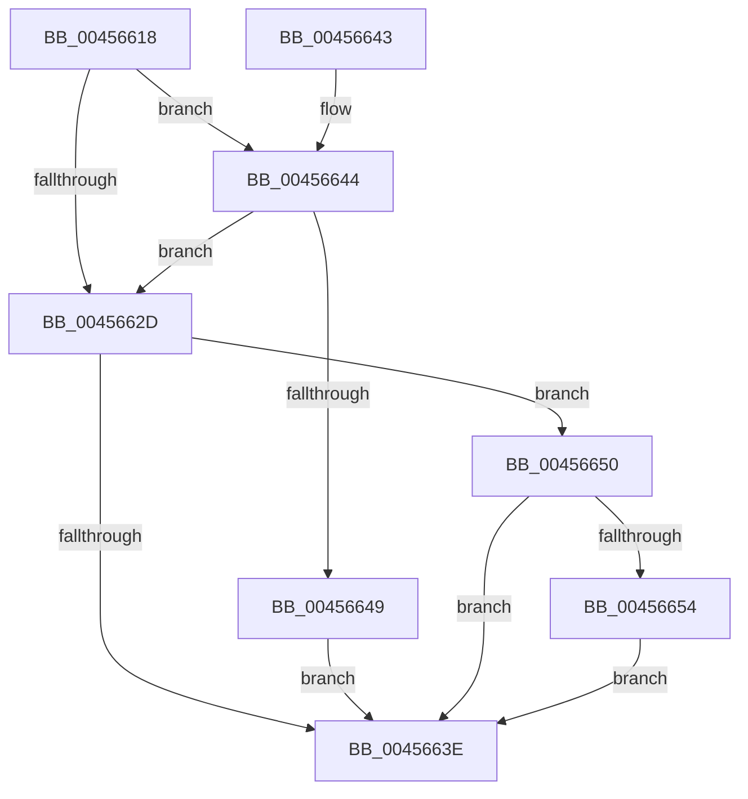

# CmpRecordRegistryLockRelease

- RVA: `0x00456618`–`0x0045665B` (길이 `67` bytes)
- VA: `0x0000000140456618`
- 실행 섹션: `.text`
- PDB 이름 있음: `예`; PDB Function 태그: `아니요`
- unwind 정보 RVA: `0x0006DBD4`
- 디코드: `21`개 명령, `67/67` bytes 표시
- 미해석 바이트: `0` (있으면 어셈블리에 `.byte`로 보존)

> 이 문서는 커널 이미지의 기계어와 PDB 기호를 분석해 생성했습니다. 4번과 5번은 함수 원형과 자료형을 바이너리 사용 방식에서 추정한 C 해석이며 원본 소스 복구 결과는 아닙니다.

## 1. Dependencies

- 직접 호출 지점: **2**; 고유 호출 대상: **2**
- 직접 호출자로 확인된 함수: **1**
- RIP 상대 이미지 참조: **1**

### Outgoing calls
- `0x0045661C` → [CmpGetThreadInfo](CmpGetThreadInfo_function_00456AB8.md) (function, `0x00456AB8`)
- `0x00456649` → [CmpThreadInfoLogStack](../4C/CmpThreadInfoLogStack_function_004CA590.md) (function, `0x004CA590`)

### Direct callers
- [CmpUnlockRegistry](../../pagecmrc/BC/CmpUnlockRegistry_function_00BC9A84.md) at `0x00BC9AAC`

### Static image references
- `0x00456621` → RVA `0x00EF7108` (`.data`; read)

## 2. Other-region calls and transfers

- 다른 실행 섹션으로 향하는 call: **0**
- 별도 외부 분기/꼬리 이동을 확인하지 못했습니다.

## 3. Assembly (complete function range)

```asm
00456618  48 83 EC 28                     sub rsp, 0x28
0045661C  E8 97 04 00 00                  call 0x140456ab8
00456621  83 3D E0 0A AA 00 01            cmp dword ptr [rip + 0xaa0ae0], 1
00456628  48 8B C8                        mov rcx, rax
0045662B  75 17                           jne 0x140456644
0045662D  8B 40 10                        mov eax, dword ptr [rax + 0x10]
00456630  FF C8                           dec eax
00456632  89 41 10                        mov dword ptr [rcx + 0x10], eax
00456635  83 3D CC 0A AA 00 01            cmp dword ptr [rip + 0xaa0acc], 1
0045663C  74 12                           je 0x140456650
0045663E  48 83 C4 28                     add rsp, 0x28
00456642  C3                              ret
00456643  CC                              int3
00456644  48 85 C9                        test rcx, rcx
00456647  75 E4                           jne 0x14045662d
00456649  E8 42 3F 07 00                  call 0x1404ca590
0045664E  EB EE                           jmp 0x14045663e
00456650  85 C0                           test eax, eax
00456652  75 EA                           jne 0x14045663e
00456654  48 83 61 08 00                  and qword ptr [rcx + 8], 0
00456659  EB E3                           jmp 0x14045663e
```

## 4. C-style interpretation (structured pseudocode)

```c
__int64 __fastcall CmpRecordRegistryLockRelease(void)
{
    __int64 result;
    __int64 v_rsp;

    v_rsp = (v_rsp) - (40);
    result = CmpGetThreadInfo(a1, a2, a3, a4);
    if ((*(unsigned int *)(v_rip + 11143904)) != 1) goto loc_00456644;
loc_0045662D:
    result = (unsigned int)(((unsigned int)(*(unsigned int *)(result + 16))) - 1);
    *(unsigned int *)(result + 16) = (unsigned int)(result);
    if ((*(unsigned int *)(v_rip + 11143884)) == 1) goto loc_00456650;
loc_0045663E:
    v_rsp = (v_rsp) + (40);
    return result;
loc_00456644:
    if (result != 0) goto loc_0045662D;
    result = CmpThreadInfoLogStack(result, a2, a3, a4);
    goto loc_0045663E;
loc_00456650:
    if ((unsigned int)(result) != 0) goto loc_0045663E;
    goto loc_0045663E;
}
```

## 5. (Beta) C Style

```c
void CmpRecordRegistryLockRelease(void)
{
    int64_t result;
    int64_t local_rsp;

    local_rsp = (local_rsp) - (40);
    result = CmpGetThreadInfo(a1, a2, a3, a4);
    if ((*(uint32_t *)(v_rip + 0xAA0AE0)) != 1) goto loc_00456644;
loc_0045662D:
    result = (uint32_t)(((uint32_t)(*(uint32_t *)(result + 0x10))) - 1);
    *(uint32_t *)(result + 0x10) = (uint32_t)(result);
    if ((*(uint32_t *)(v_rip + 0xAA0ACC)) == 1) goto loc_00456650;
loc_0045663E:
    local_rsp = (local_rsp) + (40);
    return result;
loc_00456644:
    if (result != 0) goto loc_0045662D;
    result = CmpThreadInfoLogStack(result, a2, a3, a4);
    goto loc_0045663E;
loc_00456650:
    if ((uint32_t)(result) != 0) goto loc_0045663E;
    goto loc_0045663E;
}
```

## 6. Execution-region graph

[열기: 2D/3D 그래프와 함수 탐색 컨트롤 패널](../../../control-panel.html?section=text&rva=0x00456618&view=graph)

- 2D 그래프는 위에서 아래로 흐르고, 3D 그래프는 빈 공간을 드래그해 회전합니다. Shift+드래그는 이동, 휠은 확대·축소, 함수 노드 선택은 대상 보고서 이동입니다.

### Static fallback


