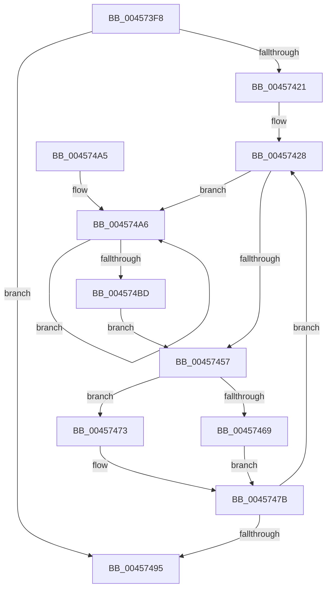

# CmpWaitForLateUnloadWorker

- RVA: `0x004573F8`–`0x004574BF` (길이 `199` bytes)
- VA: `0x00000001404573F8`
- 실행 섹션: `.text`
- PDB 이름 있음: `예`; PDB Function 태그: `아니요`
- unwind 정보 RVA: `0x000A81A4`
- 디코드: `53`개 명령, `199/199` bytes 표시
- 미해석 바이트: `0` (있으면 어셈블리에 `.byte`로 보존)

> 이 문서는 커널 이미지의 기계어와 PDB 기호를 분석해 생성했습니다. 4번과 5번은 함수 원형과 자료형을 바이너리 사용 방식에서 추정한 C 해석이며 원본 소스 복구 결과는 아닙니다.

## 1. Dependencies

- 직접 호출 지점: **7**; 고유 호출 대상: **5**
- 직접 호출자로 확인된 함수: **1**
- RIP 상대 이미지 참조: **0**

### Outgoing calls
- `0x0045740A` → [CmLockHive](../../page/85/CmLockHive_function_008512B4.md) (function, `0x008512B4`)
- `0x00457418` → [CmUnlockHive](../../page/85/CmUnlockHive_function_00851D6C.md) (function, `0x00851D6C`)
- `0x00457433` → [memset](../6C/memset_function_006C6C40.md) (function, `0x006C6C40`)
- `0x0045746C` → [ExpUnblockPushLock](../2A/ExpUnblockPushLock_function_002A40FC.md) (function, `0x002A40FC`)
- `0x00457476` → [ExTimedWaitForUnblockPushLock](../2A/ExTimedWaitForUnblockPushLock_function_002A44B0.md) (function, `0x002A44B0`)
- `0x0045747E` → [CmLockHive](../../page/85/CmLockHive_function_008512B4.md) (function, `0x008512B4`)
- `0x0045748C` → [CmUnlockHive](../../page/85/CmUnlockHive_function_00851D6C.md) (function, `0x00851D6C`)

### Direct callers
- [sub_00865B4C](../../page/86/Unknown_function_00865B4C.md) at `0x00865C4A`

### Static image references
- 디코드된 RIP-relative 메모리 참조가 없습니다.

## 2. Other-region calls and transfers

- 다른 실행 섹션으로 향하는 call: **4**
  - `0x0045740A` → [CmLockHive](../../page/85/CmLockHive_function_008512B4.md) (`.text` → `PAGE`)
  - `0x00457418` → [CmUnlockHive](../../page/85/CmUnlockHive_function_00851D6C.md) (`.text` → `PAGE`)
  - `0x0045747E` → [CmLockHive](../../page/85/CmLockHive_function_008512B4.md) (`.text` → `PAGE`)
  - `0x0045748C` → [CmUnlockHive](../../page/85/CmUnlockHive_function_00851D6C.md) (`.text` → `PAGE`)
- 별도 외부 분기/꼬리 이동을 확인하지 못했습니다.

## 3. Assembly (complete function range)

```asm
004573F8  48 89 5C 24 08                  mov qword ptr [rsp + 8], rbx
004573FD  48 89 74 24 10                  mov qword ptr [rsp + 0x10], rsi
00457402  57                              push rdi
00457403  48 83 EC 60                     sub rsp, 0x60
00457407  48 8B D9                        mov rbx, rcx
0045740A  E8 A5 9E 3F 00                  call 0x1408512b4
0045740F  8B B3 C0 12 00 00               mov esi, dword ptr [rbx + 0x12c0]
00457415  48 8B CB                        mov rcx, rbx
00457418  E8 4F A9 3F 00                  call 0x140851d6c
0045741D  85 F6                           test esi, esi
0045741F  74 74                           je 0x140457495
00457421  48 8D BB C8 12 00 00            lea rdi, [rbx + 0x12c8]
00457428  33 D2                           xor edx, edx
0045742A  48 8D 4C 24 20                  lea rcx, [rsp + 0x20]
0045742F  44 8D 42 40                     lea r8d, [rdx + 0x40]
00457433  E8 08 F8 26 00                  call 0x1406c6c40
00457438  C7 44 24 54 02 00 00 00         mov dword ptr [rsp + 0x54], 2
00457440  0F 0D 0F                        prefetchw byte ptr [rdi]
00457443  48 8B 07                        mov rax, qword ptr [rdi]
00457446  48 8D 4C 24 20                  lea rcx, [rsp + 0x20]
0045744B  48 89 44 24 38                  mov qword ptr [rsp + 0x38], rax
00457450  F0 48 0F B1 0F                  lock cmpxchg qword ptr [rdi], rcx
00457455  75 4F                           jne 0x1404574a6
00457457  8B 83 C0 12 00 00               mov eax, dword ptr [rbx + 0x12c0]
0045745D  48 8D 54 24 20                  lea rdx, [rsp + 0x20]
00457462  48 8B CF                        mov rcx, rdi
00457465  3B C6                           cmp eax, esi
00457467  74 0A                           je 0x140457473
00457469  45 33 C0                        xor r8d, r8d
0045746C  E8 8B CC E4 FF                  call 0x1402a40fc
00457471  EB 08                           jmp 0x14045747b
00457473  45 33 C0                        xor r8d, r8d
00457476  E8 35 D0 E4 FF                  call 0x1402a44b0
0045747B  48 8B CB                        mov rcx, rbx
0045747E  E8 31 9E 3F 00                  call 0x1408512b4
00457483  8B B3 C0 12 00 00               mov esi, dword ptr [rbx + 0x12c0]
00457489  48 8B CB                        mov rcx, rbx
0045748C  E8 DB A8 3F 00                  call 0x140851d6c
00457491  85 F6                           test esi, esi
00457493  75 93                           jne 0x140457428
00457495  48 8B 5C 24 70                  mov rbx, qword ptr [rsp + 0x70]
0045749A  48 8B 74 24 78                  mov rsi, qword ptr [rsp + 0x78]
0045749F  48 83 C4 60                     add rsp, 0x60
004574A3  5F                              pop rdi
004574A4  C3                              ret
004574A5  CC                              int3
004574A6  48 8B C8                        mov rcx, rax
004574A9  48 89 44 24 38                  mov qword ptr [rsp + 0x38], rax
004574AE  48 8D 54 24 20                  lea rdx, [rsp + 0x20]
004574B3  F0 48 0F B1 17                  lock cmpxchg qword ptr [rdi], rdx
004574B8  48 3B C1                        cmp rax, rcx
004574BB  75 E9                           jne 0x1404574a6
004574BD  EB 98                           jmp 0x140457457
```

## 4. C-style interpretation (structured pseudocode)

```c
__int64 __fastcall CmpWaitForLateUnloadWorker(__int64 a1, int a2)
{
    __int64 result;
    __int64 v_rsp;
    unsigned int v_stack_m14;
    unsigned __int64 v_stack_m30;
    unsigned __int64 v_stack_m48;
    unsigned __int64 v_stack_p10;
    unsigned __int64 v_stack_p20;
    unsigned __int64 v_stack_p38;
    unsigned __int64 v_stack_p8;

    v_stack_p8 = v_rbx;
    v_stack_p10 = v_rsi;
    v_rsp = (v_rsp) - (96);
    result = CmLockHive(a1, a2, a3, a4);
    result = CmUnlockHive(a1, a2, a3, a4);
    if ((unsigned int)((unsigned int)(*(unsigned int *)(a1 + 4800))) == 0) goto loc_00457495;
loc_00457428:
    a2 = 0;
    result = memset(v_stack_m48, a2, a2 + 64, a4);
    v_stack_m14 = 2;
    v_stack_m30 = *(unsigned __int64 *)(a1 + 4808);
    if (condition_is_not_equal) goto loc_004574A6;
loc_00457457:
    if (((unsigned int)((unsigned int)(*(unsigned int *)(a1 + 4800)))) == ((unsigned int)((unsigned int)(*(unsigned int *)(a1 + 4800))))) goto loc_00457473;
    a3 = 0;
    result = ExpUnblockPushLock(a1 + 4808, v_stack_m48, a3, a4);
    goto loc_0045747B;
loc_00457473:
    a3 = 0;
    result = ExTimedWaitForUnblockPushLock(a1 + 4808, v_stack_m48, a3, a4);
loc_0045747B:
    result = CmLockHive(a1, v_stack_m48, a3, a4);
    result = CmUnlockHive(a1, v_stack_m48, a3, a4);
    if ((unsigned int)((unsigned int)(*(unsigned int *)(a1 + 4800))) != 0) goto loc_00457428;
loc_00457495:
    v_rsp = (v_rsp) + (96);
    return result;
loc_004574A6:
    v_stack_p38 = result;
    if (result != result) goto loc_004574A6;
    goto loc_00457457;
}
```

## 5. (Beta) C Style

```c
int64_t CmpWaitForLateUnloadWorker(void *Arg1, int32_t Arg2)
{
    uint8_t *arg1 = (uint8_t *)Arg1;

    int64_t result;
    int64_t local_rsp;
    uint32_t v_stack_m14;
    uint64_t v_stack_m30;
    uint64_t v_stack_m48;
    uint64_t v_stack_p10;
    uint64_t v_stack_p20;
    uint64_t v_stack_p38;
    uint64_t v_stack_p8;

    v_stack_p8 = local_rbx;
    v_stack_p10 = local_rsi;
    local_rsp = (local_rsp) - (96);
    result = CmLockHive(Arg1, Arg2, a3, a4);
    result = CmUnlockHive(Arg1, Arg2, a3, a4);
    if ((uint32_t)((uint32_t)(*(uint32_t *)(arg1 + 0x12C0))) == 0) goto loc_00457495;
loc_00457428:
    Arg2 = 0;
    result = memset(v_stack_m48, Arg2, Arg2 + 64, a4);
    v_stack_m14 = 2;
    v_stack_m30 = *(uint64_t *)(arg1 + 0x12C8);
    if (condition_is_not_equal) goto loc_004574A6;
loc_00457457:
    if (((uint32_t)((uint32_t)(*(uint32_t *)(arg1 + 0x12C0)))) == ((uint32_t)((uint32_t)(*(uint32_t *)(arg1 + 0x12C0))))) goto loc_00457473;
    a3 = 0;
    result = ExpUnblockPushLock(Arg1 + 4808, v_stack_m48, a3, a4);
    goto loc_0045747B;
loc_00457473:
    a3 = 0;
    result = ExTimedWaitForUnblockPushLock(Arg1 + 4808, v_stack_m48, a3, a4);
loc_0045747B:
    result = CmLockHive(Arg1, v_stack_m48, a3, a4);
    result = CmUnlockHive(Arg1, v_stack_m48, a3, a4);
    if ((uint32_t)((uint32_t)(*(uint32_t *)(arg1 + 0x12C0))) != 0) goto loc_00457428;
loc_00457495:
    local_rsp = (local_rsp) + (96);
    return result;
loc_004574A6:
    v_stack_p38 = result;
    if (result != result) goto loc_004574A6;
    goto loc_00457457;
}
```

### 관측된 메모리 오프셋

구조체 형식이 확인되지 않은 접근은 인자 기준의 오프셋으로만 기록했습니다.

| 기준 인자 | 오프셋 표현 | 폭 (bit) | 접근 |
|---|---:|---:|---|
| `Arg1` | `+ 0x0` | `8` | `R` |
| `Arg1` | `+ 0x0` | `64` | `R` |
| `Arg1` | `+ 0x12C0` | `32` | `R` |
| `Arg1` | `+ 0x12C8` | `64` | `R` |

## 6. Execution-region graph

[열기: 2D/3D 그래프와 함수 탐색 컨트롤 패널](../../../control-panel.html?section=text&rva=0x004573F8&view=graph)

- 2D 그래프는 위에서 아래로 흐르고, 3D 그래프는 빈 공간을 드래그해 회전합니다. Shift+드래그는 이동, 휠은 확대·축소, 함수 노드 선택은 대상 보고서 이동입니다.

### Static fallback


