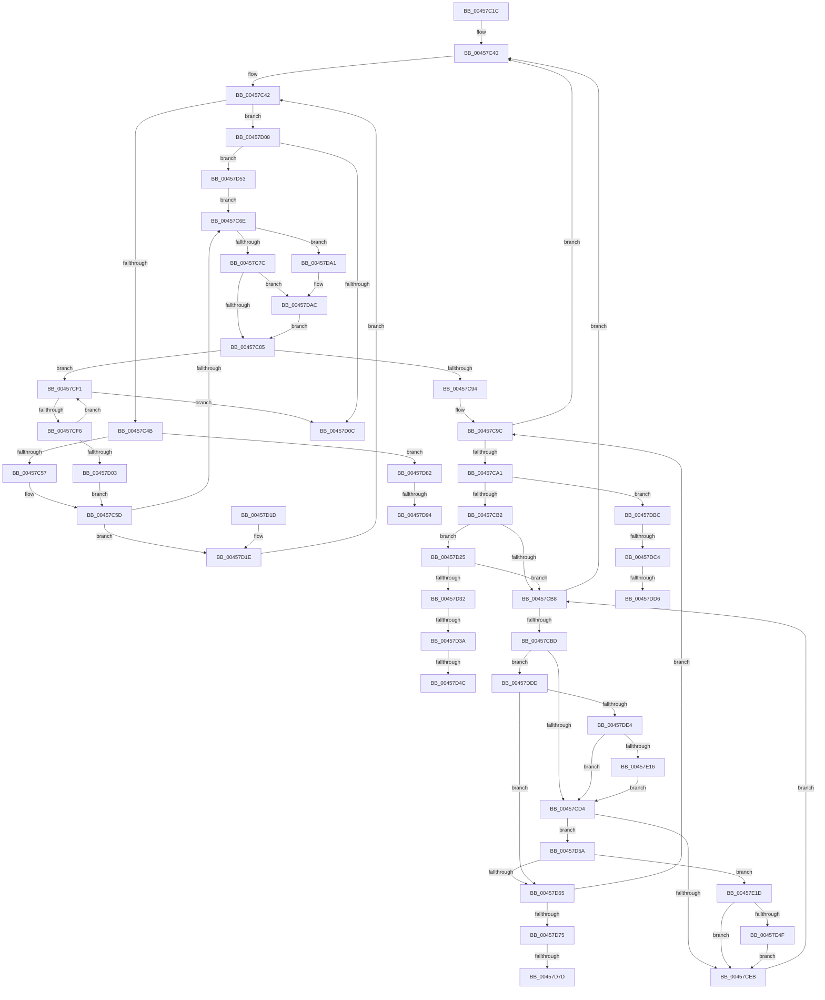

# CountUnicodeToUTF8

- RVA: `0x00457C1C`–`0x00457E56` (길이 `570` bytes)
- VA: `0x0000000140457C1C`
- 실행 섹션: `.text`
- PDB 이름 있음: `예`; PDB Function 태그: `예`
- unwind 정보 RVA: `0x000A824C`
- 디코드: `150`개 명령, `570/570` bytes 표시
- 미해석 바이트: `0` (있으면 어셈블리에 `.byte`로 보존)

> 이 문서는 커널 이미지의 기계어와 PDB 기호를 분석해 생성했습니다. 4번과 5번은 함수 원형과 자료형을 바이너리 사용 방식에서 추정한 C 해석이며 원본 소스 복구 결과는 아닙니다.

## 1. Dependencies

- 직접 호출 지점: **0**; 고유 호출 대상: **0**
- 직접 호출자로 확인된 함수: **2**
- RIP 상대 이미지 참조: **0**

### Outgoing calls
- 직접 디코드된 call 명령이 없습니다.

### Direct callers
- [RtlUnicodeStringToUTF8String](../../page/79/RtlUnicodeStringToUTF8String_function_00794C90.md) at `0x00794CC5`
- [sub_0090DD01](../../page/90/Unknown_function_0090DD01.md) at `0x0090DD22`

### Static image references
- 디코드된 RIP-relative 메모리 참조가 없습니다.

## 2. Other-region calls and transfers

- 다른 실행 섹션으로 향하는 call: **0**
- call이 아닌 외부 분기/꼬리 이동: **10**
  - `0x00457D34` → [sub_006F1B64 + 0x1D](../6F/Unknown_function_006F1B64.md) (`tail-transfer`)
  - `0x00457D46` → [sub_006F1B64 + 0x24](../6F/Unknown_function_006F1B64.md) (`tail-transfer`)
  - `0x00457D4E` → [sub_006F1B64 + 0x1D](../6F/Unknown_function_006F1B64.md) (`tail-transfer`)
  - `0x00457D77` → [sub_006F1B64 + 0x24](../6F/Unknown_function_006F1B64.md) (`tail-transfer`)
  - `0x00457D7D` → [sub_006F1B64 + 0x4C](../6F/Unknown_function_006F1B64.md) (`tail-transfer`)
  - `0x00457D8E` → [sub_006F1B64](../6F/Unknown_function_006F1B64.md) (`tail-transfer`)
  - `0x00457D9C` → [sub_006F1B64 + 0x3](../6F/Unknown_function_006F1B64.md) (`tail-transfer`)
  - `0x00457DBE` → [sub_006F1B64 + 0x16](../6F/Unknown_function_006F1B64.md) (`tail-transfer`)
  - `0x00457DD0` → [sub_006F1B64 + 0x24](../6F/Unknown_function_006F1B64.md) (`tail-transfer`)
  - `0x00457DD8` → [sub_006F1B64 + 0x16](../6F/Unknown_function_006F1B64.md) (`tail-transfer`)

## 3. Assembly (complete function range)

```asm
00457C1C  48 89 5C 24 18                  mov qword ptr [rsp + 0x18], rbx
00457C21  48 89 6C 24 20                  mov qword ptr [rsp + 0x20], rbp
00457C26  57                              push rdi
00457C27  8B C2                           mov eax, edx
00457C29  45 33 D2                        xor r10d, r10d
00457C2C  48 D1 E8                        shr rax, 1
00457C2F  49 8B F8                        mov rdi, r8
00457C32  4C 8B C9                        mov r9, rcx
00457C35  D1 EA                           shr edx, 1
00457C37  BD FF 07 00 00                  mov ebp, 0x7ff
00457C3C  48 8D 1C 41                     lea rbx, [rcx + rax*2]
00457C40  33 C9                           xor ecx, ecx
00457C42  4C 3B CB                        cmp r9, rbx
00457C45  0F 83 BD 00 00 00               jae 0x140457d08
00457C4B  41 0F B7 01                     movzx eax, word ptr [r9]
00457C4F  85 C9                           test ecx, ecx
00457C51  0F 85 2B 01 00 00               jne 0x140457d82
00457C57  8B C8                           mov ecx, eax
00457C59  49 83 C1 02                     add r9, 2
00457C5D  8D 81 00 28 FF FF               lea eax, [rcx - 0xd800]
00457C63  3D FF 03 00 00                  cmp eax, 0x3ff
00457C68  0F 86 B0 00 00 00               jbe 0x140457d1e
00457C6E  8D 81 00 28 FF FF               lea eax, [rcx - 0xd800]
00457C74  3B C5                           cmp eax, ebp
00457C76  0F 86 25 01 00 00               jbe 0x140457da1
00457C7C  83 F9 7F                        cmp ecx, 0x7f
00457C7F  0F 87 27 01 00 00               ja 0x140457dac
00457C85  48 8B C3                        mov rax, rbx
00457C88  49 2B C1                        sub rax, r9
00457C8B  48 D1 F8                        sar rax, 1
00457C8E  48 83 F8 0D                     cmp rax, 0xd
00457C92  76 5D                           jbe 0x140457cf1
00457C94  4C 8D 58 F9                     lea r11, [rax - 7]
00457C98  4F 8D 1C 59                     lea r11, [r9 + r11*2]
00457C9C  4D 3B CB                        cmp r9, r11
00457C9F  73 9F                           jae 0x140457c40
00457CA1  41 0F B7 09                     movzx ecx, word ptr [r9]
00457CA5  49 83 C1 02                     add r9, 2
00457CA9  83 F9 7F                        cmp ecx, 0x7f
00457CAC  0F 87 0A 01 00 00               ja 0x140457dbc
00457CB2  41 F6 C1 02                     test r9b, 2
00457CB6  75 6D                           jne 0x140457d25
00457CB8  4D 3B CB                        cmp r9, r11
00457CBB  73 83                           jae 0x140457c40
00457CBD  45 8B 41 04                     mov r8d, dword ptr [r9 + 4]
00457CC1  41 8B C0                        mov eax, r8d
00457CC4  41 8B 09                        mov ecx, dword ptr [r9]
00457CC7  0B C1                           or eax, ecx
00457CC9  A9 80 FF 80 FF                  test eax, 0xff80ff80
00457CCE  0F 85 09 01 00 00               jne 0x140457ddd
00457CD4  45 8B 41 0C                     mov r8d, dword ptr [r9 + 0xc]
00457CD8  49 83 C1 08                     add r9, 8
00457CDC  41 8B C0                        mov eax, r8d
00457CDF  41 8B 09                        mov ecx, dword ptr [r9]
00457CE2  0B C1                           or eax, ecx
00457CE4  A9 80 FF 80 FF                  test eax, 0xff80ff80
00457CE9  75 6F                           jne 0x140457d5a
00457CEB  49 83 C1 08                     add r9, 8
00457CEF  EB C7                           jmp 0x140457cb8
00457CF1  4C 3B CB                        cmp r9, rbx
00457CF4  73 16                           jae 0x140457d0c
00457CF6  41 0F B7 09                     movzx ecx, word ptr [r9]
00457CFA  49 83 C1 02                     add r9, 2
00457CFE  83 F9 7F                        cmp ecx, 0x7f
00457D01  76 EE                           jbe 0x140457cf1
00457D03  E9 55 FF FF FF                  jmp 0x140457c5d
00457D08  85 C9                           test ecx, ecx
00457D0A  75 47                           jne 0x140457d53
00457D0C  48 8B 5C 24 20                  mov rbx, qword ptr [rsp + 0x20]
00457D11  41 8B C2                        mov eax, r10d
00457D14  48 8B 6C 24 28                  mov rbp, qword ptr [rsp + 0x28]
00457D19  89 17                           mov dword ptr [rdi], edx
00457D1B  5F                              pop rdi
00457D1C  C3                              ret
00457D1D  CC                              int3
00457D1E  FF CA                           dec edx
00457D20  E9 1D FF FF FF                  jmp 0x140457c42
00457D25  41 0F B7 09                     movzx ecx, word ptr [r9]
00457D29  49 83 C1 02                     add r9, 2
00457D2D  83 F9 7F                        cmp ecx, 0x7f
00457D30  76 86                           jbe 0x140457cb8
00457D32  3B CD                           cmp ecx, ebp
00457D34  0F 86 47 9E 29 00               jbe 0x1406f1b81
00457D3A  8B C1                           mov eax, ecx
00457D3C  25 00 F8 00 00                  and eax, 0xf800
00457D41  3D 00 D8 00 00                  cmp eax, 0xd800
00457D46  0F 84 3C 9E 29 00               je 0x1406f1b88
00457D4C  FF C2                           inc edx
00457D4E  E9 2E 9E 29 00                  jmp 0x1406f1b81
00457D53  FF C2                           inc edx
00457D55  E9 14 FF FF FF                  jmp 0x140457c6e
00457D5A  A9 00 F8 00 F8                  test eax, 0xf800f800
00457D5F  0F 84 B8 00 00 00               je 0x140457e1d
00457D65  0F B7 C9                        movzx ecx, cx
00457D68  49 83 C1 02                     add r9, 2
00457D6C  83 F9 7F                        cmp ecx, 0x7f
00457D6F  0F 86 27 FF FF FF               jbe 0x140457c9c
00457D75  3B CD                           cmp ecx, ebp
00457D77  0F 87 0B 9E 29 00               ja 0x1406f1b88
00457D7D  E9 2E 9E 29 00                  jmp 0x1406f1bb0
00457D82  FF C2                           inc edx
00457D84  05 00 24 FF FF                  add eax, 0xffff2400
00457D89  3D FF 03 00 00                  cmp eax, 0x3ff
00457D8E  0F 87 D0 9D 29 00               ja 0x1406f1b64
00457D94  41 B0 01                        mov r8b, 1
00457D97  B9 FD FF 00 00                  mov ecx, 0xfffd
00457D9C  E9 C6 9D 29 00                  jmp 0x1406f1b67
00457DA1  B9 FD FF 00 00                  mov ecx, 0xfffd
00457DA6  41 BA 07 01 00 00               mov r10d, 0x107
00457DAC  8D 42 01                        lea eax, [rdx + 1]
00457DAF  3B CD                           cmp ecx, ebp
00457DB1  0F 46 C2                        cmovbe eax, edx
00457DB4  8D 50 01                        lea edx, [rax + 1]
00457DB7  E9 C9 FE FF FF                  jmp 0x140457c85
00457DBC  3B CD                           cmp ecx, ebp
00457DBE  0F 86 B6 9D 29 00               jbe 0x1406f1b7a
00457DC4  8B C1                           mov eax, ecx
00457DC6  25 00 F8 00 00                  and eax, 0xf800
00457DCB  3D 00 D8 00 00                  cmp eax, 0xd800
00457DD0  0F 84 B2 9D 29 00               je 0x1406f1b88
00457DD6  FF C2                           inc edx
00457DD8  E9 9D 9D 29 00                  jmp 0x1406f1b7a
00457DDD  A9 00 F8 00 F8                  test eax, 0xf800f800
00457DE2  75 81                           jne 0x140457d65
00457DE4  F7 C1 00 00 80 FF               test ecx, 0xff800000
00457DEA  8D 42 01                        lea eax, [rdx + 1]
00457DED  0F 44 C2                        cmove eax, edx
00457DF0  F7 C1 80 FF 00 00               test ecx, 0xff80
00457DF6  8D 48 01                        lea ecx, [rax + 1]
00457DF9  0F 44 C8                        cmove ecx, eax
00457DFC  41 F7 C0 00 00 80 FF            test r8d, 0xff800000
00457E03  8D 51 01                        lea edx, [rcx + 1]
00457E06  0F 44 D1                        cmove edx, ecx
00457E09  41 F7 C0 80 FF 00 00            test r8d, 0xff80
00457E10  0F 84 BE FE FF FF               je 0x140457cd4
00457E16  FF C2                           inc edx
00457E18  E9 B7 FE FF FF                  jmp 0x140457cd4
00457E1D  F7 C1 00 00 80 FF               test ecx, 0xff800000
00457E23  8D 42 01                        lea eax, [rdx + 1]
00457E26  0F 44 C2                        cmove eax, edx
00457E29  F7 C1 80 FF 00 00               test ecx, 0xff80
00457E2F  8D 48 01                        lea ecx, [rax + 1]
00457E32  0F 44 C8                        cmove ecx, eax
00457E35  41 F7 C0 00 00 80 FF            test r8d, 0xff800000
00457E3C  8D 51 01                        lea edx, [rcx + 1]
00457E3F  0F 44 D1                        cmove edx, ecx
00457E42  41 F7 C0 80 FF 00 00            test r8d, 0xff80
00457E49  0F 84 9C FE FF FF               je 0x140457ceb
00457E4F  FF C2                           inc edx
00457E51  E9 95 FE FF FF                  jmp 0x140457ceb
```

## 4. C-style interpretation (structured pseudocode)

```c
__int64 __fastcall CountUnicodeToUTF8(__int64 a1, int a2, __int64 a3)
{
    __int64 result;
    __int64 v_r10;
    unsigned __int64 v_stack_p18;
    unsigned __int64 v_stack_p20;

    v_stack_p18 = v_rbx;
    v_stack_p20 = v_rbp;
    v_r10 = 0;
    result = ((unsigned int)(a2)) >> (1);
    a2 = (unsigned int)((a2) >> (1));
loc_00457C40:
    a1 = 0;
loc_00457C42:
    if (0 >= (a1 + result * 2)) goto loc_00457D08;
    if (0 != 0) goto loc_00457D82;
    a4 = (a1) + (2);
loc_00457C5D:
    if (((unsigned int)((unsigned int)((unsigned int)(*(unsigned __int16 *)(a1))) - 55296)) <= 0x3FFULL) goto loc_00457D1E;
loc_00457C6E:
    if (((unsigned int)((unsigned int)((unsigned int)(*(unsigned __int16 *)(a1))) - 55296)) <= ((unsigned int)((unsigned int)(0x7FFULL)))) goto loc_00457DA1;
    if (((unsigned int)((unsigned int)((unsigned int)(*(unsigned __int16 *)(a1))))) > 127) goto loc_00457DAC;
loc_00457C85:
    result = (a1 + result * 2) - (a4);
    result = (result) >> (1);
    if (result <= 13) goto loc_00457CF1;
loc_00457C9C:
    if (a4 >= (a4 + result - 7 * 2)) goto loc_00457C40;
    a4 = (a4) + (2);
    if (((unsigned int)(*(unsigned __int16 *)(a4))) > 127) goto loc_00457DBC;
    if ((((unsigned __int8)(a4)) & (2)) != 0) goto loc_00457D25;
loc_00457CB8:
    if (a4 >= (a4 + result - 7 * 2)) goto loc_00457C40;
    result = (unsigned int)(((unsigned int)((unsigned int)((unsigned int)(*(unsigned int *)(a4 + 4))))) | ((unsigned int)((unsigned int)(*(unsigned int *)(a4)))));
    if ((((unsigned int)(result)) & (0xFF80FF80ULL)) != 0) goto loc_00457DDD;
loc_00457CD4:
    a4 = (a4) + (8);
    result = (unsigned int)(((unsigned int)((unsigned int)((unsigned int)(*(unsigned int *)(a4 + 12))))) | ((unsigned int)((unsigned int)(*(unsigned int *)(a4)))));
    if ((((unsigned int)(result)) & (0xFF80FF80ULL)) != 0) goto loc_00457D5A;
loc_00457CEB:
    a4 = (a4) + (8);
    goto loc_00457CB8;
loc_00457CF1:
    if (a4 >= (a1 + result * 2)) goto loc_00457D0C;
    a4 = (a4) + (2);
    if (((unsigned int)(*(unsigned __int16 *)(a4))) <= 127) goto loc_00457CF1;
    goto loc_00457C5D;
loc_00457D08:
    if ((unsigned int)(*(unsigned __int16 *)(a4)) != 0) goto loc_00457D53;
loc_00457D0C:
    *(unsigned int *)(a3) = a2;
    return 0;
loc_00457D1E:
    a2 = (unsigned int)((a2) - 1);
    goto loc_00457C42;
loc_00457D25:
    a4 = (a4) + (2);
    if (((unsigned int)(*(unsigned __int16 *)(a4))) <= 127) goto loc_00457CB8;
    result = (unsigned int)(((unsigned int)((unsigned int)(*(unsigned __int16 *)(a4)))) & (0xF800ULL));
    a2 = (unsigned int)((a2) + 1);
loc_00457D53:
    a2 = (unsigned int)((a2) + 1);
    goto loc_00457C6E;
loc_00457D5A:
    if ((((unsigned int)(result)) & (0xF800F800ULL)) == 0) goto loc_00457E1D;
loc_00457D65:
    a4 = (a4) + (2);
    if (((unsigned int)((unsigned __int16)(*(unsigned __int16 *)(a4)))) <= 127) goto loc_00457C9C;
loc_00457D82:
    a2 = (unsigned int)((a2) + 1);
    result = (unsigned int)((result) + (0xFFFF2400ULL));
loc_00457DA1:
loc_00457DAC:
    result = a2 + 1;
    if (((unsigned int)((unsigned int)(0xFFFDULL))) <= ((unsigned int)(v_stack_p20))) { result = a2; }
    goto loc_00457C85;
loc_00457DBC:
    result = (unsigned int)(((unsigned int)((unsigned int)((unsigned int)(0xFFFDULL)))) & (0xF800ULL));
    a2 = (unsigned int)((result + 1) + 1);
loc_00457DDD:
    if ((((unsigned int)(result)) & (0xF800F800ULL)) != 0) goto loc_00457D65;
    result = a2 + 1;
    if ((((unsigned int)((unsigned int)(0xFFFDULL))) & (0xFF800000ULL)) == 0) { result = a2; }
    a1 = result + 1;
    if ((((unsigned int)((unsigned int)(0xFFFDULL))) & (0xFF80ULL)) == 0) { a1 = (unsigned int)(result); }
    a2 = a1 + 1;
    if (((1) & (0xFF800000ULL)) == 0) { a2 = (unsigned int)(a1); }
    if (((1) & (0xFF80ULL)) == 0) goto loc_00457CD4;
    a2 = (unsigned int)((a2) + 1);
    goto loc_00457CD4;
loc_00457E1D:
    result = a2 + 1;
    if ((((unsigned int)(a1)) & (0xFF800000ULL)) == 0) { result = a2; }
    a1 = result + 1;
    if ((((unsigned int)(a1)) & (0xFF80ULL)) == 0) { a1 = (unsigned int)(result); }
    a2 = a1 + 1;
    if (((1) & (0xFF800000ULL)) == 0) { a2 = (unsigned int)(a1); }
    if (((1) & (0xFF80ULL)) == 0) goto loc_00457CEB;
    a2 = (unsigned int)((a2) + 1);
    goto loc_00457CEB;
}
```

## 5. (Beta) C Style

```c
int64_t CountUnicodeToUTF8(void *Arg1, int32_t Arg2, void *Arg3)
{
    uint8_t *arg1 = (uint8_t *)Arg1;
    uint8_t *arg3 = (uint8_t *)Arg3;

    int64_t result;
    int64_t local_r10;
    uint64_t v_stack_p18;
    uint64_t v_stack_p20;

    v_stack_p18 = local_rbx;
    v_stack_p20 = local_rbp;
    local_r10 = 0;
    result = ((uint32_t)(Arg2)) >> (1);
    Arg2 = (uint32_t)((Arg2) >> (1));
loc_00457C40:
    Arg1 = 0;
loc_00457C42:
    if (0 >= (Arg1 + result * 2)) goto loc_00457D08;
    if (0 != 0) goto loc_00457D82;
    a4 = (Arg1) + (2);
loc_00457C5D:
    if (((uint32_t)((uint32_t)((uint32_t)(*(uint16_t *)(arg1))) - 55296)) <= 0x3FFULL) goto loc_00457D1E;
loc_00457C6E:
    if (((uint32_t)((uint32_t)((uint32_t)(*(uint16_t *)(arg1))) - 55296)) <= ((uint32_t)((uint32_t)(0x7FFULL)))) goto loc_00457DA1;
    if (((uint32_t)((uint32_t)((uint32_t)(*(uint16_t *)(arg1))))) > 127) goto loc_00457DAC;
loc_00457C85:
    result = (Arg1 + result * 2) - (a4);
    result = (result) >> (1);
    if (result <= 13) goto loc_00457CF1;
loc_00457C9C:
    if (a4 >= (a4 + result - 7 * 2)) goto loc_00457C40;
    a4 = (a4) + (2);
    if (((uint32_t)(*(uint16_t *)(a4))) > 127) goto loc_00457DBC;
    if ((((uint8_t)(a4)) & (2)) != 0) goto loc_00457D25;
loc_00457CB8:
    if (a4 >= (a4 + result - 7 * 2)) goto loc_00457C40;
    result = (uint32_t)(((uint32_t)((uint32_t)((uint32_t)(*(uint32_t *)(a4 + 0x4))))) | ((uint32_t)((uint32_t)(*(uint32_t *)(a4)))));
    if ((((uint32_t)(result)) & (0xFF80FF80ULL)) != 0) goto loc_00457DDD;
loc_00457CD4:
    a4 = (a4) + (8);
    result = (uint32_t)(((uint32_t)((uint32_t)((uint32_t)(*(uint32_t *)(a4 + 0xC))))) | ((uint32_t)((uint32_t)(*(uint32_t *)(a4)))));
    if ((((uint32_t)(result)) & (0xFF80FF80ULL)) != 0) goto loc_00457D5A;
loc_00457CEB:
    a4 = (a4) + (8);
    goto loc_00457CB8;
loc_00457CF1:
    if (a4 >= (Arg1 + result * 2)) goto loc_00457D0C;
    a4 = (a4) + (2);
    if (((uint32_t)(*(uint16_t *)(a4))) <= 127) goto loc_00457CF1;
    goto loc_00457C5D;
loc_00457D08:
    if ((uint32_t)(*(uint16_t *)(a4)) != 0) goto loc_00457D53;
loc_00457D0C:
    *(uint32_t *)(arg3) = Arg2;
    return 0;
loc_00457D1E:
    Arg2 = (uint32_t)((Arg2) - 1);
    goto loc_00457C42;
loc_00457D25:
    a4 = (a4) + (2);
    if (((uint32_t)(*(uint16_t *)(a4))) <= 127) goto loc_00457CB8;
    result = (uint32_t)(((uint32_t)((uint32_t)(*(uint16_t *)(a4)))) & (0xF800ULL));
    Arg2 = (uint32_t)((Arg2) + 1);
loc_00457D53:
    Arg2 = (uint32_t)((Arg2) + 1);
    goto loc_00457C6E;
loc_00457D5A:
    if ((((uint32_t)(result)) & (0xF800F800ULL)) == 0) goto loc_00457E1D;
loc_00457D65:
    a4 = (a4) + (2);
    if (((uint32_t)((uint16_t)(*(uint16_t *)(a4)))) <= 127) goto loc_00457C9C;
loc_00457D82:
    Arg2 = (uint32_t)((Arg2) + 1);
    result = (uint32_t)((result) + (0xFFFF2400ULL));
loc_00457DA1:
loc_00457DAC:
    result = Arg2 + 1;
    if (((uint32_t)((uint32_t)(0xFFFDULL))) <= ((uint32_t)(v_stack_p20))) { result = Arg2; }
    goto loc_00457C85;
loc_00457DBC:
    result = (uint32_t)(((uint32_t)((uint32_t)((uint32_t)(0xFFFDULL)))) & (0xF800ULL));
    Arg2 = (uint32_t)((result + 1) + 1);
loc_00457DDD:
    if ((((uint32_t)(result)) & (0xF800F800ULL)) != 0) goto loc_00457D65;
    result = Arg2 + 1;
    if ((((uint32_t)((uint32_t)(0xFFFDULL))) & (0xFF800000ULL)) == 0) { result = Arg2; }
    Arg1 = result + 1;
    if ((((uint32_t)((uint32_t)(0xFFFDULL))) & (0xFF80ULL)) == 0) { Arg1 = (uint32_t)(result); }
    Arg2 = Arg1 + 1;
    if (((1) & (0xFF800000ULL)) == 0) { Arg2 = (uint32_t)(Arg1); }
    if (((1) & (0xFF80ULL)) == 0) goto loc_00457CD4;
    Arg2 = (uint32_t)((Arg2) + 1);
    goto loc_00457CD4;
loc_00457E1D:
    result = Arg2 + 1;
    if ((((uint32_t)(Arg1)) & (0xFF800000ULL)) == 0) { result = Arg2; }
    Arg1 = result + 1;
    if ((((uint32_t)(Arg1)) & (0xFF80ULL)) == 0) { Arg1 = (uint32_t)(result); }
    Arg2 = Arg1 + 1;
    if (((1) & (0xFF800000ULL)) == 0) { Arg2 = (uint32_t)(Arg1); }
    if (((1) & (0xFF80ULL)) == 0) goto loc_00457CEB;
    Arg2 = (uint32_t)((Arg2) + 1);
    goto loc_00457CEB;
}
```

### 관측된 메모리 오프셋

구조체 형식이 확인되지 않은 접근은 인자 기준의 오프셋으로만 기록했습니다.

| 기준 인자 | 오프셋 표현 | 폭 (bit) | 접근 |
|---|---:|---:|---|
| `Arg1` | `+ 0x0 + rax*2` | `64` | `R` |
| `Arg3` | `+ 0x0` | `32` | `W` |

## 6. Execution-region graph

[열기: 2D/3D 그래프와 함수 탐색 컨트롤 패널](../../../control-panel.html?section=text&rva=0x00457C1C&view=graph)

- 2D 그래프는 위에서 아래로 흐르고, 3D 그래프는 빈 공간을 드래그해 회전합니다. Shift+드래그는 이동, 휠은 확대·축소, 함수 노드 선택은 대상 보고서 이동입니다.

### Static fallback


