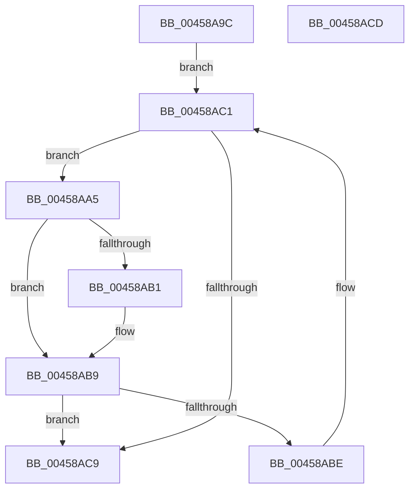

# EmpSearchRuleDatabase

- RVA: `0x00458A9C`–`0x00458ACE` (길이 `50` bytes)
- VA: `0x0000000140458A9C`
- 실행 섹션: `.text`
- PDB 이름 있음: `예`; PDB Function 태그: `아니요`
- unwind 정보 RVA: `0x000DB714`
- 디코드: `17`개 명령, `50/50` bytes 표시
- 미해석 바이트: `0` (있으면 어셈블리에 `.byte`로 보존)

> 이 문서는 커널 이미지의 기계어와 PDB 기호를 분석해 생성했습니다. 4번과 5번은 함수 원형과 자료형을 바이너리 사용 방식에서 추정한 C 해석이며 원본 소스 복구 결과는 아닙니다.

## 1. Dependencies

- 직접 호출 지점: **0**; 고유 호출 대상: **0**
- 직접 호출자로 확인된 함수: **6**
- RIP 상대 이미지 참조: **1**

### Outgoing calls
- 직접 디코드된 call 명령이 없습니다.

### Direct callers
- [EmpClientRuleRegisterNotification](../../page/71/EmpClientRuleRegisterNotification_function_00712DE4.md) at `0x00712EF4`
- [EmClientQueryRuleState](../../pagelk/B7/EmClientQueryRuleState_function_00B77D70.md) at `0x00B77DEE`
- [EmClientRuleEvaluate](../../pagelk/B7/EmClientRuleEvaluate_function_00B77E90.md) at `0x00B77F2D`
- [EmpParseRuleTerm](../../init/C2/EmpParseRuleTerm_function_00C26FC0.md) at `0x00C27092`
- [EmpParseRules](../../init/C2/EmpParseRules_function_00C2745C.md) at `0x00C27557`
- [EmpParseTargetRules](../../init/C2/EmpParseTargetRules_function_00C27C78.md) at `0x00C27D19`

### Static image references
- `0x00458A9C` → RVA `0x00F8F178` (`.data`; read)

## 2. Other-region calls and transfers

- 다른 실행 섹션으로 향하는 call: **0**
- 별도 외부 분기/꼬리 이동을 확인하지 못했습니다.

## 3. Assembly (complete function range)

```asm
00458A9C  48 8B 15 D5 66 B3 00            mov rdx, qword ptr [rip + 0xb366d5]
00458AA3  EB 1C                           jmp 0x140458ac1
00458AA5  4C 8D 42 E8                     lea r8, [rdx - 0x18]
00458AA9  4D 8B 08                        mov r9, qword ptr [r8]
00458AAC  4C 2B 09                        sub r9, qword ptr [rcx]
00458AAF  75 08                           jne 0x140458ab9
00458AB1  4D 8B 48 08                     mov r9, qword ptr [r8 + 8]
00458AB5  4C 2B 49 08                     sub r9, qword ptr [rcx + 8]
00458AB9  4D 85 C9                        test r9, r9
00458ABC  74 0B                           je 0x140458ac9
00458ABE  48 8B 12                        mov rdx, qword ptr [rdx]
00458AC1  45 33 C0                        xor r8d, r8d
00458AC4  48 85 D2                        test rdx, rdx
00458AC7  75 DC                           jne 0x140458aa5
00458AC9  49 8B C0                        mov rax, r8
00458ACC  C3                              ret
00458ACD  CC                              int3
```

## 4. C-style interpretation (structured pseudocode)

```c
__int64 __fastcall EmpSearchRuleDatabase(__int64 a1)
{
    goto loc_00458AC1;
loc_00458AA5:
    a4 = (*(unsigned __int64 *)(*(unsigned __int64 *)(v_rip + 11757269) - 24)) - (*(unsigned __int64 *)(a1));
    if (!(condition_is_not_equal)) {
        a4 = *(unsigned __int64 *)(*(unsigned __int64 *)(v_rip + 11757269) - 24 + 8);
        a4 = (a4) - (*(unsigned __int64 *)(a1 + 8));
    }
    if (a4 == 0) goto loc_00458AC9;
loc_00458AC1:
    a3 = 0;
    if (*(unsigned __int64 *)(*(unsigned __int64 *)(v_rip + 11757269)) != 0) goto loc_00458AA5;
loc_00458AC9:
    return 0;
}
```

## 5. (Beta) C Style

```c
int64_t EmpSearchRuleDatabase(void *Arg1)
{
    uint8_t *arg1 = (uint8_t *)Arg1;

    goto loc_00458AC1;
loc_00458AA5:
    a4 = (*(uint64_t *)(*(uint64_t *)(v_rip + 0xB366D5) - 0x18)) - (*(uint64_t *)(arg1));
    if (!(condition_is_not_equal)) {
        a4 = *(uint64_t *)(*(uint64_t *)(v_rip + 0xB366D5) - 0x18 + 0x8);
        a4 = (a4) - (*(uint64_t *)(arg1 + 0x8));
    }
    if (a4 == 0) goto loc_00458AC9;
loc_00458AC1:
    a3 = 0;
    if (*(uint64_t *)(*(uint64_t *)(v_rip + 0xB366D5)) != 0) goto loc_00458AA5;
loc_00458AC9:
    return 0;
}
```

### 관측된 메모리 오프셋

구조체 형식이 확인되지 않은 접근은 인자 기준의 오프셋으로만 기록했습니다.

| 기준 인자 | 오프셋 표현 | 폭 (bit) | 접근 |
|---|---:|---:|---|
| `Arg1` | `+ 0x0` | `64` | `R` |
| `Arg1` | `+ 0x8` | `64` | `R` |

## 6. Execution-region graph

[열기: 2D/3D 그래프와 함수 탐색 컨트롤 패널](../../../control-panel.html?section=text&rva=0x00458A9C&view=graph)

- 2D 그래프는 위에서 아래로 흐르고, 3D 그래프는 빈 공간을 드래그해 회전합니다. Shift+드래그는 이동, 휠은 확대·축소, 함수 노드 선택은 대상 보고서 이동입니다.

### Static fallback


