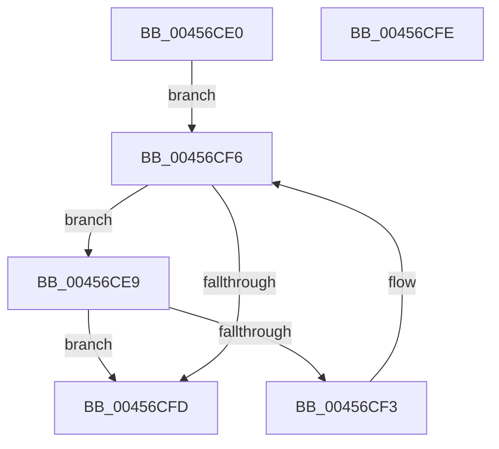

# EmpSearchTargetRuleList

- RVA: `0x00456CE0`–`0x00456CFF` (길이 `31` bytes)
- VA: `0x0000000140456CE0`
- 실행 섹션: `.text`
- PDB 이름 있음: `예`; PDB Function 태그: `아니요`
- unwind 정보 RVA: `0x000DB714`
- 디코드: `11`개 명령, `31/31` bytes 표시
- 미해석 바이트: `0` (있으면 어셈블리에 `.byte`로 보존)

> 이 문서는 커널 이미지의 기계어와 PDB 기호를 분석해 생성했습니다. 4번과 5번은 함수 원형과 자료형을 바이너리 사용 방식에서 추정한 C 해석이며 원본 소스 복구 결과는 아닙니다.

## 1. Dependencies

- 직접 호출 지점: **0**; 고유 호출 대상: **0**
- 직접 호출자로 확인된 함수: **5**
- RIP 상대 이미지 참조: **1**

### Outgoing calls
- 직접 디코드된 call 명령이 없습니다.

### Direct callers
- [sub_006F7FE4](../6F/Unknown_function_006F7FE4.md) at `0x006F801B`
- [EmpClientRuleRegisterNotification](../../page/71/EmpClientRuleRegisterNotification_function_00712DE4.md) at `0x00712F08`
- [EmClientQueryRuleState](../../pagelk/B7/EmClientQueryRuleState_function_00B77D70.md) at `0x00B77E02`
- [EmClientRuleEvaluate](../../pagelk/B7/EmClientRuleEvaluate_function_00B77E90.md) at `0x00B77F3A`
- [EmpParseTargetRules](../../init/C2/EmpParseTargetRules_function_00C27C78.md) at `0x00C27D5B`

### Static image references
- `0x00456CE0` → RVA `0x00F8F168` (`.data`; read)

## 2. Other-region calls and transfers

- 다른 실행 섹션으로 향하는 call: **0**
- 별도 외부 분기/꼬리 이동을 확인하지 못했습니다.

## 3. Assembly (complete function range)

```asm
00456CE0  48 8B 15 81 84 B3 00            mov rdx, qword ptr [rip + 0xb38481]
00456CE7  EB 0D                           jmp 0x140456cf6
00456CE9  48 8D 42 E0                     lea rax, [rdx - 0x20]
00456CED  48 39 48 08                     cmp qword ptr [rax + 8], rcx
00456CF1  74 0A                           je 0x140456cfd
00456CF3  48 8B 12                        mov rdx, qword ptr [rdx]
00456CF6  33 C0                           xor eax, eax
00456CF8  48 85 D2                        test rdx, rdx
00456CFB  75 EC                           jne 0x140456ce9
00456CFD  C3                              ret
00456CFE  CC                              int3
```

## 4. C-style interpretation (structured pseudocode)

```c
__int64 __fastcall EmpSearchTargetRuleList(__int64 a1)
{
    __int64 result;

    goto loc_00456CF6;
loc_00456CE9:
    if ((*(unsigned __int64 *)(*(unsigned __int64 *)(v_rip + 11764865) - 32 + 8)) == a1) goto loc_00456CFD;
loc_00456CF6:
    result = 0;
    if (*(unsigned __int64 *)(*(unsigned __int64 *)(v_rip + 11764865)) != 0) goto loc_00456CE9;
loc_00456CFD:
    return result;
}
```

## 5. (Beta) C Style

```c
int64_t EmpSearchTargetRuleList(int64_t Arg1)
{
    int64_t result;

    goto loc_00456CF6;
loc_00456CE9:
    if ((*(uint64_t *)(*(uint64_t *)(v_rip + 0xB38481) - 0x20 + 0x8)) == Arg1) goto loc_00456CFD;
loc_00456CF6:
    result = 0;
    if (*(uint64_t *)(*(uint64_t *)(v_rip + 0xB38481)) != 0) goto loc_00456CE9;
loc_00456CFD:
    return result;
}
```

## 6. Execution-region graph

[열기: 2D/3D 그래프와 함수 탐색 컨트롤 패널](../../../control-panel.html?section=text&rva=0x00456CE0&view=graph)

- 2D 그래프는 위에서 아래로 흐르고, 3D 그래프는 빈 공간을 드래그해 회전합니다. Shift+드래그는 이동, 휠은 확대·축소, 함수 노드 선택은 대상 보고서 이동입니다.

### Static fallback


