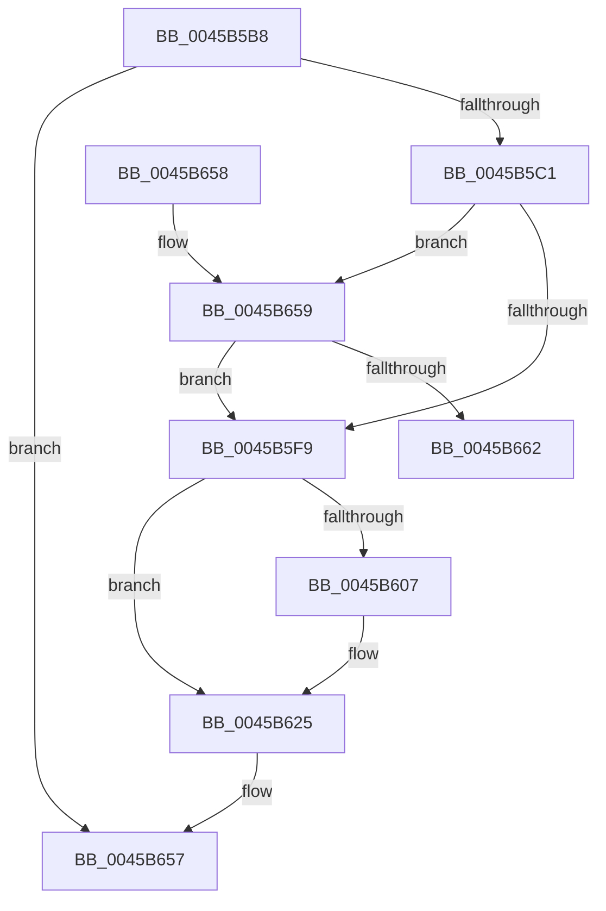

# EnableFlushTimer

- RVA: `0x0045B5B8`–`0x0045B685` (길이 `205` bytes)
- VA: `0x000000014045B5B8`
- 실행 섹션: `.text`
- PDB 이름 있음: `예`; PDB Function 태그: `예`
- unwind 정보 RVA: `0x000A93E0`
- 디코드: `52`개 명령, `205/205` bytes 표시
- 미해석 바이트: `0` (있으면 어셈블리에 `.byte`로 보존)

> 이 문서는 커널 이미지의 기계어와 PDB 기호를 분석해 생성했습니다. 4번과 5번은 함수 원형과 자료형을 바이너리 사용 방식에서 추정한 C 해석이며 원본 소스 복구 결과는 아닙니다.

## 1. Dependencies

- 직접 호출 지점: **6**; 고유 호출 대상: **5**
- 직접 호출자로 확인된 함수: **3**
- RIP 상대 이미지 참조: **1**

### Outgoing calls
- `0x0045B5FE` → [ExpTimerSetParametersAreValid](ExpTimerSetParametersAreValid_function_0045B68C.md) (function, `0x0045B68C`)
- `0x0045B61F` → [KeBugCheckEx](../4F/KeBugCheckEx_function_004FD660.md) (function, `0x004FD660`)
- `0x0045B628` → [ExpCheckForFreedEnhancedTimer](../3A/ExpCheckForFreedEnhancedTimer_function_003A0148.md) (function, `0x003A0148`)
- `0x0045B63B` → [KeSetTimer2](../3A/KeSetTimer2_function_003A08E0.md) (function, `0x003A08E0`)
- `0x0045B648` → [_security_check_cookie](../6A/_security_check_cookie_function_006AC640.md) (function, `0x006AC640`)
- `0x0045B67F` → [KeBugCheckEx](../4F/KeBugCheckEx_function_004FD660.md) (function, `0x004FD660`)

### Direct callers
- [InsertEventEntryInLookUpTable](../2F/InsertEventEntryInLookUpTable_function_002F1424.md) at `0x002F16D6`
- [TlgAggregateInternalFlushTimerCallbackKernelMode](../4C/TlgAggregateInternalFlushTimerCallbackKernelMode_function_004C4240.md) at `0x004C4270`
- [TlgAggregateInternalFlushWorkItemRoutineKernelMode](../../page/A6/TlgAggregateInternalFlushWorkItemRoutineKernelMode_function_00A693B0.md) at `0x00A69414`

### Static image references
- `0x0045B5CB` → RVA `0x00E0A740` (`.data`; read)

## 2. Other-region calls and transfers

- 다른 실행 섹션으로 향하는 call: **0**
- 별도 외부 분기/꼬리 이동을 확인하지 못했습니다.

## 3. Assembly (complete function range)

```asm
0045B5B8  48 85 C9                        test rcx, rcx
0045B5BB  0F 84 96 00 00 00               je 0x14045b657
0045B5C1  48 89 5C 24 18                  mov qword ptr [rsp + 0x18], rbx
0045B5C6  57                              push rdi
0045B5C7  48 83 EC 50                     sub rsp, 0x50
0045B5CB  48 8B 05 6E F1 9A 00            mov rax, qword ptr [rip + 0x9af16e]
0045B5D2  48 33 C4                        xor rax, rsp
0045B5D5  48 89 44 24 48                  mov qword ptr [rsp + 0x48], rax
0045B5DA  48 83 4C 24 40 FF               or qword ptr [rsp + 0x40], 0xffffffffffffffff
0045B5E0  45 33 C0                        xor r8d, r8d
0045B5E3  8B C2                           mov eax, edx
0045B5E5  48 8B D9                        mov rbx, rcx
0045B5E8  48 69 F8 F0 D8 FF FF            imul rdi, rax, -0x2710
0045B5EF  4C 89 44 24 38                  mov qword ptr [rsp + 0x38], r8
0045B5F4  48 85 FF                        test rdi, rdi
0045B5F7  7F 60                           jg 0x14045b659
0045B5F9  48 8D 4C 24 38                  lea rcx, [rsp + 0x38]
0045B5FE  E8 89 00 00 00                  call 0x14045b68c
0045B603  84 C0                           test al, al
0045B605  75 1E                           jne 0x14045b625
0045B607  BA 09 00 00 00                  mov edx, 9
0045B60C  4C 89 44 24 20                  mov qword ptr [rsp + 0x20], r8
0045B611  4C 8D 4C 24 38                  lea r9, [rsp + 0x38]
0045B616  B9 C7 00 00 00                  mov ecx, 0xc7
0045B61B  44 8D 42 F8                     lea r8d, [rdx - 8]
0045B61F  E8 3C 20 0A 00                  call 0x1404fd660
0045B624  CC                              int3
0045B625  48 8B CB                        mov rcx, rbx
0045B628  E8 1B 4B F4 FF                  call 0x1403a0148
0045B62D  4C 8D 4C 24 38                  lea r9, [rsp + 0x38]
0045B632  45 33 C0                        xor r8d, r8d
0045B635  48 8B D7                        mov rdx, rdi
0045B638  48 8B CB                        mov rcx, rbx
0045B63B  E8 A0 52 F4 FF                  call 0x1403a08e0
0045B640  48 8B 4C 24 48                  mov rcx, qword ptr [rsp + 0x48]
0045B645  48 33 CC                        xor rcx, rsp
0045B648  E8 F3 0F 25 00                  call 0x1406ac640
0045B64D  48 8B 5C 24 70                  mov rbx, qword ptr [rsp + 0x70]
0045B652  48 83 C4 50                     add rsp, 0x50
0045B656  5F                              pop rdi
0045B657  C3                              ret
0045B658  CC                              int3
0045B659  F6 81 81 00 00 00 04            test byte ptr [rcx + 0x81], 4
0045B660  74 97                           je 0x14045b5f9
0045B662  BA 09 00 00 00                  mov edx, 9
0045B667  4C 89 44 24 20                  mov qword ptr [rsp + 0x20], r8
0045B66C  4C 8D 4C 24 30                  lea r9, [rsp + 0x30]
0045B671  48 89 7C 24 30                  mov qword ptr [rsp + 0x30], rdi
0045B676  B9 C7 00 00 00                  mov ecx, 0xc7
0045B67B  44 8D 42 F9                     lea r8d, [rdx - 7]
0045B67F  E8 DC 1F 0A 00                  call 0x1404fd660
0045B684  CC                              int3
```

## 4. C-style interpretation (structured pseudocode)

```c
__int64 __fastcall EnableFlushTimer(__int64 a1, int a2, int a3)
{
    __int64 result;
    __int64 v_rdi;
    __int64 v_rsp;
    unsigned __int64 v_stack_m10;
    unsigned __int64 v_stack_m18;
    unsigned __int64 v_stack_m20;
    unsigned __int64 v_stack_m38;
    unsigned __int64 v_stack_p18;
    unsigned __int64 v_stack_p20;
    unsigned __int64 v_stack_p30;

    if (a1 == 0) goto loc_0045B657;
    v_stack_p18 = v_rbx;
    v_rsp = (v_rsp) - (80);
    result = (*(unsigned __int64 *)(v_rip + 10154350)) ^ (v_rsp);
    v_stack_m10 = result;
    a3 = 0;
    v_rdi = (v_rdi) * ((unsigned int)(a2));
    v_stack_m20 = 0;
    if (condition_is_greater) goto loc_0045B659;
loc_0045B5F9:
    result = ExpTimerSetParametersAreValid(v_stack_m20, a2, a3, a4);
    if ((unsigned __int8)(result) == 0) {
        a2 = 9;
        v_stack_m38 = 0;
        a4 = v_stack_m20;
        a1 = 199;
        a3 = a2 - 8;
        result = KeBugCheckEx(a1, a2, a3, a4);
    }
    result = ExpCheckForFreedEnhancedTimer(a1, a2, a3, a4);
    a3 = 0;
    result = KeSetTimer2(a1, v_rdi, a3, v_stack_m20);
    a1 = (v_stack_m10) ^ (v_rsp);
    result = _security_check_cookie(a1, v_rdi, a3, v_stack_m20);
    v_rsp = (v_rsp) + (80);
loc_0045B657:
    return result;
loc_0045B659:
    if (((*(unsigned __int8 *)(a1 + 129)) & (4)) == 0) goto loc_0045B5F9;
    v_stack_p20 = 0;
    v_stack_p30 = v_rdi;
    result = KeBugCheckEx(199, 9, 9 - 7, v_stack_p30);
    return result;
}
```

## 5. (Beta) C Style

```c
int64_t EnableFlushTimer(int64_t Arg1, int32_t Arg2, int32_t Arg3)
{
    int64_t result;
    int64_t local_rdi;
    int64_t local_rsp;
    uint64_t v_stack_m10;
    uint64_t v_stack_m18;
    uint64_t v_stack_m20;
    uint64_t v_stack_m38;
    uint64_t v_stack_p18;
    uint64_t v_stack_p20;
    uint64_t v_stack_p30;

    if (Arg1 == 0) goto loc_0045B657;
    v_stack_p18 = local_rbx;
    local_rsp = (local_rsp) - (80);
    result = (*(uint64_t *)(v_rip + 0x9AF16E)) ^ (local_rsp);
    v_stack_m10 = result;
    Arg3 = 0;
    local_rdi = (local_rdi) * ((uint32_t)(Arg2));
    v_stack_m20 = 0;
    if (condition_is_greater) goto loc_0045B659;
loc_0045B5F9:
    result = ExpTimerSetParametersAreValid(v_stack_m20, Arg2, Arg3, a4);
    if ((uint8_t)(result) == 0) {
        Arg2 = 9;
        v_stack_m38 = 0;
        a4 = v_stack_m20;
        Arg1 = 199;
        Arg3 = Arg2 - 8;
        result = KeBugCheckEx(Arg1, Arg2, Arg3, a4);
    }
    result = ExpCheckForFreedEnhancedTimer(Arg1, Arg2, Arg3, a4);
    Arg3 = 0;
    result = KeSetTimer2(Arg1, local_rdi, Arg3, v_stack_m20);
    Arg1 = (v_stack_m10) ^ (local_rsp);
    result = _security_check_cookie(Arg1, local_rdi, Arg3, v_stack_m20);
    local_rsp = (local_rsp) + (80);
loc_0045B657:
    return result;
loc_0045B659:
    if (((*(uint8_t *)(Arg1 + 0x81)) & (4)) == 0) goto loc_0045B5F9;
    v_stack_p20 = 0;
    v_stack_p30 = local_rdi;
    result = KeBugCheckEx(199, 9, 9 - 7, v_stack_p30);
    return result;
}
```

## 6. Execution-region graph

[열기: 2D/3D 그래프와 함수 탐색 컨트롤 패널](../../../control-panel.html?section=text&rva=0x0045B5B8&view=graph)

- 2D 그래프는 위에서 아래로 흐르고, 3D 그래프는 빈 공간을 드래그해 회전합니다. Shift+드래그는 이동, 휠은 확대·축소, 함수 노드 선택은 대상 보고서 이동입니다.

### Static fallback


