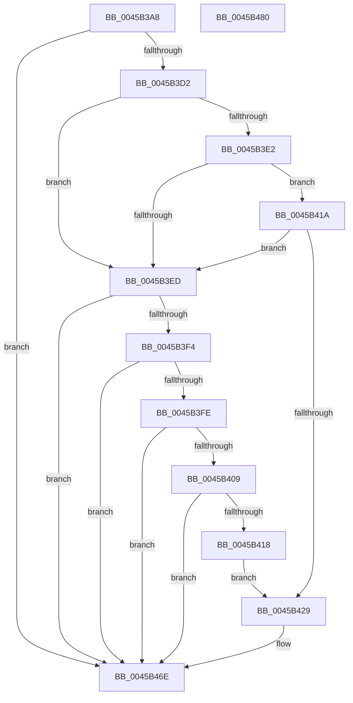

# EtwTraceMemoryAcg

- RVA: `0x0045B3A8`–`0x0045B481` (길이 `217` bytes)
- VA: `0x000000014045B3A8`
- 실행 섹션: `.text`
- PDB 이름 있음: `예`; PDB Function 태그: `아니요`
- unwind 정보 RVA: `0x000A9144`
- 디코드: `55`개 명령, `217/217` bytes 표시
- 미해석 바이트: `0` (있으면 어셈블리에 `.byte`로 보존)

> 이 문서는 커널 이미지의 기계어와 PDB 기호를 분석해 생성했습니다. 4번과 5번은 함수 원형과 자료형을 바이너리 사용 방식에서 추정한 C 해석이며 원본 소스 복구 결과는 아닙니다.

## 1. Dependencies

- 직접 호출 지점: **2**; 고유 호출 대상: **2**
- 직접 호출자로 확인된 함수: **1**
- RIP 상대 이미지 참조: **3**

### Outgoing calls
- `0x0045B469` → [EtwWriteEx](../25/EtwWriteEx_function_0025F0D0.md) (function, `0x0025F0D0`)
- `0x0045B476` → [_security_check_cookie](../6A/_security_check_cookie_function_006AC640.md) (function, `0x006AC640`)

### Direct callers
- [MiArbitraryCodeBlocked](../../page/97/MiArbitraryCodeBlocked_function_0097D7CC.md) at `0x0097D7F2`
- [MiArbitraryCodeBlocked](../../page/97/MiArbitraryCodeBlocked_function_0097D7CC.md) at `0x0097D80F`

### Static image references
- `0x0045B3B0` → RVA `0x00E0A740` (`.data`; read)
- `0x0045B3BF` → RVA `0x00EFF848` (`.data`; read)
- `0x0045B43A` → RVA `0x00019918` (`.rdata`; read)

## 2. Other-region calls and transfers

- 다른 실행 섹션으로 향하는 call: **0**
- 별도 외부 분기/꼬리 이동을 확인하지 못했습니다.

## 3. Assembly (complete function range)

```asm
0045B3A8  89 4C 24 08                     mov dword ptr [rsp + 8], ecx
0045B3AC  48 83 EC 68                     sub rsp, 0x68
0045B3B0  48 8B 05 89 F3 9A 00            mov rax, qword ptr [rip + 0x9af389]
0045B3B7  48 33 C4                        xor rax, rsp
0045B3BA  48 89 44 24 58                  mov qword ptr [rsp + 0x58], rax
0045B3BF  48 8B 15 82 44 AA 00            mov rdx, qword ptr [rip + 0xaa4482]
0045B3C6  45 33 C0                        xor r8d, r8d
0045B3C9  48 85 D2                        test rdx, rdx
0045B3CC  0F 84 9C 00 00 00               je 0x14045b46e
0045B3D2  48 8B 4A 20                     mov rcx, qword ptr [rdx + 0x20]
0045B3D6  41 B9 00 01 00 00               mov r9d, 0x100
0045B3DC  44 39 41 60                     cmp dword ptr [rcx + 0x60], r8d
0045B3E0  74 0B                           je 0x14045b3ed
0045B3E2  8B 41 68                        mov eax, dword ptr [rcx + 0x68]
0045B3E5  8B 41 70                        mov eax, dword ptr [rcx + 0x70]
0045B3E8  49 85 C1                        test r9, rax
0045B3EB  75 2D                           jne 0x14045b41a
0045B3ED  66 44 39 42 66                  cmp word ptr [rdx + 0x66], r8w
0045B3F2  74 7A                           je 0x14045b46e
0045B3F4  48 8B 4A 28                     mov rcx, qword ptr [rdx + 0x28]
0045B3F8  44 39 41 60                     cmp dword ptr [rcx + 0x60], r8d
0045B3FC  74 70                           je 0x14045b46e
0045B3FE  8B 41 68                        mov eax, dword ptr [rcx + 0x68]
0045B401  8B 41 70                        mov eax, dword ptr [rcx + 0x70]
0045B404  49 85 C1                        test r9, rax
0045B407  74 65                           je 0x14045b46e
0045B409  48 8B 49 78                     mov rcx, qword ptr [rcx + 0x78]
0045B40D  48 8B C1                        mov rax, rcx
0045B410  49 23 C1                        and rax, r9
0045B413  48 3B C1                        cmp rax, rcx
0045B416  75 56                           jne 0x14045b46e
0045B418  EB 0F                           jmp 0x14045b429
0045B41A  48 8B 49 78                     mov rcx, qword ptr [rcx + 0x78]
0045B41E  48 8B C1                        mov rax, rcx
0045B421  49 23 C1                        and rax, r9
0045B424  48 3B C1                        cmp rax, rcx
0045B427  75 C4                           jne 0x14045b3ed
0045B429  48 8B 0D 18 44 AA 00            mov rcx, qword ptr [rip + 0xaa4418]
0045B430  48 8D 44 24 70                  lea rax, [rsp + 0x70]
0045B435  48 89 44 24 48                  mov qword ptr [rsp + 0x48], rax
0045B43A  48 8D 15 D7 E4 BB FF            lea rdx, [rip - 0x441b29]
0045B441  48 8D 44 24 48                  lea rax, [rsp + 0x48]
0045B446  48 C7 44 24 50 04 00 00 00      mov qword ptr [rsp + 0x50], 4
0045B44F  48 89 44 24 38                  mov qword ptr [rsp + 0x38], rax
0045B454  41 B9 01 00 00 00               mov r9d, 1
0045B45A  44 89 4C 24 30                  mov dword ptr [rsp + 0x30], r9d
0045B45F  4C 89 44 24 28                  mov qword ptr [rsp + 0x28], r8
0045B464  4C 89 44 24 20                  mov qword ptr [rsp + 0x20], r8
0045B469  E8 62 3C E0 FF                  call 0x14025f0d0
0045B46E  48 8B 4C 24 58                  mov rcx, qword ptr [rsp + 0x58]
0045B473  48 33 CC                        xor rcx, rsp
0045B476  E8 C5 11 25 00                  call 0x1406ac640
0045B47B  48 83 C4 68                     add rsp, 0x68
0045B47F  C3                              ret
0045B480  CC                              int3
```

## 4. C-style interpretation (structured pseudocode)

```c
__int64 __fastcall EtwTraceMemoryAcg(int a1, __int64 a2, int a3)
{
    __int64 result;
    __int64 v_rsp;
    unsigned __int64 v_stack_m10;
    unsigned __int64 v_stack_m18;
    unsigned __int64 v_stack_m20;
    unsigned __int64 v_stack_m30;
    unsigned int v_stack_m38;
    unsigned __int64 v_stack_m40;
    unsigned __int64 v_stack_m48;
    unsigned int v_stack_p8;

    v_stack_p8 = a1;
    v_rsp = (v_rsp) - (104);
    result = (*(unsigned __int64 *)(v_rip + 10154889)) ^ (v_rsp);
    v_stack_m10 = result;
    a3 = 0;
    if (*(unsigned __int64 *)(v_rip + 11158658) == 0) goto loc_0045B46E;
    if ((*(unsigned int *)(*(unsigned __int64 *)(*(unsigned __int64 *)(v_rip + 11158658) + 32) + 96)) == 0) goto loc_0045B3ED;
    if (((256) & ((unsigned int)(*(unsigned int *)(*(unsigned __int64 *)(*(unsigned __int64 *)(v_rip + 11158658) + 32) + 112)))) != 0) goto loc_0045B41A;
loc_0045B3ED:
    if ((*(unsigned __int16 *)(*(unsigned __int64 *)(v_rip + 11158658) + 102)) == 0) goto loc_0045B46E;
    if ((*(unsigned int *)(*(unsigned __int64 *)(*(unsigned __int64 *)(v_rip + 11158658) + 40) + 96)) == 0) goto loc_0045B46E;
    if (((256) & ((unsigned int)(*(unsigned int *)(*(unsigned __int64 *)(*(unsigned __int64 *)(v_rip + 11158658) + 40) + 112)))) == 0) goto loc_0045B46E;
    result = (*(unsigned __int64 *)(*(unsigned __int64 *)(*(unsigned __int64 *)(v_rip + 11158658) + 40) + 120)) & (256);
    if (result != (*(unsigned __int64 *)(*(unsigned __int64 *)(*(unsigned __int64 *)(v_rip + 11158658) + 40) + 120))) goto loc_0045B46E;
    goto loc_0045B429;
loc_0045B41A:
    result = (*(unsigned __int64 *)(*(unsigned __int64 *)(*(unsigned __int64 *)(*(unsigned __int64 *)(v_rip + 11158658) + 40) + 120) + 120)) & (256);
    if (result != (*(unsigned __int64 *)(*(unsigned __int64 *)(*(unsigned __int64 *)(*(unsigned __int64 *)(v_rip + 11158658) + 40) + 120) + 120))) goto loc_0045B3ED;
loc_0045B429:
    v_stack_m20 = v_stack_p8;
    v_stack_m18 = 4;
    v_stack_m30 = v_stack_m20;
    v_stack_m38 = 1;
    v_stack_m40 = 0;
    v_stack_m48 = 0;
    result = EtwWriteEx(*(unsigned __int64 *)(v_rip + 11158552), v_rip - 4463401, a3, 1);
loc_0045B46E:
    a1 = (v_stack_m10) ^ (v_rsp);
    result = _security_check_cookie(a1, v_rip - 4463401, a3, 1);
    v_rsp = (v_rsp) + (104);
    return result;
}
```

## 5. (Beta) C Style

```c
int64_t EtwTraceMemoryAcg(int32_t Arg1, int64_t Arg2, int32_t Arg3)
{
    int64_t result;
    int64_t local_rsp;
    uint64_t v_stack_m10;
    uint64_t v_stack_m18;
    uint64_t v_stack_m20;
    uint64_t v_stack_m30;
    uint32_t v_stack_m38;
    uint64_t v_stack_m40;
    uint64_t v_stack_m48;
    uint32_t v_stack_p8;

    v_stack_p8 = Arg1;
    local_rsp = (local_rsp) - (104);
    result = (*(uint64_t *)(v_rip + 0x9AF389)) ^ (local_rsp);
    v_stack_m10 = result;
    Arg3 = 0;
    if (*(uint64_t *)(v_rip + 0xAA4482) == 0) goto loc_0045B46E;
    if ((*(uint32_t *)(*(uint64_t *)(*(uint64_t *)(v_rip + 0xAA4482) + 0x20) + 0x60)) == 0) goto loc_0045B3ED;
    if (((256) & ((uint32_t)(*(uint32_t *)(*(uint64_t *)(*(uint64_t *)(v_rip + 0xAA4482) + 0x20) + 0x70)))) != 0) goto loc_0045B41A;
loc_0045B3ED:
    if ((*(uint16_t *)(*(uint64_t *)(v_rip + 0xAA4482) + 0x66)) == 0) goto loc_0045B46E;
    if ((*(uint32_t *)(*(uint64_t *)(*(uint64_t *)(v_rip + 0xAA4482) + 0x28) + 0x60)) == 0) goto loc_0045B46E;
    if (((256) & ((uint32_t)(*(uint32_t *)(*(uint64_t *)(*(uint64_t *)(v_rip + 0xAA4482) + 0x28) + 0x70)))) == 0) goto loc_0045B46E;
    result = (*(uint64_t *)(*(uint64_t *)(*(uint64_t *)(v_rip + 0xAA4482) + 0x28) + 0x78)) & (256);
    if (result != (*(uint64_t *)(*(uint64_t *)(*(uint64_t *)(v_rip + 0xAA4482) + 0x28) + 0x78))) goto loc_0045B46E;
    goto loc_0045B429;
loc_0045B41A:
    result = (*(uint64_t *)(*(uint64_t *)(*(uint64_t *)(*(uint64_t *)(v_rip + 0xAA4482) + 0x28) + 0x78) + 0x78)) & (256);
    if (result != (*(uint64_t *)(*(uint64_t *)(*(uint64_t *)(*(uint64_t *)(v_rip + 0xAA4482) + 0x28) + 0x78) + 0x78))) goto loc_0045B3ED;
loc_0045B429:
    v_stack_m20 = v_stack_p8;
    v_stack_m18 = 4;
    v_stack_m30 = v_stack_m20;
    v_stack_m38 = 1;
    v_stack_m40 = 0;
    v_stack_m48 = 0;
    result = EtwWriteEx(*(uint64_t *)(v_rip + 0xAA4418), v_rip - 4463401, Arg3, 1);
loc_0045B46E:
    Arg1 = (v_stack_m10) ^ (local_rsp);
    result = _security_check_cookie(Arg1, v_rip - 4463401, Arg3, 1);
    local_rsp = (local_rsp) + (104);
    return result;
}
```

## 6. Execution-region graph

[열기: 2D/3D 그래프와 함수 탐색 컨트롤 패널](../../../control-panel.html?section=text&rva=0x0045B3A8&view=graph)

- 2D 그래프는 위에서 아래로 흐르고, 3D 그래프는 빈 공간을 드래그해 회전합니다. Shift+드래그는 이동, 휠은 확대·축소, 함수 노드 선택은 대상 보고서 이동입니다.

### Static fallback


