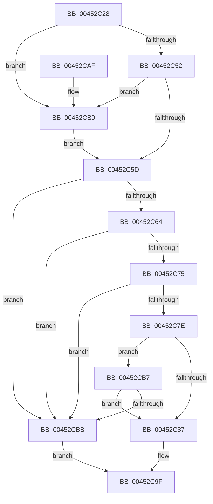

# EtwpCovSampSafeForUserAddressCapture

- RVA: `0x00452C28`–`0x00452CC2` (길이 `154` bytes)
- VA: `0x0000000140452C28`
- 실행 섹션: `.text`
- PDB 이름 있음: `예`; PDB Function 태그: `아니요`
- unwind 정보 RVA: `0x0009A3D0`
- 디코드: `41`개 명령, `154/154` bytes 표시
- 미해석 바이트: `0` (있으면 어셈블리에 `.byte`로 보존)

> 이 문서는 커널 이미지의 기계어와 PDB 기호를 분석해 생성했습니다. 4번과 5번은 함수 원형과 자료형을 바이너리 사용 방식에서 추정한 C 해석이며 원본 소스 복구 결과는 아닙니다.

## 1. Dependencies

- 직접 호출 지점: **1**; 고유 호출 대상: **1**
- 직접 호출자로 확인된 함수: **1**
- RIP 상대 이미지 참조: **0**

### Outgoing calls
- `0x00452C75` → [MmCanThreadFault](../2F/MmCanThreadFault_function_002F86B0.md) (function, `0x002F86B0`)

### Direct callers
- [EtwpCovSampCaptureSample](../65/EtwpCovSampCaptureSample_function_00653F24.md) at `0x00654057`

### Static image references
- 디코드된 RIP-relative 메모리 참조가 없습니다.

## 2. Other-region calls and transfers

- 다른 실행 섹션으로 향하는 call: **0**
- 별도 외부 분기/꼬리 이동을 확인하지 못했습니다.

## 3. Assembly (complete function range)

```asm
00452C28  48 89 5C 24 08                  mov qword ptr [rsp + 8], rbx
00452C2D  48 89 74 24 10                  mov qword ptr [rsp + 0x10], rsi
00452C32  57                              push rdi
00452C33  48 83 EC 20                     sub rsp, 0x20
00452C37  8B F9                           mov edi, ecx
00452C39  44 0F 20 C1                     mov rcx, cr8
00452C3D  65 48 8B 1C 25 88 01 00 00      mov rbx, qword ptr gs:[0x188]
00452C46  33 F6                           xor esi, esi
00452C48  8B 83 A0 05 00 00               mov eax, dword ptr [rbx + 0x5a0]
00452C4E  A8 01                           test al, 1
00452C50  75 5E                           jne 0x140452cb0
00452C52  8B C6                           mov eax, esi
00452C54  48 39 B3 F0 00 00 00            cmp qword ptr [rbx + 0xf0], rsi
00452C5B  74 53                           je 0x140452cb0
00452C5D  89 02                           mov dword ptr [rdx], eax
00452C5F  80 F9 02                        cmp cl, 2
00452C62  73 57                           jae 0x140452cbb
00452C64  65 48 8B 04 25 88 01 00 00      mov rax, qword ptr gs:[0x188]
00452C6D  39 B0 E4 01 00 00               cmp dword ptr [rax + 0x1e4], esi
00452C73  75 46                           jne 0x140452cbb
00452C75  E8 36 5A EA FF                  call 0x1402f86b0
00452C7A  85 C0                           test eax, eax
00452C7C  74 3D                           je 0x140452cbb
00452C7E  40 38 B3 AE 05 00 00            cmp byte ptr [rbx + 0x5ae], sil
00452C85  75 30                           jne 0x140452cb7
00452C87  65 48 8B 0C 25 88 01 00 00      mov rcx, qword ptr gs:[0x188]
00452C90  B8 BB 00 00 C0                  mov eax, 0xc00000bb
00452C95  80 B9 4A 02 00 00 01            cmp byte ptr [rcx + 0x24a], 1
00452C9C  0F 45 C6                        cmovne eax, esi
00452C9F  48 8B 5C 24 30                  mov rbx, qword ptr [rsp + 0x30]
00452CA4  48 8B 74 24 38                  mov rsi, qword ptr [rsp + 0x38]
00452CA9  48 83 C4 20                     add rsp, 0x20
00452CAD  5F                              pop rdi
00452CAE  C3                              ret
00452CAF  CC                              int3
00452CB0  B8 01 00 00 00                  mov eax, 1
00452CB5  EB A6                           jmp 0x140452c5d
00452CB7  85 FF                           test edi, edi
00452CB9  75 CC                           jne 0x140452c87
00452CBB  B8 BB 00 00 C0                  mov eax, 0xc00000bb
00452CC0  EB DD                           jmp 0x140452c9f
```

## 4. C-style interpretation (structured pseudocode)

```c
__int64 __fastcall EtwpCovSampSafeForUserAddressCapture(int a1, __int64 a2)
{
    __int64 result;
    __int64 v_rsi;
    __int64 v_rsp;
    unsigned __int64 v_stack_p10;
    unsigned __int64 v_stack_p8;

    v_stack_p8 = v_rbx;
    v_stack_p10 = v_rsi;
    v_rsp = (v_rsp) - (32);
    v_rsi = 0;
    if ((((unsigned __int8)((unsigned int)(*(unsigned int *)(*(unsigned __int64 *)(gs_base + (0 + 392)) + 1440)))) & (1)) != 0) goto loc_00452CB0;
    if ((*(unsigned __int64 *)(*(unsigned __int64 *)(gs_base + (0 + 392)) + 240)) == 0) goto loc_00452CB0;
loc_00452C5D:
    *(unsigned int *)(a2) = 0;
    if (((unsigned __int8)(v_cr8)) >= 2) goto loc_00452CBB;
    if ((*(unsigned int *)(*(unsigned __int64 *)(gs_base + (0 + 392)) + 484)) != 0) goto loc_00452CBB;
    result = MmCanThreadFault(v_cr8, a2, a3, a4);
    if ((unsigned int)(result) == 0) goto loc_00452CBB;
    if ((*(unsigned __int8 *)(*(unsigned __int64 *)(gs_base + (0 + 392)) + 1454)) != 0) goto loc_00452CB7;
loc_00452C87:
    result = (unsigned int)(0xC00000BBULL);
    if ((*(unsigned __int8 *)(*(unsigned __int64 *)(gs_base + (0 + 392)) + 586)) != 1) { result = 0; }
loc_00452C9F:
    v_rsp = (v_rsp) + (32);
    return result;
loc_00452CB0:
    goto loc_00452C5D;
loc_00452CB7:
    if ((unsigned int)((unsigned int)(a1)) != 0) goto loc_00452C87;
loc_00452CBB:
    goto loc_00452C9F;
}
```

## 5. (Beta) C Style

```c
int64_t EtwpCovSampSafeForUserAddressCapture(int32_t Arg1, void *Arg2)
{
    uint8_t *arg2 = (uint8_t *)Arg2;

    int64_t result;
    int64_t local_rsi;
    int64_t local_rsp;
    uint64_t v_stack_p10;
    uint64_t v_stack_p8;

    v_stack_p8 = local_rbx;
    v_stack_p10 = local_rsi;
    local_rsp = (local_rsp) - (32);
    local_rsi = 0;
    if ((((uint8_t)((uint32_t)(*(uint32_t *)(*(uint64_t *)(gs_base + (0 + 0x188)) + 0x5A0)))) & (1)) != 0) goto loc_00452CB0;
    if ((*(uint64_t *)(*(uint64_t *)(gs_base + (0 + 0x188)) + 0xF0)) == 0) goto loc_00452CB0;
loc_00452C5D:
    *(uint32_t *)(arg2) = 0;
    if (((uint8_t)(v_cr8)) >= 2) goto loc_00452CBB;
    if ((*(uint32_t *)(*(uint64_t *)(gs_base + (0 + 0x188)) + 0x1E4)) != 0) goto loc_00452CBB;
    result = MmCanThreadFault(v_cr8, Arg2, a3, a4);
    if ((uint32_t)(result) == 0) goto loc_00452CBB;
    if ((*(uint8_t *)(*(uint64_t *)(gs_base + (0 + 0x188)) + 0x5AE)) != 0) goto loc_00452CB7;
loc_00452C87:
    result = (uint32_t)(0xC00000BBULL);
    if ((*(uint8_t *)(*(uint64_t *)(gs_base + (0 + 0x188)) + 0x24A)) != 1) { result = 0; }
loc_00452C9F:
    local_rsp = (local_rsp) + (32);
    return result;
loc_00452CB0:
    goto loc_00452C5D;
loc_00452CB7:
    if ((uint32_t)((uint32_t)(Arg1)) != 0) goto loc_00452C87;
loc_00452CBB:
    goto loc_00452C9F;
}
```

### 관측된 메모리 오프셋

구조체 형식이 확인되지 않은 접근은 인자 기준의 오프셋으로만 기록했습니다.

| 기준 인자 | 오프셋 표현 | 폭 (bit) | 접근 |
|---|---:|---:|---|
| `Arg2` | `+ 0x0` | `32` | `W` |

## 6. Execution-region graph

[열기: 2D/3D 그래프와 함수 탐색 컨트롤 패널](../../../control-panel.html?section=text&rva=0x00452C28&view=graph)

- 2D 그래프는 위에서 아래로 흐르고, 3D 그래프는 빈 공간을 드래그해 회전합니다. Shift+드래그는 이동, 휠은 확대·축소, 함수 노드 선택은 대상 보고서 이동입니다.

### Static fallback


