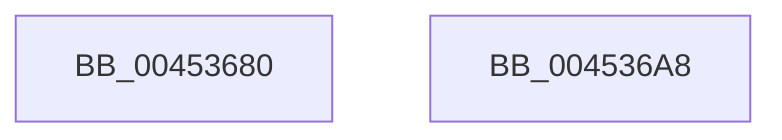

# EtwpExpandedStackWalk

- RVA: `0x00453680`–`0x004536A9` (길이 `41` bytes)
- VA: `0x0000000140453680`
- 실행 섹션: `.text`
- PDB 이름 있음: `예`; PDB Function 태그: `아니요`
- unwind 정보 RVA: `0x0005CF00`
- 디코드: `14`개 명령, `41/41` bytes 표시
- 미해석 바이트: `0` (있으면 어셈블리에 `.byte`로 보존)

> 이 문서는 커널 이미지의 기계어와 PDB 기호를 분석해 생성했습니다. 4번과 5번은 함수 원형과 자료형을 바이너리 사용 방식에서 추정한 C 해석이며 원본 소스 복구 결과는 아닙니다.

## 1. Dependencies

- 직접 호출 지점: **1**; 고유 호출 대상: **1**
- 직접 호출자로 확인된 함수: **0**
- RIP 상대 이미지 참조: **0**

### Outgoing calls
- `0x0045369A` → [RtlWalkFrameChain](../2F/RtlWalkFrameChain_function_002F85E0.md) (function, `0x002F85E0`)

### Direct callers
- 이 함수 시작 RVA로 연결되는 직접 call은 확인되지 않았습니다. 간접 호출은 완전히 역산할 수 없습니다.

### Static image references
- 디코드된 RIP-relative 메모리 참조가 없습니다.

## 2. Other-region calls and transfers

- 다른 실행 섹션으로 향하는 call: **0**
- 별도 외부 분기/꼬리 이동을 확인하지 못했습니다.

## 3. Assembly (complete function range)

```asm
00453680  40 53                           push rbx
00453682  48 83 EC 20                     sub rsp, 0x20
00453686  48 8B 41 08                     mov rax, qword ptr [rcx + 8]
0045368A  48 8B D9                        mov rbx, rcx
0045368D  8A 50 07                        mov dl, byte ptr [rax + 7]
00453690  8B 51 18                        mov edx, dword ptr [rcx + 0x18]
00453693  44 8B 41 1C                     mov r8d, dword ptr [rcx + 0x1c]
00453697  48 8B 09                        mov rcx, qword ptr [rcx]
0045369A  E8 41 4F EA FF                  call 0x1402f85e0
0045369F  89 43 20                        mov dword ptr [rbx + 0x20], eax
004536A2  48 83 C4 20                     add rsp, 0x20
004536A6  5B                              pop rbx
004536A7  C3                              ret
004536A8  CC                              int3
```

## 4. C-style interpretation (structured pseudocode)

```c
__int64 __fastcall EtwpExpandedStackWalk(__int64 a1)
{
    __int64 result;
    __int64 v_rsp;

    v_rsp = (v_rsp) - (32);
    result = RtlWalkFrameChain(*(unsigned __int64 *)(a1), (unsigned int)(*(unsigned int *)(a1 + 24)), (unsigned int)(*(unsigned int *)(a1 + 28)), a4);
    *(unsigned int *)(a1 + 32) = (unsigned int)(result);
    v_rsp = (v_rsp) + (32);
    return result;
}
```

## 5. (Beta) C Style

```c
int64_t EtwpExpandedStackWalk(void *Arg1)
{
    uint8_t *arg1 = (uint8_t *)Arg1;

    int64_t result;
    int64_t local_rsp;

    local_rsp = (local_rsp) - (32);
    result = RtlWalkFrameChain(*(uint64_t *)(arg1), (uint32_t)(*(uint32_t *)(arg1 + 0x18)), (uint32_t)(*(uint32_t *)(arg1 + 0x1C)), a4);
    *(uint32_t *)(arg1 + 0x20) = (uint32_t)(result);
    local_rsp = (local_rsp) + (32);
    return result;
}
```

### 관측된 메모리 오프셋

구조체 형식이 확인되지 않은 접근은 인자 기준의 오프셋으로만 기록했습니다.

| 기준 인자 | 오프셋 표현 | 폭 (bit) | 접근 |
|---|---:|---:|---|
| `Arg1` | `+ 0x0` | `64` | `R` |
| `Arg1` | `+ 0x8` | `64` | `R` |
| `Arg1` | `+ 0x18` | `32` | `R` |
| `Arg1` | `+ 0x1C` | `32` | `R` |
| `Arg1` | `+ 0x20` | `32` | `W` |

## 6. Execution-region graph

[열기: 2D/3D 그래프와 함수 탐색 컨트롤 패널](../../../control-panel.html?section=text&rva=0x00453680&view=graph)

- 2D 그래프는 위에서 아래로 흐르고, 3D 그래프는 빈 공간을 드래그해 회전합니다. Shift+드래그는 이동, 휠은 확대·축소, 함수 노드 선택은 대상 보고서 이동입니다.

### Static fallback


